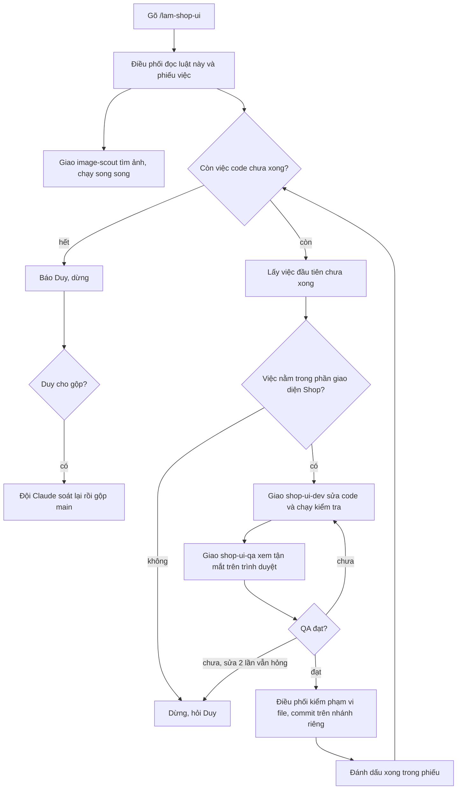

# Lệnh /lam-shop-ui — làm giao diện Shop web



> Duy chốt 2026-11-11 cho Gemini, từ 15/11 dùng chung cho Claude và Gemini. Phạm vi hẹp hơn workflow `feature`: chỉ giao diện Shop web.
> Luật chung (giá vốn, dữ liệu cá nhân, đặt tên, git) ở `AGENTS.md` vẫn áp dụng.

## 1. Phạm vi

**Được sửa** (máy kiểm bằng `scripts/check_shop_ui_scope.py`):

| Vùng | Ghi chú |
|---|---|
| `frontend/app/**`, `frontend/components/**`, `frontend/features/**` | Giao diện Shop: trang, component, CSS module |
| `frontend/lib/**` | Chỉ phần dùng ở trình duyệt (định dạng, số lượng, mock). **Không** thêm/đổi endpoint, khoá JSON, cách gọi API |
| `frontend/scripts/test-*.mjs` | Thêm hoặc sửa test đơn vị FE |
| `frontend/e2e/shop_*.py` | Thêm ca e2e. Trừ `shop_e2e_lib.py`, `shop_seed.py` (dùng chung, cấm) |
| `doc/features/2026-11-11-shop-ui-gemini/` | Phiếu việc, ghi chú dev, báo cáo QA của bạn |

**Không được đụng:** `backend/`, `adapter/`, `erp-console/`, `doc/` ngoài thư mục trên (nhất là `doc/decisions.md`,
`doc/business-process-spec.md`, `doc/design/`), `DESIGN.md`, `frontend/package.json`, `frontend/package-lock.json`,
`frontend/next.config.mjs`, `frontend/firebase*.json`, `frontend/.env*`, `.github/`, `.claude/`, `.agents/`, `.gemini/`,
`AGENTS.md`, `CLAUDE.md`, `GEMINI.md`, `scripts/` (chỉ được chạy).

**Không được làm:** deploy (`firebase`, `gcloud`), đụng DB staging/production, `npm install <gói mới>`, nâng phiên bản Next/React,
`npm audit fix`, `git push`, gộp vào `main`, `git add -A` / `git add .`, force-push, sửa file người khác đang sửa dở
(xem `git status` lúc bắt đầu).

## 2. Layout: bạn tự sáng tạo

Duy muốn Shop **đẹp**. Bố cục, khoảng cách, cỡ chữ, màu, hiệu ứng, cách sắp khối trên từng trang là **do bạn tự nghĩ và quyết**.
Không có luật bố cục nào bắt buộc. Màn cũ ở `doc/design/shop/screens/` chỉ để biết trang đó có những thông tin gì, không bắt bám theo.
Muốn tham khảo cách làm thì xem skill `.agents/skills/{impeccable,emil-design-eng,ui-ux-pro-max}/`.

Chỉ giữ những ràng buộc kỹ thuật sau (vì test tự động kiểm, hoặc vì đụng dữ liệu):
- Mỗi trang vẫn đủ thông tin và chức năng như hiện có: giá, tình trạng hàng, nút mua, giỏ, đặt hàng, tra đơn, chính sách.
- Giữ nguyên `data-testid`, `id`, `aria-*` mà e2e đang dùng. Đổi chỗ đặt được, xoá thì không.
- Màu khai thành biến CSS trong `frontend/app/globals.css` (được thêm biến mới). Không viết mã hex trong `.tsx`/`.module.css`, không dùng `transition: all`.
- Dùng tốt ở 360 px (điện thoại) và 1280 px (máy tính), chữ đọc được, bấm được bằng bàn phím.
- Không thêm thư viện, không thêm font hay ảnh tải từ ngoài.
- Contract API (`doc/features/2026-10-06-shop-giao-dien-moi/02b-tech-design.md` §3) và pattern code (`.agents/skills/nextjs-shop-patterns/SKILL.md`) giữ nguyên.

## 3. Luật cứng (vi phạm = dừng, hỏi Duy)

- **Không rò giá vốn**: Shop không bao giờ hiện, lưu hay gửi giá vốn, lãi, mã lô, số kg tồn thật.
- **Không rò dữ liệu cá nhân khách** (tên, SĐT, địa chỉ, bất biến 9, lỗi Critical): không ghi `console.log`, không lưu
  `localStorage`/`sessionStorage` ngoài những khoá đã có, không đưa vào URL. Test và ảnh chụp chỉ dùng dữ liệu giả.
- **Câu chữ chính sách, cam kết, pháp lý, giá, phí giao** lấy từ CMS hoặc code đã có. Không tự viết câu mới khẳng định chất lượng,
  nguồn gốc, thời gian giao hay quyền lợi khách. Cần câu mới mà chưa có → ghi vào câu hỏi cho Duy, dừng việc đó.
- **Định danh tiếng Anh chuẩn** (xem `AGENTS.md` mục Đặt tên). Chữ hiển thị, comment vẫn tiếng Việt có dấu.
- **Tiền VNĐ, giờ hiển thị theo Asia/Ho_Chi_Minh** qua hàm có sẵn trong `frontend/lib/format.ts`.
- Đụng một trong các thứ sau là **điểm dừng**: cần đổi API/backend, cần thư viện mới, cần key Google Maps, phải bỏ bớt
  thông tin hay chức năng đang có, việc lan ra ngoài vùng được sửa, test hỏng sau 2 lần sửa.

## 4. Quy trình một việc

1. **Chuẩn bị:** nhận việc ở `doc/ops/bang-viec.md` (AGENTS.md mục Làm chung), rồi tạo worktree riêng từ `main`:
   `git worktree add ../loc-<ai>-shop-ui -b <ai>/shop-ui main` (`<ai>` là `claude` hoặc `gemini`). **Không** `git switch` ở checkout chính.
2. **Chọn việc:** mở `doc/features/2026-11-11-shop-ui-gemini/02c-giao-viec.md`, lấy dòng ☐ đầu tiên. Đọc đủ cột "Phải đạt".
3. **Làm:** sửa đúng file của việc đó. Việc là lỗi thì viết test tái hiện trước (`frontend/scripts/test-*.mjs` hoặc ca e2e), thấy đỏ rồi mới sửa.
4. **Kiểm chứng** (chạy thật, dán output vào `03-dev-notes.md`):
   ```bash
   cd frontend && npm ci && npx tsc --noEmit \
     && NEXT_PUBLIC_USE_MOCK=0 NEXT_PUBLIC_API_BASE=http://localhost:8000 npm run build \
     && node scripts/check-no-mock.mjs && test ! -e out/ui-preview/index.html \
     && for t in scripts/test-*.mjs; do node "$t" || exit 1; done
   cd .. && python3 scripts/check_naming.py
   git diff main -- frontend | grep -E '^\+' | grep -nE "#[0-9A-Fa-f]{6}" | grep -v globals.css   # phải rỗng
   grep -rn "transition: all" frontend/app frontend/components frontend/features                # phải rỗng
   python3 frontend/e2e/run_shop_e2e.py --suite general_rules --suite full_flow \
     --suite <bộ e2e ghi trong việc>                                                          # phải thoát 0
   ```
   Lệnh e2e tự build lại Shop và ERP vào `out/` (chỉ là bản build, không phải sửa `erp-console/`) rồi dựng DB SQLite tạm.
   `npm ci` phải sạch (không `--legacy-peer-deps`). e2e dùng cổng cố định 8000/3000/3100: nếu cổng bận thì dừng và báo,
   **không kill tiến trình của người khác**. Thấy dòng FAIL nào là chưa đạt, kể cả FAIL không liên quan tới việc của bạn
   (khi đó ghi lại và hỏi Duy).
5. **QA thật, không chấm đạt bằng đọc code:** mỗi tiêu chí giao diện phải có ảnh chụp trình duyệt ở **360 px và 1280 px**
   (Playwright), lưu ở `doc/features/2026-11-11-shop-ui-gemini/shots/`, và ít nhất một ca ngoài đường thuận (lỗi mạng, giỏ trống,
   hết hàng, dữ liệu hỏng). Ghi `04-qa-report.md`: từng tiêu chí → cách kiểm → kết quả → ảnh.
6. **Commit:** `python3 scripts/check_shop_ui_scope.py` phải in `OK`. Rồi `git add <từng file>` và commit tiếng Việt có mã việc, ví dụ
   `Shop UI: ẩn số gạch ở hộp mã hết hiệu lực khi chưa có giá máy chủ (GUI-02)`. Không commit `out/`, `.next/`, `node_modules/`, ảnh rác.
7. **Đánh dấu:** đổi ☐ thành ☑ và ghi hash commit ở phiếu, commit kèm. Quay lại bước 2.

## 4b. Chia việc cho subagent (Duy giao 14/11)

Bạn (điều phối viên) là **điều phối**: đọc phiếu, chia việc, làm git, tổng hợp báo cáo. Code, QA và tìm ảnh giao cho 3 subagent
cùng tên ở cả Claude (`.claude/agents/`) và Gemini (`.agents/agents/`):

| Subagent | Làm gì | Được ghi vào |
|---|---|---|
| `shop-ui-dev` | Code **một** việc GUI-xx, chạy lệnh kiểm chứng mục 4 bước 4, ghi `03-dev-notes.md` | file của việc đó trong vùng mục 1 |
| `shop-ui-qa` | Kiểm thật trên trình duyệt, ảnh 360 + 1280, ca ngoài đường thuận, ghi `04-qa-report.md`, kết luận ĐẠT/CHƯA ĐẠT | `04-qa-report.md`, `shots/` |
| `image-scout` | Tìm ảnh có giấy phép (GUI-09, phần c của GUI-10), ghi `nguon-anh.md` | `anh-san-pham/` |

Việc đụng backend hay ERP không thuộc lệnh này: chạy workflow `feature` với `be-dev`, `fe-dev`, `qa-tester`.

Cách chạy một vòng:
1. Chuẩn bị như mục 4 bước 1 (bạn tự làm git).
2. **Song song được:** `image-scout` (không đụng code) chạy cùng lúc với `shop-ui-dev`. Giao `image-scout` ngay đầu vòng cho GUI-09 và GUI-10 phần c.
3. **Tuần tự:** việc code giao `shop-ui-dev` **lần lượt từng việc**, không cho hai `shop-ui-dev` chạy cùng lúc. Lý do: cùng một thư mục làm việc, nhiều việc sửa chung `globals.css` và trang chủ, và e2e dùng cổng cố định 8000/3000/3100.
4. `shop-ui-dev` báo xong → bạn xem diff (`git diff --stat`), đúng file được phép thì gọi `shop-ui-qa` cho việc đó. Không cho `shop-ui-qa` chạy e2e khi `shop-ui-dev` đang chạy build/e2e.
5. `shop-ui-qa` CHƯA ĐẠT → giao lại `shop-ui-dev` kèm lỗi. Tối đa 2 vòng, quá thì dừng, hỏi Duy.
6. ĐẠT → bạn chạy `python3 scripts/check_shop_ui_scope.py` (phải `OK`), commit theo mục 4 bước 6, đánh dấu ☑ ở phiếu (bước 7), rồi sang việc kế.
7. Hết việc hoặc gặp điểm dừng → báo Duy theo mục 5.

Subagent chạy ở chế độ tự động (không ai bấm duyệt từng lệnh). Vì vậy **chỉ bạn** được chạy lệnh git. Đọc lại báo cáo của subagent
trước khi commit: không tin "PASS" khi không có dòng tổng kết test thật hoặc ảnh chụp.

## 5. Khi dừng

Báo Duy ngắn kiểu tổng quan:
- việc đã xong kèm hash commit trên nhánh `<ai>/shop-ui`,
- số test và kịch bản e2e đã chạy thật (dán dòng tổng kết),
- việc bị dừng và câu cần Duy quyết.

Không tự gộp `main`, không push. Duy hoặc đội Claude sẽ soát nhánh `<ai>/shop-ui` (Tech Lead + QA) rồi mới gộp.
