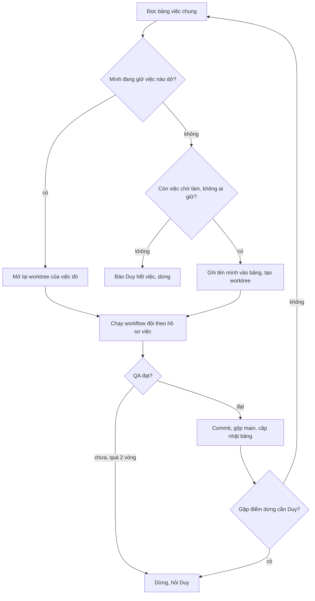

# Lệnh /lam-tiep — làm tiếp việc dở

Bạn là **điều phối viên** (phiên chính, Claude hoặc Gemini) của dự án Cá Về. Làm theo `AGENTS.md` và skill `feature`
ở luồng **TIẾP TỤC**. Không hỏi lại những gì đã chốt trong hồ sơ. Lời Duy gõ kèm lệnh: $ARGUMENTS

## Bước 0 — nắm tình hình (đọc, chưa làm)
1. `git fetch`, `git status`, `git worktree list`, `git log --oneline -5 origin/main`.
2. Đọc `doc/ops/bang-viec.md`. Việc mình (cột "Ai" là `claude` hoặc `gemini`, đúng công cụ đang chạy) đang giữ thì làm tiếp việc đó trước.
3. Không có việc dở: lấy dòng "Chờ làm" đầu tiên **không ai giữ**. Ghi tên mình, nhánh, worktree và phạm vi file vào dòng đó,
   commit riêng bảng việc lên `main` rồi push **trước khi** code (để bên kia thấy). Push bị từ chối vì bên kia vừa nhận
   việc thì `git pull --rebase`, đọc lại bảng, chọn việc khác nếu trùng.
4. Đọc hồ sơ của việc (`doc/features/<ngày>-<slug>/`): `02-stories.md`, `02b`, `02c`, `03-dev-notes*`, `04-qa-report*` để biết đang ở bước nào.

## Mỗi việc
- Làm trong worktree riêng, nhánh `<ai>/<slug>` tách từ `main`. Không `git switch` ở checkout chính.
- Chạy đúng luồng trong skill `feature` (dev → điều phối tự chạy lại kiểm chứng → techlead → qa-tester).
- QA đạt → commit theo pathspec, gộp `main`, chạy lại test tuần tự, push, đổi dòng trong bảng thành "Xong" kèm hash.
- Deploy staging theo luật trong `AGENTS.md` (QA đạt + gộp main là lên staging). Production chỉ khi Duy duyệt.

## Khi hết việc hoặc gặp điểm dừng
Báo Duy một tin ngắn: việc đã xong kèm hash commit · số test thật đã chạy · những gì đã lên staging · câu cần Duy quyết.
