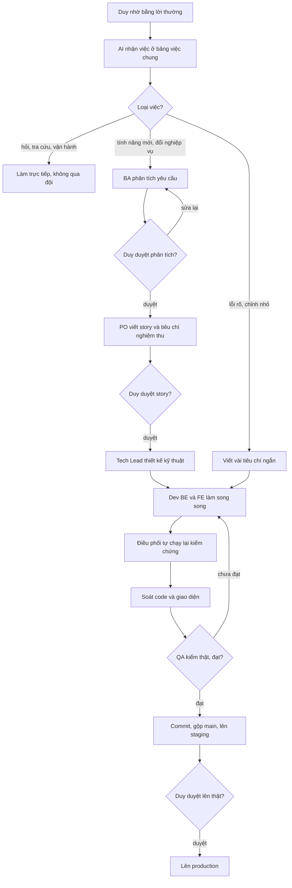

# Cá Về — luật chung cho mọi AI (Claude Code điều phối, worker Opus và Gemini qua Orca)



Vựa cá B2C (mua lô tại cảng → bán online → quản lý kho/giá vốn). Người dùng là **Duy** (PO), trao đổi bằng tiếng
Việt; AI xưng "em", gọi Duy là "anh", báo cáo ngắn kiểu tổng quan. Nghiệp vụ và bất biến: skill `caveve-domain`
(**đọc trước khi đụng code**).

File này là **luật chung duy nhất**. Claude đọc qua `CLAUDE.md` (`@AGENTS.md`), worker Antigravity đọc trực tiếp.
`CLAUDE.md` ghi phần riêng của điều phối viên, `GEMINI.md` ghi phần riêng của worker Gemini (worker Claude theo mục worker trong `CLAUDE.md`). Sửa luật chung thì sửa ở đây.

## Điều phối bằng Orca (Duy chốt 2026-11-24, thay chế độ "ngang quyền" 15/11)

**Một bộ não:** Claude Code chạy `claude-opus-5-5` trong Orca là điều phối viên duy nhất. Mọi vai trong đội chạy dưới dạng
**worker Orca**: `techlead`, `ba-analyst`, `po-owner`, `legal-vn` là worker Claude `claude-opus-5-5`; `qa-tester`, `shop-ui-qa` là
worker Claude `claude-sonnet-5-5` (như trước); QA tổng trước khi lên thật là worker Opus; các vai còn lại là worker `antigravity` (`agy`)
`gemini-4-carbon-high`. Gemini không làm điều phối nữa. Lệnh Orca, luật worker
và mẫu spec ở `doc/ops/orca-worker.md`.

| Thứ | Nguồn duy nhất | Worker Gemini đọc ở |
|---|---|---|
| Luật chung | `AGENTS.md` | `AGENTS.md` (Antigravity tự nạp) |
| Vai trong đội | `.claude/agents/<vai>.md` | chính file đó, spec Task trỏ tới |
| Skill | `.claude/skills/<tên>/` | `.agents/skills/<tên>` (liên kết, sinh bằng script) |
| Workflow đội | skill `feature` | chỉ Opus chạy |
| Luật worker + mẫu spec | `doc/ops/orca-worker.md` | dán vào đầu mọi spec |

- **Sửa vai, skill hay lệnh: chỉ sửa trong `.claude/`**. Thêm hay bớt skill thì chạy `python3 scripts/sync_ai_workspace.py`
  để cập nhật liên kết `.agents/skills/`. CI chạy `--check`, lệch là đỏ.
- **Nhận việc trước khi code** ở `doc/ops/bang-viec.md` (ai, nhánh, phạm vi file), commit bảng lên `main` rồi push.
  Hai việc đang làm không được trùng phạm vi file; trùng thì dừng, hỏi Duy.
- **Mỗi việc một worktree riêng** tách từ `origin/main`: nhánh lô `claude/<slug>` của điều phối viên, worktree của worker
  do `orca orchestration worker-start` tạo. **Không `git switch` ở checkout chính.** Gộp `main` và push làm từ worktree.
- Trước khi gộp `main`: `git fetch` rồi gộp lên `origin/main` mới nhất. Không force-push, không viết lại lịch sử `main`.
- e2e dùng cổng cố định 8000/3000/3100: mỗi lúc chỉ một worker chạy e2e. Runner tự dừng nếu cổng bận; **không kill tiến
  trình người khác**, chờ hoặc hỏi Duy.
- Tiến độ theo dõi ở hồ sơ `doc/features/`, bảng việc chung, Run trên Orca và sheet FIX WEB của Lộc. **Không dùng Jira**.

## Workflow đội — tự nhận diện, Duy không gõ lệnh

Duy chỉ nhờ bằng lời thường. **Mọi yêu cầu làm thay đổi sản phẩm** (thêm/sửa chức năng, sửa lỗi, đổi giao diện, đổi quy
tắc, viết yêu cầu/story, test thử, review, deploy) → **chạy skill `feature` trước khi làm gì khác**, để nó chọn luồng và
báo Duy một dòng:

```
ĐẦY ĐỦ  (tính năng mới / đổi nghiệp vụ)  BA → [Duy duyệt] → PO → [Duy duyệt] → Tech Lead → BE ∥ FE → UI review → QA → Review → Deploy
NHANH   (lỗi rõ / chỉnh nhỏ)             AC ngắn → BE/FE → QA → tổng kết
CHỈ BA · CHỈ PO · CHỈ QA · REVIEW · DEPLOY · TIẾP TỤC (việc đang dở, lệnh /lam-tiep)
```
Trong luồng ĐẦY ĐỦ: `product-manager` chạy trước BA khi tính năng còn ở mức ý tưởng/prototype; `ux-designer` chạy sau PO,
song song Tech Lead; `mkt-brand` được gọi khi đụng thương hiệu hoặc copy. Không chạy workflow cho câu hỏi thuần giải
thích/tra cứu, hoặc việc vận hành không đổi code (xem log, seed dữ liệu, đổi mật khẩu) — làm trực tiếp.

| Vai | Agent | Skill nạp sẵn | Đầu ra |
|---|---|---|---|
| PM | `product-manager` | caveve-domain, requirement-elicitation | `doc/features/<ngày>-<slug>/00-product-brief.md` |
| BA | `ba-analyst` | requirement-elicitation | `01-analysis.md` |
| PO | `po-owner` | user-story-writing | `02-stories.md` (+ nghiệm thu) |
| UX | `ux-designer` | caveve-ui, impeccable (chỉ đọc), web-design-guidelines, fixing-accessibility, baseline-ui | `02a-ux-flow.md` + prototype |
| Marketing/Brand (full stack) | `mkt-brand` | caveve-domain, caveve-ui, django-drf-patterns, nextjs-shop-patterns, tdd-workflow | `0X-marketing.md` + code nội dung/CMS |
| Tech Lead | `techlead` | caveve-domain, django-drf-patterns, nextjs-shop-patterns | `02b-tech-design.md` + review code |
| Pháp lý | `legal-vn` | caveve-domain (+ tìm web) | `0X-phap-ly.md` |
| BE | `be-dev` | django-drf-patterns, tdd-workflow | code `backend/` `adapter/` + `03-dev-notes.md` |
| FE | `fe-dev` | nextjs-shop-patterns, caveve-ui, impeccable, emil-design-eng, baseline-ui, fixing-accessibility | code `frontend/` `erp-console/` + `03-dev-notes.md` |
| QA | `qa-tester` | e2e-playwright, tdd-workflow | `04-qa-report.md` |
| Shop UI dev / QA / ảnh | `shop-ui-dev`, `shop-ui-qa`, `image-scout` | caveve-ui, nextjs-shop-patterns, e2e-playwright | việc GUI-xx theo lệnh `/lam-shop-ui` |

**Model:** điều phối, review chỗ nhạy cảm và 4 vai `techlead`, `ba-analyst`, `po-owner`, `legal-vn` dùng `claude-opus-5-5`; QA từng lô dùng `claude-sonnet-5-5`, QA tổng dùng `claude-opus-5-5`; các vai còn lại là
worker `agy` `gemini-4-carbon-high` (giao theo `doc/ops/orca-worker.md`). Dòng `model:` trong frontmatter vai chỉ dùng cho đường dự
phòng (công cụ Agent của Claude khi Orca hỏng hoặc chạy trên cloud).

**Quy trình một lô:**
1. Điều phối viên nhận việc ở bảng việc chung, tạo worktree, đọc dòng lô trong `02c-giao-viec.md`, chạy lệnh kiểm chứng để ghi số gốc.
2. Giao worker `be-dev` ∥ `fe-dev` qua Orca (song song khi lô ghi BE ∥ FE, mỗi bên một worktree), spec theo mẫu `doc/ops/orca-worker.md`: mã story, file được sửa và không được đụng, contract 02b.
3. Điều phối viên **tự chạy lại** lệnh kiểm chứng. Không tin báo cáo của worker khi chưa chạy.
4. Opus **tự review diff** (giá vốn, dữ liệu cá nhân, phân quyền, migration, lệch 02b), không giao worker.
5. `qa-tester` kiểm theo luật đã siết: không PASS bằng đọc code, có ca ngoài đường thuận, `npm ci` sạch.
6. REJECTED → giao lại dev, quay về bước 3 (tối đa 2 vòng). APPROVED → commit tiếng Việt có mã lô/story **theo pathspec**
   (không `git add -A`), gộp `main`, chạy lại test tuần tự, `git push origin main`, đánh ☑ ở 02c và bảng việc.
7. QA đạt + gộp main → tự deploy **staging** (UAT) cho Duy test. **Production chỉ khi Duy duyệt.**
8. Trước gate lên thật: **QA tổng** bằng worker Opus (vai `qa-tester`) kiểm hồi quy toàn bộ trên staging
   (`doc/ops/orca-worker.md`). QA tổng chưa APPROVED thì không xin Duy lên thật.

Worker không giao việc cho worker khác: mọi lượt giao việc đi qua điều phối viên. Worker chỉ commit trên nhánh worktree
của mình theo pathspec; không push, không merge, không deploy, không đụng DB thật.

## Luật bắt buộc (vi phạm = dừng lại hỏi Duy)

- **Tài liệu quy trình luôn có sơ đồ Mermaid ở đầu** (Duy chốt 11/10): spec, 00/01/02/02a/02b/02c, PLAN, runbook
  `doc/ops/`, `doc/he-thong/`, skill/agent/lệnh có khối ` ```mermaid ` ngay dưới tiêu đề. Nhãn tiếng Việt đời thường, ngắn,
  không mã kỹ thuật; điểm Duy duyệt vẽ hình thoi; nhãn có dấu câu đặt trong ngoặc kép. Sửa quy trình thì sửa sơ đồ.
- **Không lật quyết định** trong `doc/decisions.md` hay hồ sơ đã duyệt. Code lệch thiết kế → ghi "Lệch thiết kế" trong
  `03-dev-notes.md` và dừng lô đó. Rule nghiệp vụ mới → đề xuất cập nhật `doc/business-process-spec.md`, hỏi Duy trước.
- **Không rò giá vốn** (bất biến 1): serializer tách theo quyền, test bằng token từng Group.
- **Không rò dữ liệu cá nhân khách** (tên, SĐT, địa chỉ — bất biến 9, lỗi **Critical**): API công khai không trả, không
  ghi log, không đưa vào prompt AI, không gửi bên thứ ba khi Duy chưa duyệt; test/doc/commit chỉ dùng dữ liệu giả.
- **Không xoá chứng từ** (chỉ huỷ bằng trạng thái). Migration chỉ thêm, không đổi nghĩa field cũ.
- **Chốt chặn lệnh nguy hiểm** (`scripts/ai_guard.py`, hook của Claude ở `.claude/settings.json`, của Antigravity ở
  `.agents/hooks.json`): chặn hẳn force-push, xoá project/bucket/DB, `rm -rf /`; hỏi Duy khi đọc secret production, deploy
  production, `DROP TABLE`, `git reset --hard`. Không tìm cách lách; sửa luật thì chạy `python3 scripts/test_ai_guard.py`.
- **Không deploy production** khi Duy chưa duyệt. Deploy theo `doc/ops/moi-truong.md`, luôn staging trước. Build frontend
  truyền `NEXT_PUBLIC_*` trực tiếp (vì `.env.local` đè lên `.env.production`).
- **Không commit `.env`, khoá, mật khẩu, số điện thoại thật** — repo đang công khai.
- **Không báo "xong" / "test xanh"** khi chưa chạy lệnh kiểm chứng trong lượt đó và dán kết quả.
- **QA không chấm PASS bằng đọc code**: AC giao diện cần Playwright hoặc ảnh 360 + 1280; mỗi AC nghiệp vụ có ca ngoài đường thuận.
- **Pháp lý, thủ tục, tài khoản kinh doanh là việc của Lộc**; IT (Duy + AI) chỉ soạn khung và nhắc.
- Sheet feedback của Lộc: chỉ sửa giá trị, không phá format Duy đã làm; cột Tình Trạng: "Đang làm" → "Ready UAT" (đã QA đạt, chờ Duy test và cho gộp/lên thật, Duy chốt 16/11) → "Xong"; "Tạm ngưng" khi dừng.

## Lệnh kiểm chứng

```bash
cd backend && DJANGO_SECRET_KEY=test DJANGO_DEBUG=1 .venv/bin/python manage.py collectstatic --noinput   # một lần
cd backend && DJANGO_SECRET_KEY=test .venv/bin/python manage.py test --parallel 1 && .venv/bin/python manage.py makemigrations --check --dry-run
cd adapter && pytest                                    # khi có sửa adapter
cd frontend && npm ci && npx tsc --noEmit && NEXT_PUBLIC_USE_MOCK=0 NEXT_PUBLIC_API_BASE=http://localhost:8000 npm run build
cd erp-console && npm ci && npx tsc --noEmit && npm test && NEXT_PUBLIC_USE_MOCK=0 NEXT_PUBLIC_API_BASE=http://localhost:8000 npm run build
python3 frontend/e2e/run_shop_e2e.py --suite general_rules --suite full_flow   # e2e Shop + ERP
python3 scripts/check_naming.py && python3 scripts/sync_ai_workspace.py --check && python3 scripts/test_ai_guard.py
```
`npm ci` phải sạch (không `--legacy-peer-deps`). Phải thấy dòng `Ran N tests … OK` mới tính là xanh (test song song có thể
sập im lặng). Test Postgres chạy trên GitHub Actions khi push nhánh. Worktree không symlink `.env`.

## Git

- Commit **theo pathspec**: `git add <file>` rồi `git commit -m "…" -- <file>`. Không `git add -A` / `git add .`.
- Message tiếng Việt có mã lô/story. Dòng cuối ghi AI viết cùng: `Co-Authored-By: <tên model> <noreply@…>`.
- Trước khi push: `git status` không có `.env`, DB, ảnh chụp test, bí mật.

## Môi trường

**Staging** (SePay sandbox, DB `cangca_staging`) và **Production** (SePay live, DB `postgres` trên Supabase). URL, secret,
lệnh build và migrate ở `doc/ops/moi-truong.md`. Bí mật đọc bằng `gcloud secrets versions access` gán thẳng vào biến môi
trường, không in ra, không ghi file.

## Đặt tên (Duy chốt 01/10)

Định danh trong code (hàm, biến, class, module, thư mục, file, test, script, route API, khoá JSON, biến env, Group,
`data-testid`, id lệnh AI, khoá lưu trình duyệt) là **tiếng Anh chuẩn, không viết tắt tiếng Việt**. Chữ hiển thị, comment,
docstring và tài liệu vẫn tiếng Việt có dấu. Viết tắt chỉ dùng khi là chuẩn quốc tế: `VN`, `VND`, `pnl`, `id`, `url`.
Không đưa mã lô giao việc (`lo7`, `l8`) vào tên; mã lô/story ghi trong docstring.

| Khái niệm | Dùng | Không dùng |
|---|---|---|
| Vai (Group) | `owner` `manager` `warehouse_staff` `delivery_staff` `customer_service` | `chu` `quan_ly` `nv_kho` `nv_giao` `cskh` |
| Người giao trên một phiếu | `courier` | `nv_giao` |
| Việc gọi xác nhận đơn | `confirmation` | `cskh` |
| Nhập lô | `receive_batches`, `ReceiveBatches*` | `nhap_lo`, `NhapLo*` |
| Lệnh AI: nhóm / mức nhạy cảm | `purchasing` `sales` `customer_service` / `high` `medium` `low` | `thu_mua` `ban_hang` / `cao` `trung_binh` `thap` |
| Giờ Việt Nam | `VN_TIME_ZONE`, `todayInVietnam()`, `today_in_vietnam()` | `VN_TZ`, `todayVn`, `vn_today` |

Giữ nguyên: migration đã chạy, `AuditLog.action` đã ghi, URL công khai Shop `/bai-viet/` `/trang/` `?chuyen-muc=`, dữ liệu
demo (username `kho1`, `chu_vua`…, slug, mã hàng), keyword AI có dấu, chuỗi `cangca`. Bảng đầy đủ:
`doc/features/2026-09-30-dat-ten-tieng-anh/02c-giao-viec.md` mục 1. Kiểm bằng `python3 scripts/check_naming.py`
(exit 1 khi file mới có định danh tiếng Việt hoặc số vi phạm tăng so với `scripts/naming_baseline.json`).

Tiền VNĐ; giờ hiển thị luôn Asia/Ho_Chi_Minh, DB lưu UTC. Báo cáo kỳ đã qua không sửa số, điều chỉnh ghi vào kỳ hiện tại.
