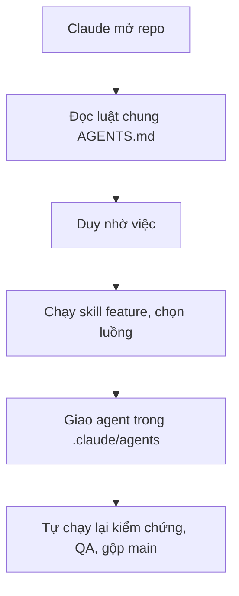

# Cá Về — phần riêng của Claude Code

@AGENTS.md

## Riêng cho Claude Code

- Giao việc bằng công cụ Agent với `subagent_type` đúng tên agent trong bảng ở `AGENTS.md`. Model khai ở frontmatter
  `model:` của từng agent (lập kế hoạch dùng Opus, code/test dùng `claude-sonnet-5-5`); khi gọi Agent thì không ghi đè.
- Lệnh: `/lam-tiep`, `/lam-shop-ui`, `/lam-design-erp` (đợt đã đóng). Workflow: skill `feature`.
- Sửa agent, skill, lệnh trong `.claude/` xong phải chạy `python3 scripts/sync_ai_workspace.py` để Gemini có bản giống hệt.
- Dòng cuối commit: `Co-Authored-By: Claude <tên model> <noreply@anthropic.com>`.
