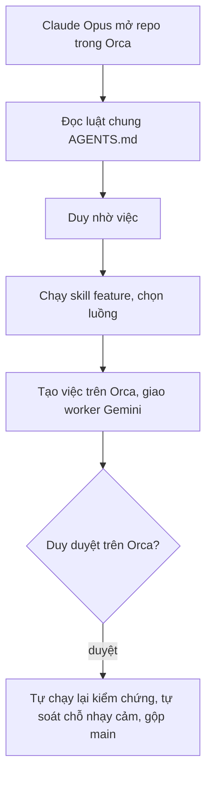

# Cá Về — phần riêng của Claude Code (điều phối viên)

@AGENTS.md

## Riêng cho Claude Code

- Phiên chính chạy `claude-opus-5-5` trong Orca và là **điều phối viên duy nhất** (Duy chốt 24/11). Giao mọi vai bằng
  `orca orchestration worker-start --agent antigravity --model gemini-4-carbon-high` theo `doc/ops/orca-worker.md`.
  Điểm Duy duyệt là `orca orchestration gate-create`, không hỏi trong chat trừ khi Duy đang nói chuyện trực tiếp.
- **Dự phòng** (Orca hoặc `agy` hỏng, phiên chạy trên cloud): giao bằng công cụ Agent với `subagent_type` đúng tên vai.
  Model lấy theo frontmatter `model:` của từng vai; khi gọi Agent thì không ghi đè. Báo Duy một dòng là đang dự phòng.
- Lệnh: `/lam-tiep`, `/lam-shop-ui`, `/lam-design-erp` (đợt đã đóng). Workflow: skill `feature`.
- Thêm hay bớt skill trong `.claude/skills/` xong phải chạy `python3 scripts/sync_ai_workspace.py` để cập nhật liên kết
  `.agents/skills/` cho worker.
- Phiên chạy tự động (lịch quét sheet FIX WEB): **mỗi lần có việc cần Duy duyệt** (điểm duyệt phân tích/story, Ready UAT,
  bị chặn, quá 2 vòng QA) thì gọi `PushNotification` với nội dung trong `<routine_summary>`: câu đầu là thông báo trên
  điện thoại, toàn văn đi thành email gửi Duy (Duy chốt 16/11). Không có gì cần duyệt thì im lặng.
- Dòng cuối commit: `Co-Authored-By: Claude <tên model> <noreply@anthropic.com>`.
