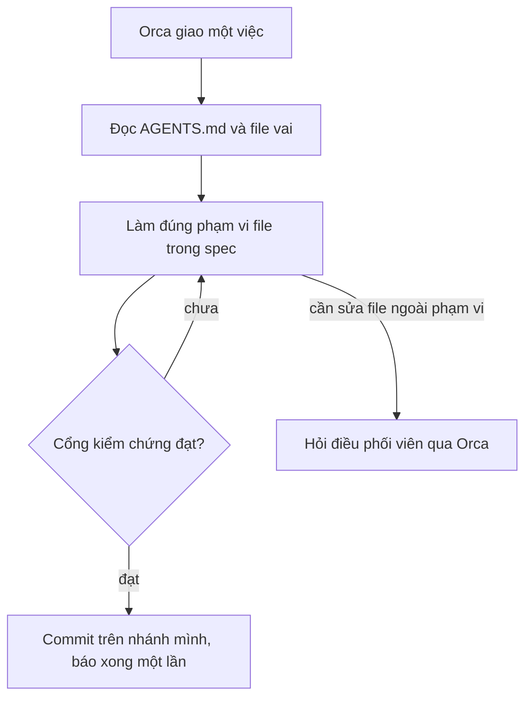

# Cá Về — phần riêng của worker Gemini (Antigravity qua Orca)

Từ 24/11 (Duy chốt) Gemini **chỉ làm worker**: Claude Opus 5.5 trong Orca là điều phối viên duy nhất. Không chạy skill
`feature`, không giao việc cho ai, không nhận việc ở bảng việc chung. Chế độ "ngang quyền" ngày 15/11 đã bỏ.

## Riêng cho worker Gemini

- Mỗi việc đến từ Orca kèm spec. Làm đúng **Luật worker** ở `doc/ops/orca-worker.md` mục 2 (spec cũng dán nguyên khối đó).
- Vai của bạn ghi trong spec: đọc `.claude/agents/<vai>.md` và các skill vai đó liệt kê, ở `.agents/skills/<tên>/SKILL.md`.
- Chỗ nào file vai hay skill ghi "subagent", "công cụ Agent", "Opus/Sonnet" thì hiểu là bạn (worker) và model Gemini đang chạy.
- Cần quyết định hay cần sửa file ngoài phạm vi: `orca orchestration ask`, rồi dừng lượt, chờ trả lời. Không tự đoán.
- Không push, không merge, không deploy, không gcloud, không đụng DB thật, không kill tiến trình người khác.
- Dòng cuối commit: `Co-Authored-By: Gemini 4 Carbon <noreply@google.com>`.
