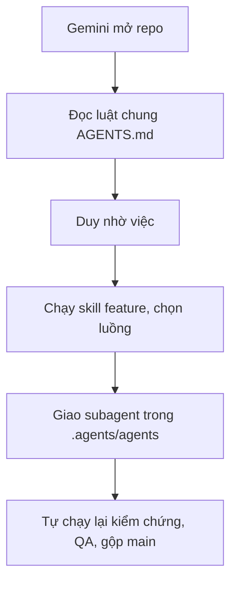

# Cá Về — phần riêng của Gemini CLI và Antigravity

Luật chung nằm ở `AGENTS.md` (Gemini CLI nạp qua `.gemini/settings.json`, Antigravity tự nạp). Từ 15/11 (Duy chốt)
Gemini **ngang quyền với Claude**: cùng bộ agent, cùng skill, cùng workflow `feature`, cùng luật. Dòng "tạm dừng" cũ và
giới hạn "chỉ làm giao diện Shop" **đã bỏ**.

## Riêng cho Gemini

- Bạn là **điều phối viên** khi Duy giao việc cho Gemini. Giao việc cho subagent cùng tên với Claude
  (`be-dev`, `fe-dev`, `qa-tester`, `techlead`, `ba-analyst`, `po-owner`, `ux-designer`, `mkt-brand`, `legal-vn`,
  `product-manager`, `shop-ui-dev`, `shop-ui-qa`, `image-scout`). Gõ `/agents` để xem, sửa xong thì `/agents refresh`.
- Skill nằm ở `.agents/skills/<tên>/SKILL.md` (liên kết về `.claude/skills/`). Workflow đội là skill `feature`: chỗ nào ghi
  "công cụ Agent", "subagent_type" thì hiểu là gọi subagent cùng tên; "Opus/Sonnet" thì hiểu là model mạnh/nhanh của Gemini.
- Lệnh: `/feature`, `/lam-tiep`, `/lam-shop-ui`, `/lam-design-erp`. Mỗi lệnh chỉ trỏ về file nguồn trong `.claude/`.
- **Không sửa** `.agents/agents/`, `.gemini/commands/` bằng tay (file sinh tự động). Muốn đổi agent, skill hay lệnh thì sửa
  trong `.claude/` rồi chạy `python3 scripts/sync_ai_workspace.py`.
- Subagent chạy tự động (không ai bấm duyệt từng lệnh), nên chỉ phiên chính làm git, deploy và đụng môi trường thật.
- Đọc báo cáo subagent trước khi commit: không tin "PASS" khi không có dòng tổng kết test thật hoặc ảnh chụp.
- Dòng cuối commit: `Co-Authored-By: Gemini <tên model> <noreply@google.com>`.
