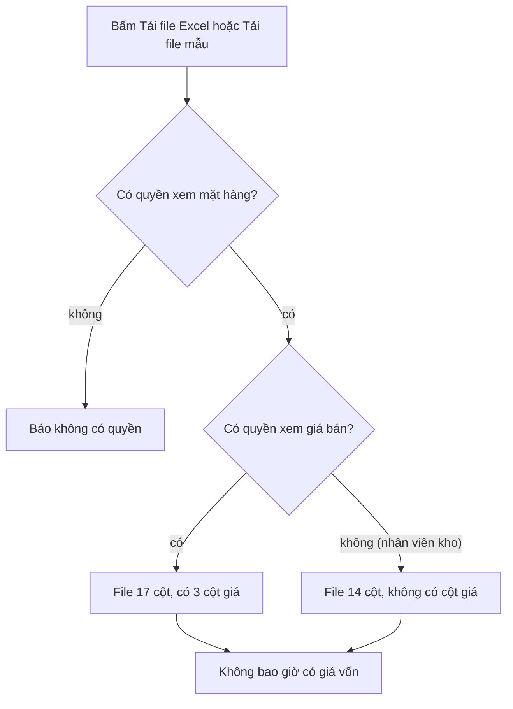

# catalog/item_files — Tải file Excel mặt hàng (FISH-66)

Hồ sơ: `doc/features/2026-11-14-hang-ban-excel-dong-lanh/` (story S3, S4; thiết kế 02b §3, §4, §6). Lô 2 máy chủ làm phần tải file.
Phần nhập file (S5, S6) làm ở lô 3.

| Endpoint | Việc | Quyền |
|---|---|---|
| `GET /api/catalog/items/export/` | tải danh sách, lọc `item_group`, `is_active`, `item_type=SIMPLE\|BUNDLE`, `has_image` | `catalog.view_item`; 3 cột giá chỉ khi có `catalog.view_itemprice` |
| `GET /api/catalog/items/export-template/` | file mẫu, 1 dòng ví dụ giả | như trên |

Response: `Content-Disposition`, `X-Row-Count` (đã mở qua `CORS_EXPOSE_HEADERS`), `Cache-Control: no-store`.

- `columns.py`: bảng cột tường minh (không lặp qua field model, bất biến 1). `IMPORT_PERMS` dùng ở lô 3.
- `workbook.py`: ghi xlsx; mọi ô chữ ép thành ô chữ, ô nguy hiểm (`= + - @`, tab, CR, LF) thêm `quotePrefix` (S3-AC10).
- `services.py`: `export_items` (ghi AuditLog `export_items`: chỉ số dòng và có cột giá hay không), `export_template` (không ghi nhật ký).
- `api.py`: `APIView` riêng, không có JSON parser, nên bộ dò lệnh AI không đăng ký thành lệnh (D6). Test: `tests/test_no_ai_command.py`.
- Tham số `ITEM_IMPORT_*` ở `config/settings.py` (dùng cho lô 3).
- Thư viện: `openpyxl==3.1.5`, `defusedxml==0.7.1`. Không thêm model, không migration.
