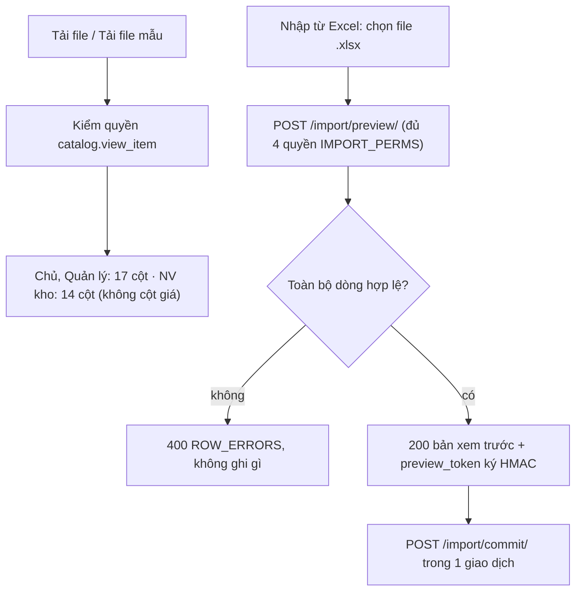

# catalog/item_files — Tải và nhập file Excel mặt hàng (FISH-66)

Hồ sơ: `doc/features/2026-11-14-hang-ban-excel-dong-lanh/` (story S3–S6; thiết kế 02b §3, §4, §6).

| Endpoint | Việc | Quyền |
|---|---|---|
| `GET /api/catalog/items/export/` | tải danh sách, lọc `item_group`, `is_active`, `item_type=SIMPLE\|BUNDLE`, `has_image` | `catalog.view_item`; 3 cột giá chỉ khi có `catalog.view_itemprice` |
| `GET /api/catalog/items/export-template/` | file mẫu, 1 dòng ví dụ giả `VD-001` | như trên |
| `GET /api/catalog/items/import/limits/` | ngưỡng kích thước, số dòng, TTL, cảnh báo giá | đủ 4 quyền `IMPORT_PERMS` |
| `POST /api/catalog/items/import/preview/` | đọc `.xlsx`, kiểm toàn bộ dòng, trả xem trước + `preview_token` | đủ 4 quyền `IMPORT_PERMS` |
| `POST /api/catalog/items/import/commit/` | ghi thay đổi trong 1 giao dịch + `AuditLog` | đủ 4 quyền `IMPORT_PERMS` |

- `columns.py`: bảng cột tường minh (không lặp qua field model, bất biến 1), `IMPORT_PERMS`.
- `workbook.py`: ghi xlsx; mọi ô chữ ép thành ô chữ, ô nguy hiểm (`= + - @`, tab, CR, LF) thêm `quotePrefix` (S3-AC10). Sheet "Hướng dẫn" của bản 14 cột không nhắc cột giá.
- `reader.py`: kiểm định dạng `.xlsx`, chống zip bomb/macro, đọc 2 lượt (`data_only=True/False`) để bắt công thức.
- `plan.py`: nạp DB theo lô (số truy vấn cố định), kiểm từng dòng theo 02b §4.2–4.3, tính cờ giá (`check_zeros`, `large_change`, `backdated`) và dấu vân tay dữ liệu `d`.
- `token.py`: ký/kiểm `preview_token` bằng `django.core.signing` (`compress=True`), hạn 30 phút.
- `services.py`: `export_items`, `export_template`, `get_import_limits`, `preview_import`, `commit_import`.
- `api.py`: `APIView` riêng, không kế thừa `JSONParser`, nên bộ dò lệnh AI không đăng ký thành lệnh (D6).
