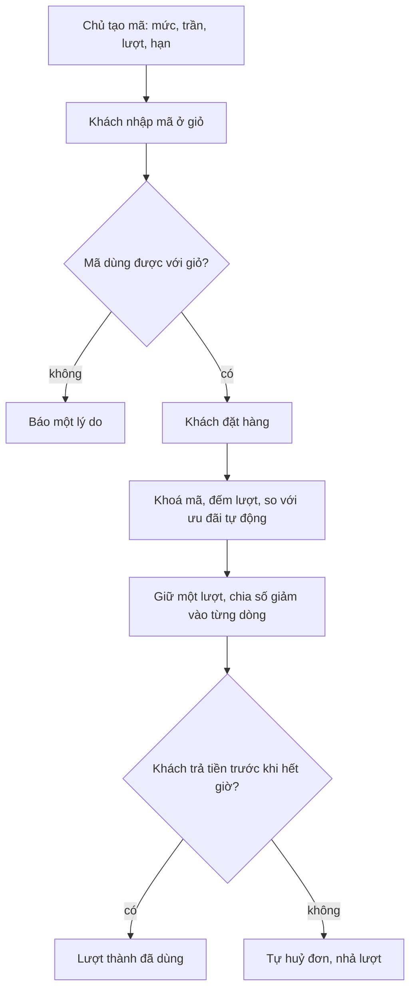

# catalog/vouchers — Mã giảm giá công khai (SHOP-3b-01, 3b-03, 3b-04)

Quy tắc: BR-DM-17…24, quyết định Duy 10/10. Một mã/đơn, không cộng dồn với `PricingRule` (lấy lợi hơn, hoà thì giữ ưu đãi
tự động), trần giảm = `VOUCHER_MAX_PERCENT` (50%) của giỏ, mã % bắt buộc có trần tiền, tổng sau giảm luôn > 0. Giới hạn theo
TỔNG lượt (không theo SĐT, bất biến 9). Mã không bao giờ bị xoá (bất biến 3): dừng bằng `disable`.

| File | Việc |
|---|---|
| `services.py` | `normalize_code`, `compute_discount`, `evaluate_voucher` (dùng chung kiểm mã và tạo đơn), `allocate_whole_vnd`, tạo/sửa/tắt/bật + AuditLog, `with_counts`, `filter_by_status` |
| `api.py` | ERP `/api/catalog/vouchers/` — mọi endpoint cần `catalog.manage_voucher` (chỉ Chủ, uỷ được) |
| `shop_api.py` | `POST /api/shop/vouchers/check/` công khai, throttle `shop_voucher_check` |
| `serializers.py` | dict JSON tường minh (không `__all__`) |

Lượt dùng ở `sales.VoucherRedemption` + `apps/sales/orders/voucher_redemptions.py` (`hold` khi tạo đơn, `mark_used` ở
`payments.issue_invoice`, `release` ở `cancel_unpaid_expired`). Thứ tự khoá khi tạo đơn: đơn → mã → lô (02b §2.2).
Lãi lỗ theo kỳ đúng (hoá đơn = tổng sau giảm); lãi lỗ theo lô còn công thức cũ (02b §8.1, chờ Duy).
Test: `tests/test_services.py`, `test_api.py`, `test_shop_check.py`; tích hợp đơn ở `sales/orders/tests/test_voucher_order.py`,
đua Postgres ở `test_voucher_race.py`, kỳ ở `reports/tests/test_voucher_period_pnl.py`.
