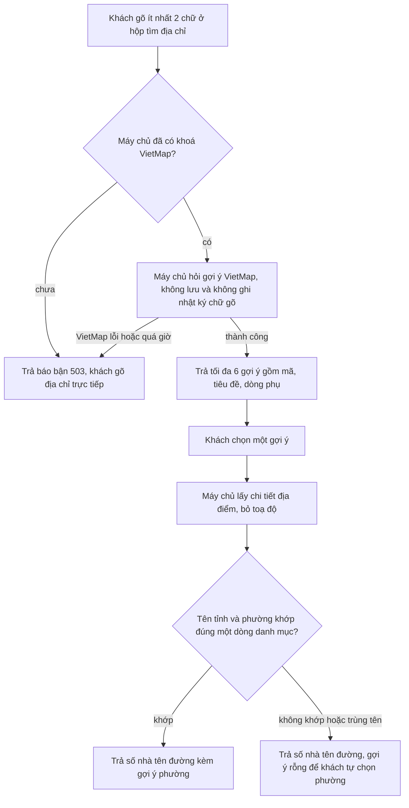

# address_search — Tìm địa chỉ trên Shop qua máy chủ Cá Về

Module thực hiện phương án A của `02b-tech-design.md` §1.9b (story `SHOP-3-04`, bất biến 9):

- `vietmap.py`: gọi `autocomplete/v4` và `place/v4` của VietMap bằng `urllib` trong thư viện chuẩn với host/đường dẫn cố định, bỏ hoàn toàn toạ độ (`lat`, `lng`) và mã riêng VietMap, chỉ ghi nhật ký mã trạng thái khi lỗi.
- `matching.py`: đối chiếu tên tỉnh, quận/huyện (`legacy`), phường/xã từ VietMap sang mã danh mục tĩnh `administrative_units` bằng `fold_text`; chỉ gợi ý khi khớp duy nhất 1 đơn vị.
- `shop_api.py`: hai endpoint công khai chỉ nhận `POST` thân JSON (`/api/shop/address-search/`, `/api/shop/address-place/`), giới hạn tần suất `shop_address_search` theo IP.
