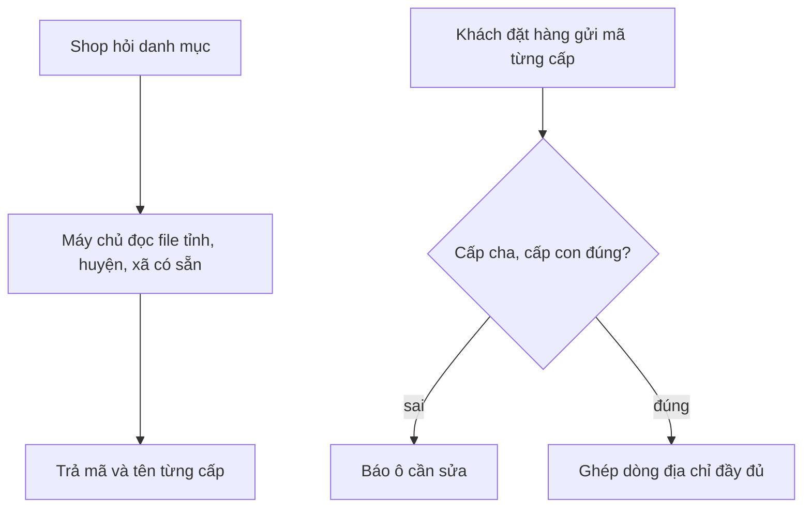

# administrative_units — Danh mục địa giới hành chính (STA-01, STA-02)

Hai kiểu: `current` (tỉnh, phường/xã, từ 01/07/2025) và `legacy` (tỉnh, quận/huyện, phường/xã). Cùng một mã có thể là hai
đơn vị khác nhau ở hai kiểu nên mọi hàm nhận `scheme`.

- `data/current.json`, `data/legacy.json`: dữ liệu tĩnh, công cộng. Nguồn: vietnam-divisions-js 3.0.0 (MIT), trích 16/11/2026;
  ghi lại trong khoá `description` của từng file. Cập nhật khi nhà nước đổi: thay file, chạy lại test toàn vẹn (T-A1).
- `catalog.py`: tra cứu theo mã, nạp lười một lần mỗi tiến trình. Không DB, không log.
- `addresses.py`: `parse_address_parts` (kiểm cha-con, trả lỗi theo ô) và `compose_full_address`.
- `shop_api.py`: `GET /api/shop/administrative-units/?scheme=&level=&parent=` (AllowAny, chỉ đọc, `Cache-Control` công khai).
