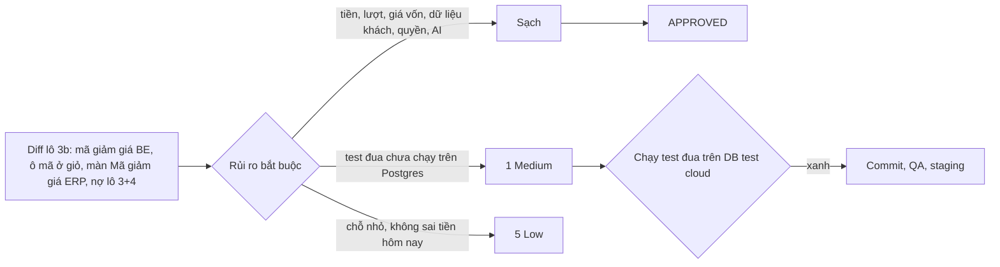

# 03b · Review code lô 3b mã giảm giá (techlead)

> techlead · 11/10/2026 · nhánh `shop/lo-3b-voucher` (chưa commit), so với `main`. Phạm vi: `backend/`, `frontend/`, `erp-console/`,
> `scripts/` và file chưa track. Bỏ qua `doc/`.
> Số kiểm chứng điều phối đã chạy: BE 10 app Ran 3923 OK (skipped=16), `makemigrations` sạch; FE 8 script 281 ca, build,
> check-no-mock; ERP tsc, 1359 ca, build, check-no-mock, check-ai-chunks; naming OK.
> Techlead tự chạy thêm: `manage.py test apps.catalog.vouchers …test_voucher_order …test_shop_lookup_3b
> apps.reports.tests.test_voucher_period_pnl …test_voucher_race` → Ran 131 OK (skipped=4, là 4 ca đua Postgres). Thử tay
> `allocate_whole_vnd` với dòng lẻ 0,5đ và 3đ chia 4 dòng: tổng luôn bằng số giảm, không dòng nào âm.

## Kết luận: **APPROVED** (kèm điều kiện M1 trước khi merge)

Không có lỗi Critical hay High.

**Tiền đúng.**
- Kiểm mã công khai và tạo đơn dùng chung `evaluate_voucher` và `compute_discount`.
- Thứ tự chặn đúng §3.8: chặn theo `max_discount`, rồi trần `VOUCHER_MAX_PERCENT` đọc từ settings, rồi chặn `subtotal − 1`, cuối cùng làm tròn xuống nguyên đồng. Vì vậy tổng sau giảm luôn ≥ 1đ.
- `allocate_whole_vnd` chia tiền nguyên đồng, tổng khớp tuyệt đối, không dòng nào vượt giá gộp của nó.
- `total_amount` bằng `_q_vnd(Σ line.amount)`, khớp `total_after` của kiểm mã. Hoá đơn chép `line.amount` và `order.total_amount`, nên lãi lỗ theo kỳ tính trên số đã trừ mã (`test_voucher_period_pnl`). Giá vốn chụp lại không đổi.
- Mã giảm thay hẳn PricingRule (dòng có `pricing_rule=None`), không cộng dồn. Hoà thì `BETTER_PROMO`.

**Lượt dùng không vượt tổng (về thiết kế).**
- Khoá đúng thứ tự §2.2: chèn đơn, rồi khoá `Voucher` bằng `select_for_update` không join, đếm lượt bằng truy vấn mới, rồi mới khoá lô.
- Thanh toán và job hết giờ chỉ cập nhật `VoucherRedemption`, không khoá `Voucher`, nên không có vòng khoá.
- Kiểm nhanh trước `atomic` chỉ để giữ thứ tự lỗi #5 trước #6. Kết quả quyết định là lần kiểm dưới khoá.
- `release` và `mark_used` lọc `state=HELD` nên chạy lại cũng không đổi gì.
- Đơn đã trả rồi bị huỷ không nhả lượt.

**Không rò dữ liệu.**
- `VoucherRedemption` không có tên, SĐT hay địa chỉ. `redemptions` trả đúng 4 khoá.
- Kiểm mã công khai không trả số lượt còn lại, danh sách mã, số kg hay giá vốn. `terms` chỉ có khi `MIN_ORDER` hoặc `BETTER_PROMO`.
- Mã mới bị chặn nếu chứa dãy từ 9 chữ số trở lên. Giới hạn theo tổng lượt, không theo SĐT.
- AuditLog `disable_voucher` chỉ ghi `note_marker`. `customer_terms` không chép vào nhật ký.
- FE chỉ lưu chuỗi mã vào `localStorage`, không lưu số tiền và không có dữ liệu cá nhân.

**Phân quyền.**
- `CanManageVoucher` áp cho mọi action: chưa đăng nhập 401, thiếu quyền 403. Không có DELETE hay PUT.
- Migration `0010` chỉ cấp cho `owner`. Capability uỷ được. Test chạy qua từng nhóm và kiểm cả việc uỷ rồi thu hồi.
- ERP chặn ở cả menu, `ViewGuard` và màn hình.

**Lãi lỗ theo lô (§8.1).** `reports/services.py` không đổi. Vẫn dùng giá gộp, có test khoá hành vi cũ. Đây chỉ là đề xuất cho Duy, không chặn lô này.

### Duyệt các quyết định be-dev tự đưa ra

| # | Quyết định | Kết luận |
|---|---|---|
| 1 | Thêm `SalesOrder.payment_started_at` (`sales/0022`), ghi ở `payments/shop_api.py` | **Duyệt.** Mốc này do server ghi, thay `sessionStorage` (nợ D3), không phải dữ liệu cá nhân. Chỉ lộ khi đơn còn `BOOKED`. Xem L2. Techlead bổ sung 0022 vào 02b §4. |
| 2 | Gọi `mark_used` trong `issue_invoice` thay vì nhánh MATCHED | **Duyệt, đúng hơn 02b.** `issue_invoice` là điểm chung duy nhất của 2 đường lập hoá đơn: IPN khớp (`:313`) và Chủ xác nhận hoặc gắn khoản thiếu (`_issue_and_close :863`). Cả hai đều đã khoá đơn trước đó. Có test cho đường xác nhận thủ công. Techlead sửa §2.1 và §4. |
| 3 | Chặn AI gọi `/api/catalog/vouchers/` bằng `FORBIDDEN_PREFIXES` | **Duyệt.** Mã giảm giá thuộc nhóm "tiền rời túi" nên chỉ Chủ làm bằng tay. Xem L3. |
| 4 | Loại `catalog` khỏi đích của test migration accounts, thêm `Voucher.disabled_note` vào allowlist | **Duyệt.** Cùng mẫu với các app trước. Ghi chú nội bộ đã chặn dãy số và không chép vào AuditLog. |
| — | fe-dev sửa ngoài phạm vi (`enums.ts`, `auditModel.ts`, `auth/mock.ts`, `CartSummary.*`, `OrderScreen`/`OrderView`) | **Duyệt.** Chỉ là nhãn hoặc mock để phục vụ đúng story 3b, D1/E1 và nợ M1/D3. |

## Lỗi theo mức

### Medium

**M1. 6 ca đua Postgres chưa chạy lần nào.** Đó là 4 ca trong `test_voucher_race.py` và 2 ca M2 trong `test_shop_create_race.py`. Cả 6 đều bị skip trên SQLite. Đây là bằng chứng duy nhất cho câu "lượt không vượt tổng khi tranh nhau" và "không deadlock với job hết giờ".
- Cách sửa: không cần sửa code. Chạy `manage.py test apps.sales.orders.tests.test_voucher_race apps.sales.orders.tests.test_shop_create_race` trên DB test Postgres trên cloud (không trỏ staging hay production, decisions 10/10). Phải thấy `Ran … OK` và skipped=0 cho các lớp này.
- Ai làm: điều phối hoặc qa-tester, **trước khi merge `main`**.

### Low (làm ở lô sau, không chặn)

**L1. `backend/apps/sales/orders/tests/test_voucher_race.py:143` khẳng định rỗng.** `place()` dùng SĐT `09001…`, nhưng assert lại tìm `09002{200+i}`, nên dòng này luôn đúng dù có tạo đơn hay không. Phần kiểm `outcome == "USED_UP"` vẫn bắt được lỗi chính.
- Cách sửa: đổi thành `filter(phone=f"09001{200 + i:05d}")`.
- Ai làm: be-dev.

**L2. `backend/apps/sales/payments/shop_api.py:40-44` có thao tác ghi DB ngay trong view.** Theo idiom dự án, việc này thuộc service.
- Cách sửa: chuyển vào `payments/checkout.py` (ví dụ `mark_payment_started(order)`), gọi sau `build_checkout_params`.
- Ai làm: be-dev.

**L3. Chưa có test khẳng định riêng rằng AI bị chặn ở mã giảm giá.** Test DW-07 hiện có chỉ quét các spec đang có.
- Cách sửa: thêm `assertTrue(is_url_forbidden("/api/catalog/vouchers/1/disable/"))` và kiểm registry không có lệnh nào dưới tiền tố này vào `apps/ai/registry/tests/test_forbidden_prefixes.py`.
- Ai làm: be-dev.

**L4. `frontend/features/checkout/components/CheckoutScreen.tsx:274` hiện sai "giá chưa giảm" trong hộp B8.** Hộp lấy `fullPrice = localTotal`, là tổng gộp do FE tự tính. Khi lý do là `BETTER_PROMO`, hoặc giỏ đang có PricingRule, đơn đặt lại sẽ rẻ hơn số đang hiện. Hôm nay Shop chưa có PricingRule nên chưa sai.
- Cách sửa: khi mở hộp B8, gọi `checkVoucher({items})` không kèm mã rồi hiện `total_after`. Lấy được thì mới hiện con số, không thì chỉ hiện câu chữ.
- Ai làm: fe-dev.

**L5. `backend/apps/catalog/vouchers/services.py:346` báo sai câu cho `is_active`.** `is_active` gửi qua PATCH bị `FIELD_LOCKED` với câu "đã bắt đầu chạy", kể cả khi mã chưa chạy. ERP không gửi khoá này (đã dùng `disable`/`enable`), nên chỉ là câu chữ.
- Cách sửa: bỏ `is_active` khỏi `sent`, hoặc trả câu "Dùng nút Tắt/Bật mã".
- Ai làm: be-dev.

### Ghi chú (không phải lỗi)

`OrderScreen.tsx:43-59` vẫn giữ `sessionStorage` `shop_pending_since_v1` để dự phòng khi server chưa trả `payment_pending_since`, ví dụ đơn chưa mở cổng. Chấp nhận được. Có thể gỡ ở lô 7 sau khi staging chạy ổn.
