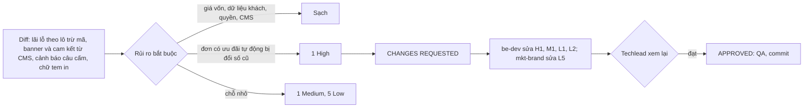

# 03b · Review code lô 5c và lãi lỗ theo lô có mã giảm giá (techlead)

> techlead · 11/10/2026 · nhánh `shop/lo-5c-content-batch-pnl` (chưa commit), so với `main`. Phạm vi: `backend/`, `frontend/`,
> `erp-console/`, `scripts/` và file chưa track. Bỏ qua `doc/`.
> Số kiểm chứng điều phối đã chạy: BE 10 app Ran 3953 OK (skipped=16), `makemigrations` sạch; FE ci, tsc, build, check-no-mock,
> 9 script; hex Shop 0; ERP tsc, 1360 ca, build; naming OK.
> Techlead tự chạy thêm một test tạm (đã xoá): đơn **không mã**, có PricingRule giảm 20.000đ, 4 kg × 150.000đ →
> `batch_pnl.revenue` = **580.000** (trên `main` là 600.000).

## Kết luận vòng 1: **CHANGES REQUESTED** (1 High). Vòng 2: **APPROVED** (xem cuối file)

Phần CMS, ERP và tem in đạt. Phần lãi lỗ theo lô đúng cho đơn có mã, nhưng làm đổi số của đơn **không mã** có ưu đãi tự động.

## Lỗi

### H1 (High, be-dev) Đơn có ưu đãi tự động (PricingRule) bị trừ giảm giá, kể cả đơn cũ và lô đã chốt
- `backend/apps/reports/services.py:38`. `_net_shares` nhận ra "dòng có giảm" bằng `line.amount != line.qty × line.rate`. Ưu
  đãi tự động (PricingRule, có từ Phase 2) cũng ghi giảm vào `SalesOrderLine.amount` (`apps/sales/orders/services.py:426–435`), rồi
  hoá đơn chép sang `SalesInvoiceLine.amount` (`apps/sales/payments/services.py:681`). Vì vậy mọi đơn cũ có ưu đãi tự động nay bị
  tính doanh thu lô theo số đã giảm. Đã đo được: 600.000 thành 580.000.
- Hậu quả có ba mặt:
  1. Trái quyết định Duy 11/10 chiều, vốn chỉ nói "trừ phần giảm giá **mã**, áp cho đơn từ nay".
  2. Trái luật "không sửa số kỳ cũ" và E2 (lô đã chốt không đổi số), vì phần doanh thu ở `:77–81` không lọc theo `closed_at`.
  3. Lập luận của be-dev ("không có khoá kỳ, chỉ đơn dùng mã mới có giảm, nên dữ liệu cũ không đổi") **sai**. Câu cùng ý trong
     BR-BC-04 ("lô/đơn trước khi có mã không có giảm nên số tự giữ") cũng sai.
- **Cách sửa:** chỉ chia theo số thực thu khi hoá đơn thuộc đơn có lượt mã `VoucherRedemption.state == USED`. Đơn không mã giữ
  nguyên công thức `qty × rate`, kể cả đơn có PricingRule. Gợi ý: lấy danh sách id đơn có mã một lần trong `batch_pnl`, truyền vào
  `_net_shares`. Không thêm field. Mã chỉ có từ lô 3b, chỉ chạy trên staging, nên đơn trước đó không bị đổi.
- **Test phải thêm** ở `test_voucher_period_pnl.py`:
  1. Đơn có PricingRule, không mã → `batch_pnl.revenue` = qty × rate (600.000).
  2. Lô đã chốt có đơn PricingRule → số không đổi.
  3. Giữ các ca đang có của đơn dùng mã.
- **Hỏi Duy (🔴, không chặn sửa):** có muốn lãi lỗ theo lô cũng trừ ưu đãi tự động cho đơn **từ nay** không? Nếu có thì phải có mốc
  ngày (setting), không dò theo dữ liệu. Chưa có câu trả lời thì giữ như cách sửa trên. Điều phối sửa câu BR-BC-04 trong spec cho khớp.

### M1 (Medium, be-dev) Gọi truy vấn lặp theo từng phân bổ
- `services.py:80` và `:96`. `_net_shares(line)` chạy lại `line.batch_allocations` cho **mỗi** phân bổ, nên mỗi lô tốn N truy vấn
  và chia lại cả dòng N lần. Lô bán nhiều đơn thì báo cáo chậm, nhưng số vẫn đúng.
- **Cách sửa:** ghi nhớ kết quả theo `line.pk` trong một lần gọi `batch_pnl` (dict cục bộ), hoặc `prefetch_related("invoice_line__batch_allocations")`.
  Sửa cùng H1.

### Low
- L1 (be-dev) `services.py:96`: chứng từ đảo một phần (`cl.qty != silb.qty`) dùng lại `cl.amount`, là số **gộp**
  (`credit_notes/services.py:53`), nên lệch với phần thực thu. Hôm nay chứng từ luôn đảo trọn phân bổ nên chưa sai. Nên chia theo tỉ lệ
  `cl.qty / silb.qty` của phần thực thu, hoặc ghi chú rõ là chưa hỗ trợ đảo một phần.
- L2 (be-dev) `test_voucher_period_pnl.py:1–5`: docstring còn ghi "Lãi lỗ THEO LÔ giữ công thức cũ … KHÔNG sửa services.py". Cần
  sửa theo hiện trạng.
- L3 (ghi nhận, không thuộc lô) Combo: phân bổ lô tính bằng kg thành phần, còn `line.rate` là giá một combo. Công thức cũ
  `alloc.qty × line.rate` cho dòng combo không giảm vì vậy đã lệch từ trước. Dòng combo có giảm thì nay lại chia theo `line.amount`, nên
  hai trường hợp không nhất quán. Đề xuất tách thành việc riêng để Duy quyết.
- L4 (mkt-brand) `load_shop_content.py:72`: `_nfc_lower` trùng với `scan._nfc_lower`. Vì `get_blocked_claims()` đã trả chữ thường
  NFC, nên import dùng chung hoặc giữ, không bắt buộc sửa.
- L5 (mkt-brand hoặc fe-dev, không chặn) Hai trang `home-banner` và `home-commitments` vẫn mở được ở `/pages/?slug=` và
  `PageScreen.tsx:58` đặt `noindex: false`. Nội dung vốn công khai, không có dữ liệu cá nhân hay giá vốn, nên **không cần chặn**. Nên đặt
  `noindex: true` cho slug bắt đầu bằng `home-` để Google không lập chỉ mục trang trơ.

## Đã soát, đạt
- **Tiền (đơn có mã):** các phần được làm tròn nguyên đồng theo cộng dồn, phần cuối nhận đúng `line.amount`, nên tổng các lô khớp tuyệt
  đối với dòng. Không có phần âm vì tổng cộng dồn chỉ tăng. Chứng từ đảo khi huỷ trừ đúng phần thực thu (550.000). Đơn không mã, không
  PricingRule thì không đổi số (600.000). Lãi lỗ theo kỳ không sửa. Hàm không trả thêm field, quyền `view_profitreport` giữ nguyên, nên
  không rò giá vốn.
- **CMS:**
  - Mọi cụm câu cấm trong §3.7.5 có mặt, cộng thêm các cụm theo 06-marketing.
  - Máy quét chỉ cảnh báo, không chặn. Snippet có che SĐT, không log.
  - Lệnh nạp dùng chung danh sách câu cấm và từ chối nội dung chứa câu cấm.
  - Trang `home-*` không có câu cấm, có test.
  - Trang production nạp ở dạng Nháp, có cờ chờ legal-vn (5-06 AC5).
  - Quyền đăng không đổi, có test `warehouse_staff` bị chặn.
- **FE Shop:**
  - `homeBlocks.ts` parse đúng contract §3.7.2. Khối sai dạng bị bỏ qua.
  - Nút chỉ nhận link nội bộ, đã qua cả `isInternalHref` và `isSafeHref`. Ảnh chỉ nhận `http(s)`.
  - Trả 404/410 thì ẩn khối, vẫn giữ một `h1` ẩn. Lỗi mạng thì bỏ cache, lần sau thử lại.
  - Đã sửa `policySummary` L3: lỗi mạng hay lỗi 5xx thì không giữ cache.
  - `ShopFrame` đọc dải chữ từ `excerpt`. Khi dự phòng thì đọc `min_qty_kg` từ site-info, không viết cứng.
  - Xoá `content.ts` và `legacy.css` sạch: grep 37 class cũ chỉ còn `page-title`, và đó là `id`, không phải class.
- **Sửa ngoài danh sách 5c-MKT là chấp nhận được.**
  - ERP `types.ts` và `contentModel.ts` phải thêm loại `claim`, nếu không `warningsOf` sẽ bỏ cảnh báo này.
  - `policySummary`, `slugs` và `mock` thuộc module `features/content`. Riêng `policySummary` là L3 đã giao cho mkt-brand.
  - `ShopFrame` cần sửa để làm AC dải chữ và L7.
  - Lô không đụng `lib/*`, và ở `backend/` không đụng gì ngoài `apps/content` (phần `reports` là của be-dev).
- **Tem in ERP:** đổi "Vựa cá tươi sống B2C" thành "Hải sản cấp đông theo lô". Hết câu cấm.

## Vòng 2 (11/10): **APPROVED**
- **H1 đã sửa.** `batch_pnl` lấy tập id đơn có `VoucherRedemption` ở trạng thái `USED` bằng một truy vấn. Chỉ các đơn này mới chia theo
  tiền thực thu. Đơn không mã, kể cả đơn có PricingRule, vẫn tính `qty × rate`, nên số lô đã chốt và số kỳ cũ không đổi.
  Đơn huỷ sau khi thanh toán không đổi trạng thái lượt mã: `release` chỉ chuyển HELD sang RELEASED, không chạm USED. Vì vậy dòng bán
  và dòng đảo luôn cùng một cách tính.
- **Test đã có:** đơn PricingRule không mã ra 600.000; lô đã chốt có đơn PricingRule không đổi số; đơn vừa có mã vừa có PricingRule
  ra đúng tiền thực thu.
- **M1 đã sửa.** Kết quả được ghi nhớ theo dòng, có test đếm số truy vấn.
- **L1 đã sửa.** Khi đảo một phần, số đảo là phần đã ghi chia theo tỉ lệ kg, làm tròn đồng.
- **L2 đã sửa.** Docstring khớp hiện trạng.
- **L5 đã sửa.** `PageScreen` đặt `noindex` cho hai trang `home-*`.
- **L3** (combo) và **L4** giữ ở dạng ghi nhận, không chặn.
- Techlead tự chạy `manage.py test apps.reports`: Ran 119 OK.
