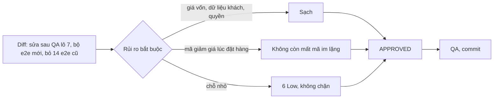

# 03b · Review code lô 7 (e2e toàn luồng và sửa sau QA) (techlead)

> techlead · 11/10/2026 · nhánh `shop/lo-7-e2e` (chưa commit), so với `main`. Phạm vi: `backend/`, `frontend/`, `erp-console/`,
> `scripts/` và file chưa track (10 file `frontend/e2e/shop_*.py` + `run_shop_e2e.py`). Bỏ qua `doc/`.
> Số điều phối đã chạy: BE 10 app Ran 3959 OK; FE ci, tsc, build, check-no-mock, 9 script (voucher 35); ERP tsc, 1360; hex 0; naming OK.
> Techlead tự chạy lại: `manage.py test apps.content.public …test_p1_sepay_checkout_params` → OK; `node scripts/test-voucher.mjs`
> → 35/35; `python3 scripts/check_naming.py` → OK.

## Kết luận: **APPROVED** (0 Critical, 0 High, 0 Medium, 6 Low)

## Trọng tâm đã soát

### B2 — gửi mã đã áp lúc đặt hàng (`CheckoutScreen.tsx:238`, `voucherView.ts:118`)
- Luôn gửi mã khách đã áp (mã trong hook, hoặc mã đã lưu khi hook chưa nạp). Máy chủ là nơi quyết: mã không còn dùng được thì
  trả `VOUCHER_INVALID` → mở hộp B8, khách tự chọn "Đặt hàng không dùng mã" hoặc "Quay lại giỏ". Không còn đường nào tạo đơn
  **giá gốc** trong khi khách đã áp mã (lỗi QA B2 đã đóng).
- Mã bị bỏ (hook `remove`, kiểm lại thấy hết hiệu lực) đều xoá cả `localStorage`, nên `readVoucherCode()` không gửi lại mã khách đã
  thấy bị bỏ. "Đặt hàng không dùng mã" không gửi mã và đổi `client_request_id` (giữ như cũ).
- BE tính lại số giảm (`apps/sales/orders/services.py`), `BETTER_PROMO` cũng là `VOUCHER_INVALID`. Đơn không bao giờ **đắt hơn**
  số khách thấy mà không hỏi. Trang thanh toán hiện tổng thật từ BE trước khi khách trả tiền.
- Còn một ca lệch theo chiều có lợi cho khách: xem L1.

### Luật CSS chung `p a:not([class]), li a:not([class])` (`globals.css:141`)
- Đã rà mọi `<a>`/`<Link>` trong `
`/`<li>` ở `components/ features/ app/`: liên kết dạng nút, thẻ, menu, bộ lọc
  (`FormErrorSummary`, `SideFilter`, `ContactView`, `PolicyNav`, `Button href`) đều có `className` nên không bị gạch chân. Chỉ link
  trơn trong câu (CMS, `CancelNotice`, `ExpiredView`) được gạch chân, đúng ý UI-RULES §8. Độ ưu tiên (0,1,2) không đè class module.
- `Checkbox.module.css` `.text a` gạch chân link chính sách trong ô đồng ý (lỗi B1 axe).

### Tiền ở dòng "kg × giá"
- Đặt hàng (`CheckoutScreen.tsx:189`): dùng đơn giá có sẵn trong giỏ (đã làm sạch ở `CartContext`), không suy ra.
- Thanh toán (`PaymentView.tsx:26`): đơn giá = `amount / qty`, chỉ hiện khi ra số nguyên đồng, ngược lại về dạng cũ "· 2 kg". Qty bước
  0,5 nên phép chia số thực là đúng tuyệt đối. Tích "qty × đơn giá" luôn bằng thành tiền dòng nên không thể hiện số sai. Xem L2.

### L11 — bỏ khoá `gateway` khỏi JSON checkout (`backend/apps/sales/payments/checkout.py:181`)
- Duyệt làm **ngoại lệ có chủ ý** cho luật "không đụng `checkout.py` mọi lô" (02b §7.0): đúng 1 dòng xoá, không đổi `fields`, thứ tự
  field, chữ ký, `checkout_url`, `environment`.
- Không ai đọc khoá này: `PaymentCheckoutSession` (`frontend/lib/types.ts:184`) không có `gateway`; `lib/mock.ts` không trả; ERP không
  dùng; adapter không gọi endpoint này (`gateway` trong `adapter/app/schemas.py` là trường của IPN SePay, không liên quan); 02b không
  ghi khoá này trong contract. Test mới `test_qa_l11_public_response_does_not_name_the_payment_gateway`.
- Ghi nhận: `checkout_url` vẫn là host của cổng, nên tên cổng vẫn đọc được trong JSON. Việc này không tránh được và khách không thấy.
  Điều phối nên ghi một dòng ngoại lệ vào nhật ký 02b §7.0 để lô sau không hiểu nhầm.

### L12 — throttle `public_content` 120 → 600/phút (`settings.py:220`)
- Vẫn đọc env `THROTTLE_PUBLIC_CONTENT`, chỉ đổi mặc định. API chỉ GET, có `Cache-Control`, không dữ liệu nhạy cảm, nên nâng là hợp lý.

### Bộ e2e mới (`frontend/e2e/run_shop_e2e.py` + 9 file)
- Một lệnh: `python3 frontend/e2e/run_shop_e2e.py` (có `--skip-build`, `--suite`, `--keep`). Tự dựng SQLite tạm trong `mkdtemp`,
  migrate, seed, chạy BE `localhost:8000` và Shop/ERP build `USE_MOCK=0`, rồi tự dọn.
- Không trỏ staging hay production: mọi URL là `localhost`, `DATABASE_URL` luôn bị đè bằng SQLite tạm. Không có URL `run.app`,
  `web.app` hay Supabase.
- Không có dữ liệu thật hay bí mật thật: tên, SĐT, địa chỉ giả (`Lê Thị Mẫu`, `0900000001`, `1 Đường Thử`); người bán giả;
  `QaPass-12345` và `e2e-internal-token` chỉ là mật khẩu, token của DB tạm.

### Xoá 14 e2e cũ — đối chiếu ca quan trọng
| Ca cũ | Còn ở đâu |
|---|---|
| Rò giá vốn ở API, HTML Shop (`qa_sepay_checkout`, `qa-lo8-*`) | `shop_general_rules.py` G3 (`COST_KEYS` trên mọi endpoint công khai, kể cả checkout; quét HTML), `shop_content_pages.py` |
| Rò dữ liệu cá nhân ở storage, cookie, URL, console, request (`qa-lo6-sr21-shop`, `golive_footer_checks`) | `shop_full_flow.py` (`assert_no_pii`), `shop_footer_consent.py:112`, `shop_general_rules.py` G2, `shop_erp_flow.py:165` (AuditLog) |
| Phân quyền mã giảm giá, lãi lỗ (Quản lý, Thủ kho, Giao, Gọi xác nhận, không nhóm 403; chưa đăng nhập 401) | `shop_general_rules.py:131`, `shop_erp_flow.py:134` |
| XSS, link độc trong bài (`qa-lo7-shop-xss`, `qa-lo7-shop-links`) | `shop_content_pages.py:146–189`, nhiều payload hơn bản cũ |
| Bí mật SePay không ra form, thứ tự field ký (`qa_sepay_checkout`) | Test BE `test_p1_sepay_checkout_params.py` (`test_p1_ac1_no_secret_leak_via_fields_array`, thứ tự field) + adapter 68 test |
| Mã trạng thái thô trên trang đơn (`order_lookup_no_raw_codes`) | `shop_design_screens.py:679` |

Không mất ca quan trọng về giá vốn, dữ liệu cá nhân hay phân quyền. Thiếu nhỏ: xem L5.

## Lỗi (đều Low, không chặn)

| Mã | Mức | Chỗ | Mô tả | Giao |
|---|---|---|---|---|
| L1 | Low | `CheckoutScreen.tsx:180–182`, `:238` | Kiểm lại mã bị **lỗi mạng**: `quote` null, `checking` false nên nút "Đặt hàng" bấm được. Tóm tắt hiện giá gốc, không có dòng giảm và không báo gì, nhưng mã vẫn được gửi. BE áp mã nên đơn **rẻ hơn** số vừa hiện. Trang thanh toán vẫn hiện đúng tổng thật, khách không bị thu sai. Đề xuất: khi `voucher.code && !voucher.quote` thì hiện chip "Mã X · sẽ kiểm khi đặt" ở tóm tắt. | fe-dev, lô sau |
| L2 | Low | `PaymentView.tsx:26` | Đơn giá suy ra từ `amount/qty`. Nếu dòng có ưu đãi tự động ghi vào `amount` (PricingRule), số hiện là giá đã giảm, khác đơn giá ở giỏ. Phép tính vẫn đúng. Nếu muốn đúng giá niêm yết thì BE cần trả `rate` dòng (thêm khoá vào `OrderLineData`, cần cập nhật 02b). | techlead ghi lại, không làm lô này |
| L3 | Low | `CheckoutScreen.tsx:277–279` | Hộp B8 khi chưa có `quote`: `discountedPrice` = `localTotal`, nên hộp gạch số cũ rồi in lại đúng số đó. Không có `quote` thì nên ẩn số gạch. | fe-dev |
| L4 | Low | `CartScreen.tsx:45`, `:95`, `:160` | `const [, setBlocked]` là state chết sau L3: còn gọi `setBlocked` nhưng không đọc. Nên xoá. Thụt lề `hotline={hotline}` lệch ở `CatalogScreen.tsx:204` và `ItemDetailScreen.tsx:98`. | fe-dev |
| L5 | Low | `frontend/e2e/` | Ca "giỏ hỏng trong `localStorage` (giá `'abc'`/`null`) không ra NaN" của `qa-lo8-shop-django.py` cũ chưa có bản e2e mới. `CartContext.tsx:68–77` đã làm sạch giá, nên rủi ro thấp. Nên thêm 1 ca vào `shop_general_rules.py`. | qa-tester, lô sau |
| L6 | Low | `apps/content/public/tests/test_public_api.py:284` | Test đọc `_DEFAULT_THROTTLE_RATES` lúc chạy, nên sẽ đỏ nếu máy CI có đặt `THROTTLE_PUBLIC_CONTENT`. Nên dùng `override` env hoặc so với `_rate(...)` mặc định. | be-dev, lô sau |

## Nhắc khi commit
- `.claude/worktrees/srv.pid2` là file chưa track và không bị ignore, **không commit**. Commit bằng pathspec (bộ nhớ 02/10).
- `frontend/e2e/__pycache__` đã bị ignore.
- L13 (`npm audit`, `next` 14.2.35) chưa xử lý trong lô này. Cần một quyết định riêng: nâng `next` lên bản vá 14.2.x, hoặc ghi lý do
  không áp dụng vì Shop xuất tĩnh.
