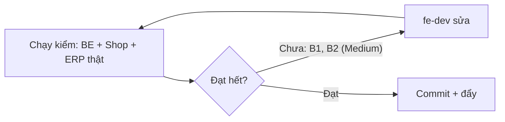

# QA — Shop lô 3b (mã giảm giá + nợ lô 3+4) · lần 1 · 2026-10-11

## Kết luận: REJECTED — 2 lỗi chặn Medium, đều phía FE (B1: mã giảm giá cũ còn trong máy sau khi đặt xong, tự áp vào giỏ lần sau; B2: bảng mã ở ERP thiếu cột "Đơn tối thiểu"). BE đạt hết.
## Tổng: ~190 lần kiểm (Shop kiểm ở 360 và 1280) · ✅ ~182 · ❌ 4 (B1 ×2 độ rộng, B2 ×1, L1 tính vào Low) · ⏸ 3 (đua song song trên Postgres, Google Maps, mã `UNREACHABLE_AUTO`: đã ghi từ lô trước)

Môi trường: BE Django thật (SQLite tạm riêng, `migrate`, `seed_demo`, `load_shop_content --author qa_owner --publish`), cổng 8000 (giới hạn tần suất nới, riêng kiểm mã giữ 20/phút) và 8001 (giới hạn mặc định). Shop và ERP build `USE_MOCK=0` trỏ `http://localhost:8000` (`npm ci` sạch, `tsc --noEmit` 0 lỗi, `npm run build` exit 0 cả hai; `check-no-mock` XANH cả hai). Chromium headless 360 và 1280. Tài khoản: `qa_owner`, `qa_manager`, `qa_wh` (kho), `qa_cs` (gọi xác nhận), `qa_delivery` (giao), `qa_nogroup`. Dữ liệu giả hoàn toàn (Nguyễn Văn A, 0900000001). Giả lập: IPN = `confirm_payment(source="GATEWAY")`; hết giờ = chạy `cancel_unpaid_expired` (2 lần); "tiền về muộn/nghi trùng" = giao dịch muộn + `duplicate_warning`; mở cổng thanh toán = gọi `POST /checkout/` rồi lùi `payment_started_at`. 84 ảnh ở `shots/lo3b-qa/`. Script tạm ở scratchpad, đã tắt server, xoá DB tạm; `frontend/out` giữ bản build `USE_MOCK=0`, API `localhost:8000`.

## Theo AC
| Mã AC | KQ | Bằng chứng |
|---|---|---|
| 3b-01 AC1 tạo mã | ✅ | ERP form tạo `cave10` (PERCENT 10, trần 50.000, tối thiểu 300.000, 100 lượt) → 201, lưu IN HOA; `starts_at` 00:00 VN = `…T17:00Z`; AuditLog `create_voucher` ghi từng trường trước→sau; giờ không múi giờ coi là giờ VN (kiểm `NAIVE1`) |
| AC2 trùng | ✅ | tạo `cave10` thường → 400 "Mã này đã có", hiện ở ô mã (`E-err-duplicate-lowercase`) |
| AC3 lỗi | ✅ | PERCENT 60 (chặn ngay ở form, không gọi API), PERCENT thiếu trần ("Nhập mức giảm tối đa…"), kết thúc trước bắt đầu, mã có 10 chữ số liền (BE chặn từ 9 chữ số, đúng 02b), lượt 0 |
| AC4 sửa có lợi | ✅ | gia hạn, tăng lượt, hạ đơn tối thiểu → 200; AuditLog `update_voucher` trước→sau |
| AC5 sửa bất lợi | ✅ | nâng tối thiểu, giảm mức, rút hạn, hạ trần, giảm tổng lượt → 400 `UNFAVORABLE_CHANGE`, ô báo đúng câu "Mã đang chạy chỉ sửa được theo hướng có lợi… Tắt mã này và tạo mã mới."; `code/kind/starts_at/customer_terms` → `FIELD_LOCKED`; mã chưa tới giờ sửa tự do (200) |
| AC6 tắt | ✅ | không lý do → 400; `OTHER` thiếu ghi chú → 400; có lý do → 200; AuditLog `disable_voucher` chỉ có `reason_code` và `note_marker` (không chép ghi chú); `DELETE` và `PUT` → 405 |
| AC7 bật lại | ✅ | còn hạn/còn lượt → 200; hết hạn → `EXPIRED`; hết lượt → `USED_UP` |
| AC8 quyền | ✅ | bảng bên dưới: 5 nhóm + chưa đăng nhập, mọi endpoint |
| AC9 uỷ quyền | ✅ | Chủ bật "Quản lý mã giảm giá" ở màn Phân quyền → Quản lý thấy menu, tạo `MGR20` thành công; Chủ tắt lại → Quản lý 403 |
| AC10 redemptions | ✅ | JSON đúng 4 khoá (`order_code, discount_amount, at, state`); không tên/SĐT/địa chỉ/giá vốn |
| 3b-02 AC1 bảng | ❌ | **B2**: có mã (kèm tên), kiểu/mức/trần, thời gian GMT+7, lượt, trạng thái; **thiếu cột đơn tối thiểu** |
| 3b-02 AC2 tạo | ✅ | dòng mới hiện trong bảng; PERCENT bắt buộc trần, mức > 50 chặn ở form |
| 3b-02 AC3 | ✅ | câu bất lợi hiện ở đúng ô (4 ca) |
| 3b-02 AC4 | ✅ | dialog 3 lý do + ghi chú, bấm Tắt không chọn lý do báo "Chọn lý do tắt mã.", focus nằm trong dialog, Esc đóng; không có nút Xoá ở bảng/form |
| 3b-02 AC5 | ✅ | dialog "Lượt dùng": mã đơn, số giảm, giờ, trạng thái (Đang giữ/Đã dùng/Đã nhả); quét HTML không có tên/SĐT/địa chỉ |
| 3b-02 AC6 | ✅ | Quản lý/Kho/Gọi xác nhận: không có menu, vào `/vouchers/` báo "Bạn không có quyền xem mục này"; Giao/không nhóm bị chặn khỏi ERP (về `/login/`) |
| 3b-03 AC1 | ✅ | `cave10` giỏ 610.000 → `valid:true`, giảm 50.000 (10% = 61.000 chạm trần), `total_after` 560.000 |
| AC2 | ✅ | giỏ 165.000 + `MIN300` → `MIN_ORDER`, `missing_amount:"135000"` |
| AC3 | ✅ | quá hạn → `EXPIRED`; chưa tới giờ, không có, đã tắt → `INVALID`; `terms:null` |
| AC4 | ✅ | lượt cuối đã giữ → `USED_UP`; JSON không có số lượt |
| AC5 | ✅ | PricingRule 186.000 vs mã 50.000 → `BETTER_PROMO`, `auto_discount_amount:"186000"`; mã đúng bằng 186.000 (hoà) → vẫn `BETTER_PROMO` |
| AC6 | ✅ | `BIG400` giỏ 660.000 → giảm 330.000 (50%), tổng > 0; `HALF50` giỏ 610.000 → tổng 305.000 |
| AC7 | ✅ | cổng 8001: 20 lần 200, lần 21–23 → 429 |
| AC8 | ✅ | JSON không có mã khác, số lượt, giá vốn, số kg tồn, SĐT, mã lô |
| 3b-04 AC1 | ✅ | giỏ 330.000 + 280.000, giảm 50.000 → phân bổ 27.049 + 22.951 = 50.000, nguồn "voucher", lượt `HELD`, `total_amount` 560.000 |
| AC2 đua | ⏸ / ✅ | 5 luồng tranh lượt cuối trên SQLite: lượt giữ đúng 1, không bán vượt (kiểm `held_count=1`); 4 luồng kia lỗi 500 do "database is locked" của SQLite, không phải lỗi sản phẩm. Kiểm tuần tự: lượt cuối đã giữ → `USED_UP` không tạo đơn. Test đua Postgres (`test_voucher_race.py`) điều phối chạy trên DB test cloud |
| AC3 | ✅ | mã bị tắt giữa lúc kiểm và lúc đặt → `VOUCHER_INVALID`, số đơn không đổi (15 → 15) |
| AC4 | ✅ | gửi lại cùng `client_request_id` → trả đơn cũ, lượt không giữ thêm |
| AC5 | ✅ | IPN cổng → lượt `HELD` → `USED` (hiện ở "Lượt dùng" trên ERP) |
| AC6 | ✅ | `cancel_unpaid_expired` chạy 2 lần: lần 1 huỷ 1 đơn + nhả lượt, lần 2 trả 0; tạo lại được đơn dùng lượt đó |
| AC7 | ✅ | đơn có mã đã trả, bị huỷ → lượt vẫn `USED`, mã vẫn `used_up` |
| AC8 | ✅ | không mã → `discount.source:null`, đơn tính như cũ; PricingRule vẫn áp |
| AC9 | ✅ | hoá đơn 560.000 = `total_amount`, tổng dòng hoá đơn 302.951 + 257.049 = 560.000; `reports/period/?year=2026&month=10` doanh thu tính theo số sau giảm; BE 3923 test xanh (có `test_voucher_period_pnl`) |
| 3b-05 AC1 | ✅ | 360: "Nhập mã" mở sheet, gõ "cave 10" thành `CAVE10`, áp xong có chip + "Bỏ mã CAVE10", "Giảm giá −50.000đ", Tổng 560.000đ, mức/tối thiểu/hạn/"Số lượt có hạn"/câu không cộng dồn, toast "Đã áp mã CAVE10"; 1280 hộp tóm tắt có ô + "Áp dụng". Giống `B6`, `DesktopVoucher` |
| AC2 | ✅ | 1280 ô nhập + "Áp dụng" nằm trong hộp tóm tắt |
| AC3 | ✅ | mỗi ca đúng một câu thấy được: INVALID/EXPIRED/chưa tới ("Mã không đúng hoặc đã hết hạn."), MIN_ORDER ("Đơn cần từ 300.000đ…"), USED_UP, mạng ("Chưa kiểm được mã. Thử lại" có nút), 429 ("Bạn thao tác hơi nhanh. Đợi 1 phút…"); lỗi `role="alert"` + `aria-invalid`; BETTER_PROMO là thông tin màu chữ thường, không đỏ, không `aria-invalid` (xem L3) |
| AC4 | ✅ | giỏ 2 kg áp `MIN300`, bấm "Bớt 0,5 kg" → gọi kiểm lại, báo MIN_ORDER, Tổng về 247.500đ, chip mất |
| AC5 | ✅ / L4 | bỏ mã rồi áp mã khác → còn đúng 1 chip. Khi đã áp, giao diện không có ô gõ mã mới (đúng thiết kế `DesktopVoucher`) nên "thay thế trực tiếp" không có đường bấm |
| AC6 | ✅ | `localStorage` chỉ thêm `cart_voucher_code_v1:"CAVE10"`; không lưu số tiền giảm; URL không có mã/SĐT |
| AC7 | ✅ | không có chữ "còn N lượt" ở giỏ, sheet, thanh toán, trang đơn |
| 3b-06 AC1 (C6/B8) | ✅ | tắt mã giữa lúc đặt → dialog "Mã X không còn dùng được / Đơn sẽ tính theo giá chưa giảm.", tổng gạch cũ → mới, không tự đặt (số đơn không đổi); cũng đúng khi lượt cuối bị người khác giữ (USED_UP) |
| AC2 | ✅ | "Đặt hàng không dùng mã" gửi lại không `voucher_code`, `client_request_id` mới (2 id khác nhau), đơn 610.000đ, lượt mã không giữ; "Quay lại giỏ" → `/shop/cart/`, mã bị gỡ khỏi giỏ |
| AC3 | ✅ | D1 và trang đơn (E1) có dòng "Mã giảm giá (CAVE10) −50.000đ", Tổng 560.000đ = `total_amount`; trang đơn tra bằng mã + SĐT ở trình duyệt khác cũng có |
| AC4 | ✅ | đơn tự huỷ có mã → "Đặt lại đơn này" → giỏ đúng món, không mã, `localStorage` không có `cart_voucher_code_v1` |
| Nợ lô 3+4 — `awaiting_confirmation` | ✅ | phiếu giao `CONFIRMING`: lookup trả `awaiting_confirmation:true`; cờ `SHOP_CONFIRM_CALL_NOTICE=1` → trang đơn hiện "Cá Về sẽ gọi … trong khung 07:00-21:00 …"; đổi phiếu sang `PREPARING` → khối ẩn; cờ tắt → khối ẩn |
| Nợ — D3 "Đã chờ" | ✅ | mốc `payment_pending_since` ghi khi mở cổng (`null` trước đó); lùi 185 s: 360 và 1280 hiển thị 3:10, sau F5 3:13 (không về 0), trình duyệt khác tra bằng mã + SĐT 3:17; `shop_pending_since_v1` không dùng |
| Nợ — M3 | ✅ | đơn tự huỷ + chỉ có giao dịch nghi trùng → `state:"expired"`, `late_payment:false`, `cancel_notice:null`, trang không có câu trả lại tiền. Đối chứng: tiền về muộn thật → `cancelled`, `late_payment:true`, "trả lại 297.000đ" |
| G1 | ✅ | catalog/kiểm mã/tạo đơn/tra đơn/giỏ HTML: không số kg tồn, mã lô, giá vốn |
| G2 | ✅ | xem "Rò dữ liệu cá nhân" |
| G3 | ✅ | không khoá giá vốn ở kiểm mã, đơn, redemptions, trang Shop |
| G5 | ✅ / L2 | sheet B5 giữ focus (Tab 8 lần không ra ngoài), Esc đóng và trả focus về nút "Nhập mã"; dialog B8 focus vào "Quay lại giỏ", Tab không thoát; Esc đóng được (focus về `body`, xem L2) |
| G7, G8 | ✅ | `check-no-mock` XANH; không còn mock tạm `discount` trong bản build |
| Giỏ sau khi đặt xong (ngoại lệ) | ❌ | **B1** |

## Ngoại lệ & biên
Mã quá hạn/chưa tới/đã tắt/không có; hết lượt vừa giữ; lượt nhả khi huỷ hết giờ rồi dùng lại; hết giờ chạy 2 lần; đơn đã trả rồi huỷ; gửi lại cùng `client_request_id`; mã tắt giữa lúc kiểm và lúc đặt; lượt cuối bị người khác giữ giữa lúc kiểm và lúc đặt; giỏ rơi dưới đơn tối thiểu sau khi áp; ưu đãi tự động lợi hơn và hoà; trần 50% và tổng không ≤ 0; `voucher_code` kiểu số → 400; `code` rỗng/null/số → "chưa nhập"; `items` rỗng/trùng/qty 0/âm/0,3/rác/món lạ → 400; bấm đúp "Áp dụng" → 1 request; 429 giả lập và thật; mất mạng rồi "Thử lại"; F5 giữ mã và kiểm lại; mã hết lượt/hết hạn khi bật lại; sửa tổng lượt thấp hơn hiện có; sửa mã chưa chạy; ISO không múi giờ; D3 sau F5 và ở trình duyệt khác; nợ M3.

## Phân quyền (HTTP, mọi endpoint `/api/catalog/vouchers/`: list, tạo, chi tiết, PATCH, tắt, bật, redemptions, DELETE)
| Nhóm | Kết quả |
|---|---|
| Chưa đăng nhập | 401 |
| `owner` | 200/201 (DELETE, PUT → 405) |
| `manager` (chưa uỷ) | 403 cả 8; Chủ uỷ → vào được, tạo 201; thu hồi → 403 lại |
| `warehouse_staff` | 403 cả 8; menu ẩn; vào URL báo không có quyền |
| `customer_service` | 403 cả 8; menu ẩn; vào URL báo không có quyền |
| `delivery_staff` | 403 cả 8; bị chặn khỏi ERP |
| không thuộc nhóm nào | 403 cả 8; bị chặn khỏi ERP |
`reports/period/` với kho: 403.

## Rò giá vốn
Quét JSON kiểm mã, tạo đơn, tra đơn, redemptions, danh sách mã và HTML giỏ/thanh toán/trang đơn: không `purchase_rate`, `landed`, `unit_cost`, `qty_available`, `used_count`, `held_count`, `total_uses` ngoài ERP. AuditLog mã chỉ có số tiền khuyến mại, không tính ngược được giá vốn. Lãi lỗ chỉ Chủ (kho 403).

## Rò dữ liệu cá nhân
- JSON kiểm mã/tạo đơn/tra đơn/`checkout`: 0 tên, SĐT, địa chỉ (quét chuỗi `Nguyễn Văn A`, `0900000001`, `Đường Giả`).
- HTML trang đơn công khai (đủ trạng thái đã mở): không hiện người nhận. `page.url`, `localStorage`, `sessionStorage` (chỉ `{mã đơn: token}`): 0 PII. ERP "Lượt dùng": không cột khách.
- Log BE hai cổng: 0 tên/SĐT/địa chỉ.
- Console trình duyệt: không in dữ liệu cá nhân. Chỉ có dòng "Failed to load resource … 400/429" do trình duyệt tự ghi cho phản hồi 4xx có chủ ý (VOUCHER_INVALID, ca 429 giả lập), không có lỗi JS.
- Tra đơn dùng POST có giới hạn tần suất (đã kiểm lô trước); kiểm mã có throttle riêng 20/phút/IP (429 thật).

## Hồi quy
BE `manage.py test --noinput`: **Ran 3923 tests OK (skipped=16)**. Adapter `pytest`: 68 passed. `makemigrations --check --dry-run`: No changes detected. `check_naming`: OK, không phát sinh mới. ERP `vitest`: 114 file, 1359 test xanh. Shop `tsc` 0 lỗi, `build` exit 0. Giỏ, thanh toán D1, D3/D4, trang đơn E1, tra đơn F1, "Đặt lại đơn này" (lô 3+4) vẫn chạy; PricingRule không mã đúng như cũ.

## Lỗi
### B1 — Mã giảm giá cũ vẫn còn trong máy sau khi đặt xong, tự áp lại vào giỏ lần sau · Medium · AC 3b-05 AC6 / 3b-06 (ngoại lệ "dữ liệu đã từng dùng")
Bước tái hiện (360 và 1280): giỏ 2 kg cá thu + 1 kg bạch tuộc, áp `CAVE10`, điền form (dữ liệu giả), "Đặt hàng" → trang thanh toán. Mở `localStorage`: `cangcaloc_cart_v1` = `[]` nhưng `cart_voucher_code_v1` = `CAVE10`. Thêm 1 kg mực vào giỏ rồi mở `/shop/cart/`: dòng "Mã giảm giá" đã báo lỗi "Đơn cần từ 250.000đ để dùng mã này." dù khách chưa gõ gì. Giỏ ≥ đơn tối thiểu (thử 1 kg cá thu + 1 kg bạch tuộc) thì tự có chip `CAVE10` và tổng giảm (445.000đ → 400.500đ).
Mong đợi: xoá mã khỏi máy khi đặt hàng thành công (cùng lúc xoá giỏ), giỏ mới không mang mã cũ.
Thực tế: mã còn; mã công khai được áp ngầm cho đơn sau, tốn lượt mã mà khách không chủ ý; báo lỗi MIN_ORDER lúc khách chưa nhập mã.
Ảnh hưởng: sai giá/tốn lượt ngoài ý khách. Ảnh `S-stale-voucher-newcart-360/1280.png`. Người sửa: fe-dev (xoá `cart_voucher_code_v1` khi tạo đơn 201, và khi "Đặt hàng không dùng mã").

### B2 — Bảng mã giảm giá ở ERP thiếu cột "Đơn tối thiểu" · Medium · AC 3b-02 AC1
Bước tái hiện: đăng nhập `qa_owner`, mở `/vouchers/`. Cột hiện có: Mã (kèm tên), Mức giảm (kiểu, mức, trần), Thời gian, Lượt dùng, Trạng thái, Thao tác. Mã `MIN300` đơn tối thiểu 300.000đ nhưng bảng không hiện số này (chỉ thấy trong form sửa).
Mong đợi: bảng có đơn tối thiểu (AC1 liệt kê rõ). Người sửa: fe-dev (`erp-console/features/catalog`, thêm vào ô "Mức giảm" hoặc cột riêng). Ảnh `E-list-24-1280.png`.

### Ghi nhận Low (không chặn)
- L1 — ERP: ô "Tìm mã hoặc tên" chỉ lọc trong các dòng đã tải (20/trang). Với 24 mã, gõ `MIN300` báo "Không tìm thấy" dù có (phải bấm "Tải thêm"). Khi mã nhiều, nên tìm phía server hoặc ghi chú "Tải thêm để tìm tiếp".
- L2 — Dialog B8: Esc đóng được và bỏ mã khỏi giỏ (tổng đổi sang giá chưa giảm, hiện rõ), không tự đặt; nhưng sau Esc focus rơi về `body` thay vì nút "Đặt hàng". Lần đặt tiếp dùng lại `client_request_id` cũ (vô hại vì lần đầu không tạo đơn).
- L3 — BETTER_PROMO: giỏ ghi "Ưu đãi đang áp đã có lợi hơn mã này." nhưng giỏ chưa hiện dòng ưu đãi tự động (giá trước giảm 930.000đ; BE đã trả `auto_discount_amount` 186.000 và `total_after` 744.000). Khách có thể thắc mắc "ưu đãi nào". Đề xuất PO duyệt có hiện dòng ưu đãi tự động ở giỏ hay không.
- L4 — AC5: không có ô gõ mã mới khi đã áp (đúng bản thiết kế); thay mã = "Bỏ mã" rồi áp mã khác. PO xác nhận câu AC5 hiểu theo cách này.
- L5 — ERP: mã đã hết hạn vẫn có nút "Tắt" (BE cho phép; tắt rồi không bật lại được, đúng V-12).
- L6 — Lý do `customer_terms` bị khoá khi mã đang chạy (đúng ghi chú BE), nên sai chính tả điều kiện hiện cho khách thì phải tắt và tạo mã mới. Cân nhắc cho sửa chữ (không đổi quyền lợi).

## Lệnh đã chạy (kèm output tóm tắt)
- `cd backend && .venv/bin/python manage.py test --noinput` → `Ran 3923 tests … OK (skipped=16)`.
- `cd adapter && .venv/bin/python -m pytest -q` → `68 passed`.
- `manage.py makemigrations --check --dry-run` → `No changes detected`. `python3 scripts/check_naming.py` → OK.
- `cd frontend && npm ci && npx tsc --noEmit` → exit 0; `NEXT_PUBLIC_USE_MOCK=0 NEXT_PUBLIC_API_BASE=http://localhost:8000 npm run build` → exit 0; `node scripts/check-no-mock.mjs` → XANH.
- `cd erp-console && npm ci && ./node_modules/.bin/tsc --noEmit` → exit 0; cùng lệnh build → exit 0; `check-no-mock` XANH; `npx vitest run` → 1359 passed.
- Playwright Chromium (script tạm trong scratchpad `lo3b/`): ERP (`e1…e7`, `p1`), API (`a1…a4`), Shop (`s1…s4`, `o1…o4`, `l2`, `d3`, `m3`), 84 ảnh `shots/lo3b-qa/`.
