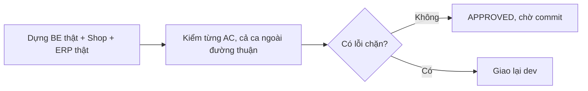

# QA — Shop lô 5c (nội dung CMS trang chủ, lệnh nạp, bỏ "cá tươi", lãi lỗ theo lô trừ mã) · lần 1 · 2026-10-11

## Kết luận: APPROVED — không có lỗi chặn; lãi lỗ theo lô trừ mã khớp số tính tay, các AC 5-03, 5-06, 5-07 đạt khi chạy thật.
## Tổng: 62 ca · ✅ 61 · ❌ 0 · ⏸ 1 (xem cuối) · Ghi nhận Low: 3

Môi trường: BE Django thật (SQLite tạm riêng, `migrate`, `seed_demo`, `seed_qa`, `load_shop_content --author qa_owner --publish` chạy 2 lần), cổng 8000; Shop và ERP build `USE_MOCK=0` trỏ `http://localhost:8000`, phục vụ tĩnh (3000, 3100). Chromium headless 360 và 1280. Dữ liệu giả (Khách Giả A…, 0900000101…). Giả lập IPN = `confirm_payment`. Ảnh: `shots/lo5c-qa/` (37 ảnh). Server và DB tạm đã dọn; `frontend/out` giữ bản build `USE_MOCK=0`, API `localhost:8000` (đã dựng lại sau thay đổi `PageScreen.tsx` lúc 14:19).

Lưu ý quy trình: trong lúc QA, dev sửa `reports/services.py` (H1, M1, L1) lúc 14:19. Lần chạy BE đầu (3953 test) bắt đầu trước đó nên **đã chạy lại** toàn bộ BE trên mã mới, và mọi số lãi lỗ ở dưới đo trên mã mới.

## Theo AC
| Mã AC | KQ | Bằng chứng |
|---|---|---|
| 5-03 AC1 sửa chữ banner ở ERP, không build lại FE | ✅ | ERP `/content/edit/?id=11` (Chủ) đổi tiêu đề thành "Banner QA mới lô 5c" → Lưu nháp → tick 5 mục → Đăng bản sửa; `/` ở 360 và 1280 hiện chữ mới. Ảnh `e2-*`, `h2-home-*` |
| 5-03 banner + cam kết đúng thiết kế | ✅ | 360: 3 ô tiêu đề (Cấp đông theo lô / Giao tận nhà / Quét mã QR); 1280: 2 ô kèm mô tả + thẻ QR riêng; dải chữ đầu trang chỉ ở 1280. Ảnh `h1-home-360/1280.png` so `Home`, `DesktopHome` |
| 5-03 AC2 CMS thiếu trang → ẩn khối, không vỡ | ✅ | Gỡ `home-banner` + `home-commitments` ở ERP (API 410) → `/` ẩn banner và cam kết, vẫn còn hàng, Góc bếp, footer, 0 lỗi JS (`h3-home-*`). Gỡ riêng cam kết: banner còn, cam kết ẩn (`h6-partial-*`). Backend tắt: thẻ "Chưa tải được hàng" + nút Thử lại, không trắng trang (`h6-down-home-360.png`) |
| 5-03 AC3 cụm cấm khi soạn | ✅ | Nhập "Cá tươi sống mỗi ngày, miễn phí giao." → lưu nháp được; bấm Đăng hiện hộp "Có chỗ cần xem lại" với 2 dòng cảnh báo (“tươi sống”, “miễn phí giao”) + nút "Quay lại sửa" / "Đã kiểm tra, vẫn đăng"; bấm vẫn đăng thì đăng được (cảnh báo, không chặn). Trước khi xác nhận, trang công khai còn bản cũ. Ảnh `e2-claim-warning-1280.png` |
| 5-03 AC4 quyền | ✅ | `qa_warehouse`, `qa_courier1`, `qa_cs1`, `qa_nogroup`: GET/PATCH/publish `/api/content/entries/` đều 403; chưa đăng nhập 401; Chủ và Quản lý 200 |
| 5-03 AC5 (G8) | ✅ | `grep -rIn "features/home/content" frontend/app components features lib scripts` = 0; `legacy.css` đã xoá và không còn chỗ trỏ tới |
| Dải chữ đầu trang đọc `min_qty` từ site-info | ✅ | Gỡ banner, chạy BE với `SHOP_MIN_QTY_KG=2`: dải chữ ở 1280 = "Hải sản cấp đông theo lô · mua từ 2 kg · giao tận nhà" (`h4-strip-min2-1280.png`); `min_qty=1` → "mua từ 1 kg". Có banner thì dải chữ lấy tóm tắt của trang CMS (số kg đã gắn lúc nạp) |
| 5-06 AC1 7 trang chính sách | ✅ | Đọc từng slug qua API công khai: `doi-tra`, `giao-hang`, `thanh-toan`, `quyen-rieng-tu` (có Google Maps, SePay), `dieu-khoan`, `khieu-nai`, `thong-tin-nguoi-ban` |
| 5-06 AC2 mục mã giảm giá | ✅ | `thanh-toan` có "mã giảm giá" và "không cộng dồn" |
| 5-06 AC3 chỗ chờ còn ngoặc vuông, không số tự bịa | ✅ | 7 trang còn ô `[…]` (đổi trả 5, giao hàng 2, khiếu nại 13…), không số SĐT nào trong toàn bộ nội dung (regex `0\d{9}` = 0) |
| 5-06 AC4 cụm cấm | ✅ | Toàn bộ 17 trang/bài: "cá tươi", "tươi sống", "miễn phí giao", "phí giao" = 0 |
| 5-06 AC5 production | ✅ | DB thứ hai `SEPAY_ENV=PRODUCTION`: thiếu `--environment production` → từ chối; kèm `--publish` → từ chối ("chỉ nạp Nháp"); nạp đúng → 17 nháp, 0 đăng; 7 trang chính sách có ghi chú "chờ legal-vn duyệt trước khi đăng" trong AuditLog `content_load` |
| 5-06 idempotent | ✅ | Lần 1: tạo 17, đăng 17. Lần 2: không đổi 17, 0 đăng. Sau khi Chủ sửa banner: "bỏ qua: đã sửa: home-banner"; có `--overwrite` thì ghi đè và đăng lại. Trang bị gỡ mà chưa ai sửa: lệnh đăng lại ("không đổi, đã đăng") |
| 5-07 AC1 | ✅ | Chặn mạng trả danh sách rỗng, màn Nội dung ERP hiện đúng "Viết bài đầu tiên để giới thiệu hàng và công thức cho khách." (`l1-content-empty-1280.png`); `grep "cá tươi"` ở `erp-console/app|features|shared` chỉ còn dữ liệu mock/test, 0 trong bản build `out/` của Shop và ERP |
| 5-07 tem in | ✅ | `/print/label/?note=5` (đơn đang soạn, `window.print` tắt): "HẢI SẢN CẤP ĐÔNG THEO LÔ" (CSS in hoa), không còn "Vựa cá tươi sống B2C"; SĐT chỉ 4 số cuối ("xxxxxx0005") (`l1-print-label-1280.png`) |
| 5-07 Shop | ✅ | 19 đường dẫn Shop × 2 độ rộng (`/`, `/shop/`, món, giỏ, tra đơn, `/about/`, `/blog/…`, 10 trang `/pages/?slug=`): 0 "cá tươi/tươi sống" |
| Lãi lỗ theo lô trừ giảm mã | ✅ | Xem mục riêng bên dưới |

## Lãi lỗ theo lô trừ mã (BR-BC-04, decisions 11/10 chiều)
Cách dựng: Chủ tạo mã `LAI50K` (giảm 50.000đ) **ở ERP** (`/vouchers/new/`, ảnh `v1-*`); 3 mặt hàng/lô riêng: PNLX (lô X 20 kg, vốn 100.000đ/kg) và PNLY (lô Y1 3 kg vốn 100.000, lô Y2 10 kg vốn 120.000), giá bán 150.000đ/kg. Đặt 5 đơn qua `POST /api/shop/orders/`, trả tiền bằng `confirm_payment`.

| Ca | Số tay | Hệ thống (API và ERP `/reports/`) | KQ |
|---|---|---|---|
| A: 4 kg X + mã | 600.000 − 50.000 = 550.000 | cộng vào lô X | ✅ |
| B: 2 kg X, **không mã** | 300.000 (không đổi) | cộng vào lô X | ✅ |
| D: 2 kg X + mã | 250.000 | cộng vào lô X | ✅ |
| E: 1 kg X + 1 kg Y + mã (đơn 2 dòng) | giảm chia 25.000/25.000 → 125.000 mỗi dòng | X và Y2 mỗi lô +125.000 | ✅ |
| Lô X (9 kg bán) | 550.000 + 300.000 + 250.000 + 125.000 = **1.225.000** | `revenue` 1.225.000, `purchase_cost` 2.000.000, `profit` −775.000 | ✅ |
| C: 7 kg PNLY + mã, ăn 2 lô (3 kg Y1 + 4 kg Y2) | 1.000.000 chia 3:4 → 428.571 / 571.429 (tròn đồng, tổng đủ) | Y1 428.571; Y2 571.429 + 125.000 = 696.429 | ✅ |
| Giá vốn không đổi theo mã | 9 kg×100.000 + 3×100.000 + 5×120.000 = 1.800.000 | Σ `unit_cost × qty` của 5 hoá đơn = 1.800.000 | ✅ |
| Theo kỳ khớp theo lô | Σ doanh thu 5 đơn = 2.350.000 = 1.225.000 + 428.571 + 696.429 | Σ hoá đơn 5 đơn = 2.350.000 (gộp cũ sẽ là 2.550.000) | ✅ |
| Kỳ tháng 10: doanh thu = Σ hoá đơn − chứng từ đảo | 6.660.000 − 400.000 | `revenue` 6.260.000, `credit_notes` 400.000 | ✅ |
| Huỷ sau khi đã trả (E, có mã) | đảo đúng phần thực thu: X 125.000, giá vốn đảo 100.000 + 120.000 | X `reversed_revenue` 125.000, `revenue` 1.100.000; kỳ: `credit_notes` +250.000, `cogs_reversed` +220.000 | ✅ |
| Huỷ sau khi đã trả (C, ăn 2 lô) | đảo trọn 428.571 và 571.429 | Y1 `revenue` 0, `reversed_revenue` 428.571; Y2 `reversed_revenue` 696.429 (gồm 125.000 của E); kỳ `credit_notes` 1.650.000 | ✅ |
| ERP hiển thị | cột "Doanh thu" của lô | `/reports/` Chủ: X 1.100.000 đ, Y2 571.429 đ, Y1 428.571 đ, đúng số API; 360 và 1280 không vỡ (`r1-reports-owner-*`) | ✅ |
| Lô đã chốt / đơn ưu đãi tự động không đổi số | — | Không chốt được lô có đơn mở (BR-LO-04) nên ca này **chạy bằng test của BE**: `test_voucher_period_pnl.py` (PricingRule không mã = 600.000, lô đã chốt có đơn PricingRule không đổi, mã + PricingRule = thực thu); BE 3957 test xanh | ✅ (test) |

Phân quyền báo cáo lãi lỗ (API `/api/reports/batch/…`, `/period/`, `/batches/`): Chủ 200; Quản lý, Kho, Gọi xác nhận, Giao, Kho+Giao, không nhóm: 403 cả 3; chưa đăng nhập: 401. ERP `/reports/` với `qa_warehouse`, `qa_manager`: báo "không có quyền", không có chữ "Doanh thu ghi nhận", 1.100.000, 571.429, 428.571, 6.010.000 trong chữ lẫn HTML.

## Ngoại lệ & biên đã chạy
Banner và cam kết cùng gỡ / gỡ riêng cam kết / backend tắt; đổi `min_qty`; `load_shop_content` chạy 2 lần, sau khi Chủ sửa, sau khi gỡ, với `--overwrite`, production thiếu cờ, production kèm `--publish`; cụm cấm trong bài đã đăng (cảnh báo, không chặn); mã giảm giá dòng ăn 2 lô (làm tròn); đơn 2 dòng chia giảm; đơn không mã cùng lô; huỷ sau thanh toán 2 lần (1 lô, 2 lô); ERP màn Nội dung rỗng; trang CMS không có (`/pages/?slug=khong-co`).

## Phân quyền (Group × hành động)
| Nhóm | Sửa/đăng nội dung CMS | Xem lãi lỗ (lô, kỳ) | Vào `/reports/` ERP |
|---|---|---|---|
| owner | 200 | 200 | thấy |
| manager | 200 (đăng có chặn tick) | 403 | báo không có quyền |
| warehouse_staff | 403 | 403 | báo không có quyền |
| customer_service | 403 | 403 | — |
| delivery_staff | 403 | 403 | — |
| không nhóm | 403 | 403 | — |
| chưa đăng nhập | 401 | 401 | — |

## Rò giá vốn
API `inventory/batches`, `sales/invoices`, `sales/orders`, `inventory/ledger`, `catalog/items` với Quản lý, Kho, Gọi xác nhận, Giao: không có `purchase_rate`, `landed_unit_cost`, `unit_cost`, `total_cost`, `profit`, `revenue`, `cogs` (chữ `"rate"` ở `catalog/items` của Quản lý là giá bán). HTML 19 trang Shop × 2 độ rộng: 0 khoá giá vốn, 0 mã lô/nhà cung cấp. AuditLog 70 dòng (nạp nội dung, huỷ đơn, tạo mã…): không có `purchase_rate`/`unit_cost`/`landed`; AuditLog `create_voucher` chỉ có mức giảm, không tính ngược được giá vốn. Dòng lãi lỗ mới không ghi AuditLog.

## Rò dữ liệu cá nhân
Log máy chủ trong cả phiên: 0 lần xuất hiện tên, SĐT, địa chỉ giả. AuditLog: 0. HTML Shop (mọi route đã quét): 0 tên/SĐT giả. Tem in ERP chỉ 4 số cuối SĐT (đúng ngoại lệ decisions 10/10). Nội dung CMS nạp: không có SĐT nào ngoài danh sách. Lưu ý phạm vi: lô này không đổi form đặt hàng/tra đơn nên không chạy lại các ca `localStorage`/POST tra đơn (đã kiểm lô 3+4, 3b).

## Hồi quy
- BE `manage.py test --noinput` (lần 2, trên mã mới): **Ran 3957 tests … OK (skipped=16)**. `makemigrations --check --dry-run`: No changes detected. Adapter `pytest -q`: 68 passed. `check_naming`: OK, không phát sinh mới.
- Shop: `npm ci` sạch, `tsc --noEmit` 0 lỗi, `npm run build` exit 0 (USE_MOCK=0, API localhost:8000), `check-no-mock` XANH, 8 file `scripts/test-*.mjs` xanh (home-content 37/37).
- ERP: `npm ci` sạch, `tsc` 0 lỗi, build exit 0, `check-no-mock` XANH, vitest 114 file / 1360 test xanh.
- Console trình duyệt: 0 lỗi JS ở mọi trang đã quét (xem L1).
- Giỏ, trang `/shop/`, `/about/`, `/blog/`, các trang `/pages/` còn chạy sau khi `PageScreen.tsx` đổi.

## Lỗi
Không có lỗi chặn.

### Ghi nhận Low (không chặn)
- **L1 — Console có dòng "Failed to load resource … 410 (Gone)"** khi Chủ gỡ banner/cam kết (404 khi chưa có). Là dòng trình duyệt tự ghi cho phản hồi 4xx có chủ ý, FE xử lý đúng (ẩn khối), không có lỗi JS. Muốn console tuyệt đối sạch thì BE cần trả 200 với `null` cho hai trang cố định. Người sửa nếu Duy muốn: be-dev.
- **L2 — Dữ liệu thử còn chữ "tươi sống"/"Cá tươi"** ở `erp-console/features/content/content.test.ts`, `contentModel.test.ts` (test cho cảnh báo) và mock; không đi vào bản build. Không cần sửa.
- **L3 — Khi backend tắt, trang chủ hiện thẻ lỗi "Chưa tải được hàng" nhưng vẫn còn các ô khung chờ phía dưới** (skeleton không tắt). Hành vi từ lô trước, không thuộc 5c.

## Chưa kiểm (⏸)
- Lô đã chốt có đơn dùng mã: không dựng được trên dữ liệu thật vì lô còn đơn mở thì không chốt được (BR-LO-04); phần này dựa vào test tự động của BE (đã chạy xanh), không phải ảnh chụp.
- Dải banner 3 slide / cam kết 4 mục (giới hạn tối đa): chỉ kiểm bằng `scripts/test-home-content.mjs` (37 ca xanh), không soạn thật ở ERP.

## Lệnh đã chạy (tóm tắt)
- `cd backend && manage.py test --noinput` → `Ran 3957 tests … OK (skipped=16)` (chạy lại sau khi dev sửa `reports/services.py`); lần đầu `Ran 3953 … OK` (trên mã cũ, bỏ).
- `cd adapter && pytest -q` → 68 passed. `makemigrations --check --dry-run` → No changes. `python3 scripts/check_naming.py` → OK.
- `cd frontend && npm ci && npx tsc --noEmit && NEXT_PUBLIC_API_BASE=http://localhost:8000 NEXT_PUBLIC_USE_MOCK=0 npm run build && node scripts/check-no-mock.mjs` → exit 0, XANH; `node scripts/test-*.mjs` → xanh.
- `cd erp-console && npm ci && tsc --noEmit && (cùng lệnh build) && check-no-mock && npx vitest run` → exit 0, XANH, 1360 passed.
- Backend thật (SQLite tạm): `migrate`, `seed_demo`, `seed_qa`, `load_shop_content --author qa_owner --publish` ×2 (+ `--overwrite`, + DB production giả), runserver 8000 (`DEBUG=1`, giới hạn tần suất nới); Playwright Chromium: `h1/h3/h4/h6` (trang chủ), `e2/e3` (ERP nội dung), `e4` (tem, rỗng), `s1` (19 route Shop), `v1` (tạo mã ở ERP), `o1` + shell `confirm_payment` (5 đơn), `r1/r2` (báo cáo ERP), API đối chiếu số tay. Script tạm ở scratchpad, đã dọn server và DB.
