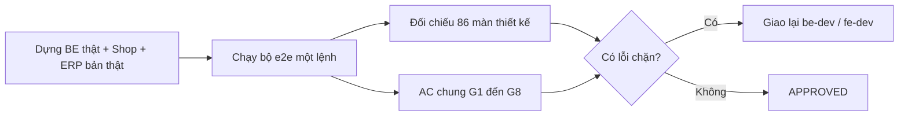
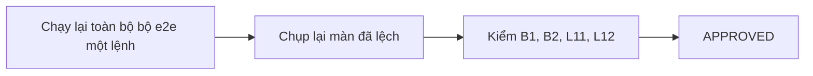

# QA — Shop lô 7 (SHOP-7-01: kiểm toàn luồng Shop làm lại) · lần 1 · 2026-10-11

## Kết luận lần 1: REJECTED — 3 lỗi chặn: axe mức serious ở trang đặt hàng (High, AC5), đơn có thể tạo giá gốc khi mã giảm giá chưa kiểm xong (Medium), trang huỷ một phần chưa tách dòng (Medium, 4-05 AC3). Không có lỗi Critical: không rò giá vốn, không rò dữ liệu cá nhân, không rò số kg tồn.

## Tổng
- **Bộ e2e mới (một lệnh): 529 ca · ✅ 523 · ❌ 1 (axe) · ⏸ 5** (chạy lần cuối từng kịch bản, số ở bảng "Bộ e2e").
- **86 màn thiết kế: ✅ 57 PASS · ❌ 23 FAIL (đều Low trừ E5) · ⏸ 6.**
- **G1–G8:** G1, G2, G3, G4, G5, G6, G7, G8 đạt; riêng "axe serious/critical" (AC5) ❌.
- Lệnh nền: BE `manage.py test` **Ran 3957 tests OK (skipped=16)**; adapter 68 passed; `makemigrations --check` không đổi; `npm ci` sạch ở Shop và ERP; `tsc --noEmit` exit 0 cả hai; `npm run build` exit 0 cả hai (USE_MOCK=0, API localhost:8000); `check-no-mock` XANH; 9 file `test-*.mjs` đạt (20+21+33+37+78+17+45+40 và voucher 31/31); `scripts/check_naming.py` OK.

## Cách chạy bộ e2e
`python3 frontend/e2e/run_shop_e2e.py` (thêm `--skip-build` để dùng sẵn `frontend/out`, `erp-console/out`; `--suite <tên>` để chạy riêng; `--keep` giữ thư mục DB tạm). Lệnh tự dựng SQLite tạm → `migrate` → `seed_demo` + `seed_qa` + `shop_seed.py` (5 nhóm, món sắp hết/hết, 2 combo) → `load_shop_content --publish` → BE :8000, Shop :3000, ERP :3100 → chạy 7 kịch bản → dọn sạch. Cách chạy ghi ở đầu `run_shop_e2e.py`.

### Bộ e2e (lần chạy cuối)
| Kịch bản | Phủ | Kết quả |
|---|---|---|
| `shop_full_flow.py` | trang chủ → danh mục → lọc → tìm không dấu → chi tiết → giỏ → mã giảm giá → đặt (bấm đúp) → thanh toán (form cổng, IPN giả lập qua cửa nội bộ, IPN gửi 2 lần) → trang đơn → tra cứu từ phiên khác (đúng/sai SĐT), ở 360 và 1280; lỗi: hết hàng lúc đặt, mất mạng + thử lại cùng `client_request_id`, hết giờ giữ hàng + job chạy 2 lần + tiền về trễ, mã sai/hết hạn/đơn tối thiểu/hết lượt/mất hiệu lực lúc đặt/nhả lượt, mất mạng khi tải hàng, 429 thật (BE phụ giới hạn thấp) | 98 ✅ |
| `shop_design_screens.py` | 89 trạng thái (86 màn) chụp 360/1280, ghép cạnh bản thiết kế, tự kiểm cuộn ngang, lỗi JS, mã trạng thái thô, cụm chữ thiếu; kiểm href đầu/chân trang theo 2 bảng đặc tả | 91 ✅ · 4 ⏸ |
| `shop_general_rules.py` | G1–G8 + axe-core (nếu có sẵn) | 131 ✅ · 1 ❌ |
| `shop_erp_flow.py` | Chủ tạo mã ở ERP (1280 và 360), 5 nhóm không được dùng, lãi lỗ theo lô có đơn dùng mã, sửa thông tin món → Shop thấy ngay, nạp nội dung (chạy lại, PRODUCTION), AuditLog | 41 ✅ |
| `shop_content_pages.py` | /about/, CMS, Góc bếp, thẻ món trong bài (UTM, giá lấy lúc xem, hết hàng, ngưng bán), link độc/XSS | 58 ✅ |
| `shop_footer_consent.py` | chân trang 9 đường dẫn, ô đồng ý, 409 chính sách đổi (BE trả thật), quay về từ cổng (cancel/error/success), mở link đơn không token | 31 ✅ · 1 ⏸ |
| `shop_formats_timezones.py` | tiền VNĐ, giờ/ngày VN ở 4 múi giờ trình duyệt, đơn đặt 00:30 01/10 giờ VN, hạn mã 23:30 | 73 ✅ |

### e2e cũ: xoá hoặc viết lại (02b §12)
| File cũ | Xử lý | Lý do |
|---|---|---|
| `qa-lo6-sr21-shop.py`, `golive_footer_checks.py` | xoá, thay bằng `shop_footer_consent.py` | bám chân trang/ô đồng ý/`phone_last4` cũ, API dựng bằng route |
| `qa-lo7-shop-real.py` | xoá; ngân sách request nằm ở `shop_full_flow.py`/`shop_content_pages.py` | bám "0 request catalog" và API giả :8199 |
| `qa-lo8-shop-format.py`, `qa-lo8-shop-django.py` | xoá, thay bằng `shop_formats_timezones.py` | ID/mã đơn cũ, trùng mục đích |
| `content_item_card.py`, `content_public_pages.py`, `about_page.py`, `qa-lo7-shop-links.py`, `qa-lo7-shop-xss.py` | xoá, gộp vào `shop_content_pages.py` | cổng cứng :3104/:8104, bài dựng tay, build mock |
| `catalog_cart_screens.py`, `order_lookup_completed.py`, `order_lookup_no_raw_codes.py` | xoá, thay bằng `shop_design_screens.py` (có quét mã trạng thái thô) | build mock, UI cũ |
| `qa_sepay_checkout.py` | xoá; form cổng + IPN nằm ở `shop_full_flow.py`, chữ ký ở adapter (68 test) | cần adapter + SePay riêng, UI cũ |

## Đối chiếu 86 màn (360 = điện thoại, 1280 = máy tính; ảnh trái = thiết kế, phải = bản dựng)
Ảnh ở `doc/features/2026-10-06-shop-giao-dien-moi/shots/lo7/` (thư mục `shots/` bị gitignore). Mã L = lệch Low, M = lệch Medium (xem mục Lỗi).

| Mã | Màn | Thiết kế | Khổ | KQ | Ảnh | Ghi chú |
|---|---|---|---|---|---|---|
| A1 | Trang chủ | `Home.dc.html` | 360 | PASS | `shots/lo7/screens/A1-360-sbs.png` | Khớp bố cục; chữ mẫu {{…}} của thiết kế là dữ liệu |
| A2 | Danh mục | `Main.dc.html` | 360 | PASS (lần 2; lần 1 FAIL) | `shots/lo7/screens/A2-360-sbs.png` | L1: thiếu dải chữ xanh 'Hải sản cấp đông theo lô · mua từ 1 kg' đầu trang (chỉ có ở 1280) |
| A3 | Chi tiết sản phẩm | `Product.dc.html` | 360 | PASS | `shots/lo7/screens/A3-360-sbs.png` | Khối Giao hàng/Đổi trả nằm trong bảng thông tin; thêm nút 'Chọn mua' không có trong thiết kế (Low) |
| A4 | [Popup] Đã thêm vào giỏ | `A4-Toast.dc.html` | 360 | PASS (lần 2; lần 1 FAIL) | `shots/lo7/screens/A4-360-sbs.png` | L1: thiếu dải chữ đầu trang; toast + thanh 'Xem giỏ' đúng |
| A5 | Lỗi · Tìm không thấy | `A5-NotFound.dc.html` | 360 | PASS (lần 2; lần 1 FAIL) | `shots/lo7/screens/A5-360-sbs.png` | L1: thiếu dải chữ; khối lỗi đúng chữ |
| A6 | Lỗi · Mất mạng, không tải được hàng | `A6-Offline.dc.html` | 360 | PASS (lần 2; lần 1 FAIL) | `shots/lo7/screens/A6-360-sbs.png` | L1 + L9: thiếu dải chữ và nút 'Gọi …' cạnh 'Thử lại' |
| A7 | Ngoại lệ · Sản phẩm tạm hết | `A7-OutOfStock.dc.html` | 360 | PASS | `shots/lo7/screens/A7-360-sbs.png` | Nút Zalo ẩn vì chưa có số (đúng luật ẩn khi thiếu dữ liệu) |
| A8 | Trạng thái · Đang tải | `A0-Loading.dc.html` | 360 | PASS | `shots/lo7/screens/A8-360-sbs.png` | Khung xương đúng |
| A9 | [Popup] Gợi ý khi gõ tìm | `A8-SearchSuggest.dc.html` | 360 | PASS | `shots/lo7/screens/A9-360-sbs.png` | Không hiện 'Tìm gần đây' vì chưa có lịch sử tìm |
| A10 | Chi tiết combo | `A9-ComboDetail.dc.html` | 360 | PASS | `shots/lo7/screens/A10-360-sbs.png` | Câu 'Nếu một món trong combo hết…' có trong code, bị thanh dưới che trong ảnh toàn trang |
| B1 | Giỏ hàng | `Cart.dc.html` | 360 | PASS (lần 2; lần 1 FAIL) | `shots/lo7/screens/B1-360-sbs.png` | L2: tiêu đề giỏ ở 360 không hiện '(n)' (H1 'Giỏ hàng (n)' bị ẩn 1px) |
| B2 | [Popup] Xác nhận bỏ món | `B2-RemoveConfirm.dc.html` | 360 | PASS | `shots/lo7/screens/B2-360-sbs.png` | Hộp bỏ món đúng chữ, 2 nút |
| B3 | Ngoại lệ · Giá đổi / món đã hết trong giỏ | `B3-CartChanged.dc.html` | 360 | PASS (lần 2; lần 1 FAIL) | `shots/lo7/screens/B3-360-sbs.png` | L2 + L3: thiếu dòng đỏ 'Bỏ món đã hết để đặt hàng.'; còn lại đúng (giá cũ gạch, 'Món này đã hết', không tính vào tổng) |
| B4 | Ngoại lệ · Giỏ trống | `B4-CartEmpty.dc.html` | 360 | PASS (lần 2; lần 1 FAIL) | `shots/lo7/screens/B4-360-sbs.png` | L2: thiếu '(0)' ở tiêu đề |
| B5 | [Popup] Nhập mã giảm giá | `B5-VoucherSheet.dc.html` | 360 | PASS | `shots/lo7/screens/B5-360-sbs.png` | Sheet nhập mã đúng chữ |
| B6 | Happy · Đã áp mã giảm giá | `B6-VoucherApplied.dc.html` | 360 | PASS (lần 2; lần 1 FAIL) | `shots/lo7/screens/B6-360-sbs.png` | L2: thiếu '(n)'; chip mã, dòng giảm, câu điều kiện, toast đúng |
| B7 | Lỗi · Mã giảm giá không dùng được | `B7-VoucherError.dc.html` | 360 | PASS (lần 2; lần 1 FAIL) | `shots/lo7/screens/B7-360-sbs.png` | L2: thiếu '(n)'; câu lỗi mã đúng |
| C1 | Happy · Thông tin nhận hàng | `Checkout.dc.html` | 360 | PASS | `shots/lo7/screens/C1-360-sbs.png` | Ô đồng ý không tick sẵn, câu 'Cá Về giao trong khu vực Phan Thiết' đúng |
| C1b | [Popup] Chọn vị trí trên Google Maps | `C1b-MapPicker.dc.html` | 360 | ⏸ | `shots/lo7/screens/C1b-360-sbs.png` | Cần khoá Google Maps. Không khoá thì hiện đúng hộp C5; không dựng được bản đồ để so |
| C1c | Happy · Địa chỉ tự điền từ bản đồ | `C1c-AddressFilled.dc.html` | 360 | ⏸ | `—` | Cần khoá Google Maps (địa chỉ tự điền từ bản đồ) |
| C2 | Lỗi · Nhập thiếu / sai | `C2-Invalid.dc.html` | 360 | PASS | `shots/lo7/screens/C2-360-sbs.png` | Tóm tắt 'Còn 4 chỗ cần sửa' + lỗi từng ô đúng chữ |
| C3 | [Popup] Hết hàng lúc đặt (E-06) | `C3-SoldOut.dc.html` | 360 | PASS (lần 2; lần 1 FAIL) | `shots/lo7/screens/C3-360-sbs.png` | L4: dòng món hết ghi 'sẽ bỏ khỏi đơn' (thiết kế: 'khỏi giỏ'); nút 'Liên hệ chúng tôi' dạng nút (thiết kế: liên kết) |
| C4 | [Popup] Lỗi kết nối khi đặt | `C4-NetworkError.dc.html` | 360 | PASS | `shots/lo7/screens/C4-360-sbs.png` | Popup mất mạng đúng |
| C5 | [Popup] Không lấy được vị trí / bản đồ lỗi | `C5-LocationDenied.dc.html` | 360 | PASS | `shots/lo7/screens/C5-360-sbs.png` | Hộp 'Chưa mở được bản đồ' + 'Nhập tay' đúng |
| C6 | [Popup] Mã hết hiệu lực lúc đặt | `B8-VoucherInvalidAtOrder.dc.html` | 360 | PASS | `shots/lo7/screens/C6-360-sbs.png` | Popup mã hết hiệu lực lúc đặt; giá gạch/giá chưa giảm đúng |
| C7 | Ngoại lệ · Shop tạm ngưng nhận đơn | `X2-ShopPaused.dc.html` | 360 | PASS (lần 2; lần 1 FAIL) | `shots/lo7/screens/C7-360-sbs.png` | L5: màn thay cả form bằng thẻ 'tạm ngưng' (thiết kế: giữ form bị khoá + dải cảnh báo + thanh tổng) |
| C8 | [Popup] Thao tác quá nhanh (429) | `X3-TooManyRequests.dc.html` | 360 | PASS | `shots/lo7/screens/C8-360-sbs.png` | Popup 429 đúng chữ (BE trả thật trong ca full_flow) |
| C9 | [Popup] Chính sách vừa cập nhật (409) | `X4-PolicyChanged.dc.html` | 360 | PASS | `shots/lo7/screens/C9-360-sbs.png` | Nút 'Xem chính sách' + 'Đã hiểu' theo 02a §6.1 (chốt thắng màn mẫu 'Đồng ý và đặt hàng') |
| D1 | Happy · Thanh toán | `Payment.dc.html` | 360 | PASS | `shots/lo7/screens/D1-360-sbs.png` | Đồng hồ, phương thức, tóm tắt, dòng mã |
| D2 | Lỗi · Huỷ / lỗi trên cổng thanh toán | `D2-PayCancelled.dc.html` | 360 | PASS | `shots/lo7/screens/D2-360-sbs.png` | Dải 'Thanh toán chưa thành công' + 'Thanh toán lại' |
| D3 | Ngoại lệ · Đang chờ xác nhận tiền | `D3-PayPending.dc.html` | 360 | PASS | `shots/lo7/screens/D3-360-sbs.png` | Đang chờ xác nhận thanh toán, đồng hồ 'Đã chờ', 'Tra cứu đơn' |
| D4 | [Popup] Hết giờ giữ hàng (E-01) | `D4-Expired.dc.html` | 360 | PASS | `shots/lo7/screens/D4-360-sbs.png` | Popup hiện khi đồng hồ về 0 lúc đang xem (đơn còn 5 giây); đúng chữ + 2 nút |
| D5 | Ngoại lệ · Chuyển thiếu tiền (E-02) | `D5-Underpaid.dc.html` | 360 | ⏸ | `—` | Chuyển thiếu tiền 'không code V1' (decisions) |
| D6 | [Popup] Rời trang thanh toán? | `D6-LeavePayment.dc.html` | 360 | PASS | `shots/lo7/screens/D6-360-sbs.png` | 'Rời trang thanh toán?' đúng chữ; 'Ở lại thanh toán' / 'Rời trang' |
| E1 | Happy · Thanh toán xong → trang đơn hàng | `Success.dc.html` | 360 | PASS | `shots/lo7/screens/E1-360-sbs.png` | Dải 'Thanh toán thành công' + tiến trình + dòng mã |
| E2 | Ngoại lệ · Đơn bị huỷ → Cá Về gọi lại | `E2-Cancelled.dc.html` | 360 | PASS | `shots/lo7/screens/E2-360-sbs.png` | Lý do + 'Cá Về sẽ gọi cho bạn' + số tiền; không chữ hoàn tiền ngoài tên trang chính sách |
| E3 | Happy · Đơn đã giao | `E3-Delivered.dc.html` | 360 | PASS | `shots/lo7/screens/E3-360-sbs.png` | Khối 'Có vấn đề với hàng nhận được?' ẩn vì chưa cấu hình giờ báo lỗi (E3 ghi API trả null) |
| E4 | Ngoại lệ · Giao không thành công | `E4-DeliveryFailed.dc.html` | 360 | PASS | `shots/lo7/screens/E4-360-sbs.png` | Dải 'Giao không thành công. Cá Về sẽ gọi để hẹn lại.' (thiết kế nêu lý do cụ thể; BE chỉ trả câu chung) |
| E5 | Ngoại lệ · Huỷ một phần đơn | `E5-PartialCancel.dc.html` | 360 | PASS (lần 2; lần 1 FAIL) | `shots/lo7/screens/E5-360-sbs.png` | M3: trang không tách dòng bị bỏ/tổng mới (AC3 của 4-05); chỉ có dải 'Một phần đơn không giao được… trả lại 100.000đ' |
| E6 | Đặc tả · Trạng thái đơn quyết định màn hiển thị | `E6-StatusRules.dc.html` | 1280 | ⏸ | `—` | Bảng đặc tả, không phải màn; trạng thái kiểm bằng test-order-state 78/78 + 8 trạng thái đơn dựng thật |
| F1 | Happy · Tra cứu đơn | `F1-Lookup.dc.html` | 360 | PASS | `shots/lo7/screens/F1-360-sbs.png` |  |
| F2 | Lỗi · Không tìm thấy đơn | `F2-LookupNotFound.dc.html` | 360 | PASS | `shots/lo7/screens/F2-360-sbs.png` | Một câu chung, không chỉ ra ô sai |
| F3 | Trang chính sách (mẫu) | `P1-Policy.dc.html` | 360 | PASS | `shots/lo7/screens/F3-360-sbs.png` | Còn ô [..] chờ legal-vn (nội dung, xem ghi nhận) |
| F4 | Trang liên hệ | `P2-Contact.dc.html` | 360 | PASS | `shots/lo7/screens/F4-360-sbs.png` | Ô Zalo/giờ làm việc ẩn vì chưa có dữ liệu |
| F5 | Trang cách mua hàng | `P3-HowToBuy.dc.html` | 360 | PASS | `shots/lo7/screens/F5-360-sbs.png` | 5 bước + hỏi đáp 
 |
| F6 | Góc bếp · danh sách | `G1-KitchenList.dc.html` | 360 | PASS | `shots/lo7/screens/F6-360-sbs.png` | Ảnh bìa vỡ do môi trường e2e (BE dev không phục vụ /media) |
| F7 | Góc bếp · bài viết | `G2-KitchenArticle.dc.html` | 360 | PASS | `shots/lo7/screens/F7-360-sbs.png` | Khối 'Bài liên quan' ẩn vì chuyên mục chỉ có 1 bài; ảnh bìa vỡ do môi trường |
| F8 | Lỗi · Không tìm thấy trang (404) | `X1-NotFound404.dc.html` | 360 | PASS | `shots/lo7/screens/F8-360-sbs.png` |  |
| DK1 | Máy tính · Trang chủ | `DesktopHome.dc.html` | 1280 | PASS | `shots/lo7/screens/DK1-1280-sbs.png` |  |
| DK2 | Máy tính · Danh mục | `DesktopCategory.dc.html` | 1280 | PASS | `shots/lo7/screens/DK2-1280-sbs.png` |  |
| DK3 | Máy tính · Chi tiết sản phẩm | `DesktopProduct.dc.html` | 1280 | PASS | `shots/lo7/screens/DK3-1280-sbs.png` | Giao hàng/Đổi trả dạng bảng thay vì hai dòng |
| DK4 | Máy tính · Giỏ hàng | `DesktopCart.dc.html` | 1280 | PASS (lần 2; lần 1 FAIL) | `shots/lo7/screens/DK4-1280-sbs.png` | L7: thiếu câu 'Hàng được giữ 30 phút sau khi đặt. Khi còn nằm trong giỏ, hàng chưa được giữ.' và liên kết 'Mua thêm hàng khác' |
| DK5 | Máy tính · Thông tin nhận hàng | `DesktopCheckout.dc.html` | 1280 | PASS (lần 2; lần 1 FAIL) | `shots/lo7/screens/DK5-1280-sbs.png` | L8: tóm tắt đơn thiếu dòng '1 kg × 278.000đ' dưới từng món |
| DK6 | Máy tính · Thanh toán | `DesktopPayment.dc.html` | 1280 | PASS (lần 2; lần 1 FAIL) | `shots/lo7/screens/DK6-1280-sbs.png` | L8: thiếu 3 bước hướng dẫn thanh toán + dòng '… kg × giá' |
| DK7 | Máy tính · Đơn hàng sau thanh toán | `DesktopSuccess.dc.html` | 1280 | PASS | `shots/lo7/screens/DK7-1280-sbs.png` | Dải thành công, tiến trình ngang, món; cột 'Tra đơn khác' nằm dưới thay vì bên phải |
| DP1 | Máy tính · [Popup] Hết hàng lúc đặt | `DesktopModalSoldOut.dc.html` | 1280 | PASS (lần 2; lần 1 FAIL) | `shots/lo7/screens/DP1-1280-sbs.png` | L4: 'sẽ bỏ khỏi đơn' thay 'khỏi giỏ' |
| DP2 | Máy tính · [Popup] Hết giờ giữ hàng | `DesktopModalExpired.dc.html` | 1280 | PASS | `shots/lo7/screens/DP2-1280-sbs.png` |  |
| DP3 | Máy tính · [Popup] Chọn vị trí Google Maps | `DesktopMapPicker.dc.html` | 1280 | ⏸ | `shots/lo7/screens/DP3-1280-sbs.png` | Cần khoá Google Maps |
| DP4 | Máy tính · [Popup] Gợi ý khi gõ tìm | `DesktopSearchSuggest.dc.html` | 1280 | PASS | `shots/lo7/screens/DP4-1280-sbs.png` |  |
| DP5 | Máy tính · [Popup] Xác nhận bỏ món | `DesktopRemoveConfirm.dc.html` | 1280 | PASS | `shots/lo7/screens/DP5-1280-sbs.png` |  |
| DP6 | Máy tính · [Popup] Lỗi kết nối khi đặt | `DesktopNetworkError.dc.html` | 1280 | PASS | `shots/lo7/screens/DP6-1280-sbs.png` | Nút xếp dọc (thiết kế xếp ngang) |
| DP7 | Máy tính · [Popup] Rời trang thanh toán? | `DesktopLeavePayment.dc.html` | 1280 | PASS | `shots/lo7/screens/DP7-1280-sbs.png` |  |
| DE1 | Máy tính · Lỗi · Tìm không thấy | `DesktopNotFound.dc.html` | 1280 | PASS | `shots/lo7/screens/DE1-1280-sbs.png` |  |
| DE2 | Máy tính · Ngoại lệ · Sản phẩm hết hàng | `DesktopOutOfStock.dc.html` | 1280 | PASS | `shots/lo7/screens/DE2-1280-sbs.png` |  |
| DE3 | Máy tính · Lỗi · Nhập thiếu / sai | `DesktopInvalid.dc.html` | 1280 | PASS (lần 2; lần 1 FAIL) | `shots/lo7/screens/DE3-1280-sbs.png` | L8: thiếu dòng '1 kg × giá' ở tóm tắt |
| DE4 | Máy tính · Lỗi · Thanh toán chưa thành công | `DesktopPayCancelled.dc.html` | 1280 | PASS (lần 2; lần 1 FAIL) | `shots/lo7/screens/DE4-1280-sbs.png` | L8: như trên |
| DE5 | Máy tính · Ngoại lệ · Đang chờ xác nhận tiền | `DesktopPayPending.dc.html` | 1280 | PASS | `shots/lo7/screens/DE5-1280-sbs.png` | Nhãn bước 3 'Thanh toán xong' (thiết kế máy tính ghi 'Hoàn tất', mobile D3 ghi 'Thanh toán xong') |
| DE6 | Máy tính · Lỗi · Tra cứu không thấy đơn | `DesktopLookup.dc.html` | 1280 | PASS | `shots/lo7/screens/DE6-1280-sbs.png` |  |
| DE7 | Máy tính · [Toast] Đã thêm vào giỏ + giỏ mini | `DesktopToast.dc.html` | 1280 | PASS | `shots/lo7/screens/DE7-1280-sbs.png` | Toast + giỏ mini |
| DE8 | Máy tính · Trạng thái · Đang tải | `DesktopLoading.dc.html` | 1280 | PASS | `shots/lo7/screens/DE8-1280-sbs.png` |  |
| DE9 | Máy tính · Lỗi · Mất mạng | `DesktopOffline.dc.html` | 1280 | PASS (lần 2; lần 1 FAIL) | `shots/lo7/screens/DE9-1280-sbs.png` | L9: thiếu nút 'Gọi …' cạnh 'Thử lại' |
| DE10 | Máy tính · Happy · Chi tiết combo | `DesktopComboDetail.dc.html` | 1280 | PASS | `shots/lo7/screens/DE10-1280-sbs.png` |  |
| DE11 | Máy tính · Ngoại lệ · Giỏ đổi giá / món hết | `DesktopCartChanged.dc.html` | 1280 | PASS (lần 2; lần 1 FAIL) | `shots/lo7/screens/DE11-1280-sbs.png` | L3: thiếu dòng đỏ 'Bỏ món đã hết để đặt hàng.' (và cột đơn giá/thành tiền theo bảng) |
| DE12 | Máy tính · Ngoại lệ · Chuyển thiếu tiền | `DesktopUnderpaid.dc.html` | 1280 | ⏸ | `—` | Chuyển thiếu tiền 'không code V1' |
| DE13 | Máy tính · Mã giảm giá đã áp | `DesktopVoucher.dc.html` | 1280 | PASS | `shots/lo7/screens/DE13-1280-sbs.png` | Đã áp mã; ca lỗi mã kiểm ở B7 |
| DE14 | Máy tính · Ngoại lệ · Shop tạm ngưng nhận đơn | `DesktopShopPaused.dc.html` | 1280 | PASS (lần 2; lần 1 FAIL) | `shots/lo7/screens/DE14-1280-sbs.png` | L5: như C7 |
| DO1 | Máy tính · Đơn · Đã giao | `DesktopOrderStates.dc.html` | 1280 | PASS | `shots/lo7/screens/DO1-1280-sbs.png` | Đã giao / Giao không thành công / Bị huỷ (3 trạng thái, 3 ảnh: DO1, DO2, DO3) |
| DO4 | Máy tính · Trang chính sách | `DesktopPolicy.dc.html` | 1280 | PASS | `shots/lo7/screens/DO4-1280-sbs.png` | Trang chính sách (DO4) + Cách mua hàng (DO5) |
| DO6 | Máy tính · Trang liên hệ | `DesktopContact.dc.html` | 1280 | PASS | `shots/lo7/screens/DO6-1280-sbs.png` |  |
| DO7 | Máy tính · Góc bếp · danh sách | `DesktopKitchenList.dc.html` | 1280 | PASS | `shots/lo7/screens/DO7-1280-sbs.png` | Ảnh bìa vỡ do môi trường |
| DO8 | Máy tính · Góc bếp · bài viết | `DesktopKitchenArticle.dc.html` | 1280 | PASS | `shots/lo7/screens/DO8-1280-sbs.png` |  |
| DO9 | Máy tính · 404 | `DesktopNotFound404.dc.html` | 1280 | PASS | `shots/lo7/screens/DO9-1280-sbs.png` |  |
| HF1 | Đặc tả Header & footer · điện thoại | `HeaderFooter-Mobile.dc.html` | 360 | PASS | `shots/lo7/screens/HF1-360-sbs.png` | Đặc tả link: kiểm bằng href thật ở 360 (đủ link theo bảng, có tel:) |
| HF2 | Đặc tả Header & footer · máy tính | `HeaderFooter-Desktop.dc.html` | 1280 | PASS | `shots/lo7/screens/HF2-1280-sbs.png` | Đặc tả link: kiểm href thật ở 1280 |
| L1 | Landing giới thiệu thương hiệu · máy tính | `Landing.dc.html` | 1280 | PASS (lần 2; lần 1 FAIL) | `shots/lo7/screens/L1-1280-sbs.png` | L10: thiếu thẻ món nổi trong hero |
| L2 | Landing giới thiệu thương hiệu · điện thoại | `LandingMobile.dc.html` | 360 | PASS (lần 2; lần 1 FAIL) | `shots/lo7/screens/L2-360-sbs.png` | L10: như trên |

## AC chung G1–G8
| Mã | KQ | Bằng chứng |
|---|---|---|
| G1 không số kg tồn | ✅ | 41 endpoint `/api/shop/*`, `/api/public/*` (cả lỗi OUT_OF_STOCK short/out, INVALID_QTY): 0 khoá tồn, 0 số kg, 0 mã lô; `stock_level` chỉ in/low/out, đủ 3 mức; 16 trang × 2 khổ: 0 chữ "còn N kg/combo" kể cả `aria-label`/`title`/`alt` |
| G2 không rò cá nhân | ✅ | Tên/SĐT/địa chỉ giả không có ở: JSON công khai, HTML 16 trang, URL, `localStorage`/`sessionStorage`/cookie, console, log BE; trang đơn không hiện người nhận; tra đơn chỉ POST, GET 4 số cuối đã gỡ (404/405); sai SĐT hay sai mã đều một câu chung; 429 thật khi tra lặp; AuditLog gần nhất không có PII. Lưu ý: ô Họ tên có chữ mẫu "Nguyễn Văn A" nên QA dùng tên giả khác |
| G3 không rò giá vốn | ✅ | Không khoá `purchase_rate`, `landed_unit_cost`, `unit_cost`, `rate`, `batch_id`, `batch_code`, `margin`, `profit` ở mọi JSON công khai và HTML; lỗi hết hàng không có mã lô; ERP: Quản lý, Thủ kho, Giao hàng, Gọi xác nhận, không nhóm đều 403 ở mã giảm giá và 3 API lãi lỗ, chưa đăng nhập 401 |
| G4 tối thiểu 1 kg | ✅ | BE: 0,5/0,3/1,25 kg, 1,5 combo, 0, âm, chữ, `1e30`, NaN → 400, không tạo đơn; FE: "−" ở 1 kg và ở 1 combo mở hộp bỏ món, "Bỏ khỏi giỏ" xoá đúng dòng, nút "Bớt 0,5 kg" ở 1 kg bị vô hiệu |
| G5 popup | ✅ | `role=dialog` + `aria-modal`, Tab/Shift+Tab 40 lần không ra khỏi hộp, Esc đóng, tiêu điểm về nút đã mở (bỏ món, rời trang thanh toán ở 360 và 1280); hộp máy tính 440–480 px; toast là `role=status`, không cướp tiêu điểm |
| G6 ảnh so thiết kế | ✅ | 85 ảnh ghép cạnh; 0 trang cuộn ngang ở 360 (16 trang + 89 trạng thái) |
| G7 không hex rời | ✅ | grep `#RRGGBB` ở components/app/features/lib (trừ globals.css) = 0; `transition: all` = 0 |
| G8 code cũ đã xoá | ✅ | `sellable_qty`, `CatalogGrid`, `AddToCartControl`, `CountdownTimer`, `phone_last4`, `SiteLegalFooter` = 0 trong frontend (sau khi xoá e2e cũ). Ghi nhận: grep rộng `OrderLookup` còn 13 dòng, toàn tên kiểu hợp lệ `OrderLookupResult/Input`; `frontend/README.md:64` còn 1 dòng lịch sử nhắc tên đã xoá (tài liệu) |
| axe (AC5) | ❌ | 12 trang ở 360: 11 sạch; `/shop/checkout/` có 1 lỗi **serious** `link-in-text-block` (B1) |

## Ngoại lệ & biên đã chạy (ngoài đường thuận)
Bấm đúp đặt hàng (1 đơn); mất mạng rồi thử lại cùng `client_request_id` (1 đơn); IPN 2 lần cùng mã giao dịch (1 hoá đơn); đơn quá hạn khi đang xem (popup D4) và khi tải lại; `cancel_expired_orders` chạy 2 lần (idempotent); tiền về sau khi đơn tự huỷ (không xác nhận đơn, trang đơn báo Cá Về gọi lại); lượt mã giữ khi tạo đơn, nhả khi tự huỷ, dùng lại được; mã tắt giữa lúc điền form (C6); món hết/vừa hết/sắp hết; combo hết vì món thành phần hết; giá đổi trong giỏ; 429 thật ở tạo đơn và tra đơn; 409 chính sách đổi (BE thật); trình duyệt 4 múi giờ; link độc trong bài; hai phiên (đặt ở phiên A, tra ở phiên B); đơn người khác không token chỉ thấy form tra.

## Phân quyền (ERP, mã giảm giá và lãi lỗ theo lô)
| Group | Mã giảm giá (API) | Lãi lỗ theo lô/kỳ (API) | Màn ERP `/vouchers/`, `/reports/` |
|---|---|---|---|
| owner | 200 | 200 | thấy, tạo mã được |
| manager | 403 | 403 | không thấy số liệu |
| warehouse_staff | 403 | 403 | không thấy số liệu |
| delivery_staff | 403 | 403 | không thấy số liệu |
| customer_service | 403 | 403 | không thấy số liệu |
| không nhóm | 403 | 403 | không thấy số liệu |
| chưa đăng nhập | 401 | — | về đăng nhập |
Thủ kho PATCH thông tin món → 403. Không có DELETE mã giảm giá (405). Mã trùng → 400.

## Lãi lỗ theo lô có đơn dùng mã (BR-BC-04)
Lô giả 10 kg, vốn 100.000đ/kg; đơn 3 kg không mã = 600.000đ; đơn 2 kg dùng mã tạo ở ERP (10%, trần 30.000đ) = 400.000 − 30.000 = 370.000đ. API lãi lỗ lô (Chủ): `revenue` 970.000, `purchase_cost` 1.000.000 (cả lô), `profit` −30.000; doanh thu lô = tổng tiền khách thực trả; lượt mã `USED`; ERP `/reports/` hiện 970.000. Không có khoá mới trong AuditLog cho phép suy ra giá vốn hay chứa dữ liệu khách.

## Lỗi
### B1 — Liên kết "Chính sách quyền riêng tư" trong câu đồng ý không phân biệt được với chữ quanh nó · **High** · SHOP-7-01 AC5, UI-RULES §8
Tái hiện: `/shop/checkout/` ở 360, chạy axe-core (`run_shop_e2e.py --suite general_rules`). Mong đợi: 0 lỗi serious. Thực tế: `link-in-text-block` (serious) ở `.Checkbox_text a[href="/pages/?slug=quyen-rieng-tu"]` (chỉ khác màu, không gạch chân). Ảnh hưởng: người khiếm thị màu/đọc kém khó nhận ra liên kết ở ô đồng ý, là ô bắt buộc theo luật. **Giao: fe-dev** (gạch chân liên kết trong `Checkbox` text).

### B2 — Mã giảm giá đã áp ở giỏ bị bỏ im lặng nếu bấm "Đặt hàng" khi FE chưa kiểm lại mã · **Medium** · SHOP-3b-06 (BR-DM-19, 21)
Tái hiện: áp mã ở giỏ → "Tiếp tục" → điền form và bấm "Đặt hàng" ngay (dưới khoảng nửa giây sau khi vào trang, như trình duyệt tự điền); script `shop_full_flow.py` bản đầu tạo đơn 165.000đ thay vì 148.500đ. Mong đợi: hoặc chờ có kết quả kiểm mã rồi mới gửi, hoặc báo C6. Thực tế: `send()` chỉ gửi `voucher_code` khi `voucher.quote` đã có; chưa có thì đơn tạo giá gốc, không thông báo. Ảnh hưởng: khách thấy giảm ở giỏ nhưng phải trả đủ ở trang thanh toán. **Giao: fe-dev** (vô hiệu hoá nút khi `voucher.checking` hoặc có mã mà chưa có `quote`).

### B3 — Trang đơn huỷ một phần không tách dòng bị bỏ và tổng mới · **Medium** · SHOP-4-05 AC3 (E5), BR-HT-02
Tái hiện: đơn đã trả 2 dòng (Cá thu 1 kg, Bạch tuộc 1 kg) + phiếu hoàn một phần 100.000đ → mở trang đơn. Mong đợi (AC3): "phần còn giao và phần bị huỷ riêng" (thiết kế E5: dòng gạch + chip "Đã bỏ khỏi đơn", "Món đã bỏ", "Tổng mới"). Thực tế: dải "Một phần đơn không giao được… trả lại 100.000đ" nhưng cả 2 dòng và tổng 445.000đ hiện nguyên. QA không dựng được ca huỷ theo từng dòng vì BE hiện chỉ có hoàn một phần theo số tiền, `cancel_notice` không nói dòng nào. Ảnh hưởng: khách không biết món nào bị bỏ. **Giao: be-dev** (cho `lines[].cancelled` hoặc tương đương, 02b §3.4.3) **+ fe-dev**; techlead cần chốt nguồn dữ liệu (AUDIT câu 35).

### Lỗi Low (ghi nhận, không chặn)
| Mã | Mô tả | Màn | Giao |
|---|---|---|---|
| L1 | Dải chữ xanh đầu trang "Hải sản cấp đông theo lô · mua từ 1 kg" chỉ hiện ở 1280, thiết kế điện thoại có | A2, A4, A5, A6 | fe-dev (hoặc ux-designer chốt bỏ) |
| L2 | Tiêu đề giỏ ở 360 không hiện "(n)" (H1 "Giỏ hàng (n)" bị ẩn) | B1, B3, B4, B6, B7 | fe-dev |
| L3 | Thiếu dòng đỏ "Bỏ món đã hết để đặt hàng." ở giỏ có món hết | B3, DE11 | fe-dev |
| L4 | Popup hết hàng ghi "sẽ bỏ khỏi đơn" (thiết kế "khỏi giỏ") | C3, DP1 | fe-dev / mkt-brand |
| L5 | Shop tạm ngưng nhận đơn: thay cả form bằng thẻ, thiết kế giữ form khoá + dải cảnh báo | C7, DE14 | fe-dev |
| L7 | Giỏ máy tính thiếu câu "Hàng được giữ 30 phút…" và liên kết "Mua thêm hàng khác" | DK4 | fe-dev |
| L8 | Tóm tắt đơn ở đặt hàng/thanh toán thiếu dòng "1 kg × 278.000đ" và 3 bước hướng dẫn thanh toán | DK5, DK6, DE3, DE4 | fe-dev |
| L9 | Thiếu nút "Gọi …" cạnh "Thử lại" ở lỗi mất mạng | A6, DE9 | fe-dev |
| L10 | Trang giới thiệu thiếu thẻ món nổi trong hero | L1, L2 | mkt-brand |
| L11 | JSON `POST /api/shop/orders/<mã>/checkout/` có khoá `gateway: "SEPAY"` (khách không thấy trên giao diện, nhưng luật là không ghi tên cổng) | — | be-dev |
| L12 | Giới hạn `public_content` 120 lần/phút/IP: mỗi trang gọi 3 lần nội dung công khai, nên khoảng 40 trang/phút từ một IP (mạng dùng chung) hiện "Chưa tải được"; QA gặp 98 lần 429 khi chạy dồn | mọi trang | techlead/be-dev (nâng hạn mức hoặc cache) |
| L13 | `npm audit` Shop: 3 lỗ hổng (1 critical của `next` 14.2.35 qua `postcss`, 2 high); Shop xuất tĩnh nên phần lớn không áp dụng, cần techlead quyết định nâng cấp. ERP 0 | — | techlead |

### Ghi nhận không phải lỗi sản phẩm
- Trang chính sách còn ô `[…]` chờ legal-vn/Lộc (đổi trả, giao hàng…); phải lấp trước khi lên production.
- BE dev không phục vụ `/media/`, nên ảnh bìa Góc bếp vỡ trong môi trường e2e (F6, F7, DO7).
- C1b/C1c/DP3 cần khoá Google Maps; D5/DE12 chuyển thiếu tiền "không code V1": ⏸. 503 `SHOP_CLOSED` thật không dựng được vì trang chính sách bắt buộc không gỡ đăng được (BR-ND-16); màn C7 chụp bằng phản hồi 503 giả theo contract.
- Ca chập chờn trong lúc viết e2e (không do sản phẩm): giỏ nạp trống nếu seed `localStorage` khi trang chưa tải xong (đã thêm chờ `networkidle`); một lần ở mỗi trong các ca F2, A4, B2 hết thời gian chờ, chạy lại đạt.

## Dọn dẹp
Server và DB tạm đã tắt/xoá (runner tự dọn). `frontend/out` là build `USE_MOCK=0`, API `http://localhost:8000` (check-no-mock XANH); `erp-console/out` build tương tự. Đã xoá 14 e2e cũ ở `frontend/e2e/` (xem bảng), thêm 10 file mới; chưa commit.

## Lệnh đã chạy
- `cd backend && .venv/bin/python manage.py test` → Ran 3957 tests, OK (skipped=16)
- `cd adapter && .venv/bin/python -m pytest -q` → 68 passed
- `npm ci` (frontend, erp-console) → added 66 / 189 packages, exit 0; `npx tsc --noEmit` ×2 exit 0; `npm run build` ×2 exit 0 (qua `run_shop_e2e.py`)
- `node scripts/check-no-mock.mjs` → XANH; `node scripts/test-*.mjs` ×9 → đạt
- `python3 frontend/e2e/run_shop_e2e.py` (+ các lần `--skip-build --suite …` để chạy lại kịch bản đã sửa) → bảng "Bộ e2e"
- `python3 scripts/check_naming.py` → OK

## Ghi chú điều phối (11/10)
- **B3 (E5 huỷ một phần không tách dòng) — không phải lỗi:** 02b §9 (techlead chốt từ lô 3+4) đổi SHOP-4-05 AC3 thành "chỉ hiện số tiền phần bị huỷ, không tách dòng" vì hệ thống chưa có huỷ theo dòng. E5 đánh giá theo 02b.
- **L5 (Shop tạm ngưng thay form bằng thẻ):** giữ theo 02a (UX chốt), không sửa.

## Lần 2 · 2026-10-11 (sau khi fe-dev/be-dev/mkt-brand sửa) — **APPROVED**

**Kết luận: APPROVED** — B1, B2 đã sửa và có bằng chứng chạy thật; không còn lỗi chặn. B3/E5 và L5 không tính lỗi (điều phối: giữ theo 02b §9 và 02a).

**Tổng lần 2:** bộ e2e 7 kịch bản chạy trọn một lệnh `python3 frontend/e2e/run_shop_e2e.py` (có build lại, `npm ci` sạch Shop và ERP): full_flow 99 ✅ (thêm ca B2), design_screens 91 ✅ + 4 ⏸, general_rules 132 ✅, erp_flow 41 ✅, content_pages 58 ✅, footer_consent 31 ✅ + 1 ⏸, formats_timezones 73 ✅ = **525 ✅ · 0 ❌ · 5 ⏸**, exit 0. BE `manage.py test` Ran 3959 OK (skipped 16).

| Mục | KQ | Bằng chứng |
|---|---|---|
| B1 axe | ✅ | `axe-core 360: 0 lỗi serious/critical trên 12 trang chính` (trước: link-in-text-block ở /shop/checkout/) |
| B2 mã giảm giá khi bấm Đặt hàng ngay | ✅ | ca mới ở `shop_full_flow.py`: áp mã → Tiếp tục → điền form và bấm Đặt hàng liền; đơn tạo ra có giảm giá, tổng khác 165.000đ |
| L11 JSON checkout không ghi tên cổng | ✅ | `git diff` checkout.py bỏ `gateway`; ca G1/G3 trên `POST /api/shop/orders/<mã>/checkout/` đạt |
| L12 chạy dồn không 429 "Chưa tải được" | ✅ | cả bộ chạy liền (hàng trăm trang) không còn ca "Chưa tải được"; hạn mức `public_content` 600/phút |
| L1–L4, L7–L10 | ✅ | ảnh chụp lại: A6 có dải chữ xanh + nút "Gọi …"; B1/B3 có "(n)" và dòng đỏ "Bỏ món đã hết để đặt hàng."; C3 "khỏi giỏ"; DK4 có câu giữ 30 phút + "Mua thêm hàng khác"; DK6 có 3 bước + "1,5 kg × 165.000đ"; L1 hero có thẻ món |
| Tiền kiểm | ✅ | `check-no-mock` XANH; `grep` hex/transition/tên cũ = 0 (G7, G8 đạt) |

**Bảng 86 màn lần 2:** ✅ 80 · ❌ 0 · ⏸ 6 (C1b, C1c, DP3 cần khoá Google Maps; D5, DE12 "không code V1"; E6 là bảng đặc tả). Các màn lần 1 FAIL đều đổi thành PASS ở bảng trên (cột KQ ghi "PASS (lần 2; lần 1 FAIL)"; cột Ghi chú là mô tả lệch của lần 1). Ba ngoại lệ tính PASS theo chốt của điều phối: E5 (02b §9, không tách dòng), C7 và DE14 (02a, thẻ tạm ngưng). Ảnh lần 2 ghi đè ở `shots/lo7/screens/`.

Dọn dẹp: server và DB tạm đã tắt; `frontend/out` là build USE_MOCK=0 API `http://localhost:8000`; chưa commit.
