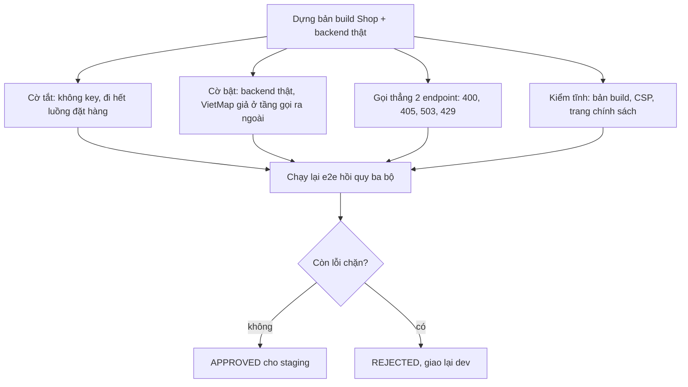

# QA — SHOP-3-04 Tìm địa chỉ VietMap (phương án A) · lần 1 · 25/11/2026



> `qa-tester` (Claude Sonnet 5.5) · nhánh `DuyduyFedev46/claude-vietmap-qa` · cơ sở: HEAD `9161513` (đã gộp VM-BE, VM-FE, VM-CMS).
> Hồ sơ đối chiếu: `02-stories.md` SHOP-3-04, `02b-tech-design.md` §1.9b, `05-phap-ly.md` §1.2c-A, `03-dev-notes-{be,fe,mkt}.md`.

## Kết luận: **APPROVED** cho staging (UAT) · chưa chứng minh được với VietMap thật

Mọi AC kiểm được đều đạt bằng chứng chạy thật; không có lỗi chặn. **Giới hạn phải đọc:** máy này không có `VIETMAP_API_KEY`, nên mọi ca "cờ bật" chạy với **backend thật của Cá Về + tầng gọi ra ngoài (`urllib.request.urlopen`) được thay bằng VietMap giả** (kịch bản ở scratch, ngoài repo). Hình dạng phản hồi thật của VietMap (tên trường, tiền tố `ref_id`, tên phường) **chưa được kiểm với máy chủ VietMap**; việc đó là bước tích hợp sau khi Duy đặt secret trên staging (ghi ở "Việc còn lại"). Production vẫn **chưa đạt** theo `05-phap-ly.md` §1.2c-A mục 3 (tên pháp nhân VietMap, thoả thuận xử lý dữ liệu, việc của Lộc).

## Tổng: 100 ca · ✅ 99 · ❌ 0 · ⏸ 1

| Nhóm | Ca | Đạt | Ghi chú |
|---|---|---|---|
| Trình duyệt, cờ tắt (backend thật, không key), 360 + 1280 | 14 | 14 | `res-off` |
| Trình duyệt, cờ bật (backend thật + VietMap giả), 360 + 1280 | 50 | 50 | gồm 429 thật của Cá Về |
| Gọi thẳng endpoint (curl) + upstream giả | 28 | 28 | bảng dưới |
| Kiểm tĩnh (build, CSP, chính sách, mã nguồn) | 7 | 7 | |
| ⏸ AC3c "đổi kiểu địa chỉ khi hộp đang mở" | 1 | 0 | xem mục ⏸ |

Hồi quy e2e (dòng TỔNG KẾT của `run_shop_e2e.py`, tách riêng, không tính vào bảng trên): xem "Lệnh đã chạy".

## Theo AC

| Mã AC | Cách kiểm | KQ | Bằng chứng |
|---|---|---|---|
| AC1 | Cờ bật, 360 + 1280: mở `/shop/checkout/`, chưa bấm: có nút "Tìm địa chỉ" cao ≥44px; 0 request `/api/shop/address-*` và 0 request tới `maps.vietmap.vn`, `unpkg.com`, `googleapis.com/maps`, `maps.gstatic.com`. Log mạng **cả phiên** (tìm, chọn, đặt đơn, lỗi) vẫn 0 request tới các domain đó | ✅ | `shots/vietmap-qa/on-checkout-flag-on-{360,1280}.png`; 4 ca "log mạng cả phiên" |
| AC2 | Bấm nút: hộp mở, dòng thông báo **đúng nguyên văn** §1.2c-A mục 1, hiện khi **chưa** có request tìm nào; gõ 1 ký tự: vẫn 0 request | ✅ | `on-dialog-open-{360,1280}.png` |
| AC3 | Gõ "12 Tran" → chọn gợi ý khớp → "Dùng địa chỉ này": ô số nhà = `12 Đường Trần Hưng Đạo`, banner "Phường gợi ý: Phường Phan Thiết" + nút; **tỉnh/phường chưa đổi, ô phường còn khoá**. Bấm "Dùng phường này": Tỉnh Lâm Đồng + Phường Phan Thiết, banner "Phường đã khớp.". Đặt đơn: thân request chỉ có `delivery_address_parts {scheme:"current", province_code:"68", district_code:null, ward_code:"22945", street}`, không có `delivery_address`, `lat`, `lng`, `place_id`, `ref`, `refid` (quét đệ quy mọi khoá). Backend thật trả `suggestion` = 68/22945 | ✅ | `on-banner-matched-*`, `on-banner-applied-*`; ca "request tạo đơn" ×2 |
| AC3b | Gợi ý thứ hai (phường không có trong danh mục) → `suggestion: null`: ô số nhà điền, banner "Bạn chọn tỉnh và phường/xã ở trên", tỉnh/phường giữ "Chọn tỉnh/thành phố", **không** nút "Dùng phường này"; sửa tay ô số nhà → banner tắt | ✅ | `on-banner-unmatched-*` |
| AC3c | Chọn "Địa chỉ cũ": search **và** place đều gửi `scheme:"legacy"`; "Dùng phường này" điền Bình Thuận → Thành phố Phan Thiết → Phường Mũi Né đúng thứ tự | ✅ | `on-legacy-applied-*` |
| AC3c (đổi kiểu khi hộp mở) | Hộp tìm là modal, radio kiểu địa chỉ nằm sau lớp phủ, Playwright không bấm được (bước không thể làm trên UI thật) | ⏸ | xem mục ⏸ |
| AC4 | `grep` `navigator.geolocation`, "Vị trí của tôi" trong `frontend/app components features lib`: 0 kết quả; `out/` không có chữ `geolocation` | ✅ | lệnh trong "Kiểm tĩnh" (1 comment ở `addressSearch.ts:2` nhắc chữ "Geolocation", xem L1) |
| AC5 | Upstream 401 → API 503 `ADDRESS_SEARCH_UNAVAILABLE`: hộp tìm đóng **trước**, đúng 1 dialog C5; "Nhập tay" đưa tiêu điểm về `#f-addr`; lỗi lần hai (423) → lần bấm nút thứ ba mở thẳng C5, **không** gọi lại API; sau lỗi, chọn tỉnh/phường + gõ tay vẫn đặt đơn được | ✅ | `on-c5-error-*` |
| AC5b | **429 thật của Cá Về** (bắn 65 request rồi gõ): dòng "Thao tác quá nhanh, thử lại sau vài giây" trong hộp, hộp không đóng, không mở C5 | ✅ | `on-429-{360,1280}.png` |
| AC6 | Esc: hộp đóng, tiêu điểm về nút `aria-label="Tìm địa chỉ giao hàng"`, chữ cũ trong ô số nhà giữ nguyên | ✅ | ca "AC6" ×2 |
| AC7 | Backend thật không có key: `site-info.address_search_enabled=false`, **không có nút** ở 360 + 1280, gõ tay + đặt đơn vẫn được (thân request có `delivery_address_parts`); e2e của dev thêm ca `site-info` lỗi | ✅ | `off-checkout-{360,1280}.png`; curl `site-info` |
| AC8 | Phản hồi search chỉ có khoá `ref,title,subtitle`; place chỉ `street,display,suggestion`; quét đệ quy không có `lat,lng,ref_id,ward_id,city_id,boundaries,distance,entry_points`. GET → 405. Chưa key → 503 và không gọi VietMap. Log backend: 0 dòng chứa chữ gõ, `ref`, key hay IP giả | ✅ | bảng "Gọi thẳng endpoint" |

## Các ca bắt buộc trong phiếu giao việc

| # | Yêu cầu | KQ | Bằng chứng |
|---|---|---|---|
| 1 | Cờ tắt (backend thật, không key): không nút; log mạng cả phiên không có `maps.vietmap.vn`, `unpkg.com`, googleapis maps | ✅ | 14/14 ca `off`; curl `site-info` → `"address_search_enabled":false` |
| 2 | Request tạo đơn không có `lat`/`lng`/`place_id`/`ref`/`refid` | ✅ | cả cờ tắt (2 ca) và cờ bật (4 ca), quét đệ quy mọi khoá |
| 3 | Gọi thẳng 2 endpoint | ✅ | bảng dưới |
| 4 | Chính sách quyền riêng tư sau `load_shop_content` có câu VietMap đúng nguyên văn §1.2c-A, không còn "Google Maps" | ✅ | xem dưới |
| 5 | `frontend/out` không có `maps.googleapis`, `GOOGLE_MAPS`, `navigator.geolocation` | ✅ | `grep -rl` trên `out/`: 0 file cho cả ba (và `geolocation`, `unpkg.com`, `maps.vietmap.vn`, `VIETMAP_API_KEY`, `maps.gstatic`) |
| 6 | CSP hai file firebase không còn domain Google Maps, vẫn còn `storage.googleapis.com` | ✅ | xem dưới |
| 7 | Hồi quy e2e `general_rules`, `full_flow`, `design_screens` | ✅ | xem "Lệnh đã chạy" |

### Gọi thẳng 2 endpoint (backend thật cổng 8011, DB tạm, không key, giới hạn mặc định)

| Ca | Kỳ vọng | Thực tế |
|---|---|---|
| `address-search` hợp lệ, chưa key | 503 `ADDRESS_SEARCH_UNAVAILABLE` | ✅ 503, `detail` "Chưa tìm được địa chỉ lúc này. Bạn gõ địa chỉ trực tiếp nhé." |
| text 1 ký tự / toàn khoảng trắng / 121 ký tự | 400 `VALIDATION` `fields.text` | ✅ 400 ×3 |
| `scheme` sai; thân là mảng JSON | 400 `fields.scheme` | ✅ 400 ×2 |
| GET, PUT trên search; GET, DELETE trên place | 405 | ✅ 405 ×4 |
| place `ref` = `http://x`, `abc` (không tiền tố), `auto:a b&apikey=1` | 400 `fields.ref` | ✅ 400 ×3 |
| place `ref` hợp lệ `auto:abc123`, chưa key | 503 | ✅ 503 |
| mọi phản hồi | `Cache-Control: no-store` | ✅ |
| 75 lần search liên tiếp trong 1 phút | 429 sau 60 lần | ✅ 14 lần trước đó + 46 lần = 60 lần 503, từ lần thứ 61 là 429 (`Retry-After` có, `code:"throttled"`). **Hai endpoint dùng chung một bộ đếm 60/phút** (lần gọi `address-place` ngay sau đó cũng 429) |
| log backend sau 75 lần gõ "quet thu 12 tran hung dao" | không có chữ gõ | ✅ 0 dòng khớp |

### Gọi thẳng với VietMap giả (backend thật cổng 8000, `VIETMAP_API_KEY` giả, `urlopen` bị thay)

| Ca | Kết quả |
|---|---|
| Upstream 401, 423, 429, 500, JSON hỏng, quá giờ | ✅ cả 6 → Cá Về trả **503** `ADDRESS_SEARCH_UNAVAILABLE` |
| Máy chủ gọi VietMap: tham số | ✅ chỉ `apikey`, `text`, `display_type` (1/2), `focus=10.9289,108.1021` (tâm Phan Thiết, không phải vị trí khách); place chỉ `apikey`, `refid`; `timeout=4` |
| Header/IP khách có bị chuyển tiếp không (đề xuất của `legal-vn`, `05-phap-ly.md` §1.2c-A mục 2) | ✅ gửi kèm `X-Forwarded-For: 203.0.113.9`, `Referer`, `Cookie`, `User-Agent` giả: request ra VietMap chỉ có header `Accept: application/json`, không có IP khách trong tham số. **Câu "VietMap không nhận địa chỉ IP, thông tin trình duyệt" trong chính sách có chứng cứ.** (Dev cũng có test `…does_not_forward_client_headers_or_ip_to_vietmap`) |
| Chữ gõ có `&apikey=HACK#x` | ✅ được mã hoá nguyên vẹn thành giá trị `text`, chỉ một `apikey` (không chèn được tham số) |
| Công thức ghép `street` | ✅ địa chỉ thường → `12 Đường Trần Hưng Đạo`; điểm POI (`name` "Chợ Phan Thiết" ≠ `address` "197 Đường Trần Phú") → `"Chợ Phan Thiết, 197 Đường Trần Phú"` đúng 02b §1.9b.3 |
| Log backend khi lỗi | ✅ chỉ có `vietmap upstream failed status=<401\|423\|429\|500\|invalid_json\|timeout> api=autocomplete`; 0 dòng chứa chữ gõ, `ref`, key, IP giả |

### (4) Chính sách quyền riêng tư sau `load_shop_content --publish`

DB tạm mới → `seed_demo`, `seed_qa`, `shop_seed.py`, `load_shop_content --author qa_owner --publish` (tạo 17, lỗi 0). Đọc `GET /api/public/content/entries/quyen-rieng-tu/`, làm phẳng khối nội dung, so với đoạn trong `05-phap-ly.md` §1.2c-A mục 2 (bỏ cú pháp `**` và liên kết markdown):
- Nguyên văn câu VietMap **khớp 100%**; liên kết `maps.vietmap.vn/console/privacy-policy` còn.
- Không còn: `Google Maps`, `Google Maps Platform`, `policies.google.com`, `vị trí bạn ghim`, nhãn `"Bản đồ"`.
- Còn đúng: dòng `Google Cloud và Supabase`, mục lưu trữ nước ngoài (Singapore).
- Nhãn trong ngoặc kép của câu chính sách là `"Tìm địa chỉ"`, trùng chữ trên nút (đã thấy trong ảnh).

### (6) CSP (`git diff 37971b2^..HEAD`)

Cả `frontend/firebase.json` và `frontend/firebase.staging.json`: bỏ đúng 4 chỗ (`script-src`, `img-src` ×2, `connect-src` của `maps.googleapis.com`/`maps.gstatic.com`). Còn: `img-src … https://storage.googleapis.com`, `connect-src 'self' <API Cá Về>`, `worker-src 'self' blob:`, `object-src 'none'`, `frame-ancestors 'none'`. JSON hợp lệ; 0 lần xuất hiện `maps.googleapis.com`, `maps.gstatic.com`, `unpkg`, `vietmap`.

## ⏸ Chưa kiểm

- **AC3c, ý "đổi kiểu địa chỉ khi hộp đang mở xoá kết quả cũ".** Hộp tìm là modal (`<dialog open aria-modal>`), hai radio kiểu địa chỉ nằm sau lớp phủ; Playwright báo "dialog intercepts pointer events", người dùng thật cũng không bấm được. Trạng thái đó **không đạt tới được qua giao diện**, nên không chấm ✅. Phần còn lại của AC3c (gửi `legacy`, điền ba cấp) đạt. Không chặn: thoát hộp rồi đổi kiểu rồi mở lại dùng kết quả mới (đã thấy qua luồng legacy ở phiên mới).

## Ngoại lệ & biên đã thử

- Cờ bật/tắt (cả hai trạng thái trên backend thật), lỗi upstream ×6 loại, 429 thật, chọn gợi ý không khớp danh mục, sửa tay sau khi điền, Esc, hai lần lỗi liên tiếp, đặt đơn sau lỗi, kiểu địa chỉ cũ, chữ gõ chứa `&apikey=`, `ref` ngoài mẫu, thân JSON sai kiểu, văn bản chỉ khoảng trắng, 121 ký tự.
- Chống đặt trùng: không thuộc phạm vi story này (hồi quy `full_flow` phủ BR-BH-27).

## Phân quyền · Rò giá vốn · Rò dữ liệu cá nhân

- **Phân quyền:** hai endpoint `AllowAny` chủ ý (Shop công khai); chỉ nhận POST; không có dữ liệu theo Group. Không đổi quyền ERP.
- **Giá vốn:** story không đụng; 4184 test backend xanh, e2e `full_flow`/`general_rules` quét giá vốn xanh.
- **Dữ liệu cá nhân (Critical nếu rò):** ✅ phản hồi hai endpoint không có tên/SĐT; request ra VietMap không kèm tên, SĐT, IP, header trình duyệt; log backend không có chữ gõ; storage + URL của trình duyệt không chứa chữ gõ hay mã gợi ý; ảnh chụp chỉ dùng dữ liệu giả (`Lê Thị Mẫu`, `0900000xxx`, địa chỉ giả).

## Lỗi

**Không có lỗi chặn (Critical/High/Medium).** Ghi nhận (Low, không chặn):

- **L1 — comment nhắc "Geolocation"** · Low · AC4. `frontend/features/checkout/addressSearch.ts:2` có câu "…không gọi Geolocation." Không phải mã gọi (`navigator.geolocation` = 0 kết quả; bản build 0 kết quả), chỉ làm một lệnh `grep -i geolocation` trên nguồn trả 1 dòng. Đổi chữ comment nếu muốn `grep` sạch tuyệt đối.
- **L2 — hai endpoint dùng chung một giới hạn 60/phút/IP** · Low · quan sát, không phải lỗi so với 02b §1.9b.3 (throttle một scope). Mỗi lần gõ (sau debounce) là 1 request, chọn gợi ý là thêm 1. Nhiều khách chung một IP ra ngoài (mạng di động CGNAT, quán cà phê) có thể chạm 429 sớm; giao diện đã xử lý 429 gọn (AC5b) và khách còn đường gõ tay. Techlead cân nhắc nâng mặc định nếu thấy 429 trên staging.
- **L3 — tài liệu thiết kế cũ còn nhắc `NEXT_PUBLIC_GOOGLE_MAPS_KEY`** · Low · `doc/design/shop/{DOI-CHIEU-CODE,HUONG-DAN-CODE,COMPONENTS}.md` (ngoài phạm vi lô, không phải code). Mã nguồn và cấu hình build không còn nhắc.
- **L4 — dòng "site-info thật" trong kịch bản QA chỉ khẳng định có gọi site-info** (kiểm mạnh hơn bằng curl: `"address_search_enabled":false` khi không key, `true` khi có key giả). Chỉ là chi tiết kịch bản của QA, không phải lỗi sản phẩm.

## Việc còn lại (không thuộc QA lô này)

1. **Tích hợp thật:** sau khi Duy đặt `VIETMAP_API_KEY` trên staging (và chốt 🔴 Q-VM-1 phương án A), chạy một lượt gõ thật để kiểm tên trường VietMap thật khớp code (`ref_id`, `address`, `ward`, `district`) và tên phường thật khớp danh mục Cá Về. Báo cáo này **không** thay thế bước đó.
2. **Production:** `05-phap-ly.md` §1.2c-A mục 3: Lộc điền tên pháp nhân vào ô `[tên pháp nhân…]` trong trang quyền riêng tư và có thoả thuận xử lý dữ liệu với VietMap; thêm dòng "chữ khách gõ để tìm địa chỉ, xử lý tạm, không lưu" vào hồ sơ đánh giá tác động.
3. **QA tổng** trên staging trước khi xin Duy lên thật (`doc/ops/orca-worker.md`).

## Lệnh đã chạy (kèm output tóm tắt)

```bash
python3 -m venv backend/.venv && backend/.venv/bin/pip install -q -r backend/requirements.txt   # xong
cd frontend && npm ci                                  # found 0 vulnerabilities (sạch, không --legacy-peer-deps)
cd erp-console && npm ci && NEXT_PUBLIC_USE_MOCK=0 NEXT_PUBLIC_API_BASE=http://localhost:8000 npm run build   # cần cho runner e2e
cd backend && DJANGO_SECRET_KEY=test DJANGO_DEBUG=1 .venv/bin/python manage.py collectstatic --noinput        # rc=0
cd frontend && npx tsc --noEmit                        # rc=0
cd frontend && NEXT_PUBLIC_USE_MOCK=0 NEXT_PUBLIC_API_BASE=http://localhost:8000 npm run build   # "○ (Static) prerendered as static content", 11 trang, rc=0
python3 frontend/e2e/run_shop_e2e.py --skip-build --suite design_screens --suite general_rules --suite full_flow
```

**TỔNG KẾT e2e (dán nguyên dòng của runner):**
```
======== TỔNG KẾT
PASS  design_screens: 92 đạt, 0 lỗi, 3 bỏ qua
PASS  general_rules: 205 đạt, 0 lỗi, 1 bỏ qua
PASS  full_flow: 135 đạt, 0 lỗi, 0 bỏ qua
```
Các mục bỏ qua đều là đặc tả hoặc chủ ý có từ trước: `D5`, `DE12` (chuyển thiếu tiền "không code V1", decisions), `E6` (bảng đặc tả, không phải màn), axe-core không cài trên máy. Không mục nào liên quan SHOP-3-04.

```bash
cd backend && DJANGO_SECRET_KEY=test .venv/bin/python manage.py test --parallel 1    # Ran 4184 tests in 217.177s · OK (skipped=19)
cd backend && .venv/bin/python manage.py makemigrations --check --dry-run            # No changes detected
cd backend && .venv/bin/python manage.py test apps.common.address_search apps.content.tests.test_load_shop_content --parallel 1   # Ran 56 tests · OK
python3 scripts/check_naming.py                       # OK - không phát sinh vi phạm mới
python3 scripts/sync_ai_workspace.py --check          # OK - 21 liên kết khớp
python3 scripts/test_ai_guard.py                      # 48/48 ca đúng
grep -rl "maps.googleapis\|GOOGLE_MAPS\|navigator.geolocation\|geolocation\|unpkg.com\|maps.vietmap.vn" frontend/out   # 0 file
grep -rniE "navigator\.geolocation|Vị trí của tôi" frontend/app frontend/components frontend/features frontend/lib      # 0 (chỉ comment "Geolocation" ở addressSearch.ts:2)
```

Ca trình duyệt tự viết (Playwright Python, scratch ngoài repo, không commit): `qa_ui.py` (MODE=off: **14 PASS / 0 FAIL**; MODE=on: **50 PASS / 0 FAIL**), `fake_be.py` (chạy backend thật, chỉ thay `urllib.request.urlopen`, ghi lại mọi request ra VietMap). Lần chạy đầu của MODE=on có 6 FAIL do chính dữ liệu giả của QA (đặt `name` khác `address`, nên backend ghép đúng spec thành "tên, địa chỉ"); đã sửa dữ liệu giả cho giống địa chỉ thật và chạy lại sạch, không sửa code sản phẩm. Một lần chạy khác dính 429 ngay từ đầu do bộ đếm throttle còn lưu từ lượt trước (cache không nằm trong bộ nhớ tiến trình), đã chờ hết cửa sổ rồi chạy lại.

Ảnh 360 + 1280 của QA: `doc/features/2026-10-06-shop-giao-dien-moi/shots/vietmap-qa/` (20 ảnh `off-*`, `on-*`). Thư mục `shots/` nằm trong `.gitignore` của repo nên ảnh ở trong worktree này, không vào commit.

Cổng 8000/3000/3100 đã giải phóng; QA chỉ dừng các tiến trình do chính mình bật.
