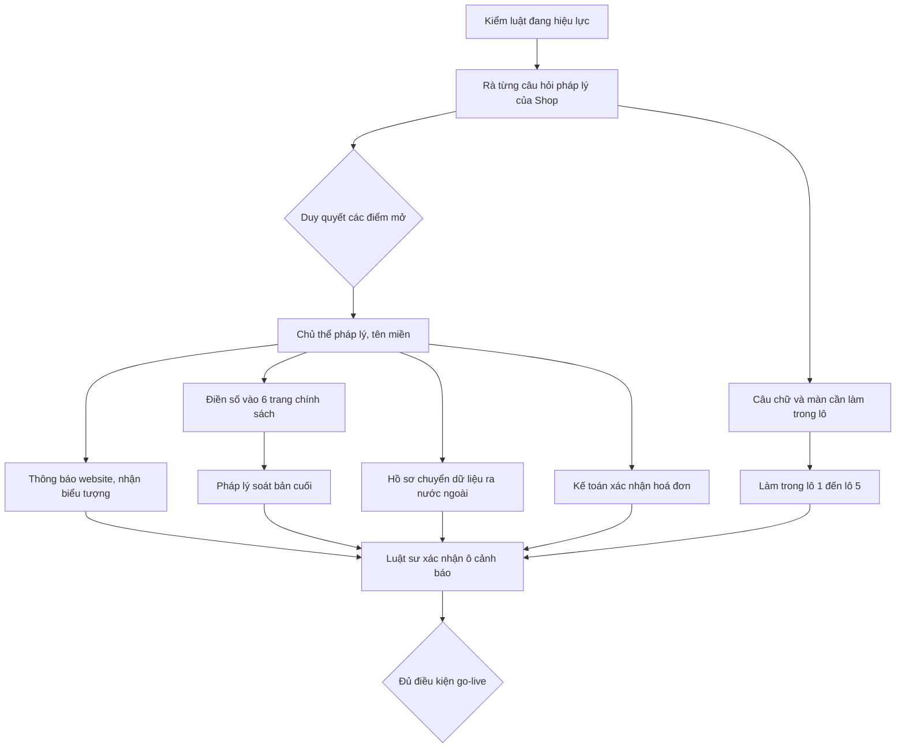

# 05 — Pháp lý cho Shop làm lại (lô 0)
> `legal-vn` · kiểm chứng 2026-10-10 · nhánh `shop/lo-0-quyet-dinh`
> Đầu vào: `00-dau-vao.md`, `doc/decisions.md` mục 2026-10-10 (tối), `doc/design/shop/UI-RULES.md`, `AUDIT-DO-DU.md` (nay ở `doc/archive/design-shop/`) §4 và §8 (câu 28, 33, 38, 39, 41),
> `doc/ops/go-live-phap-ly.md`, các màn Checkout, C1b-MapPicker, E2-Cancelled, P1-Policy, HeaderFooter-Mobile/Desktop.
>
> Đây là tài liệu tham khảo nội bộ, **không phải tư vấn pháp lý**. Nhiều điểm dưới đây dựa trên nguồn thứ cấp (luatvietnam, EY, KPMG, PwC,
> trang tư vấn) vì không đọc được bản gốc (thuvienphapluat trả 403). Chỗ nào chưa đối chiếu văn bản gốc thì ghi **(chưa xác minh bản gốc)**.
> Các ô ⚠ cần luật sư hoặc kế toán xác nhận trước go-live.



## 0. Văn bản áp dụng (đã kiểm ngày 2026-10-10)

| Văn bản | Hiệu lực | Ghi chú |
|---|---|---|
| Luật Thương mại điện tử 122/2025/QH15 | 01/7/2026 | Đ.11 k3: nền tảng có đặt hàng trực tuyến công khai điều kiện giao dịch |
| NĐ 248/2026/NĐ-CP (hướng dẫn Luật TMĐT) | 01/7/2026 | Đ.5 chính sách bảo mật · Đ.6.1.d thông tin khuyến mại trước khi đặt · Đ.7 khiếu nại · Đ.8 giá · Đ.13 giao hàng · Đ.14 đổi trả, hoàn tiền · Đ.23–24 + Phụ lục I thông báo nền tảng bán hàng trực tiếp · Đ.45.2.a biểu tượng xác nhận |
| Luật Bảo vệ dữ liệu cá nhân 91/2025/QH15 | 01/01/2026 | Đ.20 chuyển dữ liệu xuyên biên giới (k2 nộp hồ sơ trong 60 ngày; k6 các trường hợp miễn) · Đ.38 k2–3 miễn Đ.21, 22, 33.2 cho DN nhỏ/siêu nhỏ, hộ KD, **trừ** khi trực tiếp xử lý dữ liệu nhạy cảm |
| NĐ 356/2025/NĐ-CP (hướng dẫn Luật BVDLCN) | 01/01/2026 (ban hành 31/12/2025) | **Thay NĐ 13/2023.** Cấm đồng ý mặc định; đồng ý phải kiểm chứng được thời điểm, nội dung. **Dữ liệu vị trí xác định qua dịch vụ định vị** và **dữ liệu theo dõi hành vi trên mạng** thuộc nhóm nhạy cảm |
| Luật Bảo vệ quyền lợi người tiêu dùng 19/2023/QH15 | 01/7/2024 | Đ.37 k1 thông tin bắt buộc khi giao dịch từ xa (điểm d "Chi phí giao hàng (nếu có)", điểm g phí và chi phí phát sinh, điểm k quy trình đổi trả, chấm dứt) · Đ.38 k3–4 · Đ.54 phương thức giải quyết tranh chấp |
| Luật Thương mại 2005 (Đ.88–101) + NĐ 81/2018, sửa bởi NĐ 128/2024 và **NĐ 239/2026/NĐ-CP** | NĐ 239: 26/6/2026 | Khuyến mại. Đ.97 thông tin phải công khai |
| **NĐ 254/2026/NĐ-CP** về hoá đơn, chứng từ | 01/7/2026 (ban hành 30/6/2026) | **Thay NĐ 123/2020** (go-live-phap-ly mục 7 đang ghi căn cứ cũ) |
| NĐ 68/2026/NĐ-CP (thuế hộ KD), sửa bởi NĐ 141/2026 | 05/3/2026; NĐ 141 ⚠ | Hộ KD doanh thu từ 1 tỷ/năm dùng HĐĐT có mã hoặc từ máy tính tiền. Ngưỡng không chịu thuế 1 tỷ theo NĐ 141 **(chưa xác minh bản gốc)** |

## Bảng tóm tắt

| # | Câu hỏi | Kết luận | Chặn | Duy quyết? |
|---|---|---|---|---|
| 1a | Chính sách quyền riêng tư nêu Google Maps, máy chủ ở nước ngoài | **Bắt buộc** | lô 5 (nội dung) · go-live | Có: nêu tên SePay trong trang chính sách? |
| 1b | Câu đồng ý ở form đặt hàng | **Bắt buộc** (không tick sẵn, lưu phiên bản) | lô 3 | Không |
| 1c | Dòng thông báo trong popup bản đồ | **Bắt buộc** (cách hiểu thận trọng) | lô 3 | Không |
| 1d | Banner cookie | **Không cần** ở V1 | — | Không |
| 1e | Nút "Vị trí của tôi" (phát hiện thêm) | **Nên bỏ ở V1** | lô 3 | **Có** |
| 2 | Công bố chi phí giao | **Bắt buộc** nêu giá đã gồm giao hàng | lô 2–3 · go-live | Có: câu "đã gồm giao hàng" và khu vực giao |
| 3 | Câu báo huỷ đơn đã trả tiền + mục xử lý tiền trong chính sách | E2: **Nên** thêm thời hạn và link. Trang chính sách: **Bắt buộc** | lô 4 (E2) · lô 5 · go-live | **Có**: chọn câu A/B, số ngày |
| 4 | Biểu tượng thông báo website | **Bắt buộc** trước khi bán thật; trước đó **không hiện gì** | go-live | Có: chủ thể pháp lý, tên miền |
| 5 | Trang "Cơ chế giải quyết khiếu nại" | **Bắt buộc** | lô 5 · go-live | Có: thời hạn phản hồi |
| 6 | Hoá đơn điện tử | Shop **không cần** ô HĐĐT. Nghĩa vụ lập hoá đơn ở hậu trường **có thể bắt buộc** ⚠ | go-live | **Có** (cùng kế toán) |
| 7 | Mã giảm giá | **Không cần** thông báo Sở Công Thương. **Bắt buộc** công bố điều kiện, thời hạn, giới hạn lượt | lô 3 (giỏ) · lô 3b (ERP) | Có: trần mức giảm |

---

## 1. Dữ liệu cá nhân: Google Maps, câu đồng ý, popup, cookie

### 1.1 Phân tích

- **Dữ liệu đi tới Google khi khách dùng bản đồ:** chữ khách gõ ở ô tìm (thường là địa chỉ nhà), vị trí ghim, địa chỉ IP, thông tin trình duyệt. Nếu khách bấm
  "Vị trí của tôi" thì có thêm **toạ độ GPS** (`DOI-CHIEU-CODE.md` L-10). Google LLC đặt máy chủ ở nước ngoài.
- Theo Luật 91/2025 Đ.20 k1 điểm b, c, việc này có thể bị coi là chuyển dữ liệu ra nước ngoài, hoặc dùng nền tảng ở nước ngoài để xử lý dữ liệu thu thập
  tại Việt Nam. Đ.20 k6 miễn hồ sơ khi "chủ thể dữ liệu tự chuyển dữ liệu của chính mình ra nước ngoài". Trình duyệt của khách gọi thẳng tới Google, nên
  **có lập luận** đây là khách tự chuyển. Tuy nhiên Cá Về là bên chọn và nhúng Google vào luồng đặt hàng, nên đây là **vùng xám** ⚠.
  **Đề xuất:** không dựa vào ngoại lệ. Gộp Google Maps vào **hồ sơ đánh giá tác động chuyển dữ liệu ra nước ngoài** vốn đã phải lập cho máy chủ Singapore
  (checklist go-live mục 6b). Như vậy không phát sinh thủ tục mới. **Đ.38 (miễn cho hộ KD, DN nhỏ) không nhắc Đ.20**, nên hồ sơ chuyển dữ liệu ra nước
  ngoài vẫn phải làm dù Lộc là hộ kinh doanh ⚠ (Đ.38 có miễn Đ.22, là điều về cập nhật hồ sơ. Phạm vi miễn này cần luật sư đọc bản gốc).
- **Thời điểm:** khách thường mở bản đồ **trước** khi tick ô đồng ý ở cuối form. Vì vậy ô đồng ý không phủ được lần gửi dữ liệu đó cho Google. Cần có thông báo
  ngay tại popup, và việc khách chủ động gõ hay ghim sau khi đã thấy thông báo là hành vi đồng ý cho đúng mục đích này. NĐ 356 chấp nhận đồng ý qua thiết lập
  kỹ thuật trên website.
- **Dữ liệu vị trí là dữ liệu nhạy cảm:** NĐ 356/2025 xếp "vị trí của cá nhân được xác định qua dịch vụ định vị" vào nhóm nhạy cảm (chưa xác minh bản gốc,
  nhiều nguồn trùng khớp). Nút "Vị trí của tôi" dùng Geolocation của trình duyệt đúng là lấy vị trí qua dịch vụ định vị. Hệ quả:
  (a) phải báo khách đây là dữ liệu nhạy cảm và xin đồng ý riêng;
  (b) Cá Về sẽ thuộc diện "trực tiếp xử lý dữ liệu nhạy cảm", tức **mất quyền miễn** đánh giá tác động xử lý (Đ.21) và bộ phận bảo vệ dữ liệu (Đ.33 k2) theo Đ.38.
  Nút này chỉ giúp khách đỡ gõ, nên **đề xuất bỏ ở V1**. Khách vẫn tìm bằng chữ và kéo ghim được.
- **Cookie / lưu trên trình duyệt:** Luật 91 và NĐ 356 không có quy định riêng kiểu "banner cookie" như ePrivacy ở EU. Điều bị siết là **dữ liệu theo dõi hành vi**
  (nhạy cảm theo NĐ 356). Shop không có analytics, pixel hay chat. Thứ được lưu trên trình duyệt chỉ có giỏ (mã hàng, số lượng), "tìm gần đây", token tra đơn.
  Các thứ này chỉ ở máy khách và Cá Về không thu về. → **Không cần banner cookie**, chỉ cần nêu trong chính sách. **Điều kiện kèm theo:** khi nào gắn
  analytics, pixel hay chat thì phải có cơ chế xin đồng ý **trước khi nạp**. Lúc đó phải có banner và `legal-vn` soát lại.
- Font Inter phải tự host bằng `next/font` (HUONG-DAN-CODE.md:27). Nếu dùng `<link>` Google Fonts như trong file thiết kế thì mọi trang đều gửi IP cho Google,
  khi đó phải thêm vào chính sách. Giữ quy tắc này.
- Prototype `Checkout.dc.html` khởi tạo `consent: true`. **NĐ 356 cấm đặt sẵn lựa chọn "đồng ý".** Ô phải để trống mặc định. Đây là **Bắt buộc**, không còn là "để sau" như AUDIT §4.2.
- BE đã có cơ chế lưu phiên bản chính sách theo đơn (`backend/apps/sales/orders/consent.py`, BR-BH-17). Cơ chế này đáp ứng yêu cầu "đồng ý kiểm chứng được",
  nên **API đặt hàng mới phải giữ** (`accepted` + `policy_version_id`). Khi sửa chính sách để thêm Google thì phiên bản mới tự buộc khách đồng ý lại. Đúng ý đồ.

### 1.2 Câu chữ đề xuất (nguyên văn)

**(a) Ô đồng ý ở form đặt hàng** · C1 `Checkout`, `DesktopCheckout` · FE · chặn lô 3
> ☐ Tôi đồng ý để Cá Về dùng họ tên, số điện thoại và địa chỉ này để giao và hỗ trợ đơn hàng, theo [Chính sách quyền riêng tư]. Dữ liệu được lưu trên máy chủ đặt ở nước ngoài.

- Không tick sẵn. Link mở tab mới. Câu lỗi giữ: "Đánh dấu đồng ý ở trên để đặt hàng."
- Câu cuối ("Dữ liệu được lưu…") là **Nên**. Nếu Duy muốn câu ngắn thì bỏ câu cuối được, vì chính sách đã nêu và có link.

**(b) Dòng thông báo trong popup bản đồ** · C1b `MapPicker`, `DesktopMapPicker`, đặt ngay dưới ô "Tìm địa chỉ", hiện **ngay khi sheet mở** (trước khi script nạp xong) · FE · chặn lô 3
> Bản đồ do Google cung cấp. Chữ bạn gõ và vị trí bạn ghim sẽ được gửi tới Google. Không muốn dùng, bạn đóng lại và gõ địa chỉ trực tiếp.

Nếu Duy giữ nút "Vị trí của tôi" thì cần thêm một bước xin đồng ý riêng trước khi gọi Geolocation, dạng Dialog:
> Cá Về cần vị trí hiện tại của bạn để tìm địa chỉ trên bản đồ. Vị trí là dữ liệu cá nhân nhạy cảm; vị trí sẽ được gửi tới Google và Cá Về không lưu lại. [Đồng ý] [Không, tôi tự tìm]

Đồng thời phải bổ sung chính sách và đánh giá tác động. Đây là lý do đề xuất bỏ nút.

**(c) Mục bổ sung cho trang Chính sách quyền riêng tư** (`/trang/quyen-rieng-tu`) · nội dung CMS, Lộc/Duy nhập · chặn go-live

Theo NĐ 248 Đ.5, chính sách phải có ít nhất các phần sau: mục đích và phạm vi thu thập, phạm vi sử dụng, thời gian lưu, đối tượng được tiếp cận, biện pháp bảo mật,
cách xem, sửa, xoá hoặc hạn chế xử lý, và cách tiếp nhận khiếu nại về dữ liệu. Khung 4 mục hiện có còn thiếu 5 mục dưới đây. Câu đề xuất:

> **Dữ liệu Cá Về thu thập.** Khi bạn đặt hàng: họ tên, số điện thoại, địa chỉ giao hàng. Khi bạn chuyển khoản: thông tin giao dịch do ngân hàng ghi (số tiền,
> nội dung chuyển khoản, có thể có tên và số tài khoản người chuyển). Khi đơn bị huỷ sau khi bạn đã trả tiền: số tài khoản bạn chọn để nhận lại tiền.
> Cá Về không thu ngày sinh, giấy tờ tuỳ thân hay dữ liệu vị trí từ thiết bị của bạn.
>
> **Bên nhận hoặc xử lý dữ liệu cùng Cá Về.**
> - Nhân viên Cá Về: chỉ người soạn hàng, giao hàng và chăm sóc đơn của bạn.
> - Google (Google Maps Platform, máy chủ ở nước ngoài): chỉ khi bạn bấm "Bản đồ" để tìm địa chỉ. Google nhận chữ bạn gõ, vị trí bạn ghim, địa chỉ IP và
>   thông tin trình duyệt. Cá Về không gửi họ tên hay số điện thoại cho Google. Google xử lý theo chính sách riêng của Google (policies.google.com/privacy).
>   Bạn có thể không dùng bản đồ và gõ địa chỉ trực tiếp.
> - [Tên đơn vị đối soát thanh toán] và ngân hàng: nhận mã đơn và số tiền để xác nhận bạn đã chuyển khoản.
> - Nhà cung cấp hạ tầng: Google Cloud và Supabase, nơi đặt máy chủ lưu dữ liệu.
> - Cơ quan nhà nước có thẩm quyền khi pháp luật yêu cầu.
>
> **Lưu trữ ở nước ngoài.** Máy chủ lưu dữ liệu đơn hàng của Cá Về đặt tại Singapore. Cá Về đã lập hồ sơ đánh giá tác động chuyển dữ liệu cá nhân ra nước ngoài
> theo Luật Bảo vệ dữ liệu cá nhân và áp dụng các biện pháp bảo mật [kết nối mã hoá HTTPS, phân quyền theo vai, không ghi dữ liệu cá nhân vào nhật ký hệ thống].
>
> **Lưu trên trình duyệt của bạn.** Shop lưu giỏ hàng (mã hàng và số lượng), các từ bạn tìm gần đây và mã tra đơn tạm thời trên chính trình duyệt của bạn để
> trang chạy đúng. Các thông tin này không chứa họ tên, số điện thoại hay địa chỉ, và Cá Về không thu về. Shop không dùng cookie quảng cáo hay công cụ theo dõi
> hành vi. Bạn có thể xoá bằng cách xoá dữ liệu trang web trong trình duyệt.
>
> **Thời gian lưu.** Đơn hàng và chứng từ thanh toán được lưu theo thời hạn pháp luật về thương mại điện tử và kế toán yêu cầu ([Duy điền sau khi kế toán
> chốt, tối thiểu 3 năm với dữ liệu đơn hàng]). Hết thời hạn, Cá Về xoá hoặc ẩn danh họ tên, số điện thoại, địa chỉ.
>
> **Cách yêu cầu xem, sửa, xoá hoặc ngừng xử lý.** Gọi [hotline] hoặc gửi email [email], kèm mã đơn SO… và số điện thoại đặt hàng để Cá Về xác minh.
> Cá Về xác nhận đã nhận yêu cầu trong [1] ngày làm việc và trả lời trong [Duy chốt] ngày. Với đơn đã thanh toán, Cá Về giữ chứng từ theo quy định nhưng
> ẩn danh họ tên, số điện thoại, địa chỉ. Khiếu nại về dữ liệu cá nhân xử lý theo [Cơ chế giải quyết khiếu nại].

- Thời hạn trả lời yêu cầu của chủ thể dữ liệu theo NĐ 356 **chưa xác minh**. Luật sư điền số trước go-live ⚠.
- **Điểm Duy quyết:** quyết định 10/10 "giao diện khách không ghi tên nhà cung cấp cổng thanh toán" nói về màn thanh toán. Trang chính sách thì khác: NĐ 248 Đ.5
  yêu cầu nêu "đối tượng có thể tiếp cận", nên **đề xuất ghi tên SePay ở trang chính sách** (chỉ ở đây). Nếu Duy không muốn thì ghi "đơn vị đối soát thanh toán
  tại Việt Nam". Cách này rủi ro hơn, vì khó chứng minh khách đã được thông báo đủ.

### 1.2c VietMap thay Google (25/11)
> `legal-vn` · tra cứu 2026-11-25 · căn cứ `doc/decisions.md` mục 2026-11-24 (Duy chốt VietMap). Mục này **thay** phần Google ở 1.1, 1.2(b), 1.2(c) và 1.3;
> các vế khác của 1.1 (bỏ nút "Vị trí của tôi", không lưu toạ độ, thông báo trước khi nạp script) giữ nguyên. Tài liệu nội bộ, không phải tư vấn pháp lý.

**1. VietMap là ai (kiểm chứng web 25/11)**

| Thông tin | Kết quả | Nguồn |
|---|---|---|
| Tên pháp nhân | **Chưa xác minh, các nguồn lệch nhau.** Trang tuyển dụng ghi "Công ty Cổ phần Ứng dụng Bản đồ Việt (VIETMAP Co., JSC)", thành lập 2006. Chính sách quyền riêng tư của VietMap ghi "Vietmap Co., Ltd" và "các công ty con, công ty liên kết". | itviec, topdev, chính sách VietMap |
| Mã số thuế | **Chưa xác minh** (không thấy trên nguồn công khai đã đọc) | — |
| Trụ sở | **Chưa xác minh, các nguồn lệch nhau.** Chính sách VietMap: 197 Trần Phú, phường Chợ Quán, TP.HCM. TopDev: 03 Trần Nhân Tôn, Phường 9, Quận 5, TP.HCM (có thể là địa chỉ cũ trước khi sáp nhập phường). | chính sách VietMap, topdev |
| Máy chủ | Chính sách **không nêu** nơi đặt máy chủ. Mục "International transfers" nói dữ liệu "may be transferred" sang nước khác khi có đồng ý hoặc biện pháp bảo vệ theo luật. Tra DNS ngày 25/11: `maps.vietmap.vn` trỏ về IP `42.117.1.18`, whois ghi `FPT-STATICIP`, country `VN`. Tức là **điểm nhận request API đặt ở Việt Nam**; nơi lưu log và bản sao lưu thì **chưa xác minh**. | `dig` + `whois` 25/11 |
| Chính sách quyền riêng tư | https://maps.vietmap.vn/console/privacy-policy · không ghi ngày cập nhật · liên hệ `support@map.zone`, hotline 1800.555.546. Đây là bản chung của nhóm (nói nhiều về tài xế, camera xe, telematics), **không có phần riêng cho Maps API** (log truy vấn, chữ tìm kiếm, thời hạn lưu log). Mục đích có ghi "Research and development" và "Marketing And Promotions". | trang chính sách |
| Liên hệ API | `maps.info@vietmap.vn` (trang tài liệu API) | maps.vietmap.vn/docs |

**2. Đánh giá theo Luật BVDLCN 91/2025 và NĐ 356/2025**

- **Vai của VietMap.** Cá Về quyết định mục đích (tìm địa chỉ giao hàng) và phương tiện (chọn VietMap, nhúng vào bước đặt hàng), nên Cá Về là **bên kiểm soát**
  (Đ.2 k7). Trong việc tìm địa chỉ, VietMap xử lý dữ liệu theo yêu cầu của Cá Về qua hợp đồng dịch vụ API, tức là **bên xử lý** (Đ.2 k8).
  Nhưng chính sách chung của VietMap cho phép dùng dữ liệu cho nghiên cứu phát triển và tiếp thị. Nếu VietMap dùng chữ khách gõ cho mục đích riêng thì với phần đó
  VietMap là **bên thứ ba** (Đ.2 k10) ⚠. **Đề xuất:** chính sách của Cá Về ghi VietMap là bên **cùng xử lý**, kèm link chính sách của VietMap (giống cách đã làm với Google),
  để phủ cả hai cách hiểu.
- **Hợp đồng xử lý dữ liệu.** Đ.37 k2 điểm a, b: bên xử lý chỉ được nhận dữ liệu sau khi có "thoả thuận, hợp đồng về xử lý dữ liệu cá nhân" với bên kiểm soát;
  Đ.37 k1 yêu cầu bên kiểm soát nêu rõ trách nhiệm các bên trong thoả thuận đó. Điều khoản dịch vụ chấp nhận khi đăng ký key **có thể** là thoả thuận này,
  nếu có điều khoản về dữ liệu ⚠ (chưa đọc được điều khoản dịch vụ API của VietMap). Với Google trước đây cũng ở tình trạng tương tự. → Việc của Lộc, mục 5.
- **Chuyển dữ liệu ra nước ngoài (Đ.20 k1).** Đ.20 k1 tính là chuyển xuyên biên giới khi chuyển tới hệ thống lưu trữ ngoài lãnh thổ (a), cho tổ chức ở nước ngoài (b),
  hoặc dùng nền tảng ngoài lãnh thổ để xử lý (c). VietMap là doanh nghiệp Việt Nam và điểm nhận API đặt ở Việt Nam, nên **nhiều khả năng không phải chuyển ra
  nước ngoài**. Hệ quả tốt: **bỏ phần bản đồ khỏi hồ sơ đánh giá tác động chuyển dữ liệu ra nước ngoài**; hồ sơ đó vẫn phải làm cho máy chủ Singapore
  (checklist go-live dòng "Singapore + Google Maps" đọc lại là "Singapore"). Điều kiện kèm theo ⚠: (i) VietMap xác nhận bằng văn bản là lưu log trong nước, vì chính sách
  chung có câu "may be transferred"; (ii) FE **tự host** thư viện bản đồ JS/CSS hoặc nạp từ máy chủ VietMap, không nạp từ CDN nước ngoài (unpkg, jsdelivr), nếu không thì IP
  khách vẫn đi ra nước ngoài lúc mở bản đồ. Điểm (ii) Tech Lead chốt ở 02b §1.9.
- **Dữ liệu nhạy cảm.** Vị trí khách **tự kéo ghim** không phải "vị trí xác định qua dịch vụ định vị" theo NĐ 356 (chưa xác minh bản gốc, như 1.1). Giữ luật bỏ nút
  "Vị trí của tôi" và không gọi `navigator.geolocation` (SHOP-3-04 AC4) thì Cá Về vẫn không xử lý dữ liệu nhạy cảm, quyền miễn ở Đ.38 không mất.
- **Đồng ý.** Như 1.1: khách mở bản đồ trước khi tick ô đồng ý, nên dòng thông báo trong popup vẫn **bắt buộc** (cách hiểu thận trọng) và phải hiện trước khi script nạp
  (SHOP-3-04 AC2). Đổi chính sách thì phiên bản chính sách mới tự buộc khách đồng ý lại (`policy_version_id`), đúng ý đồ.
- **Ô đồng ý 1.2(a)** không đổi: câu "Dữ liệu được lưu trên máy chủ đặt ở nước ngoài" vẫn đúng vì máy chủ đơn hàng ở Singapore.

**3. Câu thông báo mới trong popup bản đồ** (thay câu Google ở SHOP-3-04 AC2 và 1.2(b)) · C1b `MapPicker`, `DesktopMapPicker` · FE · **Bắt buộc**
> Bản đồ do VietMap cung cấp. Chữ bạn gõ và vị trí bạn ghim sẽ được gửi tới VietMap để tìm địa chỉ. Không muốn dùng, bạn đóng lại và gõ địa chỉ trực tiếp.

Vị trí, thời điểm hiện như 1.2(b). AC1 của SHOP-3-04 đổi tên miền kiểm thành tên miền VietMap (PO sửa story, không thuộc mục này).

**4. Đoạn thay thế nguyên văn trong Chính sách quyền riêng tư** (`pages.json`, trang `quyen-rieng-tu`, mục "## 3. Bên nhận hoặc xử lý dữ liệu cùng Cá Về").
`mkt-brand` thay **nguyên dòng** bắt đầu bằng `- **Google (Google Maps Platform, máy chủ ở nước ngoài):**` bằng dòng dưới đây (giữ escape `\"` khi chép vào JSON):

```markdown
- **VietMap ([tên pháp nhân ghi trên hợp đồng hoặc hoá đơn VietMap], doanh nghiệp bản đồ tại Việt Nam):** chỉ khi bạn bấm "Bản đồ" để tìm địa chỉ. VietMap nhận chữ bạn gõ, vị trí bạn ghim, địa chỉ IP và thông tin trình duyệt để tìm và hiển thị địa chỉ. Cá Về không gửi họ tên hay số điện thoại cho VietMap. VietMap xử lý theo chính sách riêng của VietMap ([maps.vietmap.vn/console/privacy-policy](https://maps.vietmap.vn/console/privacy-policy)). Bạn có thể không dùng bản đồ và gõ địa chỉ trực tiếp.
```

- Ô `[tên pháp nhân…]` Lộc điền trước khi đăng production. Trên staging để nguyên ngoặc vuông được.
- Câu tuỳ chọn, **chỉ thêm khi VietMap đã xác nhận bằng văn bản** là lưu dữ liệu trong nước (mục 5): chèn sau "…để tìm và hiển thị địa chỉ." câu
  "Dữ liệu này được xử lý trên máy chủ đặt tại Việt Nam." Chưa có xác nhận thì **không** ghi, để tránh khẳng định sai.
- Mục "## 4. Lưu trữ ở nước ngoài" của trang **giữ nguyên** (chỉ nói máy chủ Singapore, không nhắc bản đồ).
- `seo_description` và các mục khác không phải sửa.

**5. Việc của Lộc** (pháp lý, tài khoản là việc của Lộc; IT chỉ soạn khung)

| Việc | Ai | Chặn |
|---|---|---|
| Lấy **tên pháp nhân, mã số thuế, địa chỉ** VietMap từ hợp đồng, hoá đơn hoặc trang tài khoản đã đăng ký key; điền vào ô `[tên pháp nhân…]` | **Lộc** | go-live production |
| Đọc điều khoản dịch vụ Maps API lúc đăng ký: có điều khoản về bảo vệ dữ liệu cá nhân không. Không có thì gửi email `maps.info@vietmap.vn` xin thoả thuận xử lý dữ liệu (Đ.37 k2), hỏi kèm: (1) log truy vấn lưu ở đâu, bao lâu; (2) có dùng chữ khách tìm cho tiếp thị hay huấn luyện không; (3) có chuyển ra nước ngoài không | **Lộc** (IT soạn sẵn email nếu Lộc cần) | go-live production ⚠ |
| Hồ sơ đánh giá tác động chuyển dữ liệu ra nước ngoài: chỉ còn máy chủ Singapore; thêm lại bản đồ nếu VietMap trả lời là có chuyển ra nước ngoài | Lộc + luật sư | go-live ⚠ |
| Câu popup mục 3 vào MapPicker; sửa AC2 (và tên miền ở AC1) SHOP-3-04 | FE + PO | lô SHOP-3-04 |
| Chép đoạn mục 4 vào `pages.json` | `mkt-brand` | lô SHOP-3-04 (staging) |
| Chốt nơi nạp thư viện bản đồ (tự host hoặc máy chủ VietMap, không CDN nước ngoài) | Tech Lead, 02b §1.9 | lô SHOP-3-04 |

**Kết luận §1.2c: ĐẠT cho staging** (câu popup và đoạn chính sách dùng được ngay) · **CHƯA ĐẠT cho production** tới khi Lộc điền tên pháp nhân và có thoả thuận
xử lý dữ liệu hoặc điều khoản dịch vụ có phần dữ liệu ⚠.

**Nguồn (tra 2026-11-25)**
- Chính sách quyền riêng tư VietMap: https://maps.vietmap.vn/console/privacy-policy
- Tài liệu Maps API VietMap: https://maps.vietmap.vn/docs/map-api/overview/
- Hồ sơ công ty: [itviec](https://itviec.com/companies/vietmap) · [topdev](https://topdev.vn/nha-tuyen-dung/vietmap-85924)
- Tra DNS/whois `maps.vietmap.vn` → `42.117.1.18`, `FPT-STATICIP`, country `VN` (chạy `dig`, `whois` ngày 25/11)
- Luật BVDLCN 91/2025: [Đ.2](https://hethongphapluat.com/luat-bao-ve-du-lieu-ca-nhan-2025/dieu-2) (k7, k8, k10) · [Đ.20](https://hethongphapluat.com/luat-bao-ve-du-lieu-ca-nhan-2025/dieu-20) (k1 a–c) · [Đ.37](https://hethongphapluat.com/luat-bao-ve-du-lieu-ca-nhan-2025/dieu-37) (k1, k2 a–b). Bản sao bên thứ ba, chưa đối chiếu công báo.

#### §1.2c-A Câu chốt cho phương án A (25/11)
> `legal-vn` · 2026-11-25 · căn cứ 02b §1.9b.2, §1.9b.3, §1.9b.7 (phương án A: **trình duyệt → máy chủ Cá Về → VietMap**, chỉ gửi chữ gõ và mã gợi ý,
> VietMap không thấy IP hay trình duyệt của khách, **không bản đồ, không ghim**, không lưu, không log chữ gõ). Story đang **tạm theo A** (chờ Duy ở 🔴 Q-VM-1).
> Theo A thì mục này **thay** mục 3 và mục 4 của §1.2c. Nếu Duy chọn B thì dùng lại nguyên mục 3, 4 của §1.2c. Tài liệu nội bộ, không phải tư vấn pháp lý.

**1. Câu thông báo trong hộp tìm** (hằng `MAP_NOTICE_TEXT`, `AddressSearchSheet`) · FE · **Bắt buộc** · thay câu §1.2c mục 3 và câu nháp 02b §1.9b.7
> Gợi ý địa chỉ do VietMap cung cấp. Chữ bạn gõ được máy chủ Cá Về chuyển tới VietMap để tìm địa chỉ, không kèm họ tên hay số điện thoại. Không muốn dùng, bạn đóng lại và gõ địa chỉ trực tiếp.

- Đã bỏ "vị trí bạn ghim" và chữ "Bản đồ", vì A không có bản đồ, không có ghim.
- So với câu nháp 02b: giữ ý "qua máy chủ Cá Về", thêm "không kèm họ tên hay số điện thoại" để khách biết phạm vi. Không ghi "không lưu" ở đây cho câu ngắn,
  vì trang chính sách đã ghi.
- Vị trí và thời điểm như AC2: hiện ngay khi hộp mở, **trước** request tìm đầu tiên, nằm sát ô tìm, không ẩn sau nút "Xem thêm".

**2. Gạch đầu dòng thay nguyên văn mục 3 trang `quyen-rieng-tu`** (`pages.json`, mục "## 3. Bên nhận hoặc xử lý dữ liệu cùng Cá Về") · `mkt-brand` lô VM-CMS
Thay **nguyên dòng** bắt đầu bằng `- **Google (Google Maps Platform, máy chủ ở nước ngoài):**` bằng dòng dưới (giữ escape `\"` khi chép vào JSON):

```markdown
- **VietMap ([tên pháp nhân ghi trên hợp đồng hoặc hoá đơn VietMap], dịch vụ tìm địa chỉ tại Việt Nam):** chỉ khi bạn bấm "Tìm địa chỉ" lúc đặt hàng. Chữ bạn gõ vào ô tìm và gợi ý bạn chọn được máy chủ Cá Về (xem mục 4) chuyển tới VietMap để lấy gợi ý địa chỉ. VietMap không nhận địa chỉ IP, thông tin trình duyệt, họ tên hay số điện thoại của bạn. Cá Về không lưu chữ bạn gõ để tìm và không ghi chữ đó vào nhật ký hệ thống; địa chỉ bạn chọn chỉ được lưu khi bạn đặt hàng, như địa chỉ gõ tay. VietMap xử lý theo chính sách riêng của VietMap ([maps.vietmap.vn/console/privacy-policy](https://maps.vietmap.vn/console/privacy-policy)). Bạn có thể không dùng và gõ địa chỉ trực tiếp.
```

- Ô `[tên pháp nhân…]`: Lộc điền trước production; staging để nguyên ngoặc vuông. **Không** chép tên "Công ty Cổ phần Ứng dụng Bản đồ Việt" từ câu nháp 02b,
  vì §1.2c mục 1 cho thấy các nguồn lệch nhau (chưa xác minh).
- Nhãn trong ngoặc kép phải **trùng chữ trên nút** (mục 4 dưới). Duy giữ nhãn "Bản đồ" thì đổi `"Tìm địa chỉ"` thành `"Bản đồ"`.
- "(xem mục 4)" trỏ sang mục "Lưu trữ ở nước ngoài" vì máy chủ Cá Về đặt tại Singapore (`asia-southeast1`, `doc/ops/moi-truong.md` dòng 31). Mục 4 **giữ nguyên**.
- Câu tuỳ chọn "Dữ liệu này được xử lý trên máy chủ đặt tại Việt Nam." của §1.2c **không dùng** nữa, vì theo A chữ gõ có đi qua máy chủ Singapore.
- Câu "VietMap không nhận địa chỉ IP, thông tin trình duyệt…" chỉ đúng khi BE gọi VietMap **không chuyển tiếp** header của khách (`X-Forwarded-For`,
  `User-Agent`, `Referer`, cookie). 02b §1.9b.3 chỉ đặt header `Accept`, khớp. Đề xuất QA/techlead thêm một ca test: request gửi VietMap không có các header đó
  và không có IP khách trong tham số. Thiếu ca này thì câu chính sách chưa có chứng cứ.

**3. Đánh giá lại theo A**

- **Cá Về là bên chuyển giao dữ liệu cho VietMap.** Ở thiết kế cũ (trình duyệt gọi thẳng), còn có thể hiểu là khách tự gửi qua công cụ Cá Về nhúng. Theo A,
  chính máy chủ Cá Về gửi chữ gõ tới VietMap, nên đây rõ ràng là **chuyển giao dữ liệu cá nhân** của bên kiểm soát cho bên xử lý, thuộc **Đ.17 k1 điểm d** Luật 91/2025
  (bên kiểm soát chuyển cho bên xử lý hoặc bên thứ ba để xử lý theo quy định). Điều kiện đi kèm vẫn là **Đ.37 k1, k2 a–b**: phải có thoả thuận hoặc hợp đồng
  xử lý dữ liệu ghi trách nhiệm các bên. Kết luận về hợp đồng **không đổi**, nhưng nay chắc chắn hơn là cần, không còn cách hiểu nào để bỏ qua ⚠.
- **Chữ gõ có phải dữ liệu cá nhân không.** Chữ gõ thường là số nhà, tên đường; không kèm tên, SĐT, IP thì VietMap khó gắn với một người. Nhưng Cá Về có thể gắn
  chữ đó với phiên đặt hàng, nên **vẫn coi là dữ liệu cá nhân** (cách hiểu thận trọng) và vẫn thông báo như mục 1, 2.
- **Ít dữ liệu hơn.** VietMap không còn nhận IP, trình duyệt, vị trí ghim. Rủi ro VietMap dùng dữ liệu cho mục đích riêng (nghiên cứu, tiếp thị theo chính sách chung)
  **giảm hẳn**, vì chữ gõ không gắn được với người dùng. Vẫn giữ ⚠ bên thứ ba như §1.2c mục 2.
- **Chuyển ra nước ngoài (Đ.20).** VietMap vẫn là bên trong nước, không thêm gì vào hồ sơ. Điểm mới: chữ gõ đi **từ trình duyệt tới máy chủ Cá Về ở Singapore**
  rồi mới tới VietMap. Đây là luồng dữ liệu đơn hàng đã có trong hồ sơ đánh giá tác động cho máy chủ Singapore, nên **không cần hồ sơ mới**. Chỉ cần thêm một dòng
  vào danh mục dữ liệu của hồ sơ đó: "chữ khách gõ để tìm địa chỉ, xử lý tạm, không lưu".
- **Điều kiện (ii) của §1.2c** (không nạp thư viện bản đồ từ CDN nước ngoài) **hết áp dụng**: A không nạp script bản đồ nào. AC1 kiểm việc này (0 request tới `unpkg.com`, `maps.vietmap.vn`).
- **Dữ liệu nhạy cảm, Đ.38:** không đổi. Không ghim, không `navigator.geolocation`, nên không có vị trí từ dịch vụ định vị. Quyền miễn của Đ.38 giữ nguyên.
- **Kết luận theo A:** **ĐẠT cho staging** (mục 1, 2 dùng được ngay) · **CHƯA ĐẠT cho production**, cùng điều kiện như §1.2c: tên pháp nhân VietMap và thoả thuận
  xử lý dữ liệu hoặc điều khoản dịch vụ có phần dữ liệu ⚠. Điều kiện xác nhận nơi lưu log của VietMap giảm từ "chặn" xuống "nên có", vì VietMap không nhận gì nhận diện được khách.

**Việc của Lộc theo A** (thay bảng §1.2c mục 5; IT chỉ soạn khung)

| Việc | Ai | Chặn |
|---|---|---|
| Lấy tên pháp nhân, mã số thuế, địa chỉ VietMap từ hợp đồng, hoá đơn hoặc trang tài khoản key; điền ô `[tên pháp nhân…]` | **Lộc** | go-live production |
| Đọc điều khoản dịch vụ Maps API; không có phần dữ liệu cá nhân thì gửi `maps.info@vietmap.vn` xin thoả thuận xử lý dữ liệu (Đ.17 k1 d, Đ.37 k2). Hỏi kèm: log truy vấn lưu ở đâu, bao lâu; có dùng chữ tìm cho tiếp thị hay huấn luyện không | **Lộc** (IT soạn email nếu cần) | go-live production ⚠ |
| Hồ sơ đánh giá tác động chuyển dữ liệu ra nước ngoài (Singapore): thêm dòng "chữ khách gõ để tìm địa chỉ, xử lý tạm, không lưu" | Lộc + luật sư | go-live ⚠ |
| Hằng `MAP_NOTICE_TEXT` theo mục 1 | fe-dev | lô VM-FE |
| Chép dòng mục 2 vào `pages.json` | `mkt-brand` | lô VM-CMS (staging) |
| Ca test BE: request gửi VietMap không có header, IP của khách | be-dev + QA | lô VM-BE |

**4. Nhãn nút "Tìm địa chỉ"**

- **Không có vấn đề pháp lý**, và **tốt hơn** "Bản đồ": A không hiện bản đồ, nên "Bản đồ" dễ khiến khách nghĩ sẽ thấy bản đồ hoặc bị lấy vị trí. Nhãn đúng với
  chức năng là cách thông tin minh bạch, hợp tinh thần Luật BVQLNTD 2023 về thông tin trung thực cho người tiêu dùng (không phải nghĩa vụ riêng cho nhãn nút).
- Ba chỗ phải **cùng một chữ**: nhãn nút, câu chính sách mục 2 ("khi bạn bấm \"Tìm địa chỉ\""), và tên hộp tìm. `aria-label` "Tìm địa chỉ giao hàng" ổn.
- Giữ icon `map-pin` được. **Không** dùng chữ "Định vị", "Vị trí của tôi", "Lấy vị trí": các chữ này gợi ý lấy vị trí thiết bị, là dữ liệu nhạy cảm theo NĐ 356.
- Placeholder ô tìm cũng là "Tìm địa chỉ" (`AddressMapPicker.tsx:294` hiện nay): trùng chữ với nút nhưng không sao.

**Nguồn bổ sung (tra 2026-11-25):** Luật BVDLCN 91/2025 [Đ.17](https://hethongphapluat.com/luat-bao-ve-du-lieu-ca-nhan-2025/dieu-17)
(k1 điểm d, k2). Bản sao bên thứ ba, chưa đối chiếu công báo.

### 1.3 Việc của ai

| Việc | Ai | Chặn |
|---|---|---|
| Ô đồng ý không tick sẵn, câu (a), giữ `policy_version_id` | FE + BE (contract 02b) | lô 3 |
| Dòng thông báo (b) trong MapPicker | FE | lô 3 |
| Quyết định giữ hay bỏ "Vị trí của tôi" | **Duy** | lô 3 |
| Nội dung (c) vào CMS, điền các ô [ ] | Duy/Lộc nhập, `legal-vn` soát | go-live |
| Hồ sơ đánh giá tác động chuyển dữ liệu ra nước ngoài (Singapore; bản đồ VietMap trong nước, xem §1.2c), nộp trong 60 ngày từ lần chuyển đầu (Đ.20 k2) | Duy + luật sư | go-live ⚠ |

---

## 2. Phí giao: có phải công bố khi không có phí?

**Kết luận: Bắt buộc** nói rõ giá đã gồm hay chưa gồm chi phí giao. Không cần chữ "miễn phí giao".

**Căn cứ.** NĐ 248 Đ.8 k1: nền tảng có đặt hàng trực tuyến phải thể hiện rõ giá **đã bao gồm hay chưa bao gồm thuế, phí vận chuyển và chi phí phát sinh khác**.
Luật BVQLNTD Đ.37 k1 điểm d ("Chi phí giao hàng (nếu có)") và điểm g (phí, chi phí có thể phát sinh). NĐ 248 Đ.13 về chính sách giao hàng: phương thức,
thời hạn ước tính, **giới hạn địa lý (nếu có)**, chính sách kiểm hàng. Nếu thông tin thiếu, Đ.38 k3 cho khách quyền đơn phương chấm dứt hợp đồng trong 30 ngày
mà không mất chi phí.

**Nhận xét.** Bỏ dòng "Phí giao · Báo khi xác nhận đơn" là đúng. Dòng đó ngầm báo có thể thu thêm, trái với "trả một lần". Nhưng bỏ hẳn mà không thay bằng gì thì
thiếu thông tin theo Đ.8 k1. Câu "đã gồm giao hàng" là **mô tả giá**, theo đúng chữ của nghị định, không phải lời hứa khuyến mại. Lời hứa "miễn phí giao" thì
bị UI-RULES §4.4 cấm.

**Câu chữ đề xuất:**

| Vị trí | Câu | Ai |
|---|---|---|
| Ngay dưới dòng Tổng ở giỏ (B1), đặt hàng (C1, DesktopCheckout), thanh toán (D1). Chữ phụ 13px | "Đã gồm giao hàng. Bạn trả một lần, không trả thêm khi nhận hàng." | FE · chặn lô 2 (giỏ), lô 3 (đặt hàng), lô 4 (D1) |
| Trang Chính sách giao hàng, mục "Chi phí giao hàng" | "Giá trên Cá Về là giá cuối cùng, đã gồm chi phí giao hàng trong khu vực Cá Về giao [Duy điền khu vực]. Bạn thanh toán một lần bằng chuyển khoản khi đặt hàng và không trả thêm cho người giao. Nếu sau này Cá Về thu phí giao, phí sẽ hiện rõ trước khi bạn đặt hàng và được báo trên trang này trước khi áp dụng." | Duy/Lộc nhập CMS · go-live |
| Trang Chính sách giao hàng, mục "Khu vực giao" (Đ.13) | "Cá Về giao trong [khu vực]. Địa chỉ ngoài khu vực này, Cá Về sẽ gọi trước khi soạn hàng; nếu không giao được, đơn được huỷ và bạn nhận lại toàn bộ số tiền đã trả." | Duy · go-live |

- Bỏ cả ở UI-RULES §2.3 và COMPONENTS (00-dau-vao đã liệt kê). Dải chính sách F2 ở bước đặt hàng **nên** thêm link "Chính sách giao hàng" (AUDIT §4.1).
- **Thuế trong giá:** Đ.8 k1 cũng hỏi giá "đã gồm thuế hay chưa". Nếu kế toán xác nhận giá bán đã gồm thuế (nếu có) thì cụm "giá cuối cùng" ở trên là đủ.
  ⚠ chờ mục 6.
- **Duy quyết:** dùng câu "Đã gồm giao hàng" (đề xuất) hay câu khác; khu vực giao; xử lý địa chỉ ngoài khu vực.

---

## 3. Đơn huỷ sau khi khách đã trả tiền

### 3.1 Câu trên trang đơn E2 có đủ không?

**Kết luận: đủ ở mức tối thiểu nếu có link tới chính sách. Nên thêm thời hạn gọi.**

**Căn cứ.** Luật không bắt buộc một câu cụ thể trên trang đơn. Nghĩa vụ thông tin nằm ở **chính sách công khai**: NĐ 248 Đ.14 (điều kiện, thời hạn, quy trình,
phương thức hoàn tiền, chi phí) và Luật BVQLNTD Đ.37 k1 điểm k (quy trình xử lý đổi trả, chấm dứt hợp đồng). Đ.38 k4 cho tham chiếu về cách hoàn: hoàn theo
**phương thức khách đã thanh toán**, trừ khi hai bên thoả thuận khác; trong trường hợp chấm dứt do thiếu thông tin thì hạn là 30 ngày. Với trường hợp người bán
tự huỷ, **chưa thấy** văn bản nào ấn định số ngày hoàn tiền cụ thể ⚠. Vì vậy Cá Về phải **tự công bố thời hạn** (Đ.14) và làm đúng thời hạn đó.

Câu hiện tại "Nhân viên sẽ gọi … để xử lý số tiền … bạn đã thanh toán" có hai điểm yếu. Thứ nhất, không có thời hạn. Thứ hai, chữ "xử lý" mơ hồ: khách không biết
có được trả lại tiền hay không. Trong tranh chấp, sự mơ hồ này có thể bị xem là thông tin không rõ ràng.

**Câu chữ đề xuất cho E2** (cả hai khổ) · FE · chặn lô 4. **Duy chọn A hoặc B:**

- **A (đề xuất):**
  > Cá Về sẽ gọi vào số điện thoại đặt hàng trong [1 ngày làm việc] để trả lại [867.000đ] bạn đã thanh toán. Cần gấp, bạn gọi [hotline].
  > [Xem cách Cá Về trả lại tiền] → `/trang/doi-tra#xu-ly-tien`

  Câu A dùng chữ "trả lại", không dùng chữ "hoàn tiền", nên vẫn khớp chữ của quyết định 10/10.
- **B (giữ tinh thần "không nói tới tiền"):**
  > Cá Về sẽ gọi vào số điện thoại đặt hàng trong [1 ngày làm việc] về số tiền [867.000đ] bạn đã thanh toán. Cần gấp, bạn gọi [hotline].
  > [Chính sách đổi trả và hoàn tiền] → `/trang/doi-tra#xu-ly-tien`

  Câu B chấp nhận được **chỉ khi** có link và trang chính sách viết đủ như mục 3.2.

Số tiền hiện trên E2 lấy từ BE. Với **huỷ một phần**, phải hiện đúng phần bị huỷ, không hiện tổng đơn (AUDIT câu 35).

### 3.2 Trang "Chính sách đổi trả và hoàn tiền", mục 4 "Xử lý tiền đã chuyển khi đơn huỷ"

**Kết luận: Bắt buộc** (NĐ 248 Đ.14). Trên trang này được và **phải** nói rõ việc trả tiền. Thu hẹp UI-RULES §2.6 như AUDIT §4.1 đề xuất (câu 38): luật "không hiện
chữ hoàn tiền" chỉ áp cho màn đơn và màn thanh toán.

Câu đề xuất (thay chỗ trống ở `P1-Policy.dc.html:79`) · Duy/Lộc nhập CMS · chặn go-live:

> **4. Xử lý tiền đã chuyển khi đơn huỷ**
>
> Áp dụng khi đơn bị huỷ sau khi bạn đã chuyển khoản, gồm: Cá Về huỷ vì hàng không đạt chất lượng khi soạn, hết hàng hoặc không giao được; bạn đề nghị huỷ trước
> khi Cá Về bắt đầu soạn hàng; hoặc tiền của bạn về sau khi đơn đã tự huỷ vì quá thời gian giữ hàng.
>
> - **Số tiền:** Cá Về trả lại toàn bộ số tiền của phần hàng không giao. Nếu chỉ một phần đơn bị huỷ, Cá Về trả lại đúng phần đó và vẫn giao phần còn lại.
>   Bạn không mất phí cho việc trả lại.
> - **Cách trả:** chuyển khoản ngân hàng. Mặc định Cá Về chuyển về tài khoản bạn đã dùng để thanh toán. Nếu bạn muốn nhận ở tài khoản khác, nhân viên sẽ xác
>   nhận với bạn qua điện thoại.
> - **Thời hạn:** Cá Về gọi cho bạn trong [1 ngày làm việc] kể từ khi đơn huỷ, và chuyển tiền trong [3 ngày làm việc] kể từ khi hai bên thống nhất tài khoản
>   nhận. Thời gian tiền về tài khoản tuỳ ngân hàng.
> - **Liên hệ:** [hotline] hoặc [Zalo], kèm mã đơn SO….
> - Cá Về **không bao giờ** hỏi mã OTP, mật khẩu hay yêu cầu bạn chuyển thêm tiền để nhận lại tiền.

- Câu cuối chống lừa đảo mạo danh. Mã đơn hiện công khai trên trang tra cứu, nên kẻ gian có thể lợi dụng. **Nên** giữ.
- Các con số trong [ ] là **cam kết pháp lý**. Duy và Lộc phải chắc làm được: theo BR-HT-07, chỉ Chủ được xác nhận chuyển tiền.
- Mục "Điều kiện đổi" và "Trường hợp không áp dụng" (hàng rã đông, bảo quản sai) cũng phải có nội dung trước go-live. Ngoài phạm vi memo này; Lộc cung cấp sự thật.
- **Dữ liệu cá nhân:** số tài khoản nhận lại tiền là dữ liệu cá nhân mới. Mục 1.2(c) đã nêu. ERP chỉ cho Chủ và Quản lý xem (Tầng 3), không ghi vào log hay AuditLog.

**Việc:** FE (E2, lô 4) · Duy chọn A/B và các con số · Duy/Lộc nhập CMS (lô 5, go-live) · sửa UI-RULES §2.6 (điều phối, sau khi Duy duyệt).

---

## 4. Biểu tượng "Đã thông báo" theo NĐ 248/2026

**Kết luận: Bắt buộc** thông báo **trước khi** website bán hàng cho người tiêu dùng (production). Trước khi được xác nhận: **không hiện logo, không hiện chữ "Đã thông báo"**.
Mặc định D12 là đúng.

**Thủ tục hiện hành** (kiểm 2026-10-10):
- Cá Về là **nền tảng kinh doanh trực tiếp có chức năng đặt hàng trực tuyến** → thủ tục **thông báo** (không phải đăng ký): NĐ 248 Đ.23 k1, Đ.24, hồ sơ **Mẫu số 01** Phụ lục II.
- Cơ quan xác nhận: **UBND cấp tỉnh** (qua Sở Công Thương), không còn là Bộ Công Thương (Đ.24 k5; Đ.51 k1).
- Nộp trực tuyến qua **Cổng Dịch vụ công quốc gia** / Hệ thống quản lý hoạt động TMĐT. Phản hồi trong **3 ngày làm việc** (Phụ lục I mục I.3).
  Tên miền cụ thể của hệ thống: nhiều nguồn vẫn ghi `online.gov.vn` **(chưa xác minh bản gốc)** ⚠.
- Khi được xác nhận, chủ website nhận **biểu tượng xác nhận điện tử đã thông báo** để gắn lên website. Người dùng bấm vào biểu tượng thì được dẫn tới thông tin
  công bố trên Hệ thống quản lý hoạt động TMĐT (Phụ lục I mục I.3; Đ.45 k2 điểm a).
- Đổi tên miền hoặc người chịu trách nhiệm thì làm thủ tục sửa đổi trong 20 ngày làm việc (nguồn thứ cấp).
- Điều kiện có trước: **chủ thể pháp lý** (DN hoặc hộ KD có MST), **tên miền riêng**. Tên `*.web.app` không phù hợp (go-live mục 1).
- **Mức phạt:** khung đang được dẫn là NĐ 98/2020 sửa bởi NĐ 17/2022: không thông báo 10–20 triệu đồng (cá nhân); tự gắn biểu tượng khi chưa thông báo 5–10 triệu.
  Nghị định xử phạt mới theo Luật TMĐT 2025 **chưa xác minh** đã ban hành hay chưa ⚠.

**Câu chữ / cách gắn** · F1 (`HeaderFooter-Desktop`, `HeaderFooter-Mobile`, dải pháp lý) · FE · không chặn lô 1, chặn go-live:
- Dùng **đúng ảnh và đường link do hệ thống cấp**. Không tự vẽ logo, không tự gõ chữ "Đã thông báo Bộ Công Thương". Nhãn trên ảnh do hệ thống quyết định;
  theo NĐ 248, chữ "Bộ Công Thương" có thể không còn đúng.
- Prop đổi tên trung tính, ví dụ `ecommerceNoticeUrl` + `ecommerceNoticeImage`, lấy từ `site-info` (BE-7), để Lộc dán vào ERP mà không phải build lại.
  `alt` của ảnh: "Biểu tượng xác nhận đã thông báo website thương mại điện tử". Mở tab mới, `rel="noopener"`.
- **Chưa có link → ẩn hẳn khối**, không để khung trống hay chữ "Đang chờ". Dải pháp lý vẫn hiện tên chủ thể, MST, địa chỉ, GCN (NĐ 248 Đ.4).
- Thiết kế đang ghi `[link xác nhận online.gov.vn]` (HeaderFooter-Desktop:191). Sửa thành "[link do Hệ thống quản lý hoạt động TMĐT cấp]".
- **Staging** đang công khai trên Internet. Nên có `noindex`, không quảng bá, và dải chữ "Bản thử – không nhận đơn thật". Staging chạy SePay sandbox nên không có
  giao dịch thật, nhưng không được để khách thật vào nhầm.

**Việc:** Duy chốt chủ thể pháp lý và tên miền → Duy/Lộc nộp hồ sơ → Lộc dán link và ảnh vào ERP · FE: khối ẩn khi trống (lô 1). **Chặn go-live production.**

---

## 5. Trang "Cơ chế giải quyết khiếu nại"

**Kết luận: Bắt buộc.** Thiết kế đã có link ở footer F1 hai khổ (`/trang/khieu-nai`). Còn thiếu nội dung.

**Căn cứ.** NĐ 248 Đ.7. Phải có ít nhất:
(a) **một phương thức liên hệ trực tuyến**;
(b) trình tự, thủ tục tiếp nhận và xử lý;
(c) **thời hạn phản hồi ban đầu và thời hạn dự kiến giải quyết cho từng loại vấn đề phổ biến**;
(d) công cụ hỗ trợ giải quyết.
Phương thức giải quyết tranh chấp theo Luật BVQLNTD Đ.54: thương lượng, hoà giải, trọng tài, toà án.
Chính sách bảo mật (NĐ 248 Đ.5) cũng phải nêu cách tiếp nhận khiếu nại về dữ liệu. Mục 1.2(c) dẫn sang trang này.

**Câu chữ đề xuất** · CMS `/trang/khieu-nai` · Duy/Lộc nhập · chặn go-live:

> **Cơ chế giải quyết khiếu nại**
>
> **1. Gửi phản ánh, khiếu nại.** Bạn chọn một trong các cách: gọi [hotline] ([giờ làm việc]); nhắn Zalo [số Zalo]; gửi email [email]. Ghi mã đơn SO…,
> số điện thoại đặt hàng, nội dung, kèm ảnh hoặc video nếu có.
>
> **2. Thời hạn.**
>
> | Loại việc | Cá Về phản hồi lần đầu | Thời hạn dự kiến giải quyết |
> |---|---|---|
> | Hàng không đúng món, thiếu, không đạt chất lượng khi nhận | trong [4 giờ làm việc] | [2 ngày làm việc] |
> | Trả lại tiền khi đơn huỷ | trong [1 ngày làm việc] | theo mục 4 Chính sách đổi trả và hoàn tiền |
> | Giao trễ, không liên lạc được người giao | trong [4 giờ làm việc] | [1 ngày làm việc] |
> | Đã chuyển khoản nhưng đơn chưa xác nhận | trong [4 giờ làm việc] | [1 ngày làm việc] |
> | Dữ liệu cá nhân (xem, sửa, xoá) | trong [1 ngày làm việc] | [theo Chính sách quyền riêng tư] |
> | Việc khác | trong [1 ngày làm việc] | [5 ngày làm việc] |
>
> **3. Trình tự.** Cá Về ghi nhận yêu cầu → xác minh với bạn qua số điện thoại đặt hàng → đề xuất cách xử lý → thực hiện khi bạn đồng ý → báo kết quả.
>
> **4. Nếu chưa đồng ý với cách xử lý.** Hai bên tiếp tục thương lượng. Bạn có quyền nhờ hoà giải, hoặc yêu cầu cơ quan bảo vệ quyền lợi người tiêu dùng
> (Sở Công Thương [tỉnh/thành]) hỗ trợ, hoặc đưa ra trọng tài hay toà án theo Luật Bảo vệ quyền lợi người tiêu dùng.
>
> **5. Người chịu trách nhiệm.** [Tên chủ thể], [địa chỉ], [MST].

- Các giờ và ngày trong [ ] là cam kết. Lộc phải làm được với số nhân sự hiện có. **Duy/Lộc quyết số.**
- Footer F2 (giỏ, đặt hàng, thanh toán) **nên** thêm link này hoặc link "Chính sách giao hàng" (AUDIT §4.1). Không bắt buộc, vì F1 đã có.

---

## 6. Hoá đơn điện tử

**Kết luận.**
- Shop **không cần** ô xuất HĐĐT và **không bắt buộc** hiện câu nào trên giao diện. Người tiêu dùng không phải cung cấp gì để người bán lập hoá đơn.
- Nhưng **nghĩa vụ lập hoá đơn của người bán không phụ thuộc vào Shop**. Nghĩa vụ này **có thể bắt buộc** cho từng đơn, tuỳ hình thức pháp lý và doanh thu của
  Lộc ⚠. Đây là việc chặn go-live, do Duy làm cùng kế toán.

**Căn cứ** (kiểm 2026-10-10, nguồn thứ cấp):
- Từ 01/7/2026, **NĐ 254/2026/NĐ-CP thay NĐ 123/2020** (go-live-phap-ly mục 7 đang dẫn căn cứ cũ). Với hàng hoá, thời điểm lập hoá đơn là lúc chuyển giao quyền
  sở hữu, **không phân biệt đã thu tiền hay chưa** (NĐ 254 Đ.9). Với Cá Về, mốc này thường là lúc giao hàng, không phải lúc nhận chuyển khoản ⚠.
  Không còn ngưỡng "dưới 200.000đ không phải lập".
- **Nếu Lộc là doanh nghiệp:** lập HĐĐT cho **mỗi lần bán**, kể cả khi người mua là cá nhân và không đòi hoá đơn.
- **Nếu Lộc là hộ kinh doanh:** doanh thu từ 1 tỷ đồng/năm thì dùng HĐĐT có mã hoặc HĐĐT khởi tạo từ máy tính tiền nối với cơ quan thuế (NĐ 68/2026; NĐ 254 Đ.6).
  Dưới ngưỡng thì nghĩa vụ hoá đơn **chưa xác minh** ⚠.
- Hộ KD tự kê khai và nộp thuế từ 2026 (bỏ thuế khoán). Ngưỡng không chịu thuế 500 triệu (Luật 2025) hoặc 1 tỷ (NĐ 141/2026) **chưa xác minh bản gốc** ⚠.

**Câu chữ đề xuất (Nên, không bắt buộc)** · trang Chính sách thanh toán, mục "Hoá đơn" · Duy/Lộc nhập CMS:
> **Hoá đơn.** Cần hoá đơn mang tên công ty, bạn gọi [hotline] hoặc nhắn Zalo [số Zalo] kèm mã đơn SO… và tên công ty, mã số thuế, địa chỉ, email nhận hoá
> đơn, trước khi Cá Về giao hàng.

- **Không được** viết "Cá Về không xuất hoá đơn". Câu này có thể trái nghĩa vụ ở trên.
- Không cần câu này trên màn đặt hàng. Giữ form 4 ô như UI-RULES §1.1.
- **Đề xuất sửa quyết định (Duy duyệt; `legal-vn` không tự sửa `decisions.md`):** đổi "Shop không có hoá đơn điện tử (không ô nhập, không xuất)" thành
  "Shop **không thu thông tin và không hiển thị** HĐĐT; việc lập hoá đơn theo luật do bộ phận kế toán làm ngoài Shop". Như vậy quyết định không bị đọc thành
  "Cá Về không xuất hoá đơn" (AUDIT câu 41).

**Việc:** **Duy + kế toán** xác định hình thức pháp lý và nghĩa vụ hoá đơn trước go-live. Nếu phải lập theo từng đơn thì cần một lô ERP riêng: nối HĐĐT từ
`SalesInvoice`, chọn nhà cung cấp HĐĐT. Gửi tên và địa chỉ khách cho nhà cung cấp HĐĐT là **bên thứ ba mới**, phải bổ sung chính sách quyền riêng tư (bất biến 9).
Điều phối cập nhật `go-live-phap-ly.md` mục 7 theo NĐ 254/2026.

---

## 7. Mã giảm giá

**Kết luận.**
- **Không cần** đăng ký hay thông báo Sở Công Thương với mã giảm giá công khai.
- **Bắt buộc** công khai điều kiện, thời hạn, giới hạn lượt **trước khi khách đặt**.
- Mức giảm: **nên đặt trần 50%** trong ERP cho tới khi xác minh xong bản gốc NĐ 239/2026.

**Căn cứ.**
- Mã giảm giá công khai, khách tự nhập để được giảm trên đơn, là hình thức **khuyến mại bằng giảm giá** (Luật Thương mại Đ.92; NĐ 81/2018 Đ.10). Đây không phải
  "phiếu mua hàng" (NĐ 81 Đ.11). Nếu sau này Cá Về **phát mã sau khi khách mua** để dùng cho lần sau, mã đó có thể thành phiếu mua hàng. Khi đó NĐ 239/2026 thêm
  nghĩa vụ phòng chống rửa tiền, phải soát lại.
- **Thông báo, đăng ký:** sau NĐ 128/2024 và **NĐ 239/2026** (hiệu lực 26/6/2026), nghĩa vụ thông báo chủ yếu còn cho chương trình có phiếu dự thi trúng thưởng
  tổng giá trị từ 100 triệu đồng không qua TMĐT. Đăng ký chỉ áp cho khuyến mại mang tính may rủi. Giảm giá không thuộc diện thông báo (KPMG, nguồn tư vấn).
  **Chưa đọc được bản gốc Điều 17 sau sửa đổi** ⚠.
- **Mức giảm tối đa:** NĐ 81 Đ.7 cũ giới hạn 50% và Thông tư 39/2025 về hạn mức. Theo luatvietnam và luatnguyen, NĐ 239/2026 đã **bãi bỏ** mức giảm tối đa và hạn mức;
  bản tóm tắt của KPMG và báo Chính phủ không nhắc tới. **Chưa xác minh bản gốc** ⚠ → đề xuất ERP chặn mức giảm **≤ 50% giá trị phần hàng được giảm**.
  Trần này an toàn dưới cả luật cũ lẫn luật mới.
- **Thông tin phải công khai:** Luật Thương mại Đ.97 k1: tên chương trình; giá và chi phí giao; tên, địa chỉ, điện thoại thương nhân; thời gian bắt đầu, kết thúc,
  địa bàn; điều kiện kèm theo nếu có (điểm đ **chưa xác minh bản gốc**). NĐ 248 Đ.6 k1 điểm d: cung cấp cho người mua thông tin đầy đủ hoặc tóm tắt về khuyến mại
  **trước khi đặt hàng**.
- **Cấm:** khuyến mại gian dối (Luật Thương mại Đ.100). Ví dụ: nâng giá trước rồi giảm; ghi "còn 5 lượt" không thật; từ chối mã còn hạn mà không có lý do đã công bố.

**Câu chữ đề xuất:**

| Vị trí | Câu | Ai / chặn |
|---|---|---|
| Giỏ (B1), sau khi nhập mã hợp lệ, ngay dưới ô mã | "Mã [MA-CODE]: giảm [20.000đ / 10%] cho đơn từ [300.000đ]. Dùng đến [23:59 ngày dd/mm/yyyy]. Số lượt có hạn. Không áp dụng cùng ưu đãi khác; Cá Về tự chọn mức có lợi hơn cho bạn." | FE · lô 3 |
| Giỏ, lỗi mã (nêu đúng lý do) | "Mã này đã hết lượt dùng." · "Mã này đã hết hạn ngày dd/mm." · "Đơn cần từ [300.000đ] để dùng mã này (còn thiếu [x]đ)." · "Mã không đúng." | FE + BE (mã lỗi riêng) · lô 3 |
| Đặt hàng (C1), thanh toán (D1), trang đơn | Dòng "Giảm giá (mã [MA-CODE]) −[x]đ" trước dòng Tổng | FE · lô 3–4 |
| Mọi nơi quảng bá mã (banner trang chủ, bài CMS, Zalo) | Kèm đủ: mức giảm, đơn tối thiểu, thời gian bắt đầu–kết thúc, "số lượt có hạn", "mỗi đơn 1 mã", khu vực giao | Duy/Lộc |
| Trang Chính sách thanh toán, mục "Mã giảm giá" | "Mỗi đơn dùng tối đa 1 mã. Mã chỉ dùng trong thời gian và với điều kiện ghi kèm mã. Mã có giới hạn tổng số lượt; hết lượt thì mã ngừng nhận dù chưa hết hạn. Mã không đổi ra tiền. Khi đơn có mã bị huỷ, Cá Về trả lại đúng số tiền bạn đã thanh toán [và trả lại lượt dùng mã nếu mã còn hạn — Duy quyết]." | Duy/Lộc nhập CMS · go-live |

**Yêu cầu cho màn ERP quản lý mã** (lô 3b, BE-11) · BE + FE · chặn lô 3b:
- Bắt buộc nhập: tên chương trình, loại và mức giảm (chặn mức > 50% ⚠), đơn tối thiểu, **ngày giờ bắt đầu và kết thúc**, tổng lượt, mô tả điều kiện hiển thị cho khách.
  Lưu lịch sử thay đổi trong AuditLog (D2).
- **Không cho sửa điều kiện bất lợi cho khách khi mã đang chạy**: nâng đơn tối thiểu, giảm mức, rút ngắn hạn. Muốn đổi thì tắt mã cũ và tạo mã mới.
  Nút "Tắt" nên hỏi lý do. Tắt sớm trước hạn đã công bố mà không vì hết lượt hay sự cố là rủi ro "không thực hiện đúng khuyến mại đã công bố" ⚠.
- Giới hạn theo tổng lượt, không theo SĐT (D3). Cách này đúng hướng thu tối thiểu dữ liệu cá nhân.
- Giá gốc để tính giảm phải là giá bán thật đang áp dụng. Không cho tạo mã đi kèm việc nâng giá trước đó (Đ.100).
- Hoá đơn hoặc chứng từ ghi rõ số giảm. Kế toán xác nhận cách ghi (mục 6).

**Duy quyết:** trần 50% (đề xuất giữ tới khi xác minh); có trả lại lượt mã khi đơn huỷ không; câu "Số lượt có hạn" hay hiện số lượt còn lại (hiện số thì phải đúng thời gian thực).

---

## 8. Phát hiện thêm (ngoài 7 câu)

| # | Việc | Mức | Ai |
|---|---|---|---|
| P1 | Nút "Vị trí của tôi" xử lý dữ liệu nhạy cảm (mục 1.1). Đề xuất bỏ ở V1 | Nên, chặn lô 3 | **Duy** |
| P2 | Prototype `consent: true` vi phạm NĐ 356 (cấm đồng ý mặc định). Ô phải trống | Bắt buộc, lô 3 | FE, QA thêm ca kiểm |
| P3 | `go-live-phap-ly.md` lỗi thời: mục 6 nên dẫn NĐ 356/2025 (đã thay NĐ 13/2023); mục 6b thêm Google Maps, ghi Đ.38 không miễn Đ.20; mục 7 đổi sang NĐ 254/2026 + NĐ 68/2026 | Nên, trước go-live | điều phối giao `legal-vn` sửa file đó (memo này không sửa) |
| P4 | Câu "Không ưng thì đổi" (Landing:177) rộng hơn chính sách thật, dễ bị coi là cam kết đổi vô điều kiện (Luật BVQLNTD) | Nên, lô 1 nếu dựng landing | `mkt-brand` + Lộc |
| P5 | Claim "cấp đông ngay tại cảng", "rõ nguồn từng lô" phải đúng sự thật (thông tin sai lệch theo Luật BVQLNTD) | Nên | Lộc xác nhận |
| P6 | Hướng dẫn kỹ năng `legal-vn` ghi "NĐ 13/2023 (phần còn hiệu lực)". Theo EY, NĐ 356/2025 đã thay NĐ 13 từ 01/01/2026 | Để sau | Duy (sửa file agent) |

---

## Kết luận: **CHƯA ĐẠT** (cho go-live) · lô 1–2 không bị chặn về pháp lý

**Lý do.** Thiết kế đã đi đúng hướng: footer đủ nhóm thông tin, có ô đồng ý, Maps chỉ nạp khi bấm, trang đơn không lộ người nhận, không có analytics. Nhưng còn
thiếu những việc mà luật buộc **trước khi bán thật**: thông báo website, chủ thể pháp lý, nội dung các trang chính sách theo NĐ 248 Đ.5, 7, 8, 13, 14, hồ sơ
chuyển dữ liệu ra nước ngoài, và xác định nghĩa vụ hoá đơn.

**Checklist chặn theo lô**
- [ ] Lô 1: khối biểu tượng thông báo ẩn khi chưa có link; prop tên trung tính (mục 4).
- [ ] Lô 2: câu "Đã gồm giao hàng…" dưới Tổng ở giỏ (mục 2).
- [ ] Lô 3: ô đồng ý không tick sẵn, câu (a), giữ `policy_version_id` (mục 1, P2); dòng thông báo Google trong MapPicker (1.2b); Duy quyết nút "Vị trí của tôi" (P1);
      câu phí giao ở C1; hiển thị điều kiện mã và lỗi mã đúng lý do (mục 7).
- [ ] Lô 3b: màn ERP mã giảm giá đủ trường bắt buộc, trần mức giảm, khoá sửa bất lợi (mục 7).
- [ ] Lô 4: câu E2 (Duy chọn A/B), số tiền đúng phần bị huỷ, câu ở D1 (mục 2, 3).
- [ ] Lô 5: khung trang chính sách có đủ các mục ở 1.2(c), 3.2, 5, và các mục "Chi phí giao hàng", "Khu vực giao", "Hoá đơn", "Mã giảm giá".

**Checklist chặn go-live production**
- [ ] Duy chốt chủ thể pháp lý (DN/hộ KD), MST, tên miền riêng.
- [ ] Thông báo website qua Cổng DVC quốc gia, nhận biểu tượng và link, Lộc dán vào ERP.
- [ ] Nhập nội dung đã điền số vào 6 trang chính sách trên CMS; `legal-vn` soát bản cuối.
- [ ] Hồ sơ đánh giá tác động chuyển dữ liệu ra nước ngoài (Singapore; bản đồ VietMap trong nước, xem §1.2c), nộp trong 60 ngày từ lần chuyển đầu, hoặc luật sư xác nhận được miễn ⚠.
- [ ] Kế toán xác nhận nghĩa vụ hoá đơn theo NĐ 254/2026 và NĐ 68/2026; nếu phải lập theo từng đơn thì có quy trình hoặc lô ERP trước khi bán.
- [ ] Luật sư xác nhận các ô ⚠: phạm vi miễn của Đ.38, thời hạn trả lời yêu cầu của chủ thể dữ liệu, bản gốc NĐ 239/2026 về mức giảm, khung phạt mới.

**Điểm Duy cần quyết:** (1) bỏ nút "Vị trí của tôi" · (2) câu "Đã gồm giao hàng" + khu vực giao · (3) câu E2 A hay B + các thời hạn gọi, trả tiền ·
(4) chủ thể pháp lý, tên miền · (5) thời hạn phản hồi khiếu nại · (6) nghĩa vụ hoá đơn (cùng kế toán) + đề xuất sửa câu quyết định HĐĐT ·
(7) trần 50%, trả lại lượt mã khi huỷ · (8) ghi tên SePay ở trang chính sách quyền riêng tư.

## Nguồn (truy cập 2026-10-10)

- NĐ 248/2026 toàn văn: [dulieuphapluat.vn](https://dulieuphapluat.vn/van-ban/thuong-mai-van-ban/nghi-dinh-2482026nd-cp-huong-dan-luat-thuong-mai-dien-tu-1389723.html) · [luatvietnam: đã có NĐ 248](https://luatvietnam.vn/tin-van-ban-moi/da-co-nghi-dinh-248-2026-nd-cp-huong-dan-thi-hanh-luat-thuong-mai-dien-tu-tu-01-7-2026-186-110111-article.html) · [siglaw: thủ tục thông báo](https://siglaw.com.vn/thu-tuc-thong-bao-website-thuong-mai-dien-tu.html) · [tenzen](https://tenzen.vn/huong-dan-thong-bao-website-bo-cong-thuong-theo-nghi-dinh-248-2026/)
- Luật BVDLCN 91/2025: [Đ.20](https://hethongphapluat.com/luat-bao-ve-du-lieu-ca-nhan-2025/dieu-20) · [Đ.38](https://hethongphapluat.com/luat-bao-ve-du-lieu-ca-nhan-2025/dieu-38) · [dpo.vn: các trường hợp chuyển ra nước ngoài](https://dpo.vn/cac-truong-hop-chuyen-du-lieu-ca-nhan-ra-nuoc-ngoai/)
- NĐ 356/2025: [EY tin pháp lý](https://www.ey.com/vi_vn/technical/tax/tax-and-law-updates/nghi-dinh-so-356-2025-nd-cp-quy-dinh-chi-tiet-mot-so-dieu-va-bien-phap-thi-hanh-luat-bao-ve-du-lieu-ca-nhan) · [PwC](https://www.pwc.com/vn/vn/publications/2026/20260128-new-rules-personal-data-protection.pdf) · [Saigon Times: dữ liệu vị trí](https://thesaigontimes.vn/nghich-ly-du-lieu-vi-tri-ca-nhan-phan-1-gia-tri-thuong-mai-cao-nhat) · [thuvienphapluat: danh mục dữ liệu nhạy cảm](https://thuvienphapluat.vn/hoi-dap-phap-luat/danh-muc-du-lieu-ca-nhan-nhay-cam-tu-ngay-01012026-gom-co-nhung-du-lieu-nao-138076092.html)
- Luật BVQLNTD 19/2023: [Chương III, Đ.37–38 (Wikisource)](https://vi.wikisource.org/wiki/Lu%E1%BA%ADt_B%E1%BA%A3o_v%E1%BB%87_quy%E1%BB%81n_l%E1%BB%A3i_ng%C6%B0%E1%BB%9Di_ti%C3%AAu_d%C3%B9ng_n%C6%B0%E1%BB%9Bc_C%E1%BB%99ng_h%C3%B2a_x%C3%A3_h%E1%BB%99i_ch%E1%BB%A7_ngh%C4%A9a_Vi%E1%BB%87t_Nam_2023/Ch%C6%B0%C6%A1ng_III) · [Chương 5 (Đ.54)](https://hethongphapluat.com/luat-bao-ve-quyen-loi-nguoi-tieu-dung-2023/chuong-5)
- Khuyến mại: [luatvietnam: NĐ 239/2026](https://luatvietnam.vn/doanh-nghiep/diem-moi-ve-xuc-tien-thuong-mai-tai-nghi-dinh-239-2026-nd-cp-561-111132-article.html) · [KPMG](https://kpmg.com/vn/vi/insights/2026/07/decree-239-on-sales-promotion.html) · [baochinhphu](https://baochinhphu.vn/sua-doi-bo-sung-mot-so-quy-dinh-ve-hoat-dong-xuc-tien-thuong-mai-102260626180824344.htm) · [luatnguyen](https://luatnguyen.vn/tin-tuc/4-diem-moi-ve-xuc-tien-thuong-mai-tu-nghi-dinh-239-2026-2663.html) · [luatvietnam: hạn mức 50% từ 01/7/2025](https://luatvietnam.vn/tin-van-ban-moi/khuyen-mai-hang-hoa-dich-vu-khong-vuot-qua-50-gia-tri-tu-01-7-2025-186-102656-article.html) · [thuvienphapluat: Đ.97 Luật Thương mại](https://thuvienphapluat.vn/hoi-dap-phap-luat/thuong-nhan-co-quyen-lua-chon-hinh-thuc-khuyen-mai-khong-thong-tin-phai-thong-bao-cong-khai-khi-thu-138014718.html)
- Hoá đơn, thuế: [NĐ 254/2026 (Kế toán Lê Ánh)](https://ketoanleanh.edu.vn/kinh-nghiem-ke-toan/nghi-dinh-254-2026-nd-cp-hoa-don-dien-tu.html) · [thue.man.net.vn: NĐ 254](https://thue.man.net.vn/en/nghi-dinh-254-2026/) · [thuvienphapluat: hộ KD từ 1 tỷ](https://thuvienphapluat.vn/hoi-dap-phap-luat/ho-kinh-doanh-co-doanh-thu-1-ty-dong-tro-len-phai-ap-dung-hoa-don-dien-tu-dung-khong-138082541.html) · [sapo: NĐ 68/2026](https://www.sapo.vn/blog/nghi-dinh-68-ve-quan-ly-thue-doi-voi-ho-ca-nhan-kinh-doanh) · [lsvn: ngưỡng 1 tỷ](https://lsvn.vn/chinh-thuc-nang-nguong-chiu-thue-voi-ho-kinh-doanh-len-1-ti-dong-nam-a172198.html) · [thuvienphapluat: hoá đơn dưới 200k năm 2026](https://thuvienphapluat.vn/hoi-dap-phap-luat/quy-dinh-ve-hoa-don-ban-le-duoi-200k-nam-2026-138098400.html)
- Xử phạt: [luatminhkhue: bán hàng online từ 1/7/2026](https://luatminhkhue.vn/cac-hanh-vi-vi-pham-ban-hang-online-bi-xu-phat-nang-tu-1-7-2026.aspx) · [tapchicongthuong](https://tapchicongthuong.vn/quy-dinh-moi-ve-xu-phat-vi-pham-hanh-chinh-trong-linh-vuc-thuong-mai-dien-tu-74909.htm)
