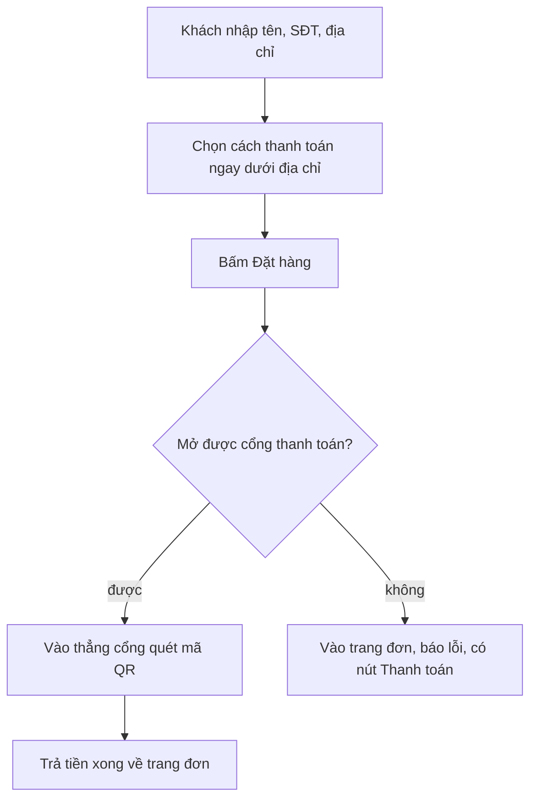

# Chọn phương thức thanh toán ngay ở form đặt hàng (luồng NHANH)
> Điều phối · 2026-10-11 · Trạng thái: **ĐÃ DUYỆT** (Duy yêu cầu trực tiếp). Nhánh `shop/fix-payment-method-on-checkout`.

## Yêu cầu nguyên văn
"bước chọn pttt thêm 1 bước hơi phiền, cho chọn pttt dưới lúc nhập địa chỉ luôn"

## Story SHOP-FIX-01 — Gộp chọn phương thức thanh toán vào form đặt hàng
Người làm: fe-dev. Backend không đổi (dùng `POST /api/shop/orders/` rồi `POST /api/shop/orders/<mã>/checkout/` có sẵn).

AC:
1. Form đặt hàng (C1, `/shop/checkout/`) có khối **"Phương thức thanh toán"** ngay dưới ô địa chỉ, trước ô đồng ý: một lựa chọn "Chuyển khoản ngân hàng (quét mã QR)" đã chọn sẵn (radio, vùng chạm ≥ 44 px), không ghi tên nhà cung cấp cổng thanh toán.
2. Bấm **"Đặt hàng"** hợp lệ: tạo đơn rồi tự mở cổng thanh toán, khách **vào thẳng trang quét mã** — không dừng ở trang đơn chờ bấm "Thanh toán". Nút hiện trạng thái đang xử lý, chống bấm đúp (giữ `client_request_id`).
3. Tạo đơn được nhưng **mở cổng lỗi** (`CHECKOUT_UNAVAILABLE`, mạng, 5xx): vào trang đơn D1 của đơn vừa tạo, có câu lỗi "Chưa mở được trang thanh toán. Thử lại." và nút "Thanh toán" — **không tạo đơn thứ hai**.
4. Trang đơn D1/D2 giữ nút "Thanh toán"/"Thanh toán lại" cho ca khách đóng cổng giữa chừng hoặc quay lại; trạng thái đơn từ server vẫn quyết định màn (E6).
5. Không đổi: mã giảm giá (B8), hết hàng (C3), lỗi mạng khi tạo đơn (C4), 429, Shop tạm ngưng, ô đồng ý không tick sẵn; không lộ dữ liệu cá nhân trên URL; 360 và 1280 không cuộn ngang.
