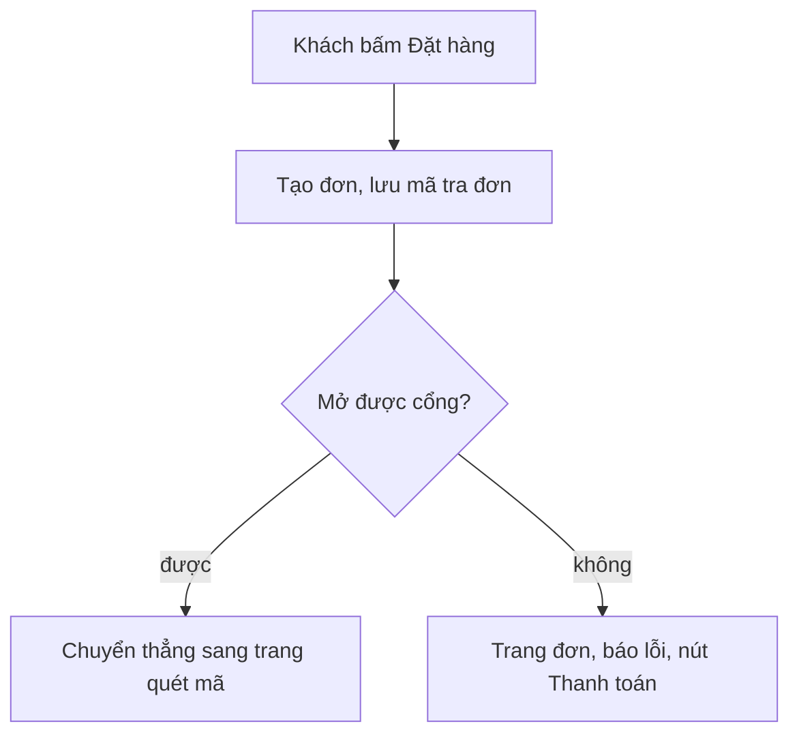

# SHOP-FIX-01 — Ghi chú dev (FE)

## Đã làm (chỉ `frontend/`, BE không đổi, không lệch contract 02b §3.3/§3.5)
- `features/checkout/components/PaymentChoice.tsx` (+ `.module.css`): fieldset/legend "Phương thức thanh toán", một radio "Chuyển khoản ngân hàng (quét mã QR)" chọn sẵn, vùng chạm >= 44px, token CSS, không tên cổng. Đặt trong `CheckoutScreen` ngay dưới ô địa chỉ, trước ô đồng ý.
- `CheckoutScreen.send`: tạo đơn -> lưu token, xoá requestId, xoá giỏ -> `startCheckoutSession` -> `redirectToGateway` (mock: `goToMockGateway`). Nút giữ trạng thái "Đang đặt…" khi đang chuyển (`openingRef`), chống bấm đúp bằng `submittingRef` như cũ. Mở cổng lỗi (mọi lỗi) -> `router.replace(orderUrl(code, true))`, không tạo đơn thứ hai (đơn đã tạo, `client_request_id` đã dùng).
- `features/checkout/afterCreate.ts` (mới, thuần): `orderUrl`, `OPEN_FAILED_MESSAGE`. Cờ `pay=failed` trên URL không chứa dữ liệu cá nhân.
- `OrderScreen`: `payError` khởi tạo "Chưa mở được trang thanh toán. Thử lại." khi có `pay=failed`; nút "Thanh toán"/"Thanh toán lại" của D1/D2 giữ nguyên.
- Mock (`lib/mock.ts`): tên khách chứa `#payfail` thì đơn vừa tạo mở cổng lỗi đúng một lần (cùng kiểu `#timeout`).
- Không đổi B8/C3/C4/429/X2 (chỉ thêm nhánh thành công của `try`).
- `scripts/test-order-state.mjs`: +3 ca (`orderUrl`, câu lỗi).

## Kiểm (chạy lượt này)
- `rm -rf .next && npm ci`, `npx tsc --noEmit`: sạch (TSC_OK).
- `NEXT_PUBLIC_USE_MOCK=0 NEXT_PUBLIC_API_BASE=http://localhost:8000 npm run build`: thành công.
- `check-no-mock.mjs`: XANH — không thấy seed mock nào trong bản build.
- `test-*.mjs`: cart-reconcile 20/20, catalog-view 21/21, format 33/33, home-content 37/37, order-state 81/81, phone 17/17, quantity 45/45, safe-href 40/40, voucher 35/35.
- `python3 scripts/check_naming.py`: OK, không phát sinh vi phạm mới. Hex rời trong CSS mới: 0.
- Playwright (dev mock): 360 và 1280 không cuộn ngang (scrollWidth = viewport), không lỗi console; đặt thường -> `/shop/checkout/?mock_gateway=1…`; đặt với `#payfail` -> `/shop/orders/?code=…&pay=failed` có câu lỗi và nút "Thanh toán".

## Ảnh (dữ liệu giả)
`shots/c1-pttt-360.png`, `shots/c1-pttt-1280.png`, `shots/d1-mo-cong-loi-360.png`.

## Nợ / lưu ý
- Radio chỉ có một lựa chọn nên `readOnly`; khi có thêm phương thức sẽ cần state và gửi giá trị lên BE (hiện BE chưa nhận field này).
- Chưa chạy với backend/SePay thật (redirect form POST giữ nguyên `gateway.ts`); QA nên thử trên staging.
