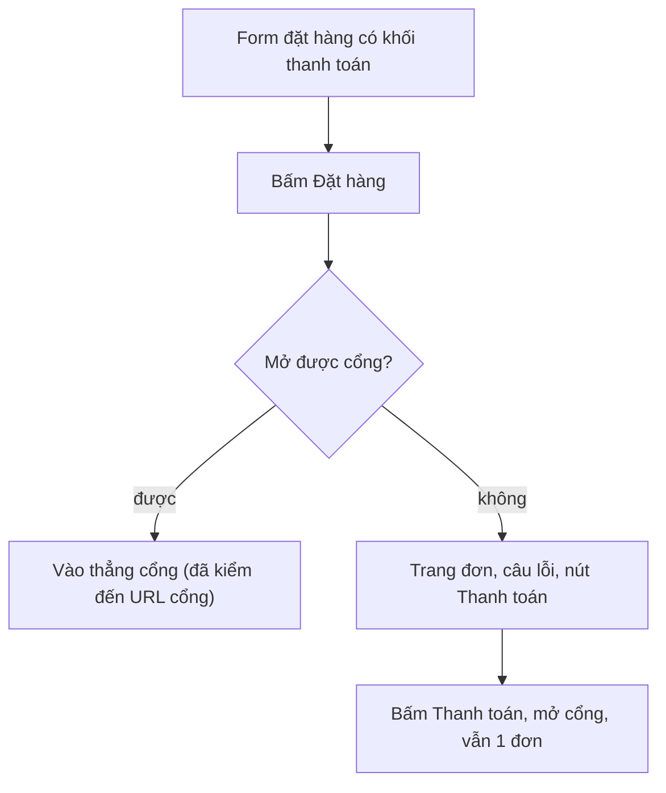

# QA — SHOP-FIX-01 Chọn phương thức thanh toán ở form đặt hàng · lần 1 · 2026-10-11

## Kết luận: APPROVED — 5/5 AC chạy thật trên trình duyệt (BE thật + Shop USE_MOCK=0), không lỗi chặn
## Tổng: 6 bộ e2e + node test · payment_choice 77 ✅ 0 ❌ · full_flow 99 ✅ · footer_consent 31 ✅ 1 ⏸ · ⏸ 1 (SHOP_CLOSED, xem dưới)

Điểm dừng ở cổng thanh toán: cổng SePay thật không gọi từ local. Trình duyệt thật bị chuyển sang `https://pay-sandbox.sepay.vn/v1/checkout/init` bằng form POST do BE ký (BE thật, SEPAY_ENV mặc định SANDBOX); Playwright chặn request đó, ghi body và trả trang giả. Phần sau (quét QR, IPN thật) chưa kiểm, nên thử ở staging.

## Theo AC
| AC | Kết quả | Bằng chứng |
|---|---|---|
| AC1 khối PTTT dưới địa chỉ | PASS (360 + 1280) | `shop_payment_choice.py::ac1`: fieldset+legend, 1 radio chọn sẵn, tên truy cập đúng, y địa chỉ < khối < ô đồng ý, vùng chạm ≥44px, HTML không có tên cổng, Tab từ ô địa chỉ tới radio, mũi tên không bỏ chọn, cuộn xuống không bị thanh dính đáy che. Ảnh `shots/qa/ac1-*.png` |
| AC2 đặt xong vào thẳng cổng, chống bấm đúp | PASS (360 + 1280) | dblclick: DB +1 đơn, 1 request tạo đơn, 1 lần POST cổng, URL cuối là URL cổng (không dừng ở trang đơn); nút khoá khi đang xử lý (tạo đơn bị làm chậm 1,5 s); form POST có mã đơn, success/cancel URL, không tên/SĐT/địa chỉ. `ac2-submitting-*.png` |
| AC3 mở cổng lỗi → D1 | PASS | 4 nhánh: BE trả 503 CHECKOUT_UNAVAILABLE (360, 1280), mất mạng, 500. Cả 4: URL `/shop/orders/?code=..&pay=failed`, câu "Chưa mở được trang thanh toán. Thử lại.", nút "Thanh toán", DB = đúng +1 đơn, 1 request tạo đơn. Gỡ lỗi rồi bấm "Thanh toán" → mở cổng, vẫn 1 đơn. `ac3-d1-error-*.png` |
| AC4 trang đơn giữ nút | PASS | Quay lại `/shop/orders/?code=` còn "Thanh toán"; bấm → mở cổng lại, không đơn mới; `result=cancel` còn nút; sau IPN (đơn đã trả theo server) nút biến mất (E6, server quyết định) |
| AC5 không đổi | PASS | full_flow 99 ✅ gồm C6 mã bị tắt (B8) báo popup không tạo đơn, C3 hết hàng, C4 mất mạng + thử lại cùng client_request_id = 1 đơn, 429 thật (C8), IPN 2 lần idempotent; footer_consent: ô đồng ý không tick sẵn, không POST khi chưa tick, 409 chính sách đổi rồi đặt lại = 1 đơn; chạy lại C3/C4 trong payment_choice |

## Ngoại lệ & biên (ngoài đường thuận)
bấm đúp; mất mạng tạo đơn rồi thử lại; hết hàng sau khi vào form; mở cổng lỗi 3 kiểu (503/mạng/500) rồi thử lại; trở về từ cổng huỷ; đơn đã trả mà mở màn cũ; chính sách đổi giữa chừng (409).

## Rò dữ liệu cá nhân
Không rò: URL (chỉ mã đơn + `pay=failed`), localStorage/sessionStorage, console, form POST gửi cổng, HTML trang đơn đều không chứa tên/SĐT/địa chỉ giả (quét trong payment_choice, full_flow, footer_consent). Giá vốn: không đổi BE; general_rules 132 ✅. Ảnh dùng dữ liệu giả.

## Hồi quy
Chạy lại cả bộ `run_shop_e2e.py`: design_screens 91 ✅ (4 ⏸ cũ), general_rules 132 ✅, erp_flow 41 ✅, content_pages 58 ✅, formats_timezones 73 ✅; full_flow/footer_consent xanh sau khi sửa kịch bản. `tsc --noEmit` sạch; `check-no-mock` xanh; 9 bộ `scripts/test-*.mjs` xanh (order-state 81/81); `check_naming` OK.

## Kịch bản e2e đã sửa (được phép sửa `frontend/e2e/**`)
Lần chạy đầu trên mã mới: full_flow và footer_consent đỏ vì còn chờ trang đơn + nút "Thanh toán" ngay sau khi đặt (hành vi cũ, AC2 đã đổi). Sửa: chặn cổng ngoài ở mọi context, chờ URL cổng, lấy mã đơn từ success_url trong form POST, rồi mở trang đơn kiểm AC4. Thêm bộ mới `shop_payment_choice.py` (đã đăng ký là suite `payment_choice`).

## Lỗi
Không có lỗi chặn.
- Ghi nhận Low: ca SHOP_CLOSED thật trong footer_consent ⏸ (BE từ chối gỡ đăng trang chính sách go-live, BR-ND-16), có từ trước, không liên quan sửa này.
- Ghi nhận Low: radio ở mép trái thẻ hơi sát viền trên 360 (ảnh `ac1-payment-block-360.png`).

## Lệnh đã chạy
- `python3 frontend/e2e/run_shop_e2e.py` (build USE_MOCK=0, API localhost:8000): lần 1 = 2 FAIL (kịch bản cũ), 5 PASS.
- `SHOP_E2E_SHOTS=…/shots python3 frontend/e2e/run_shop_e2e.py --skip-build --suite payment_choice --suite full_flow --suite footer_consent`: 73/99/31 PASS; chạy lại payment_choice sau khi thêm ca che khuất: 77 PASS.
- `npx tsc --noEmit` OK; `node scripts/test-*.mjs` xanh; `python3 scripts/check_naming.py` OK.
- Server/DB tạm đã dọn (cổng 8000/3000/3100/8001 trống). `frontend/out` là build USE_MOCK=0 API localhost:8000.
