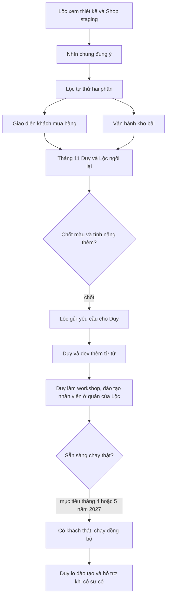

# Đánh giá của Lộc sau khi xem thiết kế và Shop staging, 2026-10-27
> Nguồn: Duy gửi ảnh chụp tin nhắn Messenger giữa Duy và Lộc ngày 27/10/2026. Ảnh không đưa vào repo (repo công khai), dưới đây là nội dung rút gọn.
> Nhãn: **(L)** Lộc nói · **(D)** Duy nói. Đây là trao đổi qua tin nhắn, chưa phải buổi họp chốt.

## 1. Lộc nhận xét gì
| # | Nội dung | Nhãn |
|---|---|---|
| N1 | Xem canvas thiết kế Shop: "dã man", "nghe hay á". **Nhìn chung đúng ý hết rồi.** | L |
| N2 | Khoảng tháng 11 hai bên ngồi lại. Lộc sẽ đưa **phần cập nhật thêm tính năng** và **chốt màu**. | L |
| N3 | Hỏi web này sau này có nối vào shop mua bán không. Duy: **đang nối rồi**, phải nhập hàng ở ERP thì mới hiện lên Shop để bán. | L / D |
| N4 | Hiểu "Hải sản" là chỗ để mua. **Chưa hiểu "Góc bếp" là trang về gì.** Duy giải thích: hải sản này rồi cũng vào nồi, nên có trang marketing (món ăn, cách nấu) rồi dẫn sang sản phẩm combo. Lộc ghi lại, lần gặp tới sửa. | L / D |
| N5 | Duy: đã tuyển dev để kiểm tra code. Còn **thanh toán nhiều loại** và **lắp giao diện** là xong. Sau đó xuống quán của Lộc ráp quy trình và đào tạo nhân viên. | D |
| N6 | Lộc: chốt xong UI/UX, chạy ổn hết chức năng rồi mới deploy. Duy: phải có workshop với đội và đào tạo, không thì hệ thống cũng chỉ vậy. | L / D |
| N7 | Ai đào tạo? Duy: **phần lớn là Duy.** | L / D |
| N8 | Hiện có hai phần chính cần thử: **(1) UI/UX của khách**, **(2) vận hành kho bãi**. Duy xác nhận đúng. | L / D |
| N9 | Lộc sẽ thử rồi gặp Duy để làm cho xong, sau đó cho dev làm từ từ. Lộc hỏi có cần chốt hết rồi mới dev không, dev nối thêm được không. | L |
| N10 | Duy: **Lộc cứ ra yêu cầu rồi gửi qua Duy, Duy với dev thêm từ từ.** Thêm tính năng thì làm thêm UI/UX rồi dev thêm. | D |
| N11 | Lộc hỏi chi phí dev Duy thuê, nhờ **ghi ra để Lộc cân đối**. Duy: sẽ ngồi với dev rồi báo lại. Duy đề nghị hai bên làm thành quy trình làm việc. | L / D |
| N12 | Lộc: Duy phải lo **đào tạo và help desk**. Lộc **mong tháng 4 hoặc tháng 5 năm 2027 chạy**. Duy: bắt buộc rồi, hiểu. | L / D |
| N13 | Duy hỏi lại: "chạy" là có khách thật và chạy đồng bộ? Bên Lộc có người vào kiểm quy trình để ráp? (**chưa có trả lời** trong ảnh) | D |

## 2. Điều đã thống nhất
- Thiết kế Shop hiện tại **đúng hướng**. Không có yêu cầu làm lại.
- **Cách nhận yêu cầu mới:** Lộc gửi yêu cầu cho Duy, Duy cùng dev thêm dần. Không cần chốt toàn bộ trước rồi mới làm. Mỗi yêu cầu vẫn đi qua workflow đội như hiện nay (BA → PO → … với tính năng mới).
- **Mục tiêu chạy thật:** tháng 4 hoặc tháng 5 năm 2027 (mong muốn của Lộc, chưa phải hạn chốt).
- **Đào tạo và hỗ trợ sau go-live:** Duy là người chính.
- **Hai mảng thử trước khi chốt:** giao diện khách (Shop) và vận hành kho (ERP).

## 3. Việc cần làm
| # | Việc | Ai | Khi nào |
|---|---|---|---|
| V1 | Thử Shop staging theo vai khách và ERP staging theo vai kho, ghi lại chỗ chưa ổn | Lộc | Trước buổi tháng 11 |
| V2 | Ngồi với dev, ước lượng chi phí, gửi Lộc | Duy | Duy hẹn "báo lại" |
| V3 | Viết quy trình làm việc Duy – Lộc – dev (yêu cầu đi từ đâu, ai duyệt, bao lâu một đợt) | Duy + Lộc | Chưa hẹn |
| V4 | Buổi ngồi tháng 11: chốt màu, tính năng thêm, Góc bếp, các câu còn chờ ở `doc/ops/hoi-loc.md` | Duy + Lộc | Tháng 11/2026 |
| V5 | Hỏi lại N13: "chạy" là khách thật và đồng bộ kho; bên Lộc có ai kiểm quy trình | Duy | Đang chờ Lộc trả lời |

## 4. Ghi chú của điều phối viên (đối chiếu với repo)
1. **"Có hàng mới hiện Shop" (N3).** Theo code (`backend/apps/catalog/items/shop_api.py`), mặt hàng **hiện** trên Shop khi đang bật và có giá niêm yết hiệu lực. Chưa có lô còn tồn thì vẫn hiện nhưng ghi "Hết hàng". Muốn **bán được** thì phải nhập lô ở ERP. Nên nói với Lộc đủ hai bước: tạo mặt hàng có giá, rồi nhập lô.
2. **Góc bếp chưa tự nói được nó là gì (N4).** Lộc là người hiểu sản phẩm nhất mà còn chưa hiểu, nên khách cũng dễ không hiểu. Chỗ để xử lý ở buổi tháng 11: tên mục (vd "Góc bếp – món ngon từ cá"), một dòng giới thiệu ở đầu trang, và mỗi bài dẫn sang combo hoặc mặt hàng để mua. Bài CMS đã có khối thẻ mặt hàng (`item_card`, 6 khối đang chờ mã hàng thật, `06-marketing.md`), combo dạng gói đã có ở backend (decisions 2026-09-10). Phần lớn là việc nội dung, không cần code mới.
3. **"Thanh toán nhiều loại" (N5) chưa có hồ sơ.** Shop hiện chỉ có một phương thức "Chuyển khoản ngân hàng (quét mã QR)"; backend chưa nhận trường phương thức (`2026-10-11-pttt-o-form-dat-hang/03-dev-notes.md`). Quyết định đang hiệu lực: "**V1 chỉ có VietQR**: không thẻ, không NAPAS khác, không cọc, thanh toán 100%" (decisions 2026-09-26, SePay) và **không thu tiền khi nhận** (decisions 2026-10-10). Thêm bất kỳ phương thức nào (thẻ, ví, thu tiền khi nhận) đều là **lật quyết định này**, Duy phải chốt và ghi `doc/decisions.md`. Cần Duy cho danh sách phương thức cụ thể rồi mới mở hồ sơ (luồng ĐẦY ĐỦ, có `legal-vn` vì đụng thanh toán).
4. **Chốt màu (N2).** Màu hiện tại nằm ở `DESIGN.md`: một màu nhấn `#1F66D1`, thêm `brand-deep` `#0E3A73`. Đổi màu chỉ cần sửa token, nhưng phải chạy lại QA so ảnh màn và kiểm tương phản. Nên chốt trước khi lắp giao diện các màn còn lại.
5. **Dev người thật (N5, N11).** Quy trình hiện tại trong `CLAUDE.md` là đội Claude tự code, QA và commit. Khi có dev Duy thuê, cần chốt dev làm phần nào và review ra sao. Duy đã nói sẽ ngồi với dev rồi báo lại; **chưa đổi gì** trong `CLAUDE.md` tới lúc đó.
6. **Mốc tháng 4–5/2027.** Còn khoảng 5–6 tháng. Những việc không phải code nhưng chặn go-live: thông tin doanh nghiệp và tên miền (L15), nghĩa vụ hoá đơn (L16), đơn vị giao hàng và việc gửi dữ liệu khách cho hãng (L3, L4), ảnh thật (L13), hotline và giờ làm việc (L14), thủ tục pháp lý AI nếu bật AI tự ghi trên production. Danh sách ở `doc/ops/hoi-loc.md` và `doc/ops/go-live-phap-ly.md`.
7. **Thử vận hành kho (N8).** Nên có kịch bản thử cho Lộc theo từng vai (nhập lô ở cảng, soạn hàng, gọi xác nhận, giao, hao hụt, chốt lô). Điều phối viên soạn được khi Duy cần.
