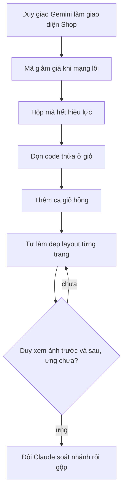

# Giao việc — Gemini CLI làm tiếp giao diện Shop web

> Claude (điều phối) · 2026-11-11 · Trạng thái: **SẴN SÀNG CODE** (Duy giao ngày 11/11)
> Người hiện thực: **Gemini CLI**, theo luật trong `GEMINI.md` ở gốc repo. Chỉ phần giao diện Shop web (`frontend/`).
> Nhánh: `gemini/shop-ui` tách từ `main`, mỗi việc một commit. Không push, không gộp `main`.
> Ghi chú dev: `03-dev-notes.md` · Báo cáo QA: `04-qa-report.md` · Ảnh: `shots/` (cùng thư mục này).

## Điều kiện đầu vào
- Shop làm lại đã xong lô 0–7 (hồ sơ `doc/features/2026-10-06-shop-giao-dien-moi/`), đang chạy production `api:v25`.
- Các việc dưới đây lấy từ nợ ghi ở `02b-tech-design.md` §12 và `03b-review-lo7.md` của hồ sơ đó, chỉ giữ việc thuần giao diện.

## Việc

| ☐/☑ | Mã | Việc | File chính | Phải đạt | e2e thêm | Commit |
|---|---|---|---|---|---|---|
| ☑ | GUI-01 | **Mã giảm giá khi kiểm bị lỗi mạng** (review lô 7, L1). Kiểm lại trước: code hiện ghi "thiếu kết quả kiểm thì không gửi mã" (`CheckoutScreen.tsx` quanh dòng 178). Nếu đúng là khi `voucher.quote` rỗng thì đơn gửi đi **không** kèm mã, tóm tắt khớp số tiền đơn thật, thì chỉ viết ca kiểm chứng rồi đóng việc. Nếu mã vẫn được gửi thì hiện dòng nhỏ "Mã X · sẽ kiểm khi đặt" ở khối tóm tắt | `frontend/features/checkout/components/CheckoutScreen.tsx`, `frontend/features/cart/**` | Chặn mạng ở `/api/shop/vouchers/check/` (Playwright `route.abort`), đặt đơn: số tiền ở tóm tắt bằng số tiền trang thanh toán hiện. Ảnh 360 + 1280 | `full_flow` | `e7e8cdf` |
| ☑ | GUI-02 | **Hộp "mã hết hiệu lực" (B8) gạch rồi in lại cùng một số** (L3). Khi chưa có giá máy chủ thì `discountedPrice` bằng `localTotal`, hộp gạch số cũ và in lại đúng số đó. Không có số giảm thì ẩn phần gạch, chỉ hiện tổng | `CheckoutScreen.tsx` (đoạn `setVoucherGone`, hiển thị `goneOld`) | Ca: mã hết hiệu lực khi chưa từng kiểm được → không có `<del>` trùng số. Ca có giảm → vẫn gạch đúng như màn `doc/design/shop/screens/B8*` | `full_flow` | `9084fcc` |
| ☐ | GUI-03 | **Dọn state chết ở giỏ** (L4). Xoá `const [, setBlocked]` và hai chỗ gọi `setBlocked` trong `CartScreen.tsx`. Sửa thụt lề `hotline={hotline}` ở `CatalogScreen.tsx:204` và `ItemDetailScreen.tsx:98` | `frontend/features/cart/components/CartScreen.tsx`, `frontend/features/catalog/components/{CatalogScreen,ItemDetailScreen}.tsx` | `tsc`, build, toàn bộ `test-*.mjs` xanh; giỏ có món hết vẫn chặn đặt như màn B3 (ảnh) | `general_rules` | — |
| ☐ | GUI-04 | **Ca e2e giỏ hỏng trong localStorage** (L5). Thêm 1 ca vào `shop_general_rules.py`: ghi giỏ có giá `"abc"` và `null` vào localStorage rồi mở `/shop/cart/` và trang đặt hàng → không thấy `NaN`, `undefined`, `Infinity` ở trang, không lỗi console | `frontend/e2e/shop_general_rules.py` | Ca mới chạy và PASS; thử làm hỏng tạm `CartContext.tsx` (không commit) để thấy ca đỏ | `general_rules` | — |
| ☐ | GUI-05 | **Làm đẹp layout toàn Shop, bạn tự sáng tạo** (`GEMINI.md` mục 2). Làm lần lượt từng cụm, mỗi cụm một commit: (a) trang chủ, (b) danh mục + chi tiết món, (c) giỏ, (d) đặt hàng + thanh toán, (e) tra đơn, (f) trang nội dung, Góc bếp, giới thiệu, 404 | `frontend/app/**`, `frontend/components/**`, `frontend/features/**`, `frontend/app/globals.css` | Mỗi cụm có ảnh **trước và sau** ở 360 + 1280 trong `shots/gui-05/`. Đủ thông tin và chức năng như cũ, e2e vẫn xanh | `design_screens` + bộ của cụm (`content_pages` cho cụm f) | — |

## Không giao cho Gemini (lý do)
- L2 đơn giá ở trang thanh toán suy từ thành tiền: cần backend trả thêm khoá, đổi contract 02b.
- L6 test throttle ở backend, nâng `next` 15 / `npm audit`: ngoài phạm vi, nâng major cần Duy quyết.
- Google Maps (cần key), câu chữ chính sách và hỏi Lộc (`doc/ops/hoi-loc.md`): việc của Duy và `mkt-brand`/`legal-vn`.

## Điểm dừng hỏi Duy
- Bất kỳ điểm dừng nào ở `GEMINI.md` mục 3.
- Hết việc ☐. Khi báo, gửi kèm đường dẫn ảnh trước và sau của GUI-05 để Duy xem.
