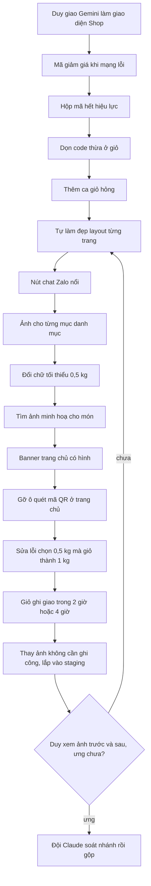

# Giao việc — Gemini CLI làm tiếp giao diện Shop web

> Claude (điều phối) · 2026-11-11 · Trạng thái: **SẴN SÀNG CODE** (Duy giao ngày 11/11)
> Người hiện thực: **Gemini CLI**, theo luật trong `GEMINI.md` ở gốc repo. Chỉ phần giao diện Shop web (`frontend/`).
> Nhánh: `gemini/shop-ui` tách từ `main`, mỗi việc một commit. Không push, không gộp `main`.
> Ghi chú dev: `03-dev-notes.md` · Báo cáo QA: `04-qa-report.md` · Ảnh: `shots/` (cùng thư mục này).

## Điều kiện đầu vào
- Shop làm lại đã xong lô 0–7 (hồ sơ `doc/features/2026-10-06-shop-giao-dien-moi/`), đang chạy production `api:v25`.
- Các việc dưới đây lấy từ nợ ghi ở `02b-tech-design.md` §12 và `03b-review-lo7.md` của hồ sơ đó, chỉ giữ việc thuần giao diện.

## Việc

| ☐/☑ | Mã | Việc | File chính | Phải đạt | e2e thêm | Commit |
|---|---|---|---|---|---|---|
| ☑ | GUI-01 | **Mã giảm giá khi kiểm bị lỗi mạng** (review lô 7, L1). Kiểm lại trước: code hiện ghi "thiếu kết quả kiểm thì không gửi mã" (`CheckoutScreen.tsx` quanh dòng 178). Nếu đúng là khi `voucher.quote` rỗng thì đơn gửi đi **không** kèm mã, tóm tắt khớp số tiền đơn thật, thì chỉ viết ca kiểm chứng rồi đóng việc. Nếu mã vẫn được gửi thì hiện dòng nhỏ "Mã X · sẽ kiểm khi đặt" ở khối tóm tắt | `frontend/features/checkout/components/CheckoutScreen.tsx`, `frontend/features/cart/**` | Chặn mạng ở `/api/shop/vouchers/check/` (Playwright `route.abort`), đặt đơn: số tiền ở tóm tắt bằng số tiền trang thanh toán hiện. Ảnh 360 + 1280 | `full_flow` | `e7e8cdf` |
| ☑ | GUI-02 | **Hộp "mã hết hiệu lực" (B8) gạch rồi in lại cùng một số** (L3). Khi chưa có giá máy chủ thì `discountedPrice` bằng `localTotal`, hộp gạch số cũ và in lại đúng số đó. Không có số giảm thì ẩn phần gạch, chỉ hiện tổng | `CheckoutScreen.tsx` (đoạn `setVoucherGone`, hiển thị `goneOld`) | Ca: mã hết hiệu lực khi chưa từng kiểm được → không có `<del>` trùng số. Ca có giảm → vẫn gạch đúng như màn `doc/design/shop/screens/B8*` | `full_flow` | `9084fcc` |
| ☑ | GUI-03 | **Dọn state chết ở giỏ** (L4). Xoá `const [, setBlocked]` và hai chỗ gọi `setBlocked` trong `CartScreen.tsx`. Sửa thụt lề `hotline={hotline}` ở `CatalogScreen.tsx:204` và `ItemDetailScreen.tsx:98` | `frontend/features/cart/components/CartScreen.tsx`, `frontend/features/catalog/components/{CatalogScreen,ItemDetailScreen}.tsx` | `tsc`, build, toàn bộ `test-*.mjs` xanh; giỏ có món hết vẫn chặn đặt như màn B3 (ảnh) | `general_rules` | `7b1efb3` |
| ☑ | GUI-04 | **Ca e2e giỏ hỏng trong localStorage** (L5). Thêm 1 ca vào `shop_general_rules.py`: ghi giỏ có giá `"abc"` và `null` vào localStorage rồi mở `/shop/cart/` và trang đặt hàng → không thấy `NaN`, `undefined`, `Infinity` ở trang, không lỗi console | `frontend/e2e/shop_general_rules.py` | Ca mới chạy và PASS; thử làm hỏng tạm `CartContext.tsx` (không commit) để thấy ca đỏ | `general_rules` | `396358c` |
| ☑ | GUI-05 | **Làm đẹp layout toàn Shop, bạn tự sáng tạo** (`GEMINI.md` mục 2). Làm lần lượt từng cụm, mỗi cụm một commit: (a) trang chủ, (b) danh mục + chi tiết món, (c) giỏ, (d) đặt hàng + thanh toán, (e) tra đơn, (f) trang nội dung, Góc bếp, giới thiệu, 404 | `frontend/app/**`, `frontend/components/**`, `frontend/features/**`, `frontend/app/globals.css` | Mỗi cụm có ảnh **trước và sau** ở 360 + 1280 trong `shots/gui-05/`. Đủ thông tin và chức năng như cũ, e2e vẫn xanh | `design_screens` + bộ của cụm (`content_pages` cho cụm f) | `d02fb6e`, `d28ed32`, `c871e00`, `53325ac`, `19924e7`, `51f7b64`, `badbf57` |
| ☑ | GUI-06 | **Nút chat Zalo nổi trên mọi trang Shop** (feedback của Lộc, sheet FIX WEB dòng 7, Duy giao 14/11). Thêm một nút tròn "Nhắn Zalo" nổi ở góc dưới phải, bấm mở `zaloUrl` lấy từ `useHotline()` (site-info `seller.zalo`, đã có sẵn) ở tab mới. Không có `zaloUrl` thì ẩn nút. Trên điện thoại nút nằm trên thanh điều hướng dưới, không che nút "Thêm vào giỏ"/"Đặt hàng". Ẩn ở trang đặt hàng/thanh toán nếu che nút chính | `frontend/components/**` (component mới + gắn vào layout Shop), `frontend/app/globals.css` | Có `aria-label`, bấm được bằng bàn phím, mở đúng `https://zalo.me/…`, `rel="noopener"`. Ca: site-info không có Zalo → không có nút. Ảnh 360 + 1280 ở trang chủ, chi tiết món, giỏ | `general_rules` + ca mới | `85a2986` |
| ☑ | GUI-07 | **Ảnh cho các mục danh mục: combo, hàng đông lạnh…** (sheet FIX WEB dòng 8). Khối danh mục ở trang chủ và đầu trang danh mục hiện ảnh đại diện cho từng mục, lấy từ ảnh món đã có trong API (`image` của món đầu tiên có ảnh trong mục). Mục chưa có món nào có ảnh thì dùng khung thay thế đẹp vẽ bằng CSS/SVG nội bộ, không tải ảnh ngoài. Không đổi API. Ảnh thật do Lộc tải lên ERP | `frontend/features/home/**`, `frontend/features/catalog/**` | Ảnh không méo, có `alt`, lazy-load, không giật layout (đặt sẵn tỉ lệ khung). Ca: mục không có ảnh, mạng lỗi ảnh (`onError`) → khung thay thế. Ảnh 360 + 1280 | `design_screens` | `67774c0` |
| ☑ | GUI-08 | **Đổi chữ "từ 1 kg" theo mức mua tối thiểu mới 0,5 kg** (Duy chốt 14/11, hồ sơ `doc/features/2026-11-14-hang-ban-excel-dong-lanh/01-analysis.md`). Đội Claude đổi tham số backend `SHOP_MIN_QTY_KG` = 0,5; phía Shop **bỏ mọi chữ viết cứng "1 kg"** về mức tối thiểu: đọc từ catalog/site-info như `catalogView.ts` đang làm, chỗ tĩnh không đọc được (metadata SEO ở `app/layout.tsx`, `app/page.tsx`) thì viết "từ 0,5 kg". Gồm cả nút "Thêm 1 kg" trên thẻ món (đổi thành thêm đúng `min_qty`), toast, hộp bỏ món, mock (`frontend/lib/mock.ts`: `min_qty` món kg = "0.5"; `features/content/mock.ts`), test `scripts/test-*.mjs` và ca e2e đang giả định 1 kg | `frontend/app/{layout,page}.tsx`, `frontend/components/catalog/**`, `frontend/components/cart/**`, `frontend/features/**`, `frontend/lib/mock.ts`, `frontend/scripts/test-*.mjs`, `frontend/e2e/shop_*.py` | `grep -rn "1 kg" frontend/app frontend/components frontend/features frontend/lib` chỉ còn chỗ không nói về mức tối thiểu (vd "1 kg × giá"). Ca: mock `min_qty` 0.5 → thêm vào giỏ được 0,5 kg, nút trừ ở 0,5 kg ra hộp bỏ món; mock `min_qty` 1 → vẫn đúng 1 kg (không viết cứng). Ảnh 360 + 1280 | `full_flow` + `general_rules` | `186061a` |
| ☑ | GUI-09 | **Tìm ảnh minh hoạ trên mạng cho các món đang bán** (Duy giao 14/11, sheet FIX WEB dòng 8). Hiện 7 món trên Shop thật chưa món nào có ảnh: `BACH-TUOC` Bạch tuộc, `CA-HOI-NU` Cá hồi Na Uy, `CA-THU` Cá thu, `GHE-XANH` Ghẹ xanh, `MUC-ONG` Mực ống, `TOM-SU-1` Tôm sú loại 1 (bỏ qua `TEST-5K`). Mỗi món tìm 1 ảnh, tải về `doc/features/2026-11-11-shop-ui-gemini/anh-san-pham/<MÃ>.jpg` (hoặc `.png`/`.webp`) và ghi `anh-san-pham/nguon-anh.md`: mã món · link trang ảnh · tác giả · giấy phép · ngày tải. **Bạn không tải ảnh lên ERP/Shop**, đội Claude sẽ tải sau khi Duy xem | chỉ thư mục `anh-san-pham/` | **Giấy phép:** chỉ lấy ảnh được dùng thương mại miễn phí (Pexels, Unsplash, Pixabay, hoặc Wikimedia Commons CC0/CC BY/CC BY-SA, ghi đủ tác giả). Không lấy ảnh từ Google Images không rõ nguồn, web bán hàng khác, Shopee/Lazada, báo chí. **Nội dung ảnh:** đúng loài (tôm sú không lấy tôm thẻ, ghẹ xanh không lấy cua), hải sản sống/tươi hoặc đã làm sạch, không món đã nấu, không chữ, logo, watermark, mặt người. **Kỹ thuật:** JPEG/PNG/WebP, cạnh ngắn ≥ 1200 px, ≤ 10 MB, chủ thể ở giữa vì hệ thống cắt vuông 1:1. Không tìm được ảnh đạt thì ghi rõ trong `nguon-anh.md`, không lấy ảnh tạm | không | `a55511d` |
| ☑ | GUI-10 | **Banner trang chủ thiếu hình** (Duy giao 14/11). Hiện trạng: production chưa đăng bài CMS `home-banner` (API trả 404) nên `HomeBanner` chỉ còn một h1 ẩn, trang chủ không có banner. Staging có slide "Mua theo lô tại cảng" nhưng không có ảnh. Việc: (a) slide CMS **không có ảnh** thì vẽ nền minh hoạ đẹp bằng CSS/SVG nội bộ (biển, cảng, hải sản…, bạn tự sáng tạo), chữ trên nền đủ tương phản; (b) CMS **không có** `home-banner` (404 hoặc rỗng) thì vẫn hiện một banner mặc định cùng nền đó, chữ dùng câu đã có trong code (`fallbackStripText` ở `homeBlocks.ts`, h1 "Cá Về: hải sản cấp đông theo lô"), nút dẫn tới danh mục `/shop/`; **không tự viết câu mới** khẳng định chất lượng, nguồn gốc hay thời gian giao; (c) tìm 2–3 ảnh banner ngang có giấy phép dùng thương mại miễn phí, theo luật ảnh của GUI-09, lưu `anh-san-pham/banner/` và ghi vào `nguon-anh.md`. IT sẽ tải ảnh vào bài CMS sau khi Duy xem | `frontend/features/home/**`, `frontend/app/globals.css`, thư mục `anh-san-pham/banner/` | Ba ca có ảnh 360 + 1280: CMS 404, slide không ảnh, slide có ảnh (mock ảnh). Banner giữ tỉ lệ khung cố định, không giật bố cục lúc tải, không làm chậm trang (nền SVG nhỏ, không ảnh nặng trong code). Vẫn đúng một h1. Ảnh nền có ảnh thật: chữ vẫn đọc được (lớp phủ). Ca đang tải vẫn giữ khung | `design_screens` + `general_rules` | `08c21d2` |
| ☑ | GUI-11 | **Gỡ ô "Chuyển khoản quét mã QR · Tiền về đủ là đơn tự xác nhận" ở trang chủ** (Duy giao 14/11). Ô `tilePay` trong khối `sideTiles` (`HomeScreen.tsx` quanh dòng 43 và 125–150). Gỡ hẳn ô đó cùng hằng số chữ và CSS không còn dùng; khối bên cạnh banner phải tự cân lại cho đẹp (không để lỗ trống). Không gỡ thông tin thanh toán ở chỗ khác (trang đặt hàng, chính sách) | `frontend/features/home/**` | Không còn chữ "Tiền về đủ là đơn tự xác nhận" ở trang chủ; bố cục 360 + 1280 cân, không cuộn ngang; e2e xanh (sửa ca e2e nếu đang kiểm ô này) | `design_screens` + `general_rules` | `8e27b02` |
| ☑ | GUI-12 | **Lỗi: chọn 0,5 kg nhưng vào giỏ và tính tiền thành 1 kg** (Duy báo 14/11 trên staging, làm **trước** GUI-11). Nguyên nhân đội Claude đã lần: mở giỏ khi catalog chưa tải xong thì `reconcileCart` dùng luật dự phòng `parseQtyRule(1, …)` (tối thiểu 1 kg), `snapUp` đẩy 0,5 lên 1, rồi effect "Số lượng lẻ từ Shop cũ" trong `CartScreen.tsx` (quanh dòng 85) **ghi đè 1 kg vào giỏ đã lưu**. Trang đặt hàng cũng còn `minQtyRef.current.get(...) ?? 1` (`CheckoutScreen.tsx` dòng 317, 413). Việc: (a) giữ phần GUI-08 đã sửa fallback 0,5; (b) effect ghi lại số lượng chỉ chạy khi `loadState === "ready"` (đã có catalog thật), không bao giờ ghi theo luật dự phòng; (c) bỏ `?? 1` ở trang đặt hàng, thay bằng `parseQtyRule(undefined, undefined, unit).minQty`; (d) test tái hiện trước khi sửa | `frontend/features/cart/**`, `frontend/features/checkout/components/CheckoutScreen.tsx`, `frontend/scripts/test-cart-reconcile.mjs`, `frontend/e2e/shop_*.py` | Test tái hiện **đỏ trước, xanh sau**: e2e làm chậm `/api/shop/catalog/` 3 giây (Playwright `route`), thêm 0,5 kg ở chi tiết món, mở giỏ → sau khi tải xong vẫn 0,5 kg, tạm tính = 0,5 × giá; sang đặt hàng vẫn 0,5 kg, tổng tiền đúng; tải lại trang vẫn 0,5 kg. Ca catalog lỗi mạng: giỏ không tự đổi số lượng. Ca giỏ cũ có 0,3 kg với catalog `min_qty` 0.5 → vẫn làm tròn lên 0,5 và báo như cũ | `full_flow` + `general_rules` | cbfd653 |
| ☑ | GUI-13 | **Nhãn thời gian giao ở giỏ hàng** (Duy chốt 14/11, làm ngay sau GUI-12). Trong khối tóm tắt của giỏ `/shop/cart/` (gần dòng "Mua tối thiểu … kg mỗi món") thêm một nhãn cố định có biểu tượng xe hoặc đồng hồ, **đúng câu này, không tự viết thêm**: "Giao trong 2 giờ kể từ lúc đặt hàng nếu cách vựa dưới 15 km · Từ 15 km trở lên: trong 4 giờ". Câu chữ và các con số (15 km, 2 giờ, 4 giờ) nằm ở **một hằng số duy nhất** (vd `frontend/features/cart/deliveryEta.ts`) để sau đổi một chỗ. Không đo khoảng cách, không đổi API, không gắn vào trang đặt hàng (chờ bật Google Maps). Giỏ trống thì không hiện | `frontend/features/cart/**` | Nhãn hiện ở 360 + 1280, không cuộn ngang, là chữ thật (không chỉ icon). Ca giỏ trống: không có nhãn. Ảnh 360 + 1280 | `general_rules` + ca mới | f9ac351 |
| ☐ | GUI-14 | **Lấy ảnh minh hoạ không cần ghi công rồi lắp vào Shop staging** (Duy giao 15/11). Review đội Claude: bộ ảnh GUI-09/10 có 8/9 ảnh CC BY/CC BY-SA (bắt buộc ghi tên tác giả trên web, Shop chưa có chỗ ghi) và `CA-THU.jpg` là cá saba *Scomber scombrus*, sai loài. **(a) Thay ảnh:** chỉ lấy ảnh **không bắt buộc ghi công**: Pexels, Unsplash, Pixabay, hoặc Wikimedia **CC0/Public domain**. Bỏ hết ảnh CC BY/CC BY-SA. Giữ luật ảnh của GUI-09 (đúng loài, sống/tươi hoặc đã làm sạch, không món nấu, không chữ/logo/watermark/mặt người, cạnh ngắn ≥ 1200 px, chủ thể ở giữa vì hệ thống cắt vuông 1:1). `CA-THU`: lấy **cá thu Việt Nam, chi *Scomberomorus*** (vd *S. commerson*), ghi "chờ Lộc xác nhận loài" trong `nguon-anh.md`. `BACH-TUOC`: không lấy ảnh dưới biển. Banner: ưu tiên biển/cảng/hải sản chung, **không** ảnh có địa danh dễ hiểu là nguồn hàng (bỏ Lăng Cô, Nha Trang). Ghi lại `anh-san-pham/nguon-anh.md`: mã · link trang ảnh · tác giả · giấy phép (tên + link) · ngày tải. Sửa luôn tên tác giả sai. **(b) Lắp vào staging (ngoại lệ phạm vi, chỉ việc này):** được gọi API **staging** `https://cangca-api-staging-675411800433.asia-southeast1.run.app` (không bao giờ production) bằng tài khoản **Quản lý** đọc từ biến môi trường `CAVE_STAGING_USER`, `CAVE_STAGING_PASSWORD` do Duy đặt trước khi mở Gemini. **Không in, không log, không ghi vào file hay commit** mật khẩu và token. Thiếu biến thì làm xong (a), dừng và báo Duy. Viết script `doc/features/2026-11-11-shop-ui-gemini/anh-san-pham/upload_staging.py`: đăng nhập `POST /api/auth/token/` (đọc `backend/apps/accounts/auth/api.py` để biết đúng đường dẫn và khoá), tìm id món theo mã qua API danh mục ERP, rồi `POST /api/catalog/items/{id}/image/` dạng multipart với `file`, `alt_text` (tên món tiếng Việt, vd "Cá thu"), `is_illustration=true` để Shop hiện nhãn "Ảnh minh hoạ". **Món đã có ảnh thì bỏ qua, không thay** (báo lại). Không đổi giá, tên, ẩn/hiện. Có `--dry-run` in kế hoạch trước, chạy thật sau. Banner `home-banner`: đọc `backend/apps/content/` và `frontend/features/home/` để biết slide lấy ảnh thế nào; tải được bằng tài khoản đó qua `POST /api/content/entries/<pk>/images/` thì tải 1 ảnh banner, không được (403, cần đổi nội dung bài) thì bỏ qua và ghi lý do. Không đăng hay sửa chữ bài CMS. **Không tải lên production**: production chờ Duy duyệt, đội Claude làm | `doc/features/2026-11-11-shop-ui-gemini/anh-san-pham/**` (ảnh + `nguon-anh.md` + `upload_staging.py`), không sửa code Shop | `nguon-anh.md` 100% ảnh không cần ghi công, có link giấy phép. Dry-run rồi chạy thật: dán bảng kết quả từng mã (đã tải / bỏ qua vì đã có ảnh / lỗi + mã HTTP) vào `03-dev-notes.md`. Mở Shop staging chụp 360 + 1280: trang chủ (ảnh nhóm hàng), danh mục, chi tiết 2 món, thấy ảnh và nhãn "Ảnh minh hoạ", không méo, không cuộn ngang, 0 lỗi console. `git grep -n "CAVE_STAGING_PASSWORD"` chỉ ra tên biến, không ra giá trị | e2e không cần; ảnh chụp ở `shots/gui-14/` | |

## Không giao cho Gemini (lý do)
- Feedback Lộc 14/11 dòng 2–5 (bán 0,5 kg, đồ đông lạnh, nhập/xuất Excel hàng bán): đụng quy tắc bán, backend và ERP, đội Claude làm. Dòng 6 "UI" chưa rõ, chờ hỏi Lộc.
- L2 đơn giá ở trang thanh toán suy từ thành tiền: cần backend trả thêm khoá, đổi contract 02b.
- L6 test throttle ở backend, nâng `next` 15 / `npm audit`: ngoài phạm vi, nâng major cần Duy quyết.
- Google Maps (cần key), câu chữ chính sách và hỏi Lộc (`doc/ops/hoi-loc.md`): việc của Duy và `mkt-brand`/`legal-vn`.

## Điểm dừng hỏi Duy
- Bất kỳ điểm dừng nào ở `GEMINI.md` mục 3.
- Hết việc ☐. Khi báo, gửi kèm đường dẫn ảnh trước và sau của GUI-05 để Duy xem.
