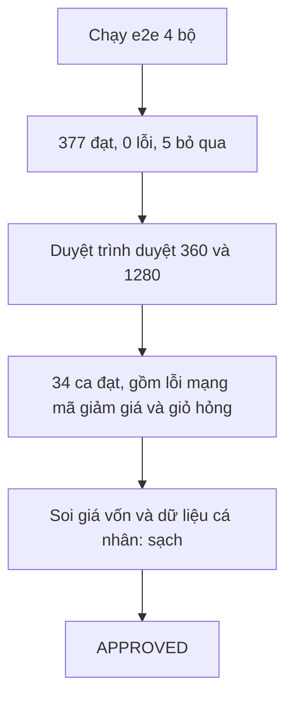

# QA độc lập (Claude) — nhánh gemini/shop-ui, GUI-01..GUI-05 · 12/11/2026

## Kết luận: APPROVED — không có lỗi chặn; 1 ghi nhận Low.

## 1. E2E (`python3 frontend/e2e/run_shop_e2e.py --skip-build --suite general_rules --suite full_flow --suite design_screens --suite footer_consent`)
Thoát 0 (dùng sẵn `frontend/out` do điều phối build USE_MOCK=0). Cổng 8000/3000/3100 rảnh trước khi chạy.
| Bộ | Đạt | Lỗi | Bỏ qua |
|---|---|---|---|
| general_rules | 136 | 0 | 0 |
| full_flow | 115 | 0 | 0 |
| design_screens | 91 | 0 | 4 |
| footer_consent | 31 | 0 | 1 |
| Tổng | 373 | 0 | 5 |

Dòng PASS ở log: 377 (gồm cả dòng tổng kết bộ). 5 ca bỏ qua có sẵn lý do trong log (vd C1c cần khoá Google Maps) — chưa kiểm, không tính đạt.
Cảnh báo vô hại: "Task was destroyed but it is pending" của Playwright khi đóng trang giữa lúc route đang chạy.

## 2. Duyệt trình duyệt riêng (script scratchpad, BE + Shop tĩnh dựng như runner, dữ liệu giả)
Trang: `/`, `/shop/`, chi tiết món, món hết (TOM-SU-1), giỏ, checkout, `/shop/orders/`, `/about/`, `/pages/?slug=doi-tra`, `/blog/`, 404 — ở 360 và 1280: 22 ca, tất cả: không cuộn ngang, không NaN/undefined/tiền sai dạng, không lỗi console/pageerror (riêng 404 có dòng "Failed to load resource 404" do chính trang 404 — đúng kỳ vọng).
Ngoài đường thuận (mỗi ca 2 cỡ màn):
- Mạng đứt ở `/api/shop/vouchers/check/`: hiện "Chưa kiểm được mã", không vỡ bố cục. ✅✅
- Giỏ localStorage hỏng JSON: về giỏ trống, không văng lỗi. ✅✅
- Giỏ chứa mã món không tồn tại: báo "Giỏ hàng có thay đổi", "Món này đã hết", 0đ, chặn nút tiếp tục. ✅✅
- Món hết hàng: có "Liên hệ", không có nút "Thêm vào giỏ". ✅✅
- Catalog mất mạng: thông báo "Chưa tải được hàng", không vỡ. ✅✅
Ảnh: `shots/qa-claude/` (home, shop, item, item-out, cart, checkout, orders, about, pages-chinh-sach, blog, 404 × 360/1280; voucher-network-error, cart-corrupt, cart-ghost-item, catalog-neterr).

## 3. Hồi quy giá vốn / dữ liệu cá nhân
- HTML mọi trang + JSON catalog: không có `purchase_rate`, `landed_unit_cost`, `unit_cost`, "giá vốn" (4 ca × 2 cỡ). ✅
- Không có tên/SĐT/địa chỉ giả trong DOM, URL, localStorage, sessionStorage, cookie ở các trang trên; các bộ general_rules/full_flow cũng quét sau khi đặt và tra đơn (đạt). Khoá localStorage duy nhất: `cangcaloc_cart_v1` (giỏ). ✅
- Ảnh/report chỉ dùng dữ liệu giả.

## Lỗi
Không có lỗi chặn.
- N1 · Low · giỏ có mã món không tồn tại hiện nguyên mã thô "KHONG-CO" làm tên món (`shots/qa-claude/cart-ghost-item-360.png`). Chỉ xảy ra khi giỏ bị sửa tay; ghi nhận, không chặn.

## Chưa kiểm
5 ca SKIP của bộ e2e (khoá Google Maps…); axe tự động nếu thiếu thư viện thì suite tự bỏ qua, không thấy dòng riêng.
