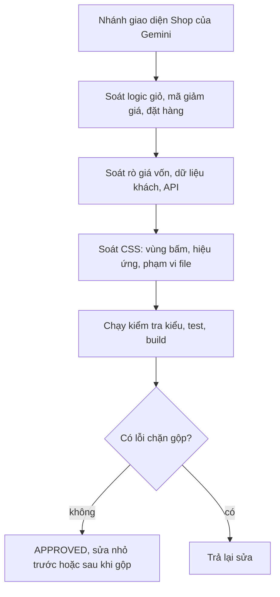

# Tech Lead review — nhánh `gemini/shop-ui` trước khi gộp `main`

> techlead · 2026-11-12 · Phạm vi: `git diff main...gemini/shop-ui` (17 commit, 69 file, `e7e8cdf`..`437801b`)

## Kết luận: **REVIEW PASS (APPROVED)**, kèm 1 Medium nên sửa trước khi gộp

Không có lỗi Critical hay High. Không đổi số tiền gửi lên máy chủ, không thêm API, không rò giá vốn hay dữ liệu cá nhân.

## Kiểm chứng đã chạy (worktree tạm tách từ `437801b`, không đụng cây làm việc)

| Lệnh | Kết quả |
|---|---|
| `npx tsc --noEmit` | sạch |
| `node scripts/test-*.mjs` (9 file) | tất cả đạt (voucher 43/43, cart-reconcile 20/20, order-state 81/81...) |
| `npm run build` | sạch, 14 route tĩnh |
| `python3 scripts/check_shop_ui_scope.py --base main` | OK, 69/69 file trong phạm vi |
| `python3 scripts/check_naming.py` | OK, không phát sinh vi phạm mới |
| grep diff: `console.`, `localStorage`, `fetch(`, `http`, `localhost`, `transition: all`, hex trong `.module.css` | không có dòng mới. `localhost:8000` trong bundle là giá trị mặc định cũ ở `lib/api.ts:22`, không đổi |

## Kết quả theo từng mục

1. **Logic TSX / BR-DM-19:** đúng.
   - GUI-01: `voucherCodeToSend` không đổi, nên mã vẫn gửi kèm đơn như trên `main`. Thay đổi chỉ thêm dòng nhắc
     (`pendingVoucherText`) và sửa comment. FE không tự tính số giảm.
   - GUI-02: `discountedPrice` thành `null` khi chưa có quote, và hộp B8 chỉ gạch khi số khác tổng. Chỉ đổi phần hiển thị.
   - GUI-03: xoá state `setBlocked` không ai đọc. Chặn đặt khi có món hết vẫn nằm trong `proceed()`.
   - `CartLine` thêm class `priceChanged`, còn `AddToCart` đổi Fragment thành `div.detailBox`. Cả hai chỉ là trình bày.
2. **Giá vốn / dữ liệu cá nhân:** sạch. Không thêm log hay khoá lưu trữ, không đưa gì lên URL. E2E dùng SĐT giả `09000000xx`.
3. **Contract 02b:** không đổi endpoint, khoá JSON hay `lib/`.
4. **API mới / URL cứng / mock:** không có.
5. **a11y / hiệu năng:** không xoá `:focus-visible` nào. Ô tìm kiếm có vòng `:focus-within`. Các transition mới đều liệt kê
   thuộc tính cụ thể, có `prefers-reduced-motion`. Có 1 Medium và 2 Low (xem dưới).
6. **File ngoài phạm vi:** không có. Các file đang sửa dở trong cây làm việc (`frontend/app/page.tsx`, `CLAUDE.md`...)
   **không** thuộc nhánh, nên khi gộp không được cuốn theo.

## Danh sách lỗi

| Mức | File:dòng (trên nhánh) | Lỗi | Đề xuất |
|---|---|---|---|
| Medium | `frontend/components/search/SearchBox.module.css:72-82` | Ô tìm ở header điện thoại: `.brand` hạ từ `--h-input` (44px) xuống `--h-chip` (40px), nút xoá `.brand .clear` từ 44px xuống **36px**. Vi phạm `doc/design/shop/UI-RULES.md` mục 1 (vùng chạm ≥ 44px) ở 360px | Giữ thanh nhìn 40px nhưng cho nút xoá vùng bấm 44px (`width/height: 44px` kèm margin âm, hoặc `::before` mở rộng vùng bấm). Phần ≥768px (dòng 139, 34px) chấp nhận được vì máy tính dùng chuột |
| Low | `frontend/components/search/SearchBox.module.css:114` | `.brand .input { font-size: 14px }` từ 768px trở lên. iPad dọc (768px) sẽ tự phóng to khi chạm vào ô. UI-RULES yêu cầu ô nhập 16px | Đặt ngưỡng ≥1024px, hoặc giữ 16px |
| Low | `frontend/features/home/components/HomeScreen.module.css:133` | Chấm slide trang chủ animate `width` (8 lên 18px), tức là animate thuộc tính bố cục. Phần tử nhỏ, đã tắt khi reduced-motion nên ảnh hưởng thấp | Dùng `transform: scaleX()` trên chấm, hoặc chấp nhận |
| Low | `frontend/features/checkout/components/CheckoutScreen.tsx:185` | GUI-01: khi kiểm mã lỗi mạng, tóm tắt hiện tổng chưa giảm (165.000đ) nhưng máy chủ áp mã, nên trang thanh toán là 148.500đ. Hai số vẫn lệch nhau, dù đây là phương án 02c chọn ("hiện dòng nhỏ ... sẽ kiểm khi đặt") và lệch theo hướng khách trả ít hơn. Thêm nữa, `useVoucher` không xoá `error` khi kiểm lại thành công, nên lúc đổi giỏ đang kiểm lại thì dòng nhắc có thể chớp lên một nhịp | Chấp nhận theo 02c. Nếu muốn gọn: chỉ hiện dòng nhắc khi `!voucher.checking` |

## Ghi chú khi gộp
- Gộp theo commit của nhánh. Không `git add -A`, vì cây làm việc đang có file sửa dở của người khác.
- Sau khi gộp, điều phối viên chạy lại `npm ci && npx tsc --noEmit && npm run build` cùng bộ `test-*.mjs` trên `main`.
