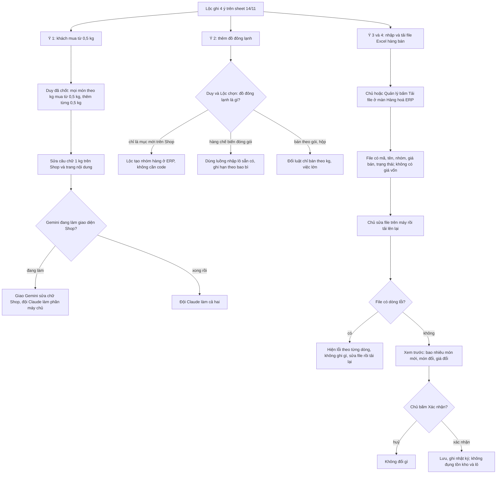
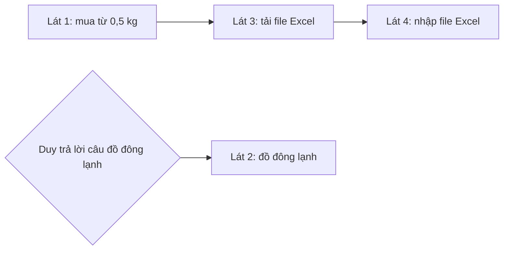

# Hàng bán: mua từ 0,5 kg, đồ đông lạnh, nhập và tải file Excel — Phân tích nghiệp vụ

> BA · 14/11/2026 · Trạng thái: **CHỜ DUYỆT**

## 1. Yêu cầu gốc

Sheet feedback của Lộc ngày 14/11/2026, mục "Web bán hàng" (Duy chuyển qua điều phối viên):

1. "Chỉnh đơn vị thêm mục 0.5kg"
2. "Thêm đồ đông lạnh"
3. "Import file excel --> hàng bán"
4. "Tải file excel --> hàng bán về máy tính"

**Duy đã chốt ý 1 (14/11, qua điều phối viên):** khách được mua **tối thiểu 0,5 kg** với món bán theo kg. Bước vẫn
là 0,5 kg. Tài liệu này ghi đây là quyết định của Duy, không hỏi lại.

## 2. Tóm tắt

- **Ý 1:** Khách cần mua được nửa ký mỗi món để thử món mới hoặc mua ít, đỡ phải mua tối thiểu 1 kg.
- **Ý 2:** Lộc cần bày bán thêm nhóm "đồ đông lạnh" trên Shop để có thêm mặt hàng và thêm doanh thu. Nghĩa
  chính xác của ý này còn phải hỏi (câu Q-01).
- **Ý 3 và 4:** Chủ vựa cần tải danh sách hàng bán ra file Excel và nhập lại từ file. Như vậy Lộc tạo hoặc sửa nhiều
  món một lượt trên máy tính, không phải gõ từng món trên ERP.

## 3. Bối cảnh trong hệ thống

### 3.1 Quy trình, rule và quyết định liên quan

| Ý | Quy trình | Rule hiện có | Quyết định ràng buộc |
|---|---|---|---|
| 1 | P-05 Bán hàng Shop | BR-BH-22 (từ 1 kg, bước 0,5 kg, tham số), BR-BH-23 (hết hàng khi tồn dưới mức tối thiểu), BR-DM-01, BR-BH-15 (làm tròn tổng) | decisions 2026-10-10 (tối): "Giá theo kg, tối thiểu 1 kg" và Q4 "đuôi lô dưới 1 kg không bán trên Shop" |
| 2 | P-01 Danh mục, P-02 Nhập lô, P-04 Vòng đời lô | BR-DM-01, BR-DM-25, BR-MH-01/02/05, BR-LO-01..07 | decisions 2026-09-09 "Hàng hoá là đông lạnh, quản lý theo lô"; 2026-09-26 FEFO, hạn mặc định 365 ngày |
| 3, 4 | P-01 Danh mục, giá | BR-DM-02/03 (giá theo hiệu lực, không chồng lấn), BR-DM-25 (chữ công khai), BR-PQ ma trận §1.4 | decisions 2026-09-10 phân quyền 3 tầng (Chủ giữ việc đổi con số lời lỗ); bất biến 1 (không rò giá vốn) |

### 3.2 Hệ thống đang làm gì (đã kiểm code ngày 14/11)

**Số lượng (ý 1)**
- Mức tối thiểu và bước của món kg là **một tham số chung cho toàn Shop**: `SHOP_MIN_QTY_KG` (mặc định 1) và
  `SHOP_QTY_STEP_KG` (mặc định 0,5) trong `backend/config/settings.py`, đọc qua env. Không có field trên từng mặt
  hàng (`backend/apps/catalog/items/services.py::qty_rule`). Combo cố định là từ 1, bước 1.
- **ERP chưa có chỗ nào cho Lộc chỉnh mức tối thiểu hay bước.** Form mặt hàng (`erp-console/features/catalog/components/ItemForm.tsx`)
  chỉ có: mã, tên, nhóm, hạn dùng mặc định, quản lý theo lô, có hạn dùng, đang kinh doanh, ghi chú ngắn, nguồn
  hàng, quy cách, bảo quản, mô tả, thành phần combo. Chữ "Số kg tối thiểu" ở ERP thuộc **ưu đãi** (PricingRule),
  không liên quan.
- API Shop trả `min_qty` và `qty_step` cho từng món (`shop_api.py`). FE Shop đọc hai số này (`frontend/lib/quantity.ts`),
  nên bộ tăng giảm tự theo. Tuy vậy còn **câu chữ "1 kg" viết cứng** ở nhiều chỗ (mục 7.1).
- Mức tồn "Hết hàng" lấy chính `SHOP_MIN_QTY_KG` làm ngưỡng (`stock_level`).
- Trang nội dung CMS (Cách mua, Điều kiện giao dịch, giới thiệu) dùng biến `{min_qty_kg}`. Biến được thay **lúc chạy
  lệnh nạp** (`load_shop_content`). Vì vậy nội dung đã nạp trên staging và production đang chứa sẵn chữ "1 kg".

**Danh mục và hàng đông lạnh (ý 2)**
- **Toàn bộ hàng của Cá Về đã là hàng đông lạnh.** decisions 2026-09-09 ghi hàng "tươi nhưng cấp đông". Shop đang
  ghi "Hải sản cấp đông theo kg". Hệ thống không có cờ "tươi/đông lạnh" vì không cần.
- Danh mục trên Shop chính là **Nhóm hàng** (`ItemGroup`: tên, nhóm cha, slug). Chủ tạo và sửa nhóm ở ERP (màn Nhóm
  hàng). Shop chỉ hiện nhóm có ít nhất một món đang kinh doanh và có giá hiệu lực.
- Phiếu giao việc Gemini GUI-07 (`doc/features/2026-11-11-shop-ui-gemini/02c-giao-viec.md`) đã nhắc "ảnh cho các
  mục danh mục: combo, hàng đông lạnh…". Như vậy Lộc đang hình dung "hàng đông lạnh" là **một mục danh mục** đứng
  cạnh combo.
- Mặt hàng có `shelf_life_in_days` (mặc định 365), `has_batch_no`, `has_expiry_date`. Hạn lô = ngày nhập + số ngày
  hạn, được sửa thấp hơn nhưng không được sửa cao hơn (BR-MH-02). Nhà cung cấp có loại Cá nhân hoặc Doanh nghiệp.
  Phiếu nhập không bắt buộc phải là hàng "tại cảng" (chỉ là cách gọi trong tài liệu).
- Đơn vị bán chỉ có kg (món thường) và combo (BR-DM-01, `KG = "Kg"` cố định).

**Excel (ý 3, 4)**
- Backend, ERP và Shop **chưa có chức năng nhập hay xuất file** (CSV hoặc Excel) nào.
- Quyền với mặt hàng theo spec §1.4: Chủ CRUD `Item`, `ItemGroup`, `BundleLine`. Quản lý và NV kho chỉ xem. Giá bán
  `ItemPrice`: Chủ tạo và sửa; Quản lý xem; NV kho **không** xem (serializer bỏ field `current_price`). "Sửa giá
  bán" là việc chỉ Chủ (`set_price`, registry).
- Đặt giá có luật sẵn trong `set_item_price`: giá mới có ngày hiệu lực, giá cũ tự đóng ở ngày trước đó, chặn chồng
  lấn với giá tương lai, chặn đặt lùi ngày đè lên đơn đã chốt giá. Mỗi lần đặt đều ghi AuditLog. Sửa mặt hàng ghi
  AuditLog `update_item` với **tên trường** đã đổi, không chép nội dung chữ.
- Giá vốn **không nằm trên mặt hàng**. Giá vốn nằm trên lô (`Batch.landed_unit_cost`, `PurchaseReceiptLine.rate`).
  Vì vậy danh sách hàng bán không cần chứa giá vốn.

## 4. Tác nhân và quyền

| Tác nhân | Group | Làm được gì trong phạm vi này | Quyền cần |
|---|---|---|---|
| Khách | (không đăng nhập) | Mua từ 0,5 kg, xem mục đồ đông lạnh | không |
| Chủ (Lộc) | `owner` | Tạo nhóm "đồ đông lạnh", tải file, nhập file (tạo/sửa món, đổi giá, ẩn/hiện) | `add_item`, `change_item`, `add_itemgroup`, `add_itemprice`/`change_itemprice` (việc "Sửa giá bán", chỉ Chủ) |
| Quản lý | `manager` | Tải file (có cột giá bán vì Quản lý được xem giá bán). **Không** nhập file | `view_item`, `view_itemprice` |
| NV kho | `warehouse_staff` | Tải file **không có cột giá bán** (mặc định Q-07) | `view_item` |
| NV giao, NV gọi xác nhận | `delivery_staff`, `customer_service` | Không liên quan | — |
| Hệ thống | — | Kiểm số lượng theo mức mới lúc tạo đơn; kiểm file nhập | — |

Ranh giới Chủ và Quản lý vẫn giữ: nhập file có thể đổi giá bán, tức là đổi con số lời lỗ, nên chỉ Chủ được nhập.
Khi Chủ uỷ việc "Sửa giá bán" cho Quản lý ở màn Phân quyền thì xem câu Q-08.

## 5. Use case

### UC-1 Khách mua 0,5 kg một món (ý 1, Duy đã chốt)
- **Tiền điều kiện:** món bán theo kg, đang kinh doanh, có giá hiệu lực, tồn bán được ít nhất 0,5 kg.
- **Luồng chính:**
  1. Khách mở thẻ món hoặc trang chi tiết. Nút ghi "Thêm 0,5 kg" (lấy theo `min_qty`).
  2. Khách bấm thêm. Giỏ có 0,5 kg. Bấm cộng thì 1 kg, 1,5 kg, …
  3. Thành tiền = đơn giá/kg × 0,5. Tổng đơn làm tròn về nguyên đồng theo BR-BH-15 như hiện nay.
  4. Đặt hàng. Máy chủ kiểm số lượng ≥ 0,5 và là bội của 0,5 (BR-BH-22 sửa), giữ chỗ 0,5 kg theo FEFO như mọi đơn.
- **Luồng thay thế:**
  - Ở 0,5 kg khách bấm trừ thì Shop hỏi bỏ món, như đang làm ở 1 kg.
  - Combo không đổi: vẫn từ 1 combo, bước 1.
- **Ngoại lệ:**
  - Gửi 0,25 kg hoặc 0 kg (sửa tay request) thì máy chủ từ chối cả đơn, không giữ chỗ (BR-BH-22).
  - Tồn bán được dưới 0,5 kg thì món hiện "Hết hàng", nút "Liên hệ chúng tôi" (BR-BH-23).
- **Hậu điều kiện:** đơn, hoá đơn và phân bổ lô ghi 0,500 kg. Giá vốn và lãi lỗ theo lô tính như cũ.

### UC-2 Đưa đồ đông lạnh lên Shop (ý 2, chờ Q-01)
Mô tả theo khuyến nghị Q-01 phương án A+B. Hàng chế biến, đóng gói vẫn bán theo kg.
- **Tiền điều kiện:** Chủ đăng nhập ERP.
- **Luồng chính:**
  1. Chủ tạo nhóm hàng "Đồ đông lạnh" ở ERP. Slug tự sinh, ví dụ `do-dong-lanh`.
  2. Chủ tạo từng mặt hàng trong nhóm đó, hoặc nhập bằng file (UC-4). Chủ ghi quy cách (ví dụ "Gói 500 g"), bảo quản
     và hạn dùng mặc định.
  3. Chủ đặt giá bán theo kg.
  4. Hàng về thì Chủ nhập lô như hiện nay (P-02). Nhà cung cấp loại Doanh nghiệp. Hạn lô sửa xuống đúng hạn in trên
     bao bì (BR-MH-02 cho sửa thấp hơn).
  5. Chủ mở bán lô (BR-MH-05). Mục "Đồ đông lạnh" hiện trên Shop.
- **Luồng thay thế:** nếu Lộc chỉ muốn **đổi cách chia mục** (ví dụ gom một số món đang có vào mục "Đồ đông lạnh")
  thì Chủ đổi nhóm của món ở ERP, không nhập lô mới.
- **Ngoại lệ:**
  - Hạn in trên bao bì dài hơn hạn mặc định của món: ERP không cho sửa hạn lô cao hơn. Chủ phải đặt hạn mặc định của
    món đủ dài trước khi nhập lô (Q-05).
  - Gói có khối lượng không chia hết cho 0,5 kg (ví dụ 400 g): không bán theo gói được, xem Q-01 phương án C.
- **Hậu điều kiện:** FEFO, giữ chỗ TTL, kiểm kê, chốt lô và lãi lỗ chạy y như hàng hiện có.

### UC-3 Tải file hàng bán về máy (ý 4)
- **Tiền điều kiện:** người dùng có quyền xem mặt hàng (Chủ, Quản lý, NV kho).
- **Luồng chính:**
  1. Ở màn Hàng hoá (ERP), người dùng bấm "Tải file Excel". Có thể giữ bộ lọc đang chọn (nhóm, đang kinh doanh, loại).
  2. Hệ thống tạo file với các cột ở mục 6.3. Cột giá bán chỉ có khi người tải được xem giá bán.
  3. Trình duyệt lưu file `hang-ban-<ngày giờ VN>.xlsx`.
- **Luồng thay thế:** bấm "Tải file mẫu" thì nhận file chỉ có dòng tiêu đề và một dòng ví dụ giả, để nhập món mới.
- **Ngoại lệ:**
  - Không có món nào khớp bộ lọc: vẫn tải được file có tiêu đề và báo "Không có món nào".
  - Mạng lỗi: báo "Chưa tải được file, bấm thử lại". Không tải nửa chừng.
  - Mất quyền giữa chừng (phiên hết hạn): 401/403 như các màn khác.
- **Hậu điều kiện:** không đổi dữ liệu. Ghi AuditLog `export_items` với người tải và số dòng (mặc định Q-12).

### UC-4 Nhập file hàng bán (ý 3)
- **Tiền điều kiện:** Chủ đăng nhập. File `.xlsx` theo đúng mẫu tải ở UC-3.
- **Luồng chính:**
  1. Chủ bấm "Nhập từ Excel" ở màn Hàng hoá, rồi chọn file.
  2. Hệ thống đọc file, kiểm từng dòng (mục 6.3, BR-DM-27) **mà chưa ghi gì**.
  3. Màn xem trước hiện: số món mới, số món sửa (kèm trường đổi), số món đổi giá (giá cũ → giá mới, ngày hiệu lực), số
     món đổi ẩn/hiện, số dòng không đổi. Món sẽ **lên Shop ngay** (đang kinh doanh + có giá) được đánh dấu riêng.
  4. Chủ bấm "Xác nhận nhập".
  5. Hệ thống ghi tất cả trong một lần. Có dòng hỏng lúc ghi thì không dòng nào được ghi. Giá đi qua đúng luật Đặt
     giá hiện có (BR-DM-02/03). Mỗi món ghi AuditLog như khi sửa tay, kèm một dòng tổng `import_items`.
  6. Báo "Đã nhập: x món mới, y món sửa, z giá mới".
- **Luồng thay thế:**
  - Chủ bấm "Huỷ" ở màn xem trước: không đổi gì.
  - File không có thay đổi nào: báo "File không có gì mới", không có nút xác nhận.
- **Ngoại lệ:**
  - File sai định dạng, không phải `.xlsx`, quá dung lượng hoặc quá số dòng: báo ngay, không đọc tiếp.
  - Thiếu cột bắt buộc hoặc đổi tên cột: báo tên cột thiếu.
  - Dòng lỗi (mã trùng trong file, nhóm không có, giá âm hoặc sai số, chữ công khai vi phạm BR-DM-25, ngày hiệu lực
    chồng giá tương lai, đặt lùi ngày đè đơn đã có): hiện bảng lỗi **theo số dòng Excel và tên cột**, câu tiếng Việt
    chỉ cách sửa. **Không ghi dòng nào** (mặc định Q-03).
  - Hai người cùng nhập, hoặc món bị sửa tay giữa lúc xem trước và lúc xác nhận: hệ thống kiểm lại lúc ghi. Dữ liệu
    đã khác so với lúc xem trước thì báo "Dữ liệu vừa thay đổi, hãy tải lại file" và không ghi.
  - Bấm xác nhận hai lần, hoặc mạng rớt rồi bấm lại: không được tạo món hay giá hai lần.
  - Người không phải Chủ gọi nhập: 403.
- **Hậu điều kiện:** mặt hàng, nhóm và giá bán đổi theo file. **Tồn kho, lô, đơn và giá vốn không đổi.** File gốc
  không lưu lại trên máy chủ (mặc định Q-13).

## 6. Business rule

### 6.1 Ý 1: số lượng

| Mã | Nội dung | Nhãn | Mới / Sửa / Giữ |
|---|---|---|---|
| BR-BH-22 | Món kg đặt **từ 0,5 kg**, là bội của **0,5 kg**. Combo số nguyên từ 1. Mức tối thiểu và bước là tham số cấu hình **chung cho mọi món kg** (mặc định Q-02). Máy chủ kiểm lúc tạo đơn, sai thì từ chối cả đơn | (D) 14/11 | **Sửa** (thay "từ 1 kg") |
| BR-BH-23 | "Hết hàng" khi tồn bán được nhỏ hơn mức tối thiểu của BR-BH-22, **nay là 0,5 kg**. Đuôi lô từ 0,5 kg đến dưới 1 kg nay **bán được** trên Shop. Đuôi dưới 0,5 kg vẫn không bán, Lộc bán ngoài hoặc điều chỉnh tồn | (D) 14/11, hệ quả | **Sửa** câu chữ (cơ chế giữ) |
| BR-BH-15 | Tổng đơn làm tròn về nguyên đồng. Giá lẻ kiểu 99.999 đ/kg × 0,5 ra số lẻ nửa đồng thì làm tròn như hiện nay | — | Giữ |
| BR-DM-01 | Món thường bán theo kg, combo theo combo | (D) 10/10 | Giữ |

**Việc cần ghi vào `decisions.md`** (điều phối viên ghi, BA không sửa): quyết định 14/11 của Duy thay ý "Giá theo kg,
tối thiểu 1 kg" (2026-10-10 tối) và câu Q4 "đuôi lô dưới 1 kg". Ngưỡng Q4 nay đi theo mức tối thiểu 0,5 kg.

### 6.2 Ý 2: đồ đông lạnh (phụ thuộc Q-01)

| Mã | Nội dung | Nhãn | Mới / Sửa / Giữ |
|---|---|---|---|
| BR-DM-01 | Đồ đông lạnh vẫn bán theo kg. Gói 500 g = 0,5 kg, gói 1 kg = 1 kg | (D) 10/10 | Giữ (nếu Q-01 chọn A hoặc B) |
| BR-MH-01/02 | Mỗi lần nhập một món sinh một lô; hạn lô sửa thấp hơn được, cao hơn thì không. Hàng đóng gói ghi hạn lô theo hạn in trên bao bì | PA | Giữ, bổ sung hướng dẫn |
| BR-DM-25 | Chữ công khai không chứa tên nhà cung cấp. Hàng chế biến có **nhãn hiệu nhà sản xuất** in trên bao bì thì có được ghi trên Shop không: xem Q-04 | (D) 10/10 | Giữ, chờ Q-04 |
| BR-DM-26 (đề xuất) | Nếu Q-01 chọn C (bán theo gói/hộp): món thường có thể bán theo **gói** với khối lượng gói cố định; kho trừ theo kg = số gói × khối lượng gói | PA | Mới, chỉ khi Duy chọn C |

### 6.3 Ý 3 và 4: file hàng bán

| Mã | Nội dung | Nhãn | Mới / Sửa / Giữ |
|---|---|---|---|
| BR-DM-27 (đề xuất) | **Cột của file hàng bán.** Cột có trong file: mã hàng (khoá nhận diện), tên, nhóm hàng (theo tên), loại (Mặt hàng thường / Combo, chỉ đọc), đơn vị (chỉ đọc), đang kinh doanh (Có/Không), hạn dùng mặc định (ngày), quản lý theo lô, có hạn dùng, ghi chú ngắn, quy cách, bảo quản, nguồn hàng, mô tả, giá bán hiện hành (đ/kg hoặc đ/combo), giá mới, ngày áp dụng giá mới. **Không bao giờ có** giá vốn, giá mua, chi phí phụ, lãi lỗ, mã lô, nhà cung cấp, tồn kho từng lô, ảnh | PA | Mới |
| BR-DM-28 (đề xuất) | **Quyền.** Tải file: ai xem được mặt hàng. Cột giá bán chỉ có khi người tải có quyền xem giá bán (NV kho không có). Nhập file: chỉ Chủ (cần đủ quyền sửa mặt hàng và "Sửa giá bán") | PA | Mới |
| BR-DM-29 (đề xuất) | **Nhập là tạo hoặc sửa theo mã hàng.** Mã có rồi thì sửa, mã chưa có thì tạo món mới. Dòng có trong hệ thống mà **không có trong file thì giữ nguyên**, không ẩn, không xoá. Muốn ngừng bán thì ghi "Không" ở cột đang kinh doanh. Nhập **không xoá** món, nhóm hay giá (bất biến 3) | PA | Mới (chờ Q-02b) |
| BR-DM-30 (đề xuất) | **Giá trong file theo luật Đặt giá.** Ô "giá mới" trống thì không đổi giá. Có số thì tạo giá mới từ "ngày áp dụng" (trống = hôm nay theo giờ VN). Giá cũ tự đóng ở ngày trước đó. Chặn chồng giá tương lai và chặn đặt lùi ngày đè đơn đã có (BR-DM-02/03). Cột "giá bán hiện hành" chỉ để xem, sửa ô đó không đổi giá | PA | Mới |
| BR-DM-31 (đề xuất) | **Kiểm cả file trước khi ghi.** Có một dòng lỗi thì không ghi dòng nào. Báo lỗi theo số dòng và tên cột. Phải qua màn xem trước và bấm xác nhận mới ghi. Ghi một lần, chống bấm hai lần | PA | Mới (chờ Q-03) |
| BR-DM-32 (đề xuất) | **Nhập không đụng kho.** Nhập file không tạo lô, không đổi tồn, không mở bán lô, không đổi giá vốn. Tồn và lô chỉ đổi qua phiếu nhập, kiểm kê, hàng hoàn (P-02, P-08, P-09) | PA | Mới |
| BR-DM-33 (đề xuất) | **Combo trong file.** Dòng combo được sửa tên, chữ, giá, đang kinh doanh. File không tạo combo mới và không sửa thành phần combo (làm ở form combo ERP) | PA | Mới |
| BR-DM-25 | Chữ công khai trong file kiểm như khi sửa ở form | (D) 10/10 | Giữ, áp cho nhập |
| BR-PQ-04/05 | Mỗi món tạo, sửa, đổi giá ghi AuditLog như khi làm tay (tên trường, không chép chữ tự do), kèm một dòng tổng cho lượt nhập | (D) | Giữ, áp cho nhập |

## 7. Tác động dữ liệu và tích hợp (không thiết kế chi tiết)

### 7.1 Ý 1: mua từ 0,5 kg (Duy đã chốt)

| Chỗ | Tác động |
|---|---|
| Tham số `SHOP_MIN_QTY_KG` | Đổi mặc định và env staging, production thành 0,5. **Không thêm field, không migration** nếu giữ một mức chung (Q-02) |
| Mức tồn Shop (`stock_level`) | Tự theo tham số. Món còn 0,5–0,99 kg đổi từ "Hết hàng" sang "Sắp hết" (dưới ngưỡng 3 kg) |
| Tạo đơn, giữ chỗ, FEFO, TTL | Không đổi luật. Đơn 0,5 kg giữ chỗ và chốt lô như đơn khác. Có thể nhiều đơn nhỏ hơn, nhiều phiếu giao hơn |
| Giá và làm tròn | Đơn giá/kg × 0,5. Tổng làm tròn nguyên đồng (BR-BH-15). Giá niêm yết chẵn nghìn thì không lẻ |
| Ưu đãi (PricingRule) và mã giảm giá | Không đổi. "Mua từ N kg" của ưu đãi là ngưỡng riêng. Mã có "đơn tối thiểu" (`min_order_amount`) vẫn chặn đơn nhỏ như cũ |
| Phí giao, đơn tối thiểu | Hiện **không có phí ship và không có giá trị đơn tối thiểu**; giá "đã gồm giao hàng". Đơn 0,5 kg vẫn được giao tận nhà, xem rủi ro mục 8 và Q-06 |
| Đơn cũ | Đơn đã có (≥ 1 kg, bội 0,5) vẫn hợp lệ, không chuyển đổi gì. Số kỳ cũ không đổi |
| Giỏ cũ trên trình duyệt | Giỏ đang lưu 1 kg vẫn hợp lệ. Hàm làm tròn giỏ cũ (`snapUp`) nay có thể giữ 0,5 kg; không cần dọn giỏ |
| Câu chữ CMS | Nội dung đã nạp chứa sẵn "từ 1 kg" (Cách mua, Điều kiện giao dịch chung, giới thiệu, mô tả SEO). Phải sửa nội dung trên staging và production (Q-09) |
| Chữ viết cứng ở Shop (`frontend/`) | `features/cart/components/CartScreen.tsx` ("Mua tối thiểu 1 kg mỗi món", hai chỗ), `app/page.tsx` và `app/layout.tsx` (mô tả SEO "từ 1 kg"), comment `QtyStepper.tsx`, `ArticleItems.tsx`, `lib/quantity.ts` (giá trị dự phòng 1), mock `features/content/mock.ts`, `features/ui-preview/*`, `README.md`. Nên cho chữ đọc từ `min_qty` hoặc site-info thay vì viết cứng |
| Test hiện có | Test giả định 1 kg: `backend/apps/sales/orders/tests/test_shop_create.py`, `test_shop_create_race.py`, `backend/apps/catalog/items/tests/test_shop_catalog.py`, `backend/apps/content/site/tests/test_site_info_shop.py`, `backend/apps/content/tests/test_load_shop_content.py`, `frontend/scripts/test-quantity.mjs`, `test-home-content.mjs`, e2e `frontend/e2e/shop_general_rules.py`, `shop_content_pages.py`, `shop_full_flow.py`. Cần thêm ca 0,5 kg đặt được, ca 0,25 kg bị từ chối, ca tồn 0,4 kg là "Hết hàng" |
| ERP | Không có màn nào hiện mức tối thiểu. Mock ERP không dùng tham số này |

**Va chạm với Gemini:** phần chữ ở Shop nằm trong `frontend/`, đúng vùng Gemini đang làm trên nhánh `gemini/shop-ui`
(CLAUDE.md ngoại lệ 11/11). Đề xuất: đội Claude đổi tham số, nội dung CMS và test backend; phần chữ trong `frontend/`
giao Gemini thành một dòng việc mới (ví dụ GUI-08) hoặc chờ nhánh Gemini gộp xong. Đổi tham số trước khi chữ Shop được
sửa thì **bộ tăng giảm đã chạy đúng 0,5 kg**, chỉ có câu chữ "tối thiểu 1 kg" sai tạm. Câu chữ sai này nằm trên trang
có giá trị pháp lý (Điều kiện giao dịch chung), nên nội dung CMS và tham số phải đổi cùng lúc trên production.

### 7.2 Ý 2: đồ đông lạnh
- **Phương án A hoặc B:** không đổi schema. Chủ tạo dữ liệu (nhóm, món, giá, lô) trên ERP. Ảnh danh mục đã có ở GUI-07
  của Gemini. Có thể cần một trang hướng dẫn ngắn cho Lộc (cách ghi hạn theo bao bì).
- **Phương án C (bán theo gói):** thêm đơn vị bán mới, đổi API Shop, giỏ, tạo đơn, phân bổ lô, tem in, báo cáo, có
  migration. Lật BR-DM-01 (D 10/10). Đây là một tính năng riêng, cần chạy luồng ĐẦY ĐỦ.
- **Phương án D (ngoài hải sản):** đổi phạm vi kinh doanh ở URD §2, có thể đổi câu chữ thương hiệu ("hải sản cấp
  đông"), cần `mkt-brand`. Pháp lý thực phẩm chế biến bao gói sẵn (nhãn hàng hoá, hồ sơ an toàn thực phẩm của nhà sản
  xuất) cần `legal-vn` xem; BA không khẳng định nội dung luật.

### 7.3 Ý 3 và 4: file Excel
- Đọc và ghi: `Item`, `ItemGroup` (chỉ đọc khi nhập, xem Q-10), `ItemPrice` qua luật Đặt giá hiện có. Không đụng
  `Batch`, `StockLedgerEntry`, `PurchaseReceipt*`, `SalesOrder*`.
- Có thể không cần model mới. Nếu techlead muốn lưu "phiên nhập" cho màn xem trước hoặc chống bấm hai lần thì phải ghi
  lý do ở 02b (bất biến 8).
- Màn hình: **ERP console**, màn Hàng hoá (`erp-console/features/catalog/`), thêm nút "Tải file Excel", "Tải file
  mẫu", "Nhập từ Excel" và màn xem trước kết quả. Không đụng Shop `frontend/`. Mock ERP cần có dữ liệu giả cho hai luồng.
- Tham số mới (bất biến 7): số dòng tối đa mỗi file, dung lượng tối đa.
- Lệnh AI: màn Hàng hoá có lệnh AI tra hàng (`AiMeta`). V1 nhập và xuất file **không** làm qua AI (mục 9).
- Không có bên thứ ba. File không gửi đi đâu ngoài trình duyệt của người dùng và máy chủ Cá Về.

## 8. Rủi ro Cá Về

| Rủi ro | Mức | Ghi chú / cách chặn |
|---|---|---|
| **Rò giá vốn qua file** | Critical nếu xảy ra | File hàng bán **không có cột giá vốn cho bất kỳ ai, kể cả Chủ** (BR-DM-27). Giá vốn xem ở màn lô và báo cáo. File liệt kê cột tường minh, không xuất "mọi field". QA phải mở file thật do NV kho và Quản lý tải, kiểm không có cột nhạy cảm |
| Rò giá bán cho NV kho | Trung bình | NV kho hiện không thấy giá bán ở ERP; file của NV kho cũng không có cột giá (Q-07) |
| **Nhập file là đổi giá hàng loạt** | Cao (tiền) | Sai một cột là cả trăm món đổi giá. Chặn: chỉ Chủ, bắt buộc xem trước với giá cũ → mới, kiểm cả file, ghi AuditLog từng giá. Món nào sắp lên Shop ngay thì đánh dấu |
| Đặt giá lùi ngày đè đơn đã chốt | Cao (lãi lỗ kỳ cũ) | Đi qua luật Đặt giá hiện có, giữ luật "không sửa số kỳ cũ" |
| Công thức độc trong ô Excel (ô bắt đầu bằng `=`, `+`, `-`, `@`) | Trung bình | Chữ do người nhập (mô tả, ghi chú) khi tải ra có thể bị Excel chạy như công thức. Cần chặn khi xuất. Ô công thức khi nhập thì đọc giá trị, không chạy |
| Dữ liệu cá nhân | Thấp | File hàng bán không có dữ liệu khách. AuditLog nhập/xuất chỉ ghi người làm và số dòng, không chép nội dung file. Không gửi file cho AI hay dịch vụ ngoài. Tên file do người dùng đặt không ghi vào log nếu không cần |
| Xoá chứng từ | Thấp | Nhập không xoá gì. Món vắng mặt trong file giữ nguyên (BR-DM-29) |
| Hàng ít kg, giao nhiều (ý 1) | Trung bình (tiền) | Đơn 0,5 kg khoảng 100–200 nghìn đồng vẫn "đã gồm giao hàng". Nếu thuê Ahamove/GHN (decisions 11/10 S-08) thì phí giao có thể ăn phần lớn lãi. Đây là quyết định kinh doanh (Q-06), không chặn làm |
| Đuôi lô nhỏ lên Shop (ý 1) | Thấp | Đuôi 0,5–1 kg nay bán được. Đây là điều tốt, nhưng cân 0,5 kg phải chính xác hơn (decisions 10/09: số kg đặt = số kg trừ kho) |
| Câu chữ pháp lý lệch luật bán (ý 1) | Trung bình | Điều kiện giao dịch chung đang ghi "từ 1 kg". Phải đổi cùng lúc với tham số trên production |
| Hạn dùng hàng đóng gói (ý 2) | Trung bình | Hạn lô tính từ ngày nhập + hạn mặc định của món. Ghi sai hạn bao bì thì FEFO và cảnh báo cận hạn sai. Cần hướng dẫn và Q-05 |
| FEFO, giữ chỗ, TTL | Không đổi | Cả ba ý không đổi thứ tự xuất lô hay giữ chỗ |

## 9. Ngoài phạm vi
- Đặt mức tối thiểu hoặc bước **riêng cho từng món** (để sau nếu Q-02 chọn phương án chung).
- Nhập hoặc xuất **lô, tồn kho, phiếu nhập, đơn hàng, khách** bằng file. Ý 3–4 chỉ là danh sách hàng bán (trừ khi Q-11
  chọn khác).
- Nhập ảnh mặt hàng bằng file (ảnh vẫn tải ở ERP từng món).
- Tạo combo hoặc sửa thành phần combo bằng file.
- Nhập/xuất qua lệnh AI, Google Sheets đồng bộ hai chiều.
- Đơn vị bán theo gói/hộp (trừ khi Q-01 chọn C, khi đó tách hồ sơ riêng).
- Phí ship, giá trị đơn tối thiểu (Q-06 chỉ hỏi ý, nếu có thì ghi quyết định riêng).

## 10. Câu hỏi mở

### 10.1 🔴 Chặn (Duy hoặc Lộc phải trả lời)

| # | Câu hỏi | Phương án | Khuyến nghị |
|---|---|---|---|
| **Q-01** | "Thêm đồ đông lạnh" nghĩa là gì? Hàng Cá Về đang bán **đã là hải sản cấp đông**. | **A.** Chỉ thêm **một mục danh mục** "Đồ đông lạnh" trên Shop cho các món sẵn có hoặc món mới. Lộc tự tạo nhóm hàng ở ERP, không cần code. **B.** Bán thêm **hàng chế biến đông lạnh đóng gói** (chả cá, cá viên, tôm viên, đồ thả lẩu…) mua từ công ty, vẫn bán theo kg (gói 500 g = 0,5 kg). Dùng luồng nhập lô sẵn có, chỉ cần hướng dẫn ghi hạn theo bao bì. **C.** Như B nhưng **bán theo gói/hộp** (gói 400 g, hộp 12 viên…). Thêm đơn vị bán mới, lật BR-DM-01, làm thành tính năng riêng. **D.** Bán cả đồ đông lạnh **ngoài hải sản** (thịt, rau củ…). Đổi phạm vi kinh doanh và câu chữ thương hiệu | **A + B.** Không đổi luật và gần như không cần code. Gói 500 g hoặc 1 kg khớp bước 0,5 kg vừa chốt. Chỉ chọn C khi Lộc có nhiều hàng gói lẻ khối lượng không chia hết 0,5 kg |
| **Q-11** | "Hàng bán" trong file Excel là danh sách gì? | **A.** **Danh sách mặt hàng đang bán**: mã, tên, nhóm, giá bán, trạng thái, chữ mô tả. Nhập để tạo/sửa món. **B.** A kèm cột **tồn bán được** (chỉ khi tải, không nhập). **C.** **Phiếu nhập hàng/lô** từ cảng bằng file. Đụng giá mua và giá vốn, chỉ Chủ, rủi ro cao. **D.** **Đơn đã bán / doanh thu** để Lộc xem trên máy. Có dữ liệu khách, rủi ro rò dữ liệu cá nhân | **A** (đúng cách hiểu của điều phối viên). Có thể thêm **B** cho file tải về vì tồn kg không phải giá vốn và ERP đã hiện cho nhân viên. C và D là tính năng khác, làm hồ sơ riêng nếu Lộc cần |
| **Q-02b** | Nhập file thì **tạo mới, sửa, hay cả hai**? | **A.** Cả hai theo mã hàng: mã có thì sửa, mã mới thì tạo. Món không có trong file giữ nguyên. **B.** Chỉ sửa món đã có (an toàn nhất, tạo món mới vẫn làm ở form). **C.** Chỉ tạo món mới. **D.** File là bản đầy đủ: món không có trong file thì tự **ngừng kinh doanh** | **A.** Lộc ghi cả "import" lẫn "tải về", nghĩa là muốn dùng file như bảng làm việc. D nguy hiểm vì quên một dòng là ẩn món khỏi Shop |
| **Q-03** | File có dòng lỗi thì sao? | **A.** **Không ghi dòng nào**, báo hết lỗi theo dòng, Lộc sửa file rồi nhập lại. **B.** Ghi các dòng đúng, bỏ dòng lỗi, cho tải danh sách dòng lỗi | **A.** Tránh nửa giá cũ nửa giá mới trên Shop. Nhập lại sau khi sửa không tạo trùng vì nhận diện theo mã |

### 10.2 🟡 Có mặc định (PO đi tiếp được nếu Duy không đổi)

| # | Câu hỏi | Mặc định PA đề xuất |
|---|---|---|
| Q-02 | Mức 0,5 kg áp chung cho mọi món kg hay chỉnh từng món? | **Chung cho mọi món kg**, đổi tham số `SHOP_MIN_QTY_KG` = 0,5. Không thêm field. Cho chỉnh từng món để sau, khi Lộc có món thật sự không bán lẻ được (ví dụ con cá nguyên trên 1 kg) |
| Q-04 | Hàng đóng gói có nhãn hiệu nhà sản xuất: Shop có được ghi tên nhãn hiệu không (BR-DM-25 cấm tên nhà cung cấp)? | Được ghi **nhãn hiệu sản phẩm** in trên bao bì ở tên món hoặc quy cách. Không ghi tên đầu mối bán sỉ cho Lộc. Cần Duy xác nhận vì đây là nới BR-DM-25 |
| Q-05 | Hạn dùng hàng đóng gói ghi thế nào? | Hạn mặc định của món đặt đủ dài (ví dụ 365 ngày). Lúc nhập lô sửa hạn xuống đúng hạn in trên bao bì (BR-MH-02 cho sửa thấp hơn). Không đổi code |
| Q-06 | Đơn chỉ 0,5 kg vẫn giao tận nhà, không phí ship, không đơn tối thiểu: Lộc có chấp nhận không? | Chấp nhận như hiện nay (decisions 10/10 tối: chưa có phí ship). Ghi rủi ro, nhắc Duy hỏi Lộc khi chốt hãng giao. Muốn có đơn tối thiểu thì làm quyết định và tính năng riêng |
| Q-07 | NV kho tải file có thấy giá bán không? | **Không**, giữ như màn ERP hiện nay (NV kho không có quyền xem giá bán) |
| Q-08 | Chủ uỷ "Sửa giá bán" cho Quản lý: Quản lý có được nhập file không? | Không. V1 nhập file chỉ cho Chủ, vì một lần nhập đổi cả mặt hàng (Quản lý không có quyền sửa món) lẫn giá |
| Q-09 | Sửa chữ "từ 1 kg" trong nội dung CMS đã nạp thế nào? | `mkt-brand` sửa nội dung qua màn Nội dung ERP trên staging. Production: Duy/Lộc duyệt rồi đăng cùng lúc bật tham số 0,5. Không chạy lại lệnh nạp đè lên chỗ Lộc đã sửa |
| Q-10 | Nhóm hàng ghi trong file chưa có thì sao? | Báo lỗi dòng "Nhóm chưa có, hãy tạo nhóm ở ERP trước". Nhập file không tự tạo nhóm (tránh gõ sai chính tả sinh nhóm rác trên Shop) |
| Q-12 | Tải file có ghi nhật ký không? | Có, `export_items`: người tải, thời điểm, số dòng, có cột giá hay không. Không ghi nội dung |
| Q-13 | Có lưu lại file Lộc đã nhập không? | Không lưu file gốc. Nhật ký từng món là đủ để truy vết |
| Q-14 | Định dạng file | `.xlsx`, tiêu đề cột tiếng Việt, cột chỉ đọc tô xám. Số nhận cả kiểu Việt Nam (`278.000`, `0,5`). Ngày dạng `dd/mm/yyyy` giờ VN. Ô "Có/Không" cho cờ. Tối đa 1.000 dòng, 2 MB (tham số) |
| Q-15 | Món nhập mới (đang kinh doanh + có giá) lên Shop ngay dù chưa có lô? | Có, như tạo tay hiện nay: Shop hiện "Hết hàng · Liên hệ" tới khi có lô mở bán. Màn xem trước ghi rõ "x món sẽ hiện trên Shop". Muốn chưa hiện thì ghi "Không" ở cột đang kinh doanh |
| Q-16 | Chữ Shop "1 kg" trong `frontend/` ai sửa? | Giao Gemini một dòng việc mới trong phiếu `2026-11-11-shop-ui-gemini/02c` (đội Claude không sửa `frontend/` khi Gemini đang làm). Tham số và CMS do đội Claude làm |

### 10.3 🟢 Để sau
- Mức tối thiểu/bước riêng từng món.
- Nhập/xuất lô, tồn, đơn hàng bằng file (nếu Q-11 cho thấy Lộc cần).
- Đồng bộ với Google Sheets của Lộc.

## 11. Đề xuất chia lát và thứ tự

| Lát | Nội dung | Luồng | Phụ thuộc | Ghi chú |
|---|---|---|---|---|
| 1 | Mua từ 0,5 kg: tham số, test backend, nội dung CMS (staging), chữ Shop (giao Gemini) | **NHANH** (Duy đã chốt, rule sửa nhỏ, không schema) | Không | Làm ngay. Production: đổi tham số và đăng CMS cùng lúc |
| 2 | Đồ đông lạnh | Nếu Q-01 = A/B: **vận hành**, Lộc nhập dữ liệu + hướng dẫn ngắn. Nếu C/D: **ĐẦY ĐỦ**, hồ sơ riêng | Q-01, Q-04, Q-05 | Ảnh mục danh mục đã có ở GUI-07 |
| 3 | Tải file hàng bán (ERP) | ĐẦY ĐỦ (cùng hồ sơ này) | Q-11 | Làm trước vì chỉ đọc, ít rủi ro. File tải về chính là mẫu nhập của lát 4 |
| 4 | Nhập file hàng bán (ERP): xem trước, xác nhận, nhật ký | ĐẦY ĐỦ (cùng hồ sơ này) | Lát 3, Q-02b, Q-03 | Rủi ro cao nhất (đổi giá hàng loạt). Cần techlead review kỹ phần giá và test đua bấm hai lần |

Lát 1 có thể chạy luồng NHANH ngay, không chờ PO. Lát 3 và 4 qua PO viết story sau khi Duy trả lời Q-11, Q-02b và Q-03.
