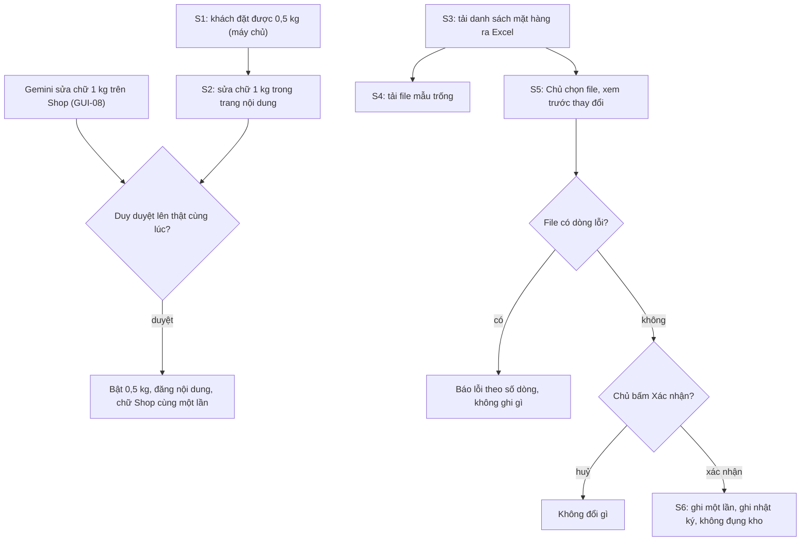

# Hàng bán: mua từ 0,5 kg, tải và nhập file Excel mặt hàng — User stories



> PO · 14/11/2026 · Nguồn: `01-analysis.md` (ĐÃ DUYỆT 14/11) + `doc/decisions.md` mục 2026-11-14 · Trạng thái: **ĐÃ DUYỆT** (Duy 14/11, duyệt cả S1–S6)
>
> Techlead 14/11: các khối "Contract API dự kiến" dưới đây là bản nháp; contract thật ở `02b-tech-design.md` §3 (đổi
> chính: lỗi dòng trả 400 `IMPORT_INVALID_ROWS` thay 422, `preview_id` thành `preview_token` gửi kèm file, lọc
> `item_type=SIMPLE|BUNDLE`). Sửa AC S6-AC6, S6-AC7, S6-AC9 và thêm S5-AC17 (C-1) cho khớp 02b và 02a.

## Mục tiêu & thước đo

- **Mua từ 0,5 kg:** khách mua thử nửa ký mỗi món. Đo: đơn có dòng 0,5 kg tạo được trên staging; không còn chữ
  "tối thiểu 1 kg" ở API, nội dung CMS và Shop sau khi lên production.
- **File Excel mặt hàng:** Lộc sửa nhiều món và giá một lượt trên máy tính. Đo: một file 200 dòng tải ra, sửa
  giá 20 món, nhập lại, xem trước đúng 20 dòng đổi giá, ghi xong trong một lần bấm. File tải ra không có cột giá vốn
  với bất kỳ vai nào.

## Phạm vi

**Trong:** Lát 1 phía máy chủ và nội dung CMS (S1, S2) · Lát 3 tải file (S3, S4) · Lát 4 nhập file (S5, S6).
Màn hình là **ERP console** (`erp-console/features/catalog/`), không đụng Shop `frontend/`.

**Ngoài:**
- Chữ "1 kg" trong `frontend/` Shop: Gemini làm ở **GUI-08** (`doc/features/2026-11-11-shop-ui-gemini/02c-giao-viec.md`).
  Đội Claude không viết story và không sửa `frontend/`.
- Lát 2 (nhóm hàng "đồ đông lạnh"): việc vận hành, Lộc tách nhóm hàng trong ERP, không code (Duy trả lời Q-01 ngày 14/11).
- Mọi mục ở `01-analysis.md` §9 (mức tối thiểu riêng từng món, nhập/xuất lô/tồn/đơn, ảnh, combo, AI, Google Sheets, cột tồn).

## Định nghĩa vai trong story

Khách · Chủ (`owner`) · Quản lý (`manager`) · NV kho (`warehouse_staff`) · NV giao (`delivery_staff`) ·
Nhân viên gọi xác nhận (`customer_service`) · Hệ thống.

---

## Lát 1 — Mua tối thiểu 0,5 kg

### S1 — Khách đặt được 0,5 kg một món · Must · BE

**Là** Khách, **tôi muốn** đặt 0,5 kg một món bán theo kg, **để** mua thử hoặc mua ít mà không phải lấy cả ký.

Bối cảnh: UC-1. Duy chốt 14/11 (decisions 2026-11-14). Không thêm field, không migration: đổi mặc định tham số
`SHOP_MIN_QTY_KG` trong `backend/config/settings.py` từ 1 thành 0,5 (đọc env, `Decimal`), đặt env staging và production
(production chỉ bật khi Duy duyệt, cùng lúc S2 và GUI-08). API Shop trả `min_qty` theo tham số nên bộ tăng giảm của
Shop tự chạy đúng. Combo giữ từ 1, bước 1. Sửa các test đang giả định 1 kg (danh sách ở `01-analysis.md` §7.1, phần
backend: `test_shop_create.py`, `test_shop_create_race.py`, `test_shop_catalog.py`, `test_site_info_shop.py`,
`test_load_shop_content.py`) để đọc từ tham số hoặc dùng `override_settings`, không viết cứng số mới.

| Mã | Given | When | Then | BR |
|---|---|---|---|---|
| S1-AC1 | Món kg đang kinh doanh, có giá 200.000 đ/kg, tồn bán được 5 kg, tham số mặc định | Khách gửi tạo đơn 0,5 kg | Đơn tạo thành công; dòng đơn và phân bổ lô ghi 0,500 kg; giữ chỗ 0,5 kg theo FEFO; thành tiền 100.000 đ | BR-BH-22, BR-BH-05/06 |
| S1-AC2 | Như AC1 | Khách gửi 1,5 kg | Đơn tạo thành công (bội 0,5 vẫn hợp lệ) | BR-BH-22 |
| S1-AC3 (lỗi) | Như AC1 | Gửi 0,25 kg, 0 kg, 0,7 kg hoặc -0,5 kg (sửa tay request) | 400, thông điệp tiếng Việt có mã BR-BH-22 nêu "từ 0,5 kg, mỗi lần thêm 0,5 kg"; không tạo đơn, không giữ chỗ, tồn bán được giữ 5 kg | BR-BH-22 |
| S1-AC4 (lỗi) | Đơn có 2 dòng: một dòng 0,5 kg hợp lệ, một dòng 0,25 kg | Gửi tạo đơn | Từ chối cả đơn, không giữ chỗ dòng nào | BR-BH-22 |
| S1-AC5 | Combo đang bán | Gửi 0,5 combo | 400 như cũ: combo số nguyên từ 1 | BR-BH-22, BR-DM-01 |
| S1-AC6 | Món có tồn bán được 0,4 kg | Khách gọi API danh mục Shop | `stock_level` = hết hàng | BR-BH-23 |
| S1-AC7 | Món có tồn bán được 0,5 kg (đuôi lô) | Khách gọi API danh mục Shop, rồi đặt 0,5 kg | `stock_level` = sắp hết; đặt 0,5 kg thành công; đặt 1 kg bị từ chối vì không đủ tồn | BR-BH-23 |
| S1-AC8 | Bất kỳ món kg | Gọi API danh mục và chi tiết Shop | `min_qty` = "0.5", `qty_step` = "0.5"; combo `min_qty` = "1" | BR-BH-22 |
| S1-AC9 | Giá lẻ 99.999 đ/kg | Đặt 0,5 kg | Tổng đơn làm tròn nguyên đồng theo luật hiện có | BR-BH-15 |
| S1-AC10 | Env đặt `SHOP_MIN_QTY_KG=1` | Đặt 0,5 kg | Bị từ chối (tham số đọc từ env, không viết cứng 0,5) | BR-BH-22, bất biến 7 |
| S1-AC11 (đua) | Tồn bán được 0,5 kg, hai khách cùng đặt 0,5 kg (test đua Postgres trên cloud) | Hai request đồng thời | Đúng một đơn thành công, đơn kia báo hết hàng; tồn không âm | BR-BH-05 |
| S1-AC12 (quyền/giá vốn) | Khách chưa đăng nhập | Gọi API danh mục Shop và tạo đơn 0,5 kg | Phản hồi không có giá vốn, mã lô, số kg tồn hay dữ liệu cá nhân của khách khác (như hiện nay) | bất biến 1, 9 |
| S1-AC13 | Đơn cũ 1 kg đã tạo trước khi đổi tham số | Mở đơn ở ERP và chạy báo cáo kỳ cũ | Đơn và số kỳ cũ không đổi | decisions "không sửa số kỳ cũ" |

Ghi chú dev: AC quyền ở story này là "không lộ thêm gì", vì Shop là API công khai. Cập nhật câu BR-BH-22/23 trong
`doc/business-process-spec.md` thuộc việc của điều phối viên (PO không sửa spec gốc), ghi trong `03-dev-notes.md`.

### S2 — Trang nội dung ghi đúng "từ 0,5 kg" · Must · BE (giao `mkt-brand`)

**Là** Khách, **tôi muốn** trang Cách mua, Điều kiện giao dịch chung và giới thiệu ghi đúng mức mua tối thiểu, **để**
không bị chữ nói một đằng, giỏ hàng làm một nẻo (trang Điều kiện giao dịch có giá trị pháp lý).

Bối cảnh: Q-09 (mặc định giữ). Biến `{min_qty_kg}` được thay lúc chạy lệnh nạp `load_shop_content`, nên nội dung đã
nạp trên staging và production đang chứa sẵn "1 kg". `mkt-brand` (a) rà nội dung mẫu nạp sẵn và mô tả SEO trong app
`content` để chữ đi theo tham số; (b) sửa nội dung đã nạp trên staging qua màn Nội dung ERP; (c) chuẩn bị bản nội dung
production cho Duy/Lộc duyệt, đăng cùng lúc bật tham số. Không chạy lại lệnh nạp đè lên chỗ Lộc đã sửa.

| Mã | Given | When | Then | BR |
|---|---|---|---|---|
| S2-AC1 | DB mới, tham số 0,5 | Chạy `load_shop_content` | Trang Cách mua, Điều kiện giao dịch chung, giới thiệu và mô tả SEO ghi "0,5 kg" (định dạng Việt, dấu phẩy), không còn chuỗi "1 kg" nói về mức tối thiểu | BR-BH-22 |
| S2-AC2 | Trang đã nạp và đã được Lộc sửa một đoạn khác | Chạy lại `load_shop_content` | Không đè nội dung Lộc đã sửa (giữ hành vi hiện có, có test) | |
| S2-AC3 | Staging sau khi `mkt-brand` sửa | Gọi API công khai các trang CMS nêu trên | Không trang nào còn "tối thiểu 1 kg" / "từ 1 kg" về mức mua; kiểm bằng script tìm chuỗi, ghi kết quả vào `03-dev-notes.md` | |
| S2-AC4 (lỗi) | Env `SHOP_MIN_QTY_KG=1` (môi trường chưa bật) | Chạy `load_shop_content` trên DB mới | Chữ ghi "1 kg" — nội dung đi theo tham số, không viết cứng 0,5 | bất biến 7 |
| S2-AC5 (quyền) | NV kho, Quản lý đăng nhập ERP | Sửa trang CMS | Theo quyền nội dung hiện có (không mở thêm quyền mới) | BR-PQ |
| S2-AC6 (bản production) | Bản nội dung production đã soạn | Duy/Lộc xem | Có danh sách trang và đoạn đổi (cũ → mới) để duyệt; chưa đăng khi Duy chưa duyệt | |

Phụ thuộc: S1 (tham số). Lên production **cùng một lần** với S1 và GUI-08 của Gemini.

---

## Lát 3 — Tải danh sách mặt hàng ra Excel

### S3 — Tải danh sách mặt hàng ra file Excel · Must · BE+FE

**Là** Chủ, Quản lý hoặc NV kho, **tôi muốn** bấm "Tải file Excel" ở màn Hàng hoá để lấy danh sách mặt hàng về máy,
**để** xem, in hoặc sửa trên máy tính (file này cũng là mẫu nhập ở S5).

Bối cảnh: UC-3, Q-11 = A (không cột tồn), BR-DM-27/28 (đề xuất, nay chốt trong hồ sơ này), Q-07, Q-12, Q-14.

**Cột của file** (thứ tự cố định, tiêu đề tiếng Việt, cột chỉ đọc tô xám):
`Mã hàng` · `Tên` · `Nhóm hàng` · `Loại` (chỉ đọc: Mặt hàng thường / Combo) · `Đơn vị` (chỉ đọc) · `Đang kinh doanh` (Có/Không) ·
`Hạn dùng mặc định (ngày)` · `Quản lý theo lô` (Có/Không) · `Có hạn dùng` (Có/Không) · `Ghi chú ngắn` · `Quy cách` ·
`Bảo quản` · `Nguồn hàng` · `Mô tả` · `Giá bán hiện hành` (chỉ đọc) · `Giá mới` · `Ngày áp dụng giá mới`.
NV kho: **không có** ba cột giá cuối. **Không ai** có cột giá vốn, giá mua, chi phí phụ, lãi lỗ, mã lô, nhà cung cấp,
tồn kho, ảnh.

| Mã | Given | When | Then | BR |
|---|---|---|---|---|
| S3-AC1 | Chủ đăng nhập, có 3 món thường + 1 combo | Bấm "Tải file Excel" | Nhận file `.xlsx` tên `hang-ban-YYYYMMDD-HHmm.xlsx` theo giờ VN; 1 dòng tiêu đề + 4 dòng; đủ 17 cột đúng thứ tự trên; giá bán hiện hành đúng giá đang hiệu lực hôm nay (giờ VN) | BR-DM-27 |
| S3-AC2 | Quản lý đăng nhập | Tải file | Có đủ 17 cột, có giá bán hiện hành | BR-DM-28 |
| S3-AC3 (quyền) | NV kho đăng nhập | Tải file | File có 14 cột, **không** có `Giá bán hiện hành`, `Giá mới`, `Ngày áp dụng giá mới`; không ô nào chứa giá bán | BR-DM-28, Q-07 |
| S3-AC4 (quyền) | NV giao, Nhân viên gọi xác nhận, hoặc chưa đăng nhập | Gọi API tải file | 403 (đã đăng nhập) / 401 (chưa đăng nhập); nút "Tải file Excel" không hiện ở ERP | BR-PQ |
| S3-AC5 (giá vốn) | Món có lô với giá mua và giá vốn lô khác 0 | Chủ, Quản lý, NV kho lần lượt tải file | Mở file thật bằng thư viện đọc xlsx: tiêu đề cột đúng danh sách cho phép (so khớp tuyệt đối, không phải "không chứa"); không ô nào bằng giá mua hay giá vốn lô | bất biến 1, BR-DM-27 |
| S3-AC6 | Đang lọc nhóm "Tôm", chỉ món đang kinh doanh | Bấm tải | File chỉ có các món khớp bộ lọc (dùng chung tham số lọc `item_group`, `is_active`, `item_type` của danh sách) | |
| S3-AC7 (rỗng) | Bộ lọc không khớp món nào | Bấm tải | Vẫn nhận file chỉ có dòng tiêu đề; ERP báo "Không có món nào khớp bộ lọc" | |
| S3-AC8 (lỗi lọc) | Gửi `item_type=abc` | Gọi API | 400 `INVALID_FILTER` như danh sách hiện có | |
| S3-AC9 (lỗi mạng) | API trả lỗi 500 hoặc mất mạng | Bấm tải | ERP báo "Chưa tải được file, bấm thử lại"; không lưu file hỏng; nút bấm lại được | |
| S3-AC10 (công thức độc) | Mô tả một món bắt đầu bằng `=HYPERLINK("http://x","y")`, ghi chú bắt đầu bằng `+`, `-`, `@`, ký tự tab hoặc xuống dòng đầu | Tải file, mở bằng thư viện đọc xlsx | Các ô đó là ô chữ (không phải công thức), giá trị hiển thị nguyên chữ người dùng đã nhập (có thể thêm dấu `'` đầu theo cách techlead chọn); không ô nào trong file có kiểu công thức | rủi ro §8 |
| S3-AC11 (định dạng) | Món có giá 278.000 đ, hạn 365 ngày | Tải file | Ô giá là số nguyên (không phải chữ), ô cờ ghi "Có"/"Không", ngày dạng `dd/mm/yyyy` | Q-14 |
| S3-AC12 (nhật ký) | Chủ tải file 4 dòng | Sau khi tải | Có 1 dòng AuditLog `export_items`: người tải, thời điểm, số dòng = 4, có cột giá = có; `detail` không chép tên món hay nội dung file | BR-PQ-04/05, Q-12 |
| S3-AC13 (hiệu năng) | 1.000 món | Chủ tải file | API trả file trong ≤ 5 giây trên staging; số truy vấn DB không tăng theo số món (test đếm truy vấn) | |

**Contract API dự kiến** (FE dựng mock theo đây; techlead chốt ở 02b):
```
GET /api/catalog/items/export/?item_group=3&is_active=true&item_type=item
  200  Content-Type: application/vnd.openxmlformats-officedocument.spreadsheetml.sheet
       Content-Disposition: attachment; filename="hang-ban-20261114-1530.xlsx"
       X-Row-Count: 4
  400  {"code": "INVALID_FILTER", "detail": "Loại hàng không hợp lệ."}
  401 / 403  như các API ERP khác
```
FE: nút "Tải file Excel" ở thanh công cụ màn Hàng hoá, có trạng thái đang tải (khoá nút), tải bằng `fetch` + blob,
tên file lấy từ `Content-Disposition`. Mock ERP trả một file xlsx giả (dữ liệu giả, không dữ liệu thật).

### S4 — Tải file mẫu để thêm món mới · Should · BE+FE

**Là** Chủ, **tôi muốn** tải một file mẫu trống, **để** điền món mới khi chưa có danh sách.
Lý do Should: file tải ở S3 đã dùng làm mẫu được; file mẫu chỉ tiện hơn cho lần đầu.

| Mã | Given | When | Then | BR |
|---|---|---|---|---|
| S4-AC1 | Chủ đăng nhập | Bấm "Tải file mẫu" | Nhận `mau-hang-ban.xlsx` cùng 17 cột như S3, 1 dòng ví dụ **giả** (mã `VD-001`, tên "Cá ví dụ"), ô giá mới và ngày áp dụng có ví dụ | BR-DM-27 |
| S4-AC2 | File mẫu chưa sửa dòng ví dụ | Chủ nhập ngay ở S5 | Dòng `VD-001` bị báo lỗi dòng "Đây là dòng ví dụ, hãy xoá hoặc đổi mã" (không tạo món ví dụ) | BR-DM-31 |
| S4-AC3 (quyền) | NV kho đăng nhập | Gọi API file mẫu | Nhận mẫu 14 cột không có cột giá; hoặc 403 nếu techlead chỉ mở cho người nhập được — chọn một, ghi ở 02b | BR-DM-28 |
| S4-AC4 (quyền) | NV giao / chưa đăng nhập | Gọi API | 403 / 401 | BR-PQ |

Contract dự kiến: `GET /api/catalog/items/export-template/` → 200 xlsx, `Content-Disposition: attachment; filename="mau-hang-ban.xlsx"`.

---

## Lát 4 — Nhập file Excel mặt hàng (chỉ Chủ)

Luật chung cho S5 và S6 (BR-DM-29..33, Q-02b = A, Q-03 = A, Q-08, Q-10, Q-13, Q-14, Q-15):
- Nhận diện theo `Mã hàng`: có rồi thì sửa, chưa có thì tạo món thường mới. Món có trong hệ thống mà **không có
  trong file thì giữ nguyên**. Nhập **không xoá** món, nhóm hay giá.
- Cột chỉ đọc (`Loại`, `Đơn vị`, `Giá bán hiện hành`) bị bỏ qua khi sửa; sửa các ô đó không đổi gì.
- Ô trống ở cột chữ không bắt buộc (`Ghi chú ngắn`, `Quy cách`, `Bảo quản`, `Nguồn hàng`, `Mô tả`) nghĩa là **giữ nguyên
  chữ cũ** (Duy chốt C-1 14/11); muốn xoá chữ thì sửa ở ERP. Cột bắt buộc (`Mã hàng`, `Tên`, `Nhóm hàng`, `Đang kinh doanh`)
  trống là lỗi dòng.
- `Giá mới` trống thì không đổi giá. Có số thì đặt giá qua luật Đặt giá hiện có (`set_item_price`) từ `Ngày áp dụng giá
  mới` (trống = hôm nay giờ VN). Giá là số nguyên đồng > 0, nhận cả `278.000` và ô số.
- Nhóm hàng tìm theo tên; chưa có hoặc trùng tên thì lỗi dòng, không tự tạo nhóm.
- Combo: chỉ sửa tên, chữ, giá, đang kinh doanh. Không tạo combo mới bằng file, không sửa thành phần.
- Không tạo lô, không đổi tồn, không mở bán lô, không đổi giá vốn.
- Tham số (bất biến 7): `ITEM_IMPORT_MAX_ROWS` mặc định 1.000, `ITEM_IMPORT_MAX_BYTES` mặc định 2 MB.
- Không lưu file gốc trên máy chủ, không ghi tên file hay nội dung ô vào log.

### S5 — Chủ chọn file Excel và xem trước thay đổi, chưa ghi gì · Must · BE+FE

**Là** Chủ, **tôi muốn** chọn file Excel và thấy trước món nào mới, món nào sửa, giá nào đổi (cũ → mới), **để** bắt
lỗi trước khi giá trên Shop đổi hàng loạt.

Bối cảnh: UC-4 bước 1–3, các ngoại lệ về file và dòng lỗi.

| Mã | Given | When | Then | BR |
|---|---|---|---|---|
| S5-AC1 | Chủ tải file ở S3, sửa giá mới 2 món, đổi tên 1 món, thêm 1 dòng mã mới hợp lệ | Chọn file ở "Nhập từ Excel" | Màn xem trước hiện: 1 món mới, 1 món sửa (liệt kê tên trường đổi, cũ → mới), 2 món đổi giá (giá cũ → giá mới, ngày áp dụng), số dòng không đổi; **DB không đổi** (đếm `Item`, `ItemPrice`, `AuditLog` trước/sau bằng nhau) | BR-DM-29/30/31 |
| S5-AC2 | Dòng mới đang kinh doanh = Có và có giá mới | Xem trước | Dòng được đánh dấu "Sẽ hiện trên Shop"; ghi tổng "x món sẽ hiện trên Shop" | Q-15 |
| S5-AC3 | Một món đổi "Đang kinh doanh" Có → Không | Xem trước | Đếm vào mục "đổi ẩn/hiện", ghi "Sẽ ẩn khỏi Shop" | BR-DM-29 |
| S5-AC4 | File tải ra, không sửa gì | Chọn file | Báo "File không có gì mới", không có nút "Xác nhận nhập" | BR-DM-31 |
| S5-AC5 | Món có trong hệ thống nhưng xoá khỏi file | Xem trước | Món đó không nằm trong danh sách đổi; không bị ẩn | BR-DM-29 |
| S5-AC6 (lỗi dòng) | File có lỗi ở dòng Excel 5 (`Giá mới` = -10), dòng 8 (`Nhóm hàng` "Tôm hùmm" chưa có), dòng 9 và 12 trùng mã `CA-01`, dòng 14 tên chứa tên nhà cung cấp | Chọn file | Không có màn xem trước, không có nút xác nhận; bảng lỗi liệt kê **đủ** các lỗi (không dừng ở lỗi đầu), mỗi lỗi có số dòng Excel, tên cột và câu tiếng Việt chỉ cách sửa (vd "Nhóm chưa có, hãy tạo nhóm ở ERP trước"); DB không đổi | BR-DM-31, BR-DM-25, Q-10 |
| S5-AC7 (lỗi giá) | Dòng có ngày áp dụng giá mới chồng lên giá tương lai đã đặt, và một dòng đặt lùi ngày đè lên đơn đã chốt giá | Chọn file | Hai lỗi dòng với câu của luật Đặt giá hiện có; không ghi gì | BR-DM-02/03 |
| S5-AC8 (lỗi combo) | Dòng mã mới với `Loại` = Combo | Chọn file | Lỗi dòng "Tạo combo mới làm ở form combo ERP" | BR-DM-33 |
| S5-AC9 (lỗi file) | File `.csv`, `.xls`, file đổi đuôi thành `.xlsx` nhưng không phải xlsx, file > 2 MB, hoặc > 1.000 dòng dữ liệu | Chọn file | Báo ngay một lỗi cấp file ("Chỉ nhận file .xlsx", "File quá 2 MB", "Quá 1.000 dòng"), không đọc tiếp; giới hạn đọc từ tham số (test bằng `override_settings` với số nhỏ) | Q-14, bất biến 7 |
| S5-AC10 (lỗi cột) | File thiếu cột `Mã hàng` hoặc đổi tên `Giá mới` thành `Gia moi` | Chọn file | Lỗi cấp file nêu tên cột thiếu | BR-DM-31 |
| S5-AC11 (định dạng) | Ô giá ghi `278.000`, ô giá kiểu số 278000, ô ngày kiểu ngày Excel và kiểu chữ `20/11/2026`, ô cờ "có"/"KHÔNG" | Xem trước | Đọc đúng cả hai kiểu; ngày hiểu theo giờ VN; `278.000,5` hoặc `abc` là lỗi dòng "Giá phải là số nguyên đồng" | Q-14 |
| S5-AC12 (công thức) | Ô mô tả là công thức `=1+1` có giá trị lưu sẵn, và một ô công thức không có giá trị lưu sẵn | Chọn file | Không chạy công thức; ô có giá trị lưu sẵn dùng giá trị đó; ô không có giá trị thì lỗi dòng "Ô có công thức, hãy dán giá trị"; file chứa macro hoặc liên kết ngoài không làm máy chủ gọi mạng | rủi ro §8 |
| S5-AC13 (quyền) | Quản lý (kể cả khi Chủ đã uỷ việc "Sửa giá bán"), NV kho, NV giao, Nhân viên gọi xác nhận | Gọi API xem trước | 403, không đọc file; ở ERP nút "Nhập từ Excel" không hiện với các vai này | BR-DM-28, Q-08, BR-PQ |
| S5-AC14 (giá vốn) | Chủ chọn file hợp lệ | Xem phản hồi xem trước | Phản hồi chỉ có trường mặt hàng và giá bán; không có giá mua, giá vốn, lãi lỗ, mã lô, tồn | bất biến 1 |
| S5-AC15 (nhật ký, log) | Chủ chọn file lỗi hoặc hợp lệ | Sau xem trước | Không ghi AuditLog (chưa đổi gì); log máy chủ không chứa tên file hay nội dung ô | BR-PQ-04, rủi ro §8 |
| S5-AC16 (hiệu năng) | File 1.000 dòng hợp lệ | Chọn file | Có kết quả xem trước trong ≤ 10 giây trên staging; số truy vấn DB không tăng theo số dòng | |
| S5-AC17 (ô chữ trống, C-1) | Món `CA-01` có Mô tả và Quy cách; file để trống hai ô đó, không sửa gì khác | Chọn file, rồi xác nhận | Xem trước báo "File không có gì mới"; Mô tả và Quy cách của `CA-01` giữ nguyên chữ cũ (thêm techlead 14/11 theo C-1, 02b §4.3) | BR-DM-29, C-1 |

**Contract API dự kiến:**
```
POST /api/catalog/items/import/preview/      multipart/form-data: file=<xlsx>
200 {
  "preview_id": "b1c2…",                       // cách giữ phiên xem trước do techlead chọn ở 02b
  "has_changes": true,
  "summary": {"created": 1, "updated": 1, "price_changed": 2, "visibility_changed": 0,
              "unchanged": 196, "will_show_on_shop": 1},
  "rows": [
    {"row": 3, "code": "CA-01", "action": "update", "name": "Cá thu cắt khúc",
     "changes": [{"field": "name", "label": "Tên", "old": "Cá thu", "new": "Cá thu cắt khúc"}],
     "price": null, "will_show_on_shop": false},
    {"row": 4, "code": "TOM-02", "action": "update", "name": "Tôm sú",
     "changes": [], "price": {"old": "278000", "new": "265000", "valid_from": "2026-11-15"},
     "will_show_on_shop": false},
    {"row": 201, "code": "MUC-09", "action": "create", "name": "Mực ống",
     "changes": [], "price": {"old": null, "new": "180000", "valid_from": "2026-11-14"},
     "will_show_on_shop": true}
  ]
}
422 {"code": "IMPORT_INVALID_ROWS",
     "errors": [{"row": 5, "column": "Giá mới", "message": "Giá phải là số nguyên đồng lớn hơn 0."},
                {"row": 8, "column": "Nhóm hàng", "message": "Nhóm chưa có, hãy tạo nhóm ở ERP trước."}]}
400 {"code": "IMPORT_INVALID_FILE", "detail": "Chỉ nhận file .xlsx."}       // cũng dùng cho quá dung lượng, quá dòng, thiếu cột
403 / 401
```
Tiền là chuỗi số nguyên đồng. `rows` chỉ gồm dòng có đổi. FE: hộp chọn file → màn xem trước (bảng giá cũ → mới,
đánh dấu "Sẽ hiện trên Shop"/"Sẽ ẩn khỏi Shop", nút "Huỷ" và "Xác nhận nhập") hoặc bảng lỗi theo dòng; mock ERP có
ba tình huống: hợp lệ, có lỗi dòng, không có gì mới.

### S6 — Chủ xác nhận nhập, hệ thống ghi một lần · Must · BE+FE

**Là** Chủ, **tôi muốn** bấm "Xác nhận nhập" để ghi đúng những gì đã xem trước, trong một lần, **để** không bao giờ có
nửa giá cũ nửa giá mới trên Shop và truy vết được ai đổi gì.

Bối cảnh: UC-4 bước 4–6, ngoại lệ đua và bấm hai lần.

| Mã | Given | When | Then | BR |
|---|---|---|---|---|
| S6-AC1 | Xem trước S5-AC1 (1 mới, 1 sửa, 2 đổi giá) | Chủ bấm "Xác nhận nhập" | Ghi đúng 1 món mới, 1 món sửa, 2 giá mới; giá cũ tự đóng ở ngày trước ngày áp dụng; ERP báo "Đã nhập: 1 món mới, 1 món sửa, 2 giá mới" và tải lại danh sách | BR-DM-29/30, BR-DM-02/03 |
| S6-AC2 (nhật ký) | Như AC1 | Sau khi ghi | Mỗi món tạo/sửa/đổi giá có AuditLog giống khi làm tay (`update_item` chỉ ghi tên trường, đặt giá ghi như `set_item_price`), cộng 1 dòng tổng `import_items` (người nhập, số món mới/sửa/giá mới); không chép nội dung chữ hay tên file vào `detail` | BR-PQ-04/05 |
| S6-AC3 (không đụng kho) | Có lô đang mở bán và đơn đang giữ chỗ của các món trong file | Xác nhận nhập | Số dòng và giá trị của `Batch`, `StockLedgerEntry`, `PurchaseReceipt*`, `SalesOrder*`, `*LineBatch` không đổi (so sánh trước/sau trong test) | BR-DM-32, bất biến 1, 6 |
| S6-AC4 | Huỷ ở màn xem trước | Chủ bấm "Huỷ" | Không gọi API ghi; DB không đổi | BR-DM-31 |
| S6-AC5 (lỗi lúc ghi) | Dòng thứ 150 hỏng lúc ghi (giả lập lỗi trong test) | Xác nhận | Không dòng nào được ghi, kể cả 149 dòng trước; không AuditLog nào; ERP báo lỗi, có thể nhập lại | BR-DM-31 |
| S6-AC6 (dữ liệu đổi giữa chừng) | Sau khi xem trước, có người sửa tay tên hoặc giá một món trong file (hoặc một lượt nhập khác vừa ghi) | Chủ bấm xác nhận | 409 `IMPORT_DATA_CHANGED`; không ghi dòng nào; ERP hiện banner W2 (02a §5) với nút **Xem trước lại**, bấm thì gửi lại chính file đang giữ trong trang để xem trước với dữ liệu mới (mất file thì nút thành "Chọn file khác") (sửa techlead 14/11, 02b §3.5) | UC-4 ngoại lệ |
| S6-AC7 (bấm hai lần) | Chủ bấm xác nhận hai lần liên tiếp, hoặc gửi lại cùng request sau khi mạng rớt | Hai request ghi | Chỉ một lần được ghi: số `Item`, `ItemPrice` và AuditLog `import_items` đúng như ghi một lần; request sau trả **409 `IMPORT_ALREADY_APPLIED`** kèm số đếm của lần đầu (`created`, `updated`, `price_changed`, `visibility_changed`), ERP hiện toast T5 "Lượt nhập này đã ghi rồi" và về danh sách; FE khoá nút khi đang gửi (sửa techlead 14/11, 02b §3.5) | BR-DM-31 |
| S6-AC8 (đua) | Hai request ghi đồng thời cùng phiên xem trước (test đua Postgres trên cloud) | Gửi song song | Đúng một lần ghi thành công | BR-DM-31 |
| S6-AC9 (quyền) | Quản lý (kể cả được uỷ "Sửa giá bán"), NV kho, NV giao gửi request ghi, kể cả với `preview_token` và file do Chủ tạo | Gọi API ghi | 403, DB không đổi | BR-DM-28, Q-08 |
| S6-AC10 (quyền đổi giữa chừng) | Chủ bị gỡ quyền giữa lúc xem trước và xác nhận | Gọi API ghi | 403, DB không đổi | BR-PQ |
| S6-AC11 (Shop) | Món mới đang kinh doanh + có giá, chưa có lô | Sau khi ghi, khách gọi API danh mục Shop | Món hiện với "hết hàng"; món đổi "Đang kinh doanh" = Không thì không còn trên Shop | Q-15, BR-BH-23 |
| S6-AC12 (giá vốn) | Sau khi ghi | Xem phản hồi API ghi | Chỉ có số đếm và mã món; không có giá vốn, giá mua, lãi lỗ | bất biến 1 |
| S6-AC13 (vòng tròn) | Chủ ghi xong | Tải file lại (S3) rồi chọn file đó để nhập (S5) | Báo "File không có gì mới" | BR-DM-27/29 |

**Contract API dự kiến:**
```
POST /api/catalog/items/import/commit/      {"preview_id": "b1c2…"}   // hoặc gửi lại file kèm dấu vân tay — techlead chốt ở 02b
200 {"created": 1, "updated": 1, "price_changed": 2, "visibility_changed": 0,
     "codes": ["CA-01", "TOM-02", "MUC-09"]}
409 {"code": "IMPORT_DATA_CHANGED", "detail": "Dữ liệu vừa thay đổi, hãy tải lại file."}
409 {"code": "IMPORT_ALREADY_APPLIED", "detail": "Lượt nhập này đã ghi."}     // hoặc 200 trả lại kết quả lần đầu
410 {"code": "IMPORT_PREVIEW_EXPIRED", "detail": "Phiên xem trước đã hết hạn, hãy chọn lại file."}
403 / 401
```
Ghi chú techlead: Q-13 không lưu file gốc. Nếu cần lưu phiên xem trước (để chống bấm hai lần và kiểm dữ liệu đổi)
thì đó là model hoặc cache mới, phải ghi lý do và migration ở 02b (bất biến 8). Thời hạn phiên xem trước là tham số.

---

## Thứ tự làm đề xuất

1. **S1** (BE) — nhỏ, không schema, mở khoá Lát 1; chạy song song được với S3.
2. **S2** (`mkt-brand`) — sau S1 vì nội dung đọc tham số. Production chờ GUI-08 của Gemini, lên cùng một lần.
3. **S3** (BE ∥ FE theo contract) — chỉ đọc, ít rủi ro; file tải ra là mẫu nhập của S5.
4. **S4** (BE ∥ FE) — nhỏ, dùng lại bộ cột của S3.
5. **S5** (BE ∥ FE) — xem trước, chưa ghi; techlead chốt cách giữ phiên xem trước ở 02b trước khi làm.
6. **S6** (BE ∥ FE) — rủi ro cao nhất (đổi giá hàng loạt); techlead review kỹ phần giá, test đua bấm hai lần.

## Rủi ro / phụ thuộc

- **S1 + S2 + GUI-08 lên production cùng lúc.** Bật tham số trước thì bộ tăng giảm đã đúng 0,5 kg nhưng chữ Shop và
  trang Điều kiện giao dịch còn "1 kg" (trang có giá trị pháp lý). Staging có thể bật S1 trước.
- GUI-08 do Gemini làm trên nhánh `gemini/shop-ui`; gộp phải qua techlead review và QA đội Claude.
- Đơn 0,5 kg vẫn "đã gồm giao hàng" (Q-06 giữ mặc định): rủi ro phí giao khi chốt hãng, không chặn làm.
- S5/S6 là cửa đổi giá hàng loạt: chỉ Chủ, bắt buộc xem trước, kiểm cả file, AuditLog từng giá.
- Rò giá vốn qua file là Critical: QA phải mở file thật do Chủ, Quản lý, NV kho tải (S3-AC5), không chấm bằng đọc code.
- Lát 2 (nhóm hàng) là việc vận hành của Lộc; nên làm trước hoặc song song để file nhập có tên nhóm đúng.

## Definition of Done (chung)

Test BE xanh (thấy "Ran … OK", chạy tuần tự sau khi gộp) · `erp-console` `tsc --noEmit` và `npm run build` sạch ·
`python3 scripts/check_naming.py` sạch · QA report APPROVED (mở file xlsx thật, có ca ngoài đường thuận) · không rò giá
vốn · không rò dữ liệu cá nhân (file, log, AuditLog, mock và test dùng dữ liệu giả) · mã BR trích trong test và commit ·
`03-dev-notes.md` ghi tham số mới (`ITEM_IMPORT_MAX_ROWS`, `ITEM_IMPORT_MAX_BYTES`, thời hạn phiên xem trước) và việc
cập nhật BR-BH-22/23, BR-DM-27..33 vào spec cho điều phối viên.

## Để sau

- Mức tối thiểu / bước riêng từng món.
- Cột tồn bán được trong file tải (Q-11 phương án B).
- Nhập/xuất lô, tồn, phiếu nhập, đơn hàng bằng file; đồng bộ Google Sheets.
- Tạo combo hoặc sửa thành phần combo bằng file; nhập ảnh bằng file.
- Cho nhập file tự tạo nhóm hàng mới.

## Câu hỏi cho Duy

- **C-1:** Ô chữ không bắt buộc (ghi chú, quy cách, bảo quản, nguồn hàng, mô tả) để trống trong file thì **xoá chữ**
  của món (mặc định PO, có hiện trong xem trước) hay **giữ nguyên**? Xoá thì file là bản thật; giữ nguyên thì không
  có cách xoá chữ bằng file.
- **C-2:** Ai tải được file mẫu (S4-AC3): mọi người xem được mặt hàng (mặc định), hay chỉ Chủ?


## Duy trả lời (14/11)
- Duyệt cả 6 story, thứ tự như PO đề xuất.
- **C-1:** ô chữ không bắt buộc để trống thì **giữ nguyên chữ cũ**, không xoá. QA/AC theo câu này.
- **C-2:** giữ mặc định PO (ai xem được mặt hàng thì tải được mẫu, NV kho bản không có cột giá).
