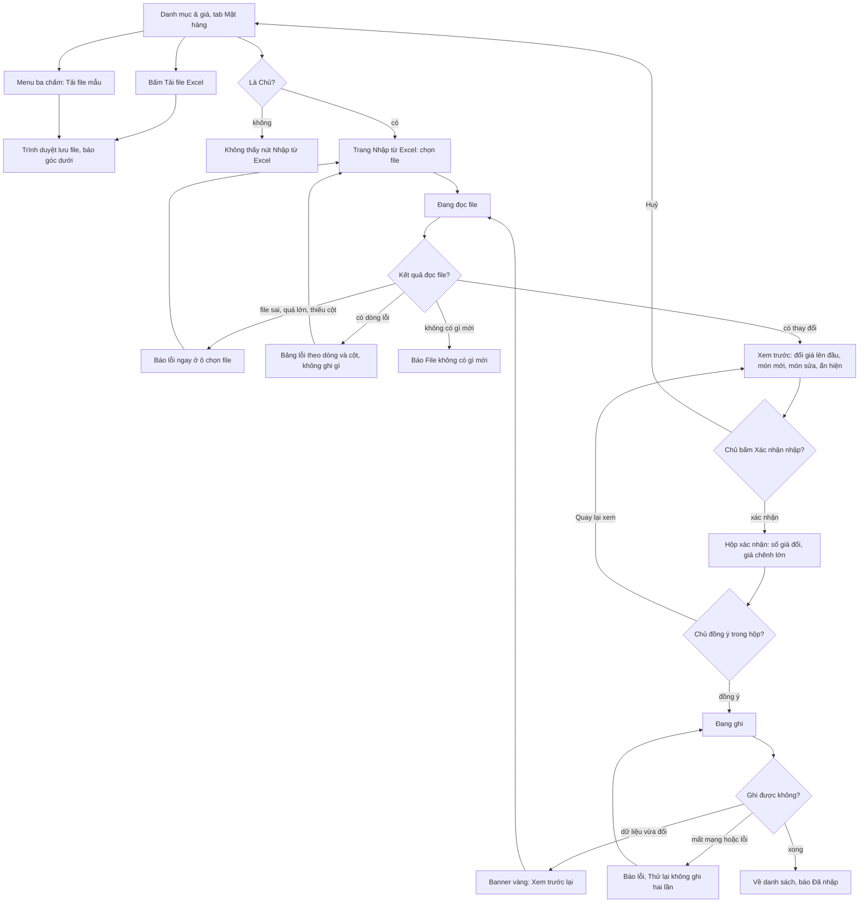

# Tải và nhập file Excel mặt hàng (S3–S6) — Luồng màn hình ERP



> UX · 14/11/2026 · Nguồn: `02-stories.md` (ĐÃ DUYỆT 14/11, C-1: ô chữ trống giữ nguyên chữ cũ) + `01-analysis.md` ·
> Luật: `doc/design/erp/UI-RULES.md` · Trạng thái: **CHỜ DUYỆT**
>
> Wireframe: [`doc/design/erp/wireframes/ERP-F1p-Nhap-xuat-Excel-mat-hang.html`](../../design/erp/wireframes/ERP-F1p-Nhap-xuat-Excel-mat-hang.html)
> (mở bằng trình duyệt, một trang dài gồm 7 khung: danh sách, chọn file, đang đọc, xem trước, bảng lỗi, hộp xác nhận, banner 409).

Phạm vi: chỉ ERP console (`erp-console/features/catalog/`). Shop `frontend/` không thuộc đợt này. Không có giá vốn ở
bất kỳ màn nào (S3-AC5, S5-AC14, S6-AC12). Dữ liệu mẫu trong tài liệu và wireframe là giả.

## 1. Màn hình và dạng hiển thị

| # | Màn | Dạng | Đường dẫn | Ai thấy | Story |
|---|---|---|---|---|---|
| M1 | Danh mục & giá › tab Mặt hàng: thêm nút **Tải file Excel**, **Nhập từ Excel**, menu "…" có **Tải file mẫu** | trang (đã có, `ItemListTab`) | `/catalog/?tab=items` | Tải: Chủ, Quản lý, NV kho. Nhập: chỉ Chủ | S3, S4, S5 |
| M2 | Nhập từ Excel › chọn file | **trang riêng** (UI-RULES §6.1: nhiều dòng) | `/catalog/import/` (mới) | Chủ | S4, S5 |
| M3 | Nhập từ Excel › xem trước thay đổi | cùng trang M2, đổi phần thân; thanh nút dính đáy | `/catalog/import/` | Chủ | S5, S6 |
| M4 | Nhập từ Excel › bảng lỗi theo dòng | cùng trang M2, đổi phần thân | `/catalog/import/` | Chủ | S5 |
| M5 | Hộp **Xác nhận nhập** | **popup (dialog)** nổi trên M3, nền mờ | — | Chủ | S6 |
| M6 | Thông báo kết quả tải file / nhập xong | **toast** góc dưới phải | — | theo M1/M3 | S3, S4, S6 |

Không dùng drawer hay bottom sheet: UI-RULES §4.1 cấm panel trượt; ERP đã duyệt cho máy tính.

Không đặt URL nào chứa dữ liệu file. `preview_id` và file đã chọn chỉ nằm trong state của trang (không `localStorage`,
không query string). Tải lại trang (F5) thì về lại bước chọn file.

## 2. Đặt nút ở M1

Thanh `actions` của `ListPage` hiện có [Thêm combo] [**Thêm mặt hàng**]. Thứ tự mới, từ trái sang phải:

```
[⤓ Tải file Excel]  [⤒ Nhập từ Excel]  […]   [+ Thêm combo]  [+ Thêm mặt hàng]   ← nút chính giữ nguyên bên phải
```

- **Tải file Excel** (nút phụ, icon `download`): ai xem được tab Mặt hàng đều thấy (`catalog.view_item`).
  Gửi đúng bộ lọc server đang chọn (nhóm, đang kinh doanh, loại, và có ảnh nếu techlead mở — mục 8).
- **Nhập từ Excel** (nút phụ, icon `upload_file`): chỉ hiện khi người dùng có quyền nhập (mục 8, câu T-1).
  Là `Link` sang `/catalog/import/`, không mở popup.
- **"…"** (`MoreMenu`, nhãn đọc "Thao tác khác với file"): một mục **Tải file mẫu**. Ai thấy nút Tải file Excel đều
  thấy mục này (C-2). NV kho nhận mẫu 14 cột, không có chữ giải thích trên màn (UI-RULES §1.7).
- Quản lý, NV kho: thấy [Tải file Excel] […], không thấy [Nhập từ Excel], [Thêm combo], [Thêm mặt hàng].
- NV giao, Nhân viên gọi xác nhận: không vào được màn Danh mục & giá (đã có `ViewGuard`), không thấy gì.
- Ô tìm tên/mã hiện lọc **phía máy** nên không đi vào file. Khi ô tìm có chữ, toast thành công ghi thêm một câu (mục 5).

## 3. Màn M2–M4: trang Nhập từ Excel

Khung `FormPage`: header "← Danh mục & giá" · tiêu đề **Nhập mặt hàng từ Excel**. Thân trang đổi theo bước, thanh nút
dính đáy đổi theo bước:

| Bước | Thân trang | Thanh nút đáy |
|---|---|---|
| Chọn file (M2) | Khối chọn file + khối tóm tắt "Cách hệ thống đọc file" | [Huỷ] |
| Đang đọc | Khối chọn file khoá, dòng "Đang đọc file…" + khung xương của xem trước | [Huỷ] (huỷ yêu cầu đang gửi) |
| Xem trước (M3) | Dải số tổng + 4 phần bảng | [Chọn file khác] [Huỷ] [**Xác nhận nhập**] |
| Không có gì mới | Hộp trạng thái | [Chọn file khác] [Về danh sách] |
| Có dòng lỗi (M4) | Alert đỏ + bảng lỗi | [Huỷ] [**Chọn file khác**] |

### 3.1 M2 — chọn file

- Một vùng chọn file: nút **Chọn file Excel** (cao ≥ 44 px, icon `upload_file`) + kéo thả file vào vùng. Input
  `type="file" accept=".xlsx,application/vnd.openxmlformats-officedocument.spreadsheetml.sheet"`, ẩn bằng `sr-only`, nút thật
  là `<button>` (giống `ImageUploadModal`). Chọn xong **tự gửi xem trước**, không cần nút thứ hai.
- Bên phải vùng chọn: hai link **Tải danh sách hiện có** (gọi S3 không bộ lọc) và **Tải file mẫu** (S4).
- Khối tóm tắt **Cách hệ thống đọc file** (mỗi dòng một cặp nhãn – giá trị, UI-RULES §6.3):

| Nhãn | Giá trị |
|---|---|
| Nhận diện món | Theo cột Mã hàng: mã có rồi thì sửa, mã mới thì tạo món |
| Món không có trong file | Giữ nguyên |
| Ô chữ để trống | Giữ nguyên chữ cũ (muốn xoá chữ, sửa ở trang mặt hàng) |
| Giá mới để trống | Giữ giá đang bán |
| Cột chỉ để xem | Loại · Đơn vị · Giá bán hiện hành |
| Tồn kho, lô | Không đổi |
| Giới hạn | File .xlsx, tối đa 1.000 dòng, 2 MB |

  Số "1.000 dòng, 2 MB" lấy từ API (mục 8, T-3), không viết cứng.

### 3.2 M3 — xem trước thay đổi (trọng tâm: không lỡ tay đổi giá)

Thứ tự trên trang, từ trên xuống:

1. **Dải số tổng** (`InfoStrip`): Đổi giá · Món mới · Món sửa · Đổi ẩn/hiện · Không đổi · Sẽ hiện trên Shop ·
   Giữ xem trước đến `hh:mm` (đếm ngược ở trường riêng, UI-RULES §1.5). Mỗi số bấm được, cuộn tới phần tương ứng.
2. **Cảnh báo cột chỉ để xem** (alert vàng, chỉ khi có): "3 dòng có sửa ở cột Giá bán hiện hành. Cột này chỉ để xem, không
   đổi giá. Muốn đổi giá, ghi vào cột Giá mới." + danh sách số dòng. Đây là lỗi lỡ tay dễ gặp nhất (sửa nhầm cột giá
   cũ, tưởng đã đổi giá). Cần BE trả `warnings` (mục 8, T-5).
3. **Phần 1 — Đổi giá (n)**, luôn đứng đầu, mở sẵn. Bảng, mỗi ô một giá trị (UI-RULES §1.1):

| Dòng | Mã hàng | Mặt hàng | Trên Shop | Giá hiện hành | Giá mới | Chênh lệch | Chênh % | Áp dụng từ | Cần xem |
|---|---|---|---|---|---|---|---|---|---|
| 4 | `TOM-02` | Tôm sú | Đang bán | 278.000 đ | 265.000 đ | ▼ −13.000 đ | ▼ −4,7% | 15/11/2026 | |
| 17 | `CA-07` | Cá thu cắt khúc | Đang bán | 185.000 đ | 18.500 đ | ▼ −166.500 đ | ▼ −90,0% | 14/11/2026 | **Kiểm lại số 0** |
| 23 | `MUC-03` | Mực lá | Đang ẩn | 240.000 đ | 320.000 đ | ▲ +80.000 đ | ▲ +33,3% | 10/11/2026 | **Chênh lớn** · **Lùi ngày** |
| 201 | `MUC-09` | Mực ống (món mới) | Sẽ hiện | — | 180.000 đ | — | — | 14/11/2026 | |

   Cách làm nổi bật:
   - **Sắp xếp mặc định theo |Chênh %| giảm dần**: dòng rủi ro nhất nằm trên cùng. Sắp lại được theo Dòng (thứ tự file).
   - Hai cột tiền liền nhau, `tabular-nums`, căn phải; **Giá mới đậm**. Chênh lệch có **mũi tên ▲/▼ và dấu +/−** (không
     chỉ dựa vào màu; tăng hay giảm đều dùng chữ thường màu `--ink`, không tô xanh đỏ vì tăng/giảm giá không phải tốt/xấu).
   - Cột **Cần xem** dùng chip chuẩn:
     - `Kiểm lại số 0` (chip lỗi, đỏ): giá mới ≥ 5 lần hoặc ≤ 1/5 giá hiện hành — dấu hiệu gõ thừa/thiếu số 0.
     - `Chênh lớn` (chip cảnh báo, hổ phách): |chênh| ≥ ngưỡng (mặc định đề xuất 30%, tham số BE, mục 8 T-4).
     - `Lùi ngày` (chip cảnh báo): ngày áp dụng trước hôm nay (giờ VN).
     Dòng có chip đỏ có thêm vạch trái 3 px màu `--crit` ở ô đầu để quét nhanh.
   - Cột **Trên Shop**: `Đang bán` / `Đang ẩn` / `Sẽ hiện` / `Sẽ ẩn` (trạng thái sau khi nhập). Giá đổi trên món đang bán
     ảnh hưởng khách ngay từ ngày áp dụng.
   - Đầu phần ghi một dòng đếm: "20 giá mới · 2 cần kiểm lại số 0 · 3 chênh lớn · 1 lùi ngày". Chữ tiếng Việt, không mã luật.
   - Món mới có giá nằm trong phần này với Giá hiện hành "—".
   - Không có cột giá vốn, lãi, so sánh với giá vốn (bất biến 1). Cảnh báo chỉ dựa trên giá bán cũ và mới.
4. **Phần 2 — Ẩn/hiện trên Shop (n)**: Dòng · Mã hàng · Mặt hàng · Trước · Sau · Trên Shop (chip `Sẽ hiện trên Shop`
   thông tin / `Sẽ ẩn khỏi Shop` cảnh báo). Mở sẵn.
5. **Phần 3 — Món mới (n)**: Dòng · Mã hàng · Tên · Nhóm hàng · Đang kinh doanh · Giá mới · Trên Shop. Món đang kinh doanh +
   có giá có chip `Sẽ hiện trên Shop` (S5-AC2); dòng đếm đầu phần "1 món sẽ hiện trên Shop, hiện Hết hàng tới khi có lô".
6. **Phần 4 — Món sửa (n)**: mỗi **trường đổi là một dòng** (không chồng cũ/mới trong một ô): Dòng · Mã hàng · Mặt hàng ·
   Trường · Trước · Sau. Chữ dài (Mô tả) cắt 2 dòng, nút "Xem đủ" mở tại chỗ (`aria-expanded`). Giá trị rỗng hiện "—".
   Theo C-1, ô chữ trống trong file **không bao giờ** xuất hiện ở đây.
7. Phần có trên 50 dòng: hiện 50 dòng đầu + nút "Hiện thêm 50". Phần rỗng (n = 0) **không hiện**.

Một món có thể nằm ở nhiều phần (vừa sửa tên vừa đổi giá); dải số tổng đếm theo phân loại của BE (`summary`).

Thanh nút dính đáy: [Chọn file khác] [Huỷ] [**Xác nhận nhập**]. Bên trái thanh: một dòng đếm "20 giá mới · 1 món mới ·
1 món sửa" để Chủ thấy quy mô ngay cạnh nút, kể cả khi đang cuộn giữa bảng.

### 3.3 M4 — bảng lỗi

- Alert đỏ đầu thân: "**File có 5 lỗi ở 4 dòng. Chưa ghi gì.** Sửa trong file Excel rồi bấm Chọn file khác."
- Bảng lỗi, sắp theo Dòng tăng dần, hiện **đủ** lỗi (S5-AC6): **Dòng** (số dòng Excel, `tabular-nums`) · **Mã hàng**
  (mono, "—" nếu trống) · **Cột** · **Cách sửa** (nguyên văn `message` của BE). Một lỗi một dòng bảng; một dòng Excel nhiều
  lỗi thì lặp số dòng.
- Trên 200 lỗi: hiện 200 dòng đầu + nút "Hiện thêm". Tiêu đề vẫn ghi tổng thật (cần `error_count`, mục 8 T-6).
- Không có nút Xác nhận nhập. Nút chính là **Chọn file khác** (mở hộp chọn file của trình duyệt ngay).

### 3.4 M5 — hộp Xác nhận nhập

Bấm **Xác nhận nhập** ở M3 luôn mở hộp này (UI-RULES §6.5: đổi giá hàng loạt không hoàn tác được bằng một nút).

- Tiêu đề: **Nhập 20 giá mới, 1 món mới, 1 món sửa?** (chỉ liệt kê loại có số > 0).
- Khối tóm tắt (nhãn – giá trị): Giá mới · Món mới · Món sửa · Sẽ hiện trên Shop · Sẽ ẩn khỏi Shop · Áp dụng giá từ
  (vd "14/11/2026 (2 món), 15/11/2026 (18 món)").
- Có dòng `Kiểm lại số 0` hoặc `Chênh lớn`: alert vàng liệt kê tối đa 5 dòng (Mã hàng · Giá hiện hành → Giá mới), rồi
  **ô đánh dấu bắt buộc** "Tôi đã kiểm 5 giá cần xem". Chưa đánh dấu thì nút chính khoá, cạnh nút có chữ lý do
  "Đánh dấu ô kiểm giá để tiếp tục" (liên kết bằng `aria-describedby`).
- Nút: [**Quay lại xem**] [**Xác nhận nhập 20 giá mới**] — nhãn nói rõ việc và số (UI-RULES §6.4); khi không có giá đổi thì
  "Xác nhận nhập 2 thay đổi". Focus ban đầu ở **Quay lại xem** (mặc định an toàn); Esc đóng = Quay lại xem.
- Đang ghi: hai nút khoá, nút chính "Đang ghi…" + vòng quay; Esc và bấm nền không đóng hộp.
- Không có "Hoàn tác" ở toast sau khi ghi (không hoàn tác được).

## 4. Bảng luồng × trạng thái

`—` = không áp dụng.

| Màn | Đang tải | Có dữ liệu | Rỗng | Lỗi mạng | Lỗi nghiệp vụ | 403 | Đang gửi | Thành công |
|---|---|---|---|---|---|---|---|---|
| **M1** Danh sách + nút file | Khung xương bảng như hiện có; nút Tải file Excel vẫn bấm được | Nút theo quyền (mục 2) | Danh sách trống/lọc trống như hiện có; tải file vẫn được, ra file chỉ có tiêu đề | Banner mất mạng như hiện có. Tải file lỗi → toast lỗi E3 (S3-AC9) | `INVALID_FILTER` → toast lỗi E4 | Mất quyền khi tải → toast lỗi E5; vào thẳng URL không quyền → màn Không có quyền | Nút đang bấm khoá, vòng quay, chữ "Đang tạo file…", `aria-busy`; nút còn lại vẫn dùng được | Trình duyệt lưu file + toast T1/T2/T3 |
| **M2** Chọn file | — (trang tĩnh, chỉ chờ quyền từ `me`) | Vùng chọn file + khối "Cách hệ thống đọc file" | — | — (chưa gửi gì) | Chọn file sai đuôi → lỗi tại chỗ E10 (kiểm ở máy, không gửi); BE trả `IMPORT_INVALID_FILE` → lỗi tại chỗ E11–E14 | Vào thẳng `/catalog/import/` không phải Chủ → màn Không có quyền (W4h) | Bước "Đang đọc" (dòng dưới) | Chuyển sang M3 / M4 / Không có gì mới |
| **M2** Đang đọc file | Tên file + "Đang đọc file…" + vòng quay, khung xương 3 dòng của bảng xem trước; vùng chọn khoá; `aria-busy` | — | — | E20 tại vùng chọn, giữ file, nút "Thử lại" | — | 403 khi đọc (quyền bị gỡ) → alert E21 + nút Về danh sách | = đang tải | — |
| **M3** Xem trước | — | Dải số + 4 phần (mục 3.2) | "File không có gì mới" (S5-AC4, S6-AC13): hộp trạng thái N1, không có nút Xác nhận | — (dữ liệu đã có) | Cảnh báo cột chỉ để xem W1 (không chặn); phiên xem trước sắp hết: trường "Giữ xem trước đến" chuyển hổ phách khi còn ≤ 2 phút | — | Xem M5 | — |
| **M4** Bảng lỗi | — | Alert đỏ + bảng Dòng · Mã hàng · Cột · Cách sửa | — | — | Mọi lỗi dòng (S5-AC6/7/8/11/12, S4-AC2) | — | — | — |
| **M5** Hộp Xác nhận nhập | — | Khối tóm tắt + (nếu có) danh sách giá cần xem + ô đánh dấu | — | Alert đỏ trong hộp E30, nút chính "Thử lại" gửi lại **cùng** `preview_id` | 409 `IMPORT_DATA_CHANGED` → đóng hộp, banner vàng W2 trên M3; 410 `IMPORT_PREVIEW_EXPIRED` → đóng hộp, banner vàng W3; 409 `IMPORT_ALREADY_APPLIED` → coi như thành công T5; lỗi ghi khác (500, S6-AC5) → E31 trong hộp | 403 (bị gỡ quyền giữa chừng, S6-AC10) → E32 trong hộp, nút "Về danh sách" | Hai nút khoá, "Đang ghi…", không đóng được; chặn rời trang (`beforeunload`) | Đóng hộp → về `/catalog/?tab=items`, danh sách tải lại, toast T4 |
| **M6** Toast | — | T1–T5, E3–E5 | T2 (file không có món) | E3 | E4 | E5 | — | T1, T3, T4, T5 |

6 màn (M2 tách 2 dòng: chọn file, đang đọc) → 7 dòng × 8 trạng thái = **56 ô**, trong đó **35 ô áp dụng**, 21 ô `—`.

## 5. Câu chữ từng thông báo

Câu chữ chức năng ERP, giọng hiện có (nói cách sửa, không mã luật, không viết tắt). Không có câu thương hiệu, nên
không cần `mkt-brand` (xem mục 9).

### Nút, nhãn
| Mã | Chỗ | Chữ |
|---|---|---|
| L1 | Nút M1 | Tải file Excel |
| L2 | Nút M1 (Chủ) | Nhập từ Excel |
| L3 | Mục menu "…" | Tải file mẫu |
| L4 | Tiêu đề M2 | Nhập mặt hàng từ Excel |
| L5 | Nút chọn | Chọn file Excel · (đã có file) Chọn file khác |
| L6 | Link M2 | Tải danh sách hiện có · Tải file mẫu |
| L7 | Nút đáy M3 | Xác nhận nhập |
| L8 | Nút hộp M5 | Quay lại xem · Xác nhận nhập {n} giá mới · Xác nhận nhập {n} thay đổi |
| L9 | Ô đánh dấu M5 | Tôi đã kiểm {n} giá cần xem |
| L10 | Chip | Kiểm lại số 0 · Chênh lớn · Lùi ngày · Sẽ hiện trên Shop · Sẽ ẩn khỏi Shop |
| L11 | Đang làm | Đang tạo file… · Đang đọc file… · Đang ghi… |

### Thành công, cảnh báo (toast / banner)
| Mã | Khi | Dạng | Chữ |
|---|---|---|---|
| T1 | Tải file xong, có món | toast thành công | Đã tải file {tên file} ({n} món). |
| T1b | Như T1, ô tìm đang có chữ | toast thành công | Đã tải file {tên file} ({n} món). File theo bộ lọc, không theo ô tìm. |
| T2 | Tải xong, 0 món (S3-AC7) | toast cảnh báo | Không có món nào khớp bộ lọc. File chỉ có dòng tiêu đề. |
| T3 | Tải file mẫu xong | toast thành công | Đã tải file mau-hang-ban.xlsx. |
| T4 | Ghi xong (S6-AC1) | toast thành công | Đã nhập: {a} món mới, {b} món sửa, {c} giá mới. (bỏ vế có số 0) |
| T5 | 409 `IMPORT_ALREADY_APPLIED` | toast thành công + về danh sách | Lượt nhập này đã ghi rồi. Danh sách đã cập nhật. |
| N1 | Không có gì mới | hộp trạng thái trong M3 | **File không có gì mới.** Mọi món trong file giống dữ liệu hiện có. Ô chữ để trống không xoá chữ cũ; muốn xoá chữ, sửa ở trang mặt hàng. |
| W1 | Sửa cột chỉ để xem | alert vàng đầu M3 | {n} dòng có sửa ở cột {tên cột}. Cột này chỉ để xem, không đổi gì. Muốn đổi giá, ghi vào cột Giá mới. Dòng: {danh sách}. |
| W2 | 409 `IMPORT_DATA_CHANGED` (S6-AC6) | banner vàng dưới header M3 | Mặt hàng vừa được sửa sau lúc bạn xem trước. Chưa ghi gì. Bấm Xem trước lại để so với dữ liệu mới. · nút **Xem trước lại** (gửi lại file đang giữ trong trang; mất file thì nút thành **Chọn file khác**) |
| W3 | 410 hết phiên | banner vàng dưới header M3 | Phiên xem trước đã hết hạn. Chưa ghi gì. Bấm Xem trước lại. · nút **Xem trước lại** |

### Lỗi
| Mã | Khi | Dạng | Chữ |
|---|---|---|---|
| E3 | Tải file: mất mạng / 500 (S3-AC9) | toast lỗi, nút được bấm lại | Chưa tải được file. Kiểm tra mạng rồi bấm Tải file Excel lại. |
| E4 | `INVALID_FILTER` | toast lỗi | Bộ lọc không hợp lệ. Chọn lại bộ lọc rồi tải lại. |
| E5 | Tải file 403 | toast lỗi | Bạn không có quyền tải danh sách mặt hàng. |
| E10 | Chọn file không phải .xlsx (kiểm ở máy) | lỗi tại vùng chọn (viền đỏ + dòng đỏ) | Chỉ nhận file .xlsx. Trong Excel chọn Lưu thành → Sổ làm việc Excel (.xlsx). |
| E11 | BE: file hỏng / đổi đuôi | lỗi tại vùng chọn | Không đọc được file này. Mở lại bằng Excel, lưu thành .xlsx rồi chọn lại. |
| E12 | BE: quá dung lượng | lỗi tại vùng chọn | File quá {2 MB}. Xoá bớt dòng hoặc tách thành hai file. |
| E13 | BE: quá số dòng | lỗi tại vùng chọn | File quá {1.000} dòng. Tách thành nhiều file, mỗi file tối đa {1.000} dòng. |
| E14 | BE: thiếu / sai tên cột (S5-AC10) | lỗi tại vùng chọn | Thiếu cột {Giá mới}. Tải file mẫu để lấy đúng tên cột. |
| E20 | Đọc file: mất mạng / 500 | lỗi tại vùng chọn + nút Thử lại | Chưa gửi được file. Kiểm tra mạng rồi bấm Thử lại. |
| E21 | Đọc file: 403 | alert đỏ đầu thân | Bạn không có quyền nhập mặt hàng. Chưa ghi gì. · nút Về danh sách |
| E30 | Ghi: mất mạng | alert đỏ trong hộp M5 | Mất kết nối khi đang ghi. Bấm Thử lại, hệ thống không ghi hai lần. |
| E31 | Ghi: lỗi máy chủ (S6-AC5) | alert đỏ trong hộp M5 | Chưa ghi được, không món nào bị đổi. Bấm Thử lại. |
| E32 | Ghi: 403 | alert đỏ trong hộp M5 | Bạn không còn quyền nhập mặt hàng. Chưa ghi gì. · nút Về danh sách |

E11–E14 và lỗi dòng ở M4 hiện **nguyên văn `detail` / `message` của BE** (giống các form ERP khác). Câu trên là câu đề
xuất cho BE; techlead chốt ở 02b. Ví dụ lỗi dòng đề xuất:

| Cột | Cách sửa |
|---|---|
| Giá mới | Giá phải là số nguyên đồng lớn hơn 0. |
| Nhóm hàng | Nhóm "Tôm hùmm" chưa có. Tạo nhóm ở ERP trước hoặc sửa đúng tên nhóm. |
| Mã hàng | Mã CA-01 lặp ở dòng 9 và 12. Mỗi mã chỉ ghi một dòng. |
| Tên | Tên có tên nhà cung cấp. Bỏ tên nhà cung cấp khỏi tên món. |
| Mã hàng | Đây là dòng ví dụ, hãy xoá hoặc đổi mã. |
| Loại | Tạo combo mới làm ở form combo ERP. |
| Mô tả | Ô có công thức, hãy dán giá trị. |
| Ngày áp dụng giá mới | (nguyên câu của luật Đặt giá hiện có) |

## 6. Map story / AC ↔ màn

| Story / AC | Màn | Trạng thái / điểm kiểm |
|---|---|---|
| S3-AC1, AC2, AC3 | M1, M6 | Nút L1; toast T1; file theo quyền (không có chữ báo trên màn) |
| S3-AC4 | M1 | Không thấy nút với NV giao, gọi xác nhận (không vào màn) |
| S3-AC6 | M1 | Gửi bộ lọc server đang chọn; T1b khi ô tìm có chữ |
| S3-AC7 | M1, M6 | T2 |
| S3-AC8 | M6 | E4 |
| S3-AC9 | M1, M6 | E3, nút mở lại; không lưu blob khi lỗi |
| S4-AC1, AC3 | M1 menu "…", M2 link | T3 |
| S4-AC2 | M4 | Lỗi dòng "Đây là dòng ví dụ…" |
| S5-AC1 | M3 | 4 phần + dải số |
| S5-AC2 | M3 phần Món mới, Đổi giá | Chip `Sẽ hiện trên Shop`, dòng đếm |
| S5-AC3 | M3 phần Ẩn/hiện | Chip `Sẽ ẩn khỏi Shop` |
| S5-AC4, S6-AC13 | M3 rỗng | N1 |
| S5-AC5 | M3 | Món vắng trong file không xuất hiện |
| S5-AC6, AC7, AC8, AC11, AC12 | M4 | Bảng lỗi đủ, theo Dòng + Cột |
| S5-AC9, AC10 | M2 | E10–E14 |
| S5-AC13 | M1, M2 | Không thấy L2; URL thẳng → Không có quyền |
| S5-AC14, S6-AC12 | M3, M5 | Không cột giá vốn, không so với giá vốn |
| S6-AC1 | M5 → M1 | T4, danh sách tải lại |
| S6-AC4 | M3 | Huỷ → về danh sách, không gọi API ghi |
| S6-AC5 | M5 | E31 |
| S6-AC6 | M5 → M3 | W2 + Xem trước lại |
| S6-AC7 | M5 | Khoá nút khi gửi; E30 Thử lại cùng `preview_id`; T5 |
| S6-AC9, AC10 | M5 | E32 |
| C-1 | M2 khối tóm tắt, N1 | Câu "Ô chữ để trống: giữ nguyên chữ cũ" |

## 7. Bàn phím, truy cập, cỡ màn

- **Focus**: chọn file xong → focus vào tiêu đề kết quả (`h2 tabindex=-1`): "Xem trước thay đổi" / "File có 5 lỗi ở 4 dòng"
  / "File không có gì mới". Có vùng `aria-live="polite"` đọc một câu tóm tắt ("Đã đọc file: 20 giá mới, 1 món mới, 1 món sửa").
- **Vùng kéo thả** không phải cách duy nhất: nút Chọn file Excel là `<button>` thật, Enter/Space mở hộp chọn file.
- **Lỗi tại vùng chọn**: input có `aria-invalid` + `aria-describedby` trỏ dòng lỗi; dòng lỗi `role="alert"`.
- **Bảng**: `<table>` thật, `<th scope="col">`, `<caption>` ẩn ("Giá đổi trong file"), nút sắp xếp ở tiêu đề có
  `aria-sort`. Mũi tên ▲/▼ là chữ đi kèm dấu +/−, đọc được; icon trang trí `aria-hidden`.
- **Chip** không dựa màu: chữ trong chip đã nói nghĩa. Vạch trái đỏ chỉ là phụ.
- **Hộp M5**: dùng `Modal`/`ConfirmModal` có sẵn (bẫy focus, Esc, trả focus về nút Xác nhận nhập). Focus ban đầu ở
  Quay lại xem. Nút chính khoá có lý do bằng chữ.
- **Nút tải đang chạy**: `aria-busy`, chữ đổi "Đang tạo file…" (không chỉ vòng quay).
- **Cỡ chạm**: nút mới dùng `.btn` hiện có; vùng chọn file và nút Chọn file Excel cao ≥ 44 px. Kiểm `.btn` ERP trên
  thiết bị chạm đạt 44 px (nếu `.btn` đang 36 px thì đây là việc chung của ERP, không sửa riêng màn này).
- **Tương phản**: chỉ dùng token `tokens.css` (light + dark): chip lỗi `--crit` trên `--crit-soft`, cảnh báo `--warn` trên
  `--warn-soft`, đều đạt AA ở cả hai chế độ theo bộ token hiện có.
- **Cỡ màn**: ERP đã duyệt cho 1280–1440 px; nhập Excel là việc trên máy tính. Ở 360 px: các nút M1 xuống dòng, bảng
  xem trước cuộn ngang **trong khung bảng** (trang không cuộn ngang), thanh nút đáy giữ hai nút chính, "Chọn file khác"
  vào cuối thân trang.
- **Chuyển động**: chỉ vòng quay và toast có sẵn; không thêm hiệu ứng.

## 8. Cần `techlead` bổ sung contract (02b)

| # | Việc | Vì sao UI cần |
|---|---|---|
| T-1 | Tên quyền FE dùng để hiện nút Nhập từ Excel và cho vào `/catalog/import/` (vd một quyền riêng `catalog.import_item`, hoặc tổ hợp; phải loại Quản lý dù được uỷ "Sửa giá bán", Q-08) | Không hard-code theo tên nhóm (UI-RULES §8.1) |
| T-2 | CORS `Access-Control-Expose-Headers: Content-Disposition, X-Row-Count` cho hai API tải | ERP và API khác miền; thiếu thì FE không đọc được tên file và số món cho toast T1/T2 |
| T-3 | Trả giới hạn `max_rows`, `max_bytes` (vd trong phản hồi 400 hoặc một API cài đặt nhỏ) | Khối tóm tắt M2 và E12/E13 không viết cứng số (bất biến 7) |
| T-4 | Mỗi dòng giá trong preview trả thêm `price.flags` (`large_change`, `check_zeros`, `backdated`) và tham số ngưỡng (đề xuất `ITEM_IMPORT_PRICE_ALERT_PERCENT` = 30, hệ số "số 0" = 5) | Chip Cần xem; tính ở BE để FE và test cùng một luật |
| T-5 | `warnings: [{row, column, message}]` cho ô cột chỉ để xem bị sửa (Giá bán hiện hành, Loại, Đơn vị); có cả khi `has_changes=false` | Alert W1, chặn lỡ tay sửa nhầm cột giá |
| T-6 | 422 trả `error_count`, `error_row_count`; mỗi lỗi thêm `code` (mã hàng của dòng, có thể rỗng) | Tiêu đề M4 "5 lỗi ở 4 dòng", cột Mã hàng |
| T-7 | `expires_at` của phiên xem trước | Trường "Giữ xem trước đến" và W3 |
| T-8 | Mỗi dòng preview trả `is_active_after` (hoặc `shop_state`: `selling`/`hidden`/`will_show`/`will_hide`) | Cột Trên Shop ở phần Đổi giá |
| T-9 | Cho API tải nhận thêm `has_image` (bộ lọc Ảnh đã có trên màn) | File khớp đúng bảng đang lọc (S3-AC6) |
| T-10 | Chốt 409 `IMPORT_ALREADY_APPLIED` trả lại kết quả lần đầu (số đếm) để toast T5 ghi đúng số; FE coi 200 lặp và 409 này như nhau | S6-AC7 |
| T-11 | Câu `detail`/`message` của BE theo bảng mục 5 (nói cách sửa) | FE hiện nguyên văn |

## 9. Copy cho `mkt-brand`

Không có. Toàn bộ là câu chữ chức năng ERP theo UI-RULES §3; không có câu thương hiệu hay marketing.

## 10. Câu hỏi cho Duy

- **H-1:** Hộp xác nhận có **ô đánh dấu bắt buộc** khi có giá "Kiểm lại số 0" hoặc "Chênh lớn". Anh đồng ý thêm bước này
  (chậm hơn một cú bấm, đổi lại khó lỡ tay)? Mặc định UX: có.
- **H-2:** Ngưỡng "Chênh lớn" mặc định **30%** và "Kiểm lại số 0" khi giá mới gấp/bằng **1/5 trở xuống hoặc 5 lần trở
  lên** giá cũ. Anh hoặc Lộc muốn số khác?
- **H-3:** Tên menu hiện là "Danh mục & giá" (tab Mặt hàng), không phải "Hàng hoá". Giữ nguyên tên này cho nút và hướng dẫn
  Lộc? Mặc định UX: giữ.

## 11. Đã tự soát

- UI-RULES §1.1 mỗi ô một giá trị (giá cũ và mới tách cột; món sửa mỗi trường một dòng) · §1.5 ngày `dd/mm/yyyy` · §1.6
  tiền `tabular-nums` căn phải · §1.7 không chữ giải thích cột giá cho NV kho · §2 không nút Làm mới · §3 không mã luật,
  không viết tắt · §4.1 không panel trượt · §6.1 nhiều dòng = trang riêng có thanh nút đáy · §6.4 nút nói việc và số ·
  §6.5 popup xác nhận · §6.6 lỗi giữ nguyên, nút Thử lại · §7 đủ trạng thái, banner vàng khi dữ liệu đổi · §8 nút theo quyền.
- `fixing-accessibility`: tên truy cập cho nút icon "…", input file có nhãn, focus sau khi đọc file, `aria-live`, lỗi
  gắn `aria-describedby`, hộp bẫy focus và trả focus, nút khoá có lý do bằng chữ, không dựa màu.
- `baseline-ui`: không thêm animation, lỗi đặt cạnh chỗ thao tác, việc không hoàn tác dùng hộp xác nhận, `tabular-nums`,
  trạng thái rỗng có một hành động.
- `web-design-guidelines`: tải file bằng nút thật (không link giả), giữ trạng thái khi lỗi, không chặn dán, URL không chứa
  dữ liệu.
- Bất biến 1 và 9: không cột/so sánh giá vốn; file và `preview_id` không vào URL hay bộ nhớ trình duyệt; dữ liệu mẫu giả.
