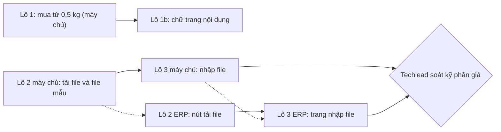
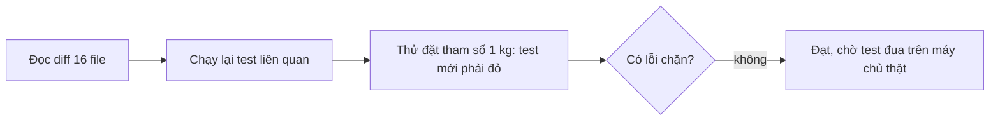
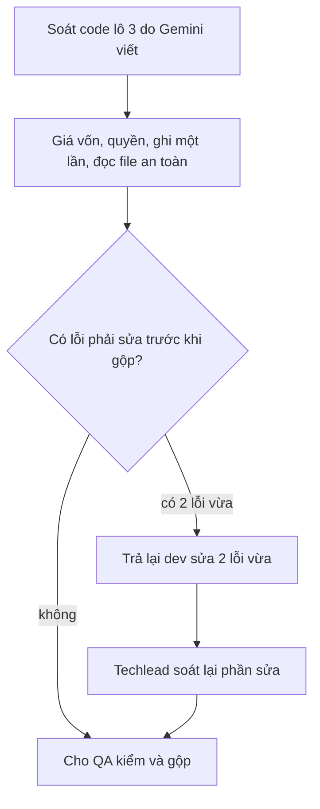

# Hàng bán: mua từ 0,5 kg, tải và nhập file Excel mặt hàng — Thiết kế kỹ thuật

```mermaid
flowchart TD
  subgraph LAT1["Mua từ 0,5 kg"]
    A1["Đổi mức tối thiểu mặc định thành 0,5 kg"] --> A2["Sửa các bài kiểm đang giả định 1 kg"]
    A2 --> A3["Sửa chữ trong trang nội dung trên staging"]
    A3 --> A4{"Duy duyệt lên thật?"}
    A4 -- "duyệt" --> A5["Bật 0,5 kg, đăng nội dung, chữ Shop cùng một lần"]
  end

  subgraph TAI["Tải file"]
    T1["Bấm Tải file Excel"] --> T2["Máy chủ tạo file theo quyền người tải"]
    T2 --> T3["Nhân viên kho: không có cột giá. Không ai có cột giá vốn"]
  end

  subgraph NHAP["Nhập file, chỉ Chủ"]
    N1["Chủ chọn file"] --> N2["Máy chủ đọc và kiểm từng dòng, chưa ghi gì"]
    N2 --> N3{"File có dòng lỗi?"}
    N3 -- "có" --> N4["Bảng lỗi theo số dòng, sửa file rồi chọn lại"]
    N3 -- "không" --> N5["Xem trước: giá cũ sang giá mới, món mới, món sửa, kèm phiếu xem trước có hạn"]
    N5 --> N6{"Chủ bấm Xác nhận?"}
    N6 -- "huỷ" --> N7["Không đổi gì"]
    N6 -- "xác nhận" --> N8["Gửi lại file kèm phiếu xem trước"]
    N8 --> N9{"Dữ liệu đã đổi từ lúc xem trước?"}
    N9 -- "đã đổi" --> N10["Báo dữ liệu vừa thay đổi, nút Xem trước lại"]
    N9 -- "đã ghi lượt này rồi" --> N11["Báo đã ghi rồi, kèm số món lần đầu"]
    N9 -- "không đổi" --> N12["Ghi tất cả trong một lần, ghi nhật ký, không đụng kho"]
  end
```



> Techlead · 14/11/2026 · Nguồn: `02-stories.md` (ĐÃ DUYỆT 14/11, S1–S6), `01-analysis.md`, `02a-ux-flow.md` (mục 8: T-1..T-11),
> `doc/decisions.md` mục 2026-11-14 · Trạng thái: **CHỜ ĐIỀU PHỐI XEM** (có 2 câu 🔴 ở §12, không chặn lô 1 và lô 2).

## 0. Quyết định kỹ thuật chính (đọc trước)

| # | Quyết định | Lý do ngắn |
|---|---|---|
| D1 | **Không thêm model, không migration** cho cả đợt. | Bất biến 8. Phiên xem trước giữ bằng phiếu ký số (D2), quyền nhập là tổ hợp quyền có sẵn (D4). |
| D2 | Phiên xem trước = **phiếu ký số `preview_token`** (Django `signing`, khoá `SECRET_KEY`). Lúc xác nhận, FE **gửi lại chính file** kèm phiếu. Máy chủ đọc lại file, so dấu vân tay dữ liệu. | Q-13 không lưu file gốc. Cloud Run nhiều instance, không có cache dùng chung (`CACHES` chưa cấu hình, mặc định LocMem theo tiến trình). Lưu kế hoạch nhập vào DB thì phải có model mới, migration và job dọn. |
| D3 | Chống ghi hai lần = **khoá dòng bảng giá mặc định** (`PriceList.is_default`, `select_for_update`) làm khoá chung của mọi lượt nhập, rồi tìm dòng AuditLog `import_items` có cùng `import_ref` (mã ngẫu nhiên trong phiếu). Có rồi → 409 `IMPORT_ALREADY_APPLIED` kèm số đếm lần đầu. | `set_item_price` đã khoá bảng giá trước tiên, nên nhập file và đặt giá tay xếp hàng theo cùng một thứ tự, không deadlock. Dòng `import_items` vốn phải ghi (S6-AC2), dùng luôn làm dấu "đã ghi". |
| D4 | Quyền nhập = **có đủ 4 quyền** `catalog.add_item`, `catalog.change_item`, `catalog.add_itemprice`, `catalog.change_itemprice` (T-1). Không thêm quyền mới. | Nhập file làm đúng những việc người đó làm tay được. Quản lý không có `add_item`/`change_item`, nên dù có được cấp quyền giá vẫn 403 (Q-08). Việc "Sửa giá bán" (`set_price`) đang là `owner_only` trong registry nên thực tế không uỷ được. |
| D5 | Thư viện **`openpyxl==3.1.5`** + **`defusedxml==0.7.1`** (§6). | Backend chưa có thư viện xlsx nào. `defusedxml` chặn tấn công XML (billion laughs). Không thêm thư viện ở `erp-console`. |
| D6 | Bốn API file đặt ở **module mới `apps/catalog/item_files/`**, là `APIView` riêng (không phải `@action` trên `ItemViewSet`), `parser_classes = [MultiPartParser]`. | `@action` trên `ItemViewSet` sẽ bị bộ dò lệnh AI (`apps/ai/registry/discovery.py`) tự đăng ký thành lệnh AI. Analysis §9 loại AI khỏi phạm vi. View không có JSON parser thì bộ dò bỏ qua. |
| D7 | Lỗi dòng trả **400 `IMPORT_INVALID_ROWS`** (không dùng 422 như nháp trong story). | `apiFetch` của ERP chỉ giữ `details` với 400 và 409. Với 422, nó mất mảng `errors`. |
| D8 | C-1: ô chữ không bắt buộc để trống thì **giữ nguyên** chữ cũ. Không có cách xoá chữ bằng file. | Duy chốt 14/11. Trong `02-stories.md` không AC nào giả định xoá. Đã **thêm** S5-AC17 để kiểm C-1. |

Sửa trong `02-stories.md` (techlead 14/11, theo yêu cầu điều phối và 02a):
- S6-AC6: 409 kèm nút **Xem trước lại**, gửi lại file đang giữ.
- S6-AC7: chốt 409 `IMPORT_ALREADY_APPLIED`, trả số đếm lần đầu.
- S6-AC9: `preview_id` đổi thành `preview_token`.
- Thêm S5-AC17 (C-1).
- Thêm ghi chú đầu file: contract thật ở 02b.

## 1. Phạm vi kỹ thuật

| Story | Làm ở | Ai |
|---|---|---|
| S1 | `backend/config/settings.py`, `apps/sales/orders/shop_errors.py`, test backend | `be-dev` |
| S2 | `apps/content` (mẫu nội dung + test), nội dung staging qua ERP | `mkt-brand` |
| S3, S4 | BE `apps/catalog/item_files/` · FE `erp-console/features/catalog/` + `shared/lib/http.ts` | `be-dev` ∥ `fe-dev` |
| S5, S6 | Như trên, thêm trang `/catalog/import/` | `be-dev` ∥ `fe-dev` |

**Không đụng:** `frontend/` (Shop, Gemini làm GUI-08 trên nhánh `gemini/shop-ui`), `adapter/`, `apps/ai/`, `apps/inventory/`, `apps/purchasing/`,
mọi migration đã có.

## 2. Kiến trúc

### 2.1 Module backend mới `apps/catalog/item_files/`

```
apps/catalog/item_files/
  README.md        module làm gì, story S3–S6, BR-DM-27..33, 5 endpoint, tham số
  columns.py       bảng cột duy nhất (khoá, tiêu đề tiếng Việt, chỉ đọc, bắt buộc, cần quyền giá) + hằng mã lỗi
  workbook.py      ghi xlsx (export, mẫu): chặn công thức, định dạng, tô xám. Hàm thuần, không đụng request
  reader.py        đọc xlsx an toàn: kiểm kích thước, zip, content type, tiêu đề, trả list dòng đã chuẩn hoá. Không đụng DB
  plan.py          dựng kế hoạch nhập: so file với DB (đọc theo lô, số truy vấn cố định), kiểm luật từng dòng, cờ giá, cảnh báo, dấu vân tay
  services.py      export_items, export_template, preview_import, commit_import (atomic, khoá, AuditLog)
  token.py         ký và đọc preview_token (django.core.signing)
  api.py           5 APIView mỏng: parse input, kiểm quyền, gọi service, trả HttpResponse/Response
  tests/           test_export.py, test_template.py, test_reader.py, test_preview.py, test_commit.py,
                   test_commit_race.py (Postgres), test_permissions.py, test_no_ai_command.py
```

Đổi nhỏ ở module có sẵn (không đổi hành vi):
- `apps/catalog/items/filters.py`: thêm `apply_item_filters(qs, params)` (gom 4 bộ lọc `item_group`, `is_active`, `item_type`,
  `has_image` đang nằm trong `ItemViewSet.filter_list`). `ItemViewSet.filter_list` gọi lại hàm này. API export dùng chung (S3-AC6, T-9).
- `apps/catalog/pricing/services.py`: tách phần kiểm của `set_item_price` thành
  `check_new_price(*, price_list, item, valid_from, valid_upto, existing_prices)`. Hàm này raise đúng 3 lỗi hiện có
  (`BR-DM-03` chồng lấn, đuôi hở, `PRICE_USED_BY_ORDERS`). `set_item_price` gọi nó sau khi khoá. Xem trước gọi nó với
  danh sách giá đã đọc sẵn, nên câu lỗi đặt giá là **một nguồn** (S5-AC7). Test `apps/catalog/pricing/tests` phải xanh y nguyên.
- `config/api_urls.py`: 5 `path(...)` đặt **trước** `include(router.urls)`, để router không bắt `export` làm `pk`.
- `config/settings.py`: tham số §6.2 và `CORS_EXPOSE_HEADERS` (T-2).
- `apps/catalog/items/public_text.py`: không đổi. Nhập file dùng lại `public_text_error`, `PUBLIC_TEXT_LIMITS`.

### 2.2 Luồng dữ liệu

```
ERP (fetch + FormData)                         Django (APIView mỏng)              item_files/services
GET  export?bộ lọc ───────────────────────►   kiểm view_item ──────────────►   export_items → workbook.write → bytes
POST import/preview  (file) ──────────────►   kiểm 4 quyền nhập ───────────►   reader.read → plan.build (chỉ đọc DB)
                     ◄──── preview_token, rows, warnings | 400 errors            → token.sign(user, sha256 file, vân tay, import_ref, giờ)
POST import/commit   (file + preview_token) ►  kiểm 4 quyền nhập ───────────►   token.verify → atomic: khoá bảng giá → đã ghi? →
                     ◄──── 200 số đếm | 409 | 410                                  khoá Item → đọc lại → so vân tay → ghi → AuditLog
```

Mọi logic nằm ở `services.py`/`plan.py`. View không chứa nghiệp vụ. Xem trước **không ghi gì** (không AuditLog, S5-AC15).

## 3. Contract API

Quy ước chung: cần đăng nhập (token DRF). Chưa đăng nhập → 401 `{"detail": "Thông tin xác thực không hợp lệ."}`. Thiếu quyền
→ 403 `{"detail": "Thiếu quyền: <perm>"}` (theo `require_perm`). Lỗi nghiệp vụ dùng phong bì `{"code", "detail", ...thêm}` của
`BusinessError(extra=...)`. Tiền là **chuỗi số nguyên đồng** (`"278000"`). Ngày ISO `YYYY-MM-DD`. Giờ ISO có múi `+07:00`.
Mọi response của 5 API có `Cache-Control: no-store`.

### 3.1 Quyền (3 tầng)

| API | Tầng 1 (model perm) | Thêm | owner | manager | warehouse_staff | delivery_staff | customer_service |
|---|---|---|---|---|---|---|---|
| `GET export/` | `catalog.view_item` | 3 cột giá chỉ khi có `catalog.view_itemprice` | 17 cột | 17 cột | 14 cột | 403 | 403 |
| `GET export-template/` | `catalog.view_item` | như trên (C-2: giữ mặc định) | 17 cột | 17 cột | 14 cột | 403 | 403 |
| `GET import/limits/` | 4 quyền nhập (D4) | | 200 | 403 | 403 | 403 | 403 |
| `POST import/preview/` | 4 quyền nhập (D4) | kiểm quyền **trước** khi đọc file | 200 | 403 | 403 | 403 | 403 |
| `POST import/commit/` | 4 quyền nhập (D4) | kiểm lại mỗi request (S6-AC10) | 200 | 403 | 403 | 403 | 403 |

Hằng `IMPORT_PERMS = ("catalog.add_item", "catalog.change_item", "catalog.add_itemprice", "catalog.change_itemprice")` đặt ở
`item_files/columns.py`. FE dùng **cùng 4 chuỗi** trong `features/catalog/permissions.ts` (`canImport` = có đủ cả 4), không xét tên nhóm (T-1).
Thiếu quyền nào thì 403 nêu quyền thiếu đầu tiên. Quyền đọc lại từ DB ở mỗi request (token DRF nạp user mới), nên Chủ bị gỡ
khỏi nhóm giữa lúc xem trước và lúc xác nhận sẽ nhận 403 (S6-AC10).

### 3.2 `GET /api/catalog/items/export/` (S3)

Query (tuỳ chọn, cùng quy ước với danh sách: rỗng = không lọc, sai → 400 `INVALID_FILTER`):
`item_group=<id>` · `is_active=1|0` · `item_type=SIMPLE|BUNDLE` · `has_image=1|0` (T-9).
Nháp trong story ghi `item_type=item`. Giá trị đúng là `SIMPLE|BUNDLE`, giống danh sách hiện có.

```
200  Content-Type: application/vnd.openxmlformats-officedocument.spreadsheetml.sheet
     Content-Disposition: attachment; filename="hang-ban-20261114-1530.xlsx"     (giờ VN, timezone.localtime)
     X-Row-Count: 4
     Cache-Control: no-store
     <bytes xlsx>
400  {"code": "INVALID_FILTER", "detail": "Tham số item_type có giá trị không hợp lệ."}
401 / 403
```
- Sắp theo `code`. Truy vấn cố định: `Item` + `select_related("item_group")`, thêm `prefetch_current_prices()` khi có quyền giá.
  **Không** prefetch `bundle_lines`, ảnh, lô (S3-AC13).
- 0 món → vẫn 200, file chỉ có tiêu đề, `X-Row-Count: 0` (S3-AC7).
- Ghi `record_audit("export_items", actor=user, changes={"rows": n, "with_prices": bool})`. Không ghi bộ lọc dạng chữ, không ghi
  tên món (S3-AC12).

### 3.3 `GET /api/catalog/items/export-template/` (S4)

```
200  Content-Disposition: attachment; filename="mau-hang-ban.xlsx"   ·  X-Row-Count: 1  ·  bytes xlsx
401 / 403
```
Cùng bộ cột với export theo quyền. Có một dòng ví dụ **giả**: `VD-001` · "Cá ví dụ" · nhóm "Nhóm ví dụ" · Mặt hàng thường · Kg · Có · 365 · Có · Có ·
ô chữ ví dụ không có giá, không có SĐT · Giá bán hiện hành trống · Giá mới `150000` · Ngày áp dụng = ngày mai (giờ VN).
Không ghi AuditLog (file không chứa dữ liệu thật).

### 3.4 `GET /api/catalog/items/import/limits/` (T-3)

```
200 {"max_rows": 1000, "max_bytes": 2097152, "preview_ttl_minutes": 30}
```
FE gọi khi mở `/catalog/import/` để hiện khối "Cách hệ thống đọc file" và các câu E12, E13. Phản hồi lỗi file (§3.5) cũng kèm `limits`.

### 3.5 `POST /api/catalog/items/import/preview/` (S5)

Request `multipart/form-data`: `file=<xlsx>`. Không nhận trường nào khác.

**200, file hợp lệ:**
```json
{
  "preview_token": "eyJ2IjoxLC…:1tAbCd:…",
  "expires_at": "2026-11-14T16:00:00+07:00",
  "has_changes": true,
  "summary": {"total_rows": 200, "created": 1, "updated": 1, "price_changed": 2, "visibility_changed": 1,
              "unchanged": 196, "will_show_on_shop": 1, "will_hide_from_shop": 1},
  "rows": [
    {"row": 3, "code": "CA-01", "action": "update", "name": "Cá thu cắt khúc",
     "changes": [{"field": "name", "label": "Tên", "old": "Cá thu", "new": "Cá thu cắt khúc"}],
     "price": null, "is_active_after": true, "shop_state": "selling"},
    {"row": 4, "code": "TOM-02", "action": "update", "name": "Tôm sú", "changes": [],
     "price": {"old": "278000", "new": "265000", "valid_from": "2026-11-15",
               "change_amount": "-13000", "change_percent": "-4.7", "flags": []},
     "is_active_after": true, "shop_state": "selling"},
    {"row": 17, "code": "CA-07", "action": "update", "name": "Cá thu cắt khúc", "changes": [],
     "price": {"old": "185000", "new": "18500", "valid_from": "2026-11-14",
               "change_amount": "-166500", "change_percent": "-90.0", "flags": ["check_zeros", "large_change"]},
     "is_active_after": true, "shop_state": "selling"},
    {"row": 30, "code": "GHE-01", "action": "update", "name": "Ghẹ xanh",
     "changes": [{"field": "is_active", "label": "Đang kinh doanh", "old": "Có", "new": "Không"}],
     "price": null, "is_active_after": false, "shop_state": "will_hide"},
    {"row": 201, "code": "MUC-09", "action": "create", "name": "Mực ống", "changes": [],
     "price": {"old": null, "new": "180000", "valid_from": "2026-11-14",
               "change_amount": null, "change_percent": null, "flags": []},
     "is_active_after": true, "shop_state": "will_show"}
  ],
  "warnings": [{"row": 12, "code": "CA-03", "column": "Giá bán hiện hành",
                "message": "Cột Giá bán hiện hành chỉ để xem, không đổi giá. Muốn đổi giá, ghi vào cột Giá mới."}],
  "limits": {"max_rows": 1000, "max_bytes": 2097152}
}
```
- `rows` chỉ gồm dòng có đổi, theo thứ tự dòng Excel. FE tự sắp theo |`change_percent`|.
- `action`: `create` | `update`. `changes[].old/new` là chữ hiển thị. Cờ ghi "Có"/"Không". Chữ dài hơn 120 ký tự bị cắt, thêm "…" ở cuối.
  Trường `item_group` hiện **tên** nhóm. `changes` không bao giờ có trường mà ô trong file để trống (C-1).
- `price.flags` (T-4), tính ở BE:
  - `check_zeros`: giá mới ≥ `ITEM_IMPORT_PRICE_ZERO_FACTOR` × giá cũ, hoặc ≤ giá cũ / hệ số đó (mặc định 5).
  - `large_change`: |chênh %| ≥ `ITEM_IMPORT_PRICE_ALERT_PERCENT` (mặc định 30).
  - `backdated`: `valid_from` < hôm nay (giờ VN).
  - Món mới (không có giá cũ) chỉ có thể có `backdated`.
  - `change_percent` làm tròn 1 chữ số (`ROUND_HALF_UP`), là chuỗi.
- `shop_state` (T-8): `selling` | `hidden` | `will_show` | `will_hide`. "Đang bán" = `is_active` và có giá hiệu lực hôm nay,
  đúng điều kiện `ShopCatalogView`. Trạng thái sau nhập dùng giá mới nếu `valid_from` ≤ hôm nay.
  `will_show_on_shop`/`will_hide_from_shop` đếm theo trường này (S5-AC2, AC3).
- `warnings` (T-5): ô cột chỉ đọc (`Loại`, `Đơn vị`, `Giá bán hiện hành`) khác giá trị hiện có. Có cả khi `has_changes = false`. Không chặn ghi.
- `has_changes = false` → `preview_token: null`, `expires_at: null`, `rows: []`. FE hiện N1 "File không có gì mới" (S5-AC4, S6-AC13).
- `expires_at` (T-7) = giờ ký + `ITEM_IMPORT_PREVIEW_TTL_MINUTES`.

**400 lỗi dòng** (S5-AC6..8, AC11, AC12, T-6). Không có `preview_token`:
```json
{"code": "IMPORT_INVALID_ROWS", "detail": "File có 5 lỗi ở 4 dòng. Chưa ghi gì.",
 "error_count": 5, "error_row_count": 4, "errors_truncated": false,
 "errors": [
   {"row": 5, "code": "TOM-02", "column": "Giá mới", "message": "Giá phải là số nguyên đồng lớn hơn 0."},
   {"row": 8, "code": "TOM-05", "column": "Nhóm hàng", "message": "Nhóm \"Tôm hùmm\" chưa có. Tạo nhóm ở ERP trước hoặc sửa đúng tên nhóm."},
   {"row": 9, "code": "CA-01", "column": "Mã hàng", "message": "Mã CA-01 lặp ở dòng 9 và 12. Mỗi mã chỉ ghi một dòng."},
   {"row": 12, "code": "CA-01", "column": "Mã hàng", "message": "Mã CA-01 lặp ở dòng 9 và 12. Mỗi mã chỉ ghi một dòng."},
   {"row": 14, "code": "CA-09", "column": "Mô tả", "message": "Không ghi nhà cung cấp, tên tàu hay ngày nhập lô trong thông tin món."}
 ],
 "limits": {"max_rows": 1000, "max_bytes": 2097152}}
```
Kiểm **hết** file, không dừng ở lỗi đầu. Trả tối đa 2.000 lỗi (`errors_truncated: true` khi cắt). `error_count` luôn là số thật.
Sắp theo `row`, rồi theo thứ tự cột.

**400 lỗi cấp file** (S5-AC9, AC10). Dừng ngay, không đọc tiếp:
```json
{"code": "IMPORT_INVALID_FILE", "reason": "missing_columns",
 "detail": "Thiếu cột Giá mới. Tải file mẫu để lấy đúng tên cột.",
 "columns": ["Giá mới"], "limits": {"max_rows": 1000, "max_bytes": 2097152}}
```
| `reason` | Khi | `detail` (02a §5) |
|---|---|---|
| `not_xlsx` | không có file, đuôi khác `.xlsx`, không phải zip, hoặc là `.xlsm` hay `.xls` | Chỉ nhận file .xlsx. Trong Excel chọn Lưu thành → Sổ làm việc Excel (.xlsx). |
| `unreadable` | zip hỏng, openpyxl không mở được, hoặc giải nén vượt giới hạn | Không đọc được file này. Mở lại bằng Excel, lưu thành .xlsx rồi chọn lại. |
| `too_large` | `file.size` > `ITEM_IMPORT_MAX_BYTES` | File quá 2 MB. Xoá bớt dòng hoặc tách thành hai file. |
| `too_many_rows` | số dòng có dữ liệu > `ITEM_IMPORT_MAX_ROWS` | File quá 1.000 dòng. Tách thành nhiều file, mỗi file tối đa 1.000 dòng. |
| `missing_columns` | thiếu cột bắt buộc, hoặc có `Ngày áp dụng giá mới` mà không có `Giá mới` | Thiếu cột {tên}. Tải file mẫu để lấy đúng tên cột. |
| `unknown_columns` | có tiêu đề lạ, ví dụ `Gia moi` | Không nhận ra cột {tên}. Tải file mẫu để lấy đúng tên cột. |
| `duplicate_columns` | một tiêu đề xuất hiện hai lần | Cột {tên} bị lặp. Mỗi cột chỉ ghi một lần. |
| `empty` | không có dòng dữ liệu nào | File chưa có dòng mặt hàng nào. |
| `no_price_list` | chưa có bảng giá mặc định (`PriceList.is_default`) | Chưa có bảng giá mặc định. Báo quản trị tạo bảng giá Bán lẻ trước. |

Số "2 MB" và "1.000" lấy từ tham số. Định dạng số kiểu Việt Nam. Tiêu đề lạ được báo là lỗi (không lặng lẽ bỏ qua), vì nếu
`Gia moi` bị bỏ qua thì giá đổi sẽ mất mà không ai biết (S5-AC10).

### 3.6 `POST /api/catalog/items/import/commit/` (S6)

Request `multipart/form-data`: `file=<chính file đã xem trước>` · `preview_token=<chuỗi>`.

```
200 {"created": 1, "updated": 1, "price_changed": 2, "visibility_changed": 1, "codes": ["CA-01", "GHE-01", "MUC-09", "TOM-02"]}
409 {"code": "IMPORT_DATA_CHANGED", "detail": "Mặt hàng vừa được sửa sau lúc bạn xem trước. Chưa ghi gì. Bấm Xem trước lại để so với dữ liệu mới."}
409 {"code": "IMPORT_ALREADY_APPLIED", "detail": "Lượt nhập này đã ghi rồi.",
     "created": 1, "updated": 1, "price_changed": 2, "visibility_changed": 1}
410 {"code": "IMPORT_PREVIEW_EXPIRED", "detail": "Phiên xem trước đã hết hạn. Chưa ghi gì. Bấm Xem trước lại."}
400 {"code": "IMPORT_PREVIEW_INVALID", "detail": "File khác với file đã xem trước. Bấm Xem trước lại."}
400 {"code": "IMPORT_INVALID_FILE", ...}       (như §3.5, khi file gửi lại hỏng)
401 / 403
```
- `codes` là mã hàng đã tạo, sửa hoặc đổi giá, sắp tăng dần. Không có giá, không có giá vốn (S6-AC12).
- `IMPORT_PREVIEW_INVALID` dùng chung cho: phiếu sai chữ ký, phiếu của người khác, hash file khác phiếu. Câu chữ không nói lý do cụ thể.
- **FE với 409 `IMPORT_DATA_CHANGED` và 410:** hiện W2/W3, nút **Xem trước lại** gọi lại `preview/` với chính `File` đang giữ trong
  state. Mất file (tải lại trang) thì nút thành "Chọn file khác" (S6-AC6 đã sửa).
- **FE với 409 `IMPORT_ALREADY_APPLIED`:** coi như ghi thành công. Toast T5 dùng số đếm trong body (T-10), rồi về danh sách.

### 3.7 Bảng mã lỗi

| HTTP | `code` | API | FE |
|---|---|---|---|
| 400 | `INVALID_FILTER` | export | E4 |
| 400 | `IMPORT_INVALID_FILE` (+`reason`) | preview, commit | E10–E14 tại vùng chọn file |
| 400 | `IMPORT_INVALID_ROWS` | preview | M4 bảng lỗi |
| 400 | `IMPORT_PREVIEW_INVALID` | commit | banner + Xem trước lại |
| 409 | `IMPORT_DATA_CHANGED` | commit | W2 |
| 409 | `IMPORT_ALREADY_APPLIED` | commit | T5 |
| 410 | `IMPORT_PREVIEW_EXPIRED` | commit | W3 |
| 401/403 | — | tất cả | E5, E21, E32 |

## 4. Định dạng file (BR-DM-27, Q-14)

### 4.1 Cột (thứ tự cố định khi ghi; khi đọc thì nhận theo **tên tiêu đề**, không theo vị trí)

| # | Tiêu đề | Khoá | Đọc/ghi | Bắt buộc khi nhập | Ô khi tải ra |
|---|---|---|---|---|---|
| 1 | Mã hàng | `code` | khoá nhận diện | có | chữ |
| 2 | Tên | `name` | ghi | có | chữ |
| 3 | Nhóm hàng | `item_group` | ghi (theo tên) | có | chữ |
| 4 | Loại | `item_type` | **chỉ đọc** (dòng mới: chặn Combo) | — | "Mặt hàng thường"/"Combo", tô xám |
| 5 | Đơn vị | `stock_uom` | **chỉ đọc** | — | "Kg", tô xám |
| 6 | Đang kinh doanh | `is_active` | ghi | có | "Có"/"Không", có danh sách chọn |
| 7 | Hạn dùng mặc định (ngày) | `shelf_life_in_days` | ghi | — | số nguyên |
| 8 | Quản lý theo lô | `has_batch_no` | ghi | — | Có/Không |
| 9 | Có hạn dùng | `has_expiry_date` | ghi | — | Có/Không |
| 10 | Ghi chú ngắn | `short_note` | ghi | — | chữ |
| 11 | Quy cách | `spec` | ghi | — | chữ |
| 12 | Bảo quản | `storage` | ghi | — | chữ |
| 13 | Nguồn hàng | `origin` | ghi | — | chữ |
| 14 | Mô tả | `description` | ghi | — | chữ |
| 15 | Giá bán hiện hành | `current_price` | **chỉ đọc**, cần quyền giá | — | số nguyên, `#,##0`, tô xám |
| 16 | Giá mới | `new_price` | ghi, cần quyền giá | — | trống |
| 17 | Ngày áp dụng giá mới | `new_price_from` | ghi, cần quyền giá | — | trống, định dạng `dd/mm/yyyy` |

**Không bao giờ có** cột hay ô chứa giá mua, giá vốn, chi phí phụ, lãi lỗ, mã lô, nhà cung cấp, tồn, ảnh. Bộ cột là **danh sách
tường minh** trong `columns.py`, không lặp qua field của model (bất biến 1).

Sheet đầu tên "Hàng bán": tiêu đề đậm, cố định hàng 1, cột chỉ đọc tô xám. Sheet thứ hai "Hướng dẫn" ghi chữ tĩnh: cách đọc file,
C-1, cột chỉ đọc. `wb.properties.creator = "Cá Về"`, không ghi tên người tải vào thuộc tính file. Khi đọc: lấy sheet "Hàng bán",
không có thì lấy sheet đầu.

### 4.2 Luật đọc từng ô

- **Chữ:** chuẩn hoá NFC, bỏ khoảng trắng hai đầu. Ô số trong cột chữ đổi thành chuỗi (`500` → "500").
- **Số tiền (`Giá mới`):** ô số nguyên, ô số thực có phần lẻ bằng 0, hoặc chữ khớp `^\d+$` hay `^\d{1,3}(\.\d{3})+$` (`278.000`).
  Mọi kiểu khác (`278.000,5`, `278,000`, `abc`, ≤ 0, > 1.000.000.000) là lỗi "Giá phải là số nguyên đồng lớn hơn 0.".
  `278,000` bị chặn có chủ ý: kiểu Việt Nam đọc thành 278 đồng.
- **Ngày:** ô ngày của Excel (lấy `.date()`, không đổi múi giờ) hoặc chữ `dd/mm/yyyy`. Trống = hôm nay theo
  `timezone.localdate()` (giờ VN). Có ngày mà không có `Giá mới` → lỗi dòng "Có ngày áp dụng mà chưa có giá mới."
- **Cờ:** `Có`/`Không` không phân biệt hoa thường, nhận cả `co`/`khong`. Ô kiểu boolean cũng nhận. Khác → lỗi "Ghi Có hoặc Không.".
- **Hạn dùng:** số nguyên 1–3650.
- **Dòng trống hẳn** (mọi ô trống) thì bỏ qua, không đếm. Số dòng báo lỗi là số dòng Excel (tiêu đề là dòng 1).

### 4.3 Luật từng dòng (BR-DM-29..33)

| Trường hợp | Xử lý |
|---|---|
| Mã có trong DB (khớp đúng chuỗi) | sửa. Chỉ so các ô **có giá trị**. Ô chữ không bắt buộc để trống → giữ nguyên (C-1, S5-AC17) |
| Mã chưa có | tạo `Item` SIMPLE. Ô trống lấy mặc định của model (chữ "", hạn 365, cờ lô/hạn = Có) |
| Mã mới chỉ khác hoa thường với mã có sẵn (`ca-01` so với `CA-01`) | lỗi "Mã ca-01 gần trùng mã CA-01 đã có. Sửa đúng mã." |
| Mã mới sai dạng: > 40 ký tự, hoặc ngoài `[A-Za-z0-9._-]` | lỗi dòng |
| Mã `VD-001` | lỗi "Đây là dòng ví dụ, hãy xoá hoặc đổi mã." (S4-AC2) |
| Mã lặp trong file | lỗi ở **mọi** dòng lặp |
| Thiếu Mã hàng, Tên, Nhóm hàng hoặc Đang kinh doanh | lỗi dòng tại cột thiếu |
| Nhóm: so sau khi chuẩn hoá (NFC, gộp khoảng trắng, `casefold`). 0 nhóm khớp → lỗi "Nhóm … chưa có…". Hơn 1 nhóm khớp → lỗi "Có nhiều nhóm tên …" | không tự tạo nhóm (Q-10) |
| Dòng mới có `Loại` = Combo | lỗi "Tạo combo mới làm ở form combo ERP." (S5-AC8) |
| Combo có sẵn đổi Nhóm, Hạn dùng, Quản lý theo lô hoặc Có hạn dùng | lỗi "Combo chỉ sửa tên, chữ, giá và đang kinh doanh bằng file. Đổi {cột} ở form combo." Không sửa thành phần combo (BR-DM-33) |
| Ô chữ công khai mới hoặc đổi | độ dài theo `PUBLIC_TEXT_LIMITS` (Tên tối đa 200). Kiểm `public_text_error` (BR-DM-25). Chỉ kiểm giá trị **đổi**, nên chữ cũ có sẵn không chặn file tải về rồi nhập lại. Kiểm cột Tên: xem 🔴 Q-TL-2 |
| `Giá mới` trống | không đổi giá |
| `Giá mới` = giá hiện hành và ngày trống | coi là không đổi (tránh tạo dòng giá trùng) |
| `Giá mới` có số | `check_new_price(...)` với `valid_upto=None` (BR-DM-02/03). Lỗi lấy nguyên câu của luật đặt giá (S5-AC7). Chú ý: giá hiện hành bắt đầu đúng hôm nay mà đặt thêm giá mới từ hôm nay sẽ bị lỗi BR-DM-03, giống đặt tay |
| Ô có công thức | có giá trị lưu sẵn thì dùng giá trị đó. Không có thì lỗi "Ô có công thức, hãy dán giá trị." (S5-AC12) |
| Món trong DB không có trong file | không động tới (S5-AC5) |

Nhập file **không bao giờ** gọi model hay service của `inventory`, `purchasing`, `sales` để ghi (BR-DM-32). `plan.py` chỉ đọc
`SalesOrderLine` gián tiếp qua `check_new_price`, khi ngày áp dụng lùi về trước hôm nay.

### 4.4 Số truy vấn cố định khi xem trước (S5-AC16)

Đọc một lần mỗi loại:
- `Item` theo `code__in`.
- `Item` theo `Lower("code")__in` (bắt mã gần trùng).
- Toàn bộ `ItemGroup`.
- `ItemPrice` của bảng mặc định cho các món trong file.
- `PriceList` mặc định.

Riêng dòng có ngày lùi về trước hôm nay thì thêm truy vấn đơn hàng (hiếm). Test `assertNumQueries` so file 10 dòng với file 300 dòng:
số truy vấn bằng nhau.

## 5. Phiên xem trước, chống ghi hai lần, dữ liệu đổi giữa chừng

### 5.1 Phiếu `preview_token`

`token.sign(...)` = `django.core.signing.dumps(payload, salt="catalog.item_files.import", compress=True)` với
`payload = {"v": 1, "u": user.pk, "h": sha256(bytes file), "d": dấu vân tay, "n": import_ref (uuid4 hex), "t": giờ ký (epoch)}`.
Phiếu không chứa dữ liệu cá nhân hay giá. Chữ ký chống sửa. Hạn kiểm bằng `t` (không dùng `max_age` của `loads`), để kiểm "đã ghi"
được **trước** kiểm hết hạn (§5.3 bước 4).

**Dấu vân tay `d`** = sha256 của JSON chuẩn hoá (`sort_keys`) gồm:
- id bảng giá mặc định, và ngày hôm nay (giờ VN);
- với mỗi mã trong file: giá trị hiện tại của mọi trường nhập được, cùng `item_type`, `item_group_id`, `pk` (hoặc `null` nếu chưa có);
- mọi `ItemPrice` của bảng mặc định cho các món đó (`id`, `rate`, `valid_from`, `valid_upto`);
- bản đồ tên nhóm (đã chuẩn hoá) → id của các nhóm được nhắc tới;
- danh sách mã gần trùng;
- kế hoạch nhập đã chuẩn hoá.

Ai sửa tay tên hay giá, đặt giá tương lai, hoặc một lượt nhập khác vừa ghi, thì vân tay đổi (S6-AC6).

### 5.2 Vì sao không thêm model `ItemImportSession`

| Cách | Được | Mất |
|---|---|---|
| Model phiên + migration | xác nhận không cần gửi lại file | lưu nội dung file đã đọc trong DB (trái tinh thần Q-13); thêm bảng, migration, job dọn phiên hết hạn (bất biến 8) |
| Cache (Redis/LocMem) | không migration | Cloud Run nhiều instance, LocMem không dùng chung; Redis chỉ có ở dev |
| **Phiếu ký số + gửi lại file (chọn)** | không lưu gì, không migration; đọc lại file dưới khoá nên chắc chắn ghi đúng dữ liệu hiện tại | gửi file 2 lần (≤ 2 MB, chấp nhận); FE phải giữ `File` trong state |

### 5.3 Thứ tự trong `commit_import` (S6-AC5..10)

1. Kiểm 4 quyền nhập. Thiếu → 403, chưa đọc file.
2. Kiểm cấp file (§3.5). Đọc chữ ký phiếu. Sai → 400 `IMPORT_PREVIEW_INVALID`. So `u == user.pk` và `h == sha256(file)`. Khác → 400 `IMPORT_PREVIEW_INVALID`.
3. `transaction.atomic()`. `PriceList.objects.select_for_update().get(is_default=True)` là **khoá chung** cho mọi lượt nhập (D3).
4. `AuditLog.objects.filter(action="import_items", changes__import_ref=n).first()`. Có → 409 `IMPORT_ALREADY_APPLIED` kèm số đếm
   lấy từ `changes` của dòng đó (T-10, S6-AC7, AC8).
5. Phiếu quá hạn (`now − t > TTL`) → 410 `IMPORT_PREVIEW_EXPIRED`.
6. `Item.objects.select_for_update().filter(code__in=codes).order_by("pk")`. **Không** `select_related` (luật khoá Postgres trong
   skill). Đọc nhóm và giá bằng truy vấn mới **sau** khoá.
7. Dựng lại kế hoạch từ file và dữ liệu vừa đọc, tính lại vân tay. Khác `d`, hoặc kế hoạch có lỗi dòng → 409 `IMPORT_DATA_CHANGED`.
8. Ghi theo thứ tự dòng:
   - Tạo hoặc sửa `Item` (`save(update_fields=...)` chỉ các trường đổi).
   - Ghi AuditLog cho từng món (§7).
   - Đổi giá thì gọi `set_item_price(price_list=default, item, rate, valid_from, valid_upto=None, actor)`. Hàm này tự đóng giá cũ và
     ghi `create_itemprice`/`close_itemprice`.
   - `BusinessError` từ `set_item_price` (ví dụ đơn vừa phát sinh làm lùi ngày bị chặn) → huỷ toàn bộ, trả 409 `IMPORT_DATA_CHANGED`.
   - `IntegrityError` (ai đó vừa tạo tay cùng mã) → huỷ toàn bộ, trả 409 `IMPORT_DATA_CHANGED`.
9. `record_audit("import_items", actor, changes={"import_ref": n, "rows": total, "created", "updated", "price_changed", "visibility_changed"})`.
10. Thoát `atomic` thì commit. Có lỗi bất kỳ ở bước 8–9 thì không dòng nào được ghi, không AuditLog nào (S6-AC5).

Đua (S6-AC8): hai request cùng phiếu. Request sau chờ khoá ở bước 3. Khi được chạy, nó thấy dòng `import_items` ở bước 4 (READ COMMITTED,
câu lệnh mới thấy dữ liệu đã commit) → 409. Nhập file và đặt giá tay dùng chung thứ tự khoá (bảng giá → món/dòng giá), nên không deadlock.
Sửa tay mặt hàng (`PATCH` item) chỉ khoá dòng `Item`. Nếu sửa tay commit trước bước 6 thì bị bắt ở bước 7. Nếu đến sau thì
phải chờ nhập xong rồi mới ghi đè (người sửa sau thắng, chấp nhận).

## 6. Thư viện, tham số, CORS

### 6.1 Thư viện (`backend/requirements.txt`)

```
# FISH-66 S3–S6 (doc/features/2026-11-14-hang-ban-excel-dong-lanh/02b §6): đọc/ghi .xlsx danh sách mặt hàng.
openpyxl==3.1.5
# openpyxl tự dùng defusedxml khi có: chặn XML bomb / entity ngoài trong file người dùng tải lên.
defusedxml==0.7.1
```
- Ghim đúng phiên bản vì thư viện này đọc file của người dùng. `et-xmlfile` là phụ thuộc kéo theo của openpyxl.
- `be-dev` ghi phiên bản thật đã cài (`pip show`) vào `03-dev-notes.md`. Test `test_reader.py` assert `openpyxl.xml.DEFUSEDXML is True`.
- Không thêm `pandas`, `xlrd` hay thư viện xlsx nào ở `erp-console` (SheetJS bản npm cũ có CVE, bản mới không có trên npm).

Đọc an toàn (`reader.py`), theo thứ tự:
1. `file.size ≤ ITEM_IMPORT_MAX_BYTES`, rồi mới đọc bytes.
2. Bytes bắt đầu bằng `PK\x03\x04`.
3. `zipfile`: số mục ≤ 2.000; tổng `file_size` sau giải nén ≤ `ITEM_IMPORT_MAX_UNPACKED_BYTES` (chặn zip bomb).
   `[Content_Types].xml` có `spreadsheetml.sheet.main+xml`. Bản `macroEnabled` → `not_xlsx`.
4. `openpyxl.load_workbook(BytesIO, read_only=True, data_only=True, keep_links=False, keep_vba=False)` để lấy giá trị.
   Mở lần thứ hai với `data_only=False` để biết ô nào là công thức. Luôn `wb.close()`.
5. `iter_rows(max_col=số cột tiêu đề)`. Vượt `max_rows` thì dừng ngay.
6. Mọi exception của zip/openpyxl → `IMPORT_INVALID_FILE`/`unreadable`. **Không** log `str(exc)` hay tên file
   (lỗi có thể chép nội dung ô).

openpyxl không chạy công thức, macro hay liên kết ngoài. `keep_links=False` bỏ liên kết ngoài, nên máy chủ không gọi mạng (S5-AC12).

### 6.2 Tham số mới (`config/settings.py`, đọc env, bất biến 7)

| Biến | Mặc định | Dùng |
|---|---|---|
| `ITEM_IMPORT_MAX_ROWS` | 1000 | số dòng dữ liệu tối đa |
| `ITEM_IMPORT_MAX_BYTES` | 2097152 (2 MB) | dung lượng file tối đa |
| `ITEM_IMPORT_MAX_UNPACKED_BYTES` | 26214400 (25 MB) | tổng dung lượng sau giải nén |
| `ITEM_IMPORT_PREVIEW_TTL_MINUTES` | 30 | hạn phiếu xem trước |
| `ITEM_IMPORT_PRICE_ALERT_PERCENT` | 30 | cờ `large_change` (H-1/H-2 ở 02a, Duy có thể đổi) |
| `ITEM_IMPORT_PRICE_ZERO_FACTOR` | 5 | cờ `check_zeros` |
| `SHOP_MIN_QTY_KG` | **0.5** (đổi từ 1) | S1 |

Django: file > 2,5 MB đi vào file tạm (`FILE_UPLOAD_MAX_MEMORY_SIZE` mặc định). Vẫn kiểm `size` trước khi đọc. Cloud Run giới hạn request 32 MB.

### 6.3 CORS (T-2)

`CORS_EXPOSE_HEADERS = ["Content-Disposition", "X-Row-Count"]` trong `settings.py`. Thiếu dòng này thì ERP (khác miền với API)
không đọc được tên file và số món. Có test: response export có `Access-Control-Expose-Headers` khi gửi `Origin` nằm trong danh sách cho phép.

### 6.4 Chặn công thức độc khi tải ra (S3-AC10)

openpyxl coi chuỗi bắt đầu bằng `=` là công thức. `workbook.write_text_cell(cell, value)`:
- gán `cell.value = value`, rồi **ép `cell.data_type = "s"`** (luôn là ô chữ);
- nếu chuỗi bắt đầu bằng `= + - @`, tab, CR hoặc LF thì đặt thêm `cell.quotePrefix = True`. Excel giữ ô đó là chữ kể cả khi
  người dùng bấm vào sửa.

Giá trị **không thêm dấu `'`**. Nhờ vậy file tải về rồi nhập lại không đổi chữ (S6-AC13). Áp cho **mọi** ô chữ (mã, tên, nhóm, 5 ô
chữ công khai). Test mở file bằng openpyxl và assert: không ô nào `data_type == "f"`, giá trị đúng nguyên chữ, `quotePrefix` đúng
ở các ô nguy hiểm. Ô số, ngày và cờ do máy chủ sinh, không chứa chữ người dùng.

## 7. Model, migration, AuditLog

- **Model mới: không. Field mới: không. Migration: không** (cả `makemigrations --check` phải sạch). Không thêm `Meta.permissions` (D4).
- AuditLog (BR-PQ-04/05). Không chép chữ tự do, tên file hay nội dung ô vào `changes`/`note`:

| `action` | Khi | `obj` | `changes` | `note` |
|---|---|---|---|---|
| `export_items` (mới) | tải file S3 | `None` | `{"rows": n, "with_prices": bool}` | "" |
| `create_item` (mới) | nhập tạo món | `Item` | `{"fields": [tên trường có giá trị]}` | "Nhập từ file Excel" |
| `update_item` (có sẵn) | nhập sửa món | `Item` | `{"fields": [tên trường đổi]}`, cùng dạng sửa tay | "Nhập từ file Excel" |
| `create_itemprice` / `close_itemprice` (có sẵn) | nhập đổi giá | `ItemPrice` | do `set_item_price` ghi, giữ nguyên | |
| `import_items` (mới) | cuối lượt nhập | `None` | `{"import_ref", "rows", "created", "updated", "price_changed", "visibility_changed"}` | "" |

`note` là hằng cố định, không phải chữ người dùng. Tra `import_ref` bằng `changes__import_ref` (JSONField chạy được trên SQLite và Postgres).

## 8. S1 và S2

### 8.1 S1, mua từ 0,5 kg (BE, không schema)

- `config/settings.py`: `SHOP_MIN_QTY_KG = Decimal(os.getenv("SHOP_MIN_QTY_KG", "0.5"))`.
- `apps/content/management/commands/load_shop_content.py:153` và `apps/content/site/services.py:73`: bỏ giá trị dự phòng
  `Decimal("1")` trong `getattr`, đọc thẳng `settings.SHOP_MIN_QTY_KG`, để không còn số 1 viết cứng.
- `apps/sales/orders/shop_errors.py::InvalidQtyError`: `detail` dựng từ tham số, ví dụ
  "Món theo kg đặt từ 0,5 kg, mỗi lần thêm 0,5 kg. Combo đặt số nguyên từ 1." (số kiểu Việt Nam). `code` vẫn `INVALID_QTY`,
  `lines[].min_qty/qty_step` giữ nguyên.
  S1-AC3 ghi "có mã BR-BH-22": mã nằm ở `code` và docstring/test, **không** đưa chuỗi "BR-BH-22" vào `detail`. API này công khai,
  khách không cần thấy mã luật. Shop hiện câu riêng theo `code` (`CheckoutScreen.tsx`), nên đổi `detail` không ảnh hưởng Shop.
- `stock_level`, `qty_rule`, `validate_line_qty`: không đổi code (đã đọc tham số).
- Test giả định 1 kg: thêm `@override_settings(SHOP_MIN_QTY_KG=Decimal("1"))` ở ca cũ đang kiểm mức 1, hoặc đổi sang đọc
  `settings`. Không viết cứng 0,5 ở ca cần chạy theo tham số. Các chỗ cụ thể:
  - `apps/sales/orders/tests/test_shop_create.py` (dòng ~64, 99–107, 206);
  - `apps/catalog/items/tests/test_shop_catalog.py` (~98, 163, 169–176, 209);
  - `apps/content/site/tests/test_site_info_shop.py` (~75);
  - `apps/content/tests/test_load_shop_content.py` (~428);
  - `apps/sales/orders/tests/test_shop_create_race.py`: 1 kg là bội 0,5 nên vẫn hợp lệ. Chỉ sửa chú thích nếu cần.
- Test mới, mỗi AC một ca. Tên tiếng Anh, docstring trích BR-BH-22/23:
  - AC1–AC10 và AC12–AC13 ở `test_shop_create.py`/`test_shop_catalog.py`;
  - AC11 (đua 0,5 + 0,5 trên tồn 0,5) ở `test_shop_create_race.py`: `TransactionTestCase` + `skipUnless(postgresql)`, chạy CI cloud.
- **Rủi ro deploy:** production hiện **không đặt** env `SHOP_MIN_QTY_KG` (`doc/ops/moi-truong.md`). Đổi mặc định trong code nghĩa là
  lần deploy production kế tiếp **tự bật 0,5 kg**, trước khi CMS và GUI-08 sẵn sàng. Xem 🔴 Q-TL-1.

### 8.2 S2, trang nội dung (giao `mkt-brand`)

- `apps/content/management/shop_content/pages.json` đã dùng `{min_qty_kg}` ở mọi câu về mức mua, và `_format_kg` ra "0,5".
  `mkt-brand` rà câu cho tự nhiên với "0,5 kg" (ví dụ "Chọn món từ 0,5 kg"). Câu combo "từ 1 combo" giữ nguyên.
- Test `test_load_shop_content.py`:
  - S2-AC1: tham số 0,5 → "0,5 kg", không còn "từ 1 kg";
  - S2-AC4: `override_settings` 1 → "1 kg";
  - S2-AC2: chạy lại lệnh nạp không đè chỗ đã sửa. Hành vi này đã có; xác nhận test hiện có phủ, thiếu thì thêm.
- Staging: sửa nội dung đã nạp qua màn Nội dung ERP (không chạy lại lệnh nạp). Script tìm chuỗi "1 kg" trên API CMS công khai,
  ghi kết quả vào `03-dev-notes.md` (S2-AC3).
- Bản production: danh sách trang và đoạn cũ → mới cho Duy duyệt (S2-AC6). Không đăng trước khi Duy duyệt.
- `mkt-brand` không sửa `frontend/`.

## 9. Rủi ro bắt buộc: cơ chế chặn và test bắt lỗi

| Rủi ro | Mức | Cơ chế chặn | Test bắt buộc (file) |
|---|---|---|---|
| **Rò giá vốn qua file export/mẫu** | Critical | Cột là danh sách tường minh trong `columns.py`. Export chỉ đọc `Item`, `ItemGroup`, `ItemPrice`, không join `Batch`/`PurchaseReceiptLine` | `test_export.py`: tạo lô bằng `make_batch` (giá mua `COST_SENTINEL`, giá vốn ≠ 0). Chủ, Quản lý, NV kho lần lượt tải. Mở file bằng openpyxl: tiêu đề **bằng đúng** danh sách cho phép theo vai (so khớp tuyệt đối). Không ô nào bằng giá mua hay giá vốn lô (S3-AC5) |
| Rò giá vốn qua preview/commit JSON | Critical | Phản hồi dựng tay trong `services.py`, không dùng serializer back-office | `test_preview.py`/`test_commit.py`: quét đệ quy bằng `find_cost_keys` (`api_base.py`) và chuỗi `COST_SENTINEL` (S5-AC14, S6-AC12) |
| Rò giá bán cho NV kho | High | `can_view_item_price` quyết định bộ cột | `test_export.py`: NV kho 14 cột, không ô nào bằng giá bán (S3-AC3, S4-AC3) |
| Vượt quyền nhập (Quản lý, có cả quyền giá) | High | `IMPORT_PERMS` kiểm trong view **trước** khi đọc file, kiểm lại ở commit | `test_permissions.py`: Quản lý được thêm `add_itemprice` + `change_itemprice` → 403 ở preview và commit. NV kho, NV giao, gọi xác nhận → 403. Chưa đăng nhập → 401. Chủ bị gỡ nhóm sau preview → commit 403. DB không đổi (S5-AC13, S6-AC9, AC10) |
| Dùng phiếu của người khác hoặc file khác | High | phiếu ký số, so `u` và `h` | `test_commit.py`: Chủ B dùng phiếu của Chủ A → 400. Đổi 1 byte file → 400. Sửa phiếu → 400 |
| Đổi giá hàng loạt sai | High | xem trước bắt buộc, cờ `check_zeros`/`large_change`, hộp xác nhận M5 (FE), AuditLog từng giá | `test_preview.py`: cờ đúng ngưỡng ở cả hai phía (đúng 5 lần, đúng 30%) với `override_settings` |
| Đặt giá lùi ngày đè đơn đã chốt (đổi lãi lỗ kỳ cũ) | High | `check_new_price` dùng chung với `set_item_price`; commit gọi lại `set_item_price` dưới khoá | `test_preview.py` (S5-AC7) + `test_commit.py`: đơn phát sinh sau preview → 409, không ghi |
| Ghi nửa chừng | High | một `transaction.atomic` | `test_commit.py`: `mock.patch` hàm ghi món để raise ở dòng 150 → đếm `Item`, `ItemPrice`, `AuditLog` trước và sau bằng nhau (S6-AC5) |
| Ghi hai lần / đua | High | khoá bảng giá mặc định + `import_ref` | `test_commit.py`: gọi commit hai lần → lần 2 là 409 kèm số đếm, số `Item`/`ItemPrice`/`import_items` như ghi một lần (S6-AC7). `test_commit_race.py` (Postgres, `TransactionTestCase`, luồng chính giữ khoá rồi mới commit) → đúng một lần ghi (S6-AC8) |
| Dữ liệu đổi giữa chừng | Medium | vân tay đọc lại dưới khoá | `test_commit.py`: sửa tên tay, đặt giá tay, hoặc chạy một lượt nhập khác giữa preview và commit → 409 (S6-AC6) |
| Nhập đụng kho | High | `item_files` không import service ghi của inventory/purchasing/sales | `test_commit.py`: đếm và so tổng `Batch`, `StockLedgerEntry`, `PurchaseReceipt*`, `SalesOrder*`, `*LineBatch` trước và sau (S6-AC3) |
| Công thức độc khi tải ra | Medium | §6.4 | `test_export.py` (S3-AC10) |
| XML bomb, zip bomb, macro, liên kết ngoài | Medium | `defusedxml`, giới hạn giải nén, chặn `macroEnabled`, `keep_links=False` | `test_reader.py`: file zip giải nén vượt giới hạn → `unreadable`; xlsm → `not_xlsx`; `.csv`/`.xls`/đổi đuôi → `not_xlsx`; patch `socket.socket.connect` để raise khi đọc file có liên kết ngoài (S5-AC9, AC12) |
| Dữ liệu cá nhân trong log/AuditLog | Medium (Critical nếu dính dữ liệu khách) | file không có dữ liệu khách; không log tên file, nội dung ô, `str(exc)`; AuditLog chỉ số đếm và tên trường | `test_preview.py`: `assertLogs`/`assertNoLogs` khi đọc file lỗi, không có tên file hay chữ trong ô. AuditLog không chứa tên món hay chữ mô tả (S3-AC12, S5-AC15, S6-AC2). Test và mock chỉ dùng dữ liệu giả |
| Lệnh AI tự sinh cho API nhập/xuất | Medium | `APIView` riêng, `parser_classes = [MultiPartParser]` (D6) | `test_no_ai_command.py`: registry không có lệnh nào trỏ `/api/catalog/items/export`/`import` |
| Xoá chứng từ / dữ liệu | Low | nhập không có nhánh xoá; món vắng trong file không động tới | S5-AC5, S5-AC17 |
| Chậm | Low | truy vấn cố định §4.4 | `assertNumQueries` cho export (10 với 50 món) và preview (10 với 300 dòng) (S3-AC13, S5-AC16) |

## 10. FE `erp-console`

Bám `doc/design/erp/UI-RULES.md` và `02a-ux-flow.md` (M1–M6, câu chữ mục 5).

| File | Việc |
|---|---|
| `shared/lib/http.ts` | thêm `apiDownload(path, {mock})` → `{blob, filename, rowCount}`: đọc `Content-Disposition` (`filename="…"`), `X-Row-Count`. Lỗi thì parse JSON và ném `ApiError` như `apiFetch`, **không** trả blob hỏng (S3-AC9). Nhánh mock trả Blob giả |
| `shared/lib/download.ts` (mới) | `saveBlob(blob, filename)` bằng `URL.createObjectURL` + thẻ `<a download>`, rồi `revokeObjectURL` |
| `features/catalog/permissions.ts` | `IMPORT_PERMS` (4 chuỗi đúng §3.1), `canImport` trong `CatalogAbility` |
| `features/catalog/itemFilesApi.ts` (mới) | `exportItems(params)` (dùng lại `itemListQuery` bỏ `page`), `exportTemplate()`, `getImportLimits()`, `previewImport(file)`, `commitImport(file, token)`. Gọi `apiFetch` với `FormData` (không dùng `apiUpload`, vì nó mất `details` của 400 và 409) |
| `features/catalog/itemFilesTypes.ts` (mới) | type khớp đúng JSON §3.4–3.6 |
| `features/catalog/itemFilesModel.ts` (mới) | hàm thuần: sắp theo \|`change_percent`\|, đếm theo cờ, câu tóm tắt, nhãn `shop_state`, nhóm lỗi theo dòng. Có test `itemFiles.test.ts` |
| `features/catalog/itemFilesMock.ts` (mới) | dữ liệu **giả**. Preview chọn tình huống theo tên file: chứa `error` → 400 lỗi dòng; `nochange` → không có gì mới; `stale` → commit 409 đổi dữ liệu; `bad` → 400 lỗi file; còn lại hợp lệ. Commit lần 2 cùng token → 409 `IMPORT_ALREADY_APPLIED` |
| `features/catalog/components/ItemFileActions.tsx` (mới) | nút M1: "Tải file Excel" (có `view_item`), menu "Tải file mẫu", "Nhập từ Excel" (chỉ `canImport`, link `/catalog/import/`). Gửi bộ lọc server đang chọn (gồm `has_image`). Khoá nút + `aria-busy` khi đang tạo file |
| `features/catalog/components/ItemListTab.tsx` | gắn `ItemFileActions` vào thanh công cụ (chỉ thêm, không đổi phần khác) |
| `features/catalog/components/ItemImportScreen.tsx` (mới) | M2–M4: giữ `File` trong state (không lưu storage, không URL). Các bước theo 02a §3. W2/W3 → "Xem trước lại" gửi lại `File` |
| `features/catalog/components/ImportPreview.tsx`, `ImportErrors.tsx`, `ImportConfirmModal.tsx` (mới) | M3, M4, M5. Modal dùng `ConfirmModal` có sẵn. Khoá nút khi đang ghi, không đóng khi đang ghi |
| `app/(console)/catalog/import/page.tsx` (mới) | route mỏng, `ViewGuard view="catalog"`. Màn tự chặn khi không có `canImport` (giống `ItemForm`) |
| `features/catalog/README.md` | thêm mục nhập/xuất file, endpoint, story |

FE **không** đọc hay ghi xlsx ở trình duyệt. Kiểm đuôi `.xlsx` ở máy chỉ để báo nhanh (E10). Máy chủ mới là lớp chặn thật.
Chỉ kiểm theo quyền, không ẩn nút theo tên nhóm.

## 11. Thứ tự thực hiện và lô giao việc



Lô 1 chạy song song với lô 2 (không chung file, trừ `config/settings.py`: lô 1 chỉ sửa dòng `SHOP_MIN_QTY_KG`, lô 2 thêm khối
`ITEM_IMPORT_*` + CORS. Điều phối gộp tuần tự). FE làm theo contract §3 bằng mock, không chờ BE.

| Lô | Story | BE/FE | File được sửa | File cấm đụng | Lệnh kiểm chứng |
|---|---|---|---|---|---|
| **1** | S1 | BE (`be-dev`) | `backend/config/settings.py` (dòng `SHOP_MIN_QTY_KG`) · `apps/sales/orders/shop_errors.py` · `apps/content/management/commands/load_shop_content.py` (chỉ dòng giá trị dự phòng) · `apps/content/site/services.py` (chỉ dòng giá trị dự phòng) · test: `apps/sales/orders/tests/test_shop_create.py`, `test_shop_create_race.py`, `apps/catalog/items/tests/test_shop_catalog.py`, `apps/content/site/tests/test_site_info_shop.py`, `apps/content/tests/test_load_shop_content.py` · `03-dev-notes.md` | `frontend/` · `apps/catalog/items/services.py` (không cần đổi) · migration · `doc/business-process-spec.md` (điều phối sửa BR-BH-22/23) | `cd backend && .venv/bin/python manage.py test apps.sales apps.catalog apps.content` rồi cả bộ `manage.py test` (thấy "Ran … OK") · `makemigrations --check --dry-run` · `python3 scripts/check_naming.py` · CI Postgres cho AC11 |
| **1b** | S2 | `mkt-brand` | `apps/content/management/shop_content/pages.json` (chỉ câu chữ về mức mua) · `apps/content/tests/test_load_shop_content.py` · nội dung staging qua ERP · `03-dev-notes.md` (bản cũ → mới cho production) | `frontend/` · code Python ngoài test · nội dung production (chờ Duy) | `manage.py test apps.content` · script tìm "1 kg" trên API CMS staging · `check_naming.py` |
| **2** | S3, S4 | BE (`be-dev`) | `backend/requirements.txt` · `config/settings.py` (khối `ITEM_IMPORT_*`, `CORS_EXPOSE_HEADERS`) · `config/api_urls.py` (path export, export-template) · `apps/catalog/items/filters.py` (`apply_item_filters`) · `apps/catalog/items/api.py` (`filter_list` gọi hàm chung) · mới `apps/catalog/item_files/{__init__,README,columns,workbook,services,api}.py` + `tests/test_export.py`, `test_template.py`, `test_no_ai_command.py` · `backend/README.md` (bản đồ module) | `apps/ai/` · `apps/inventory/`, `apps/purchasing/`, `apps/sales/` · `apps/catalog/models/` · migration · `frontend/` | `manage.py test apps.catalog` rồi cả bộ · `makemigrations --check --dry-run` · `check_naming.py` · mở file xlsx thật trong test |
| **2** | S3, S4 | FE (`fe-dev`) ∥ | `erp-console/shared/lib/http.ts` (thêm `apiDownload`) · mới `shared/lib/download.ts` · `features/catalog/permissions.ts` · mới `features/catalog/itemFilesApi.ts`, `itemFilesTypes.ts`, `itemFilesMock.ts` (phần export) · mới `components/ItemFileActions.tsx` · `components/ItemListTab.tsx` (gắn nút) · `features/catalog/README.md` | `frontend/` · `backend/` · `features/auth/` · component catalog khác | `cd erp-console && ./node_modules/.bin/tsc --noEmit && npm test && npm run build` · `check_naming.py` |
| **3** | S5, S6 | BE (`be-dev`) | `apps/catalog/pricing/services.py` (tách `check_new_price`, không đổi hành vi) · `config/api_urls.py` (limits, preview, commit) · `apps/catalog/item_files/{reader,plan,token,services,api}.py` + `tests/test_reader.py`, `test_preview.py`, `test_commit.py`, `test_commit_race.py`, `test_permissions.py` · `03-dev-notes.md` | như lô 2 BE · `apps/catalog/pricing/api.py` · `apps/common/audit.py` · `apps/accounts/` | `manage.py test apps.catalog` (pricing tests xanh y nguyên) rồi cả bộ · `makemigrations --check --dry-run` · CI Postgres (`test_commit_race`) · `check_naming.py` |
| **3** | S5, S6 | FE (`fe-dev`) ∥ | `features/catalog/itemFilesApi.ts`, `itemFilesTypes.ts`, `itemFilesMock.ts` (phần nhập) · mới `itemFilesModel.ts`, `itemFiles.test.ts` · mới `components/ItemImportScreen.tsx`, `ImportPreview.tsx`, `ImportErrors.tsx`, `ImportConfirmModal.tsx` · mới `app/(console)/catalog/import/page.tsx` · `features/catalog/README.md` | `frontend/` · `backend/` · `shared/lib/http.ts` (đã xong ở lô 2) · `features/auth/` | `tsc --noEmit && npm test && npm run build` · `NEXT_PUBLIC_USE_MOCK=1 npm run dev` chạy đủ 5 tình huống mock · `check_naming.py` |

QA lô 2–3: mở file xlsx thật do Chủ, Quản lý, NV kho tải trên staging (S3-AC5). Ca ngoài đường thuận:
- bấm Xác nhận hai lần;
- 409 dữ liệu đổi rồi bấm Xem trước lại;
- file `.csv` đổi đuôi;
- file có công thức;
- vòng tròn tải về → nhập lại → "không có gì mới".

`techlead` review lô 3 kỹ phần khoá, vân tay và `check_new_price`.

## 12. Câu hỏi

### 🔴 Cần Duy trả lời (không chặn lô 1–3 làm code, chặn deploy hoặc gộp)

| # | Câu hỏi | Phương án | Khuyến nghị |
|---|---|---|---|
| **Q-TL-1** | Production chưa đặt env `SHOP_MIN_QTY_KG`. S1 đổi mặc định trong code thành 0,5, nên **lần deploy production kế tiếp sẽ tự bật 0,5 kg**, kể cả khi lần đó chỉ để sửa việc khác, trước khi nội dung CMS và GUI-08 sẵn sàng. Trang Điều kiện giao dịch (có giá trị pháp lý) sẽ ghi sai. | **A.** Giữ đổi mặc định. Ở lần deploy production kế tiếp (nếu chưa lên thật 0,5), đặt cứng `SHOP_MIN_QTY_KG=1` trên production. Lên thật thì đổi env thành 0,5 cùng lúc đăng CMS và GUI-08. **B.** Giữ mặc định 1 trong code, chỉ đặt env staging 0,5. Khi lên thật thì đặt env production 0,5. | **A.** Đúng story S1, và code khớp quyết định 14/11. Điều phối ghi bước "đặt env =1" vào runbook deploy production (`doc/ops/moi-truong.md`) trước khi gộp lô 1 vào `main`. |
| **Q-TL-2** | Kiểm chữ công khai (BR-DM-25: không giá, SĐT, nhà cung cấp, tên tàu, mã lô) có áp cho **Tên món** không? Hiện form ERP chỉ kiểm 5 ô chữ, **không kiểm Tên**. Nhưng S5-AC6 (dòng 14) và 02a §5 giả định file báo lỗi "Tên có tên nhà cung cấp". | **A.** Áp cho Tên ở **cả form lẫn file**, chỉ kiểm khi tên mới hoặc đổi (tên cũ không bị chặn). Mở rộng BR-DM-25 thêm "tên". **B.** Giữ như form: không kiểm Tên. Đổi dữ liệu thử S5-AC6 dòng 14 sang cột Mô tả. | **A.** Tên món hiện ngay trên Shop. Hai cửa (form, file) cùng một luật. Làm form ở lô 3 BE (`ItemSerializer.validate_name`, thêm 1 test). Nếu Duy chọn B thì bỏ dòng này và sửa AC. Mặc định khi chưa có trả lời: lô 3 làm theo **B** (không đổi luật cũ), để không tự nới BR. |

### 🟡 Đã chốt mặc định (đổi được)
- S4-AC3 / C-2: file mẫu theo quyền xem như export (NV kho 14 cột).
- H-1/H-2 (02a): ngưỡng 30% và hệ số 5 là tham số env, đổi không cần sửa code.
- Ô "Giá mới" bằng đúng giá hiện hành và ngày trống: coi là không đổi.
- Tiêu đề cột lạ là lỗi cấp file (không bỏ qua).

## 13. Review code (techlead điền khi lô QA APPROVED)

| Lô | Kết luận | Ghi chú |
|---|---|---|
| 1 | **REVIEW PASS** (14/11, nhánh `feat/fish66-lo1-gop` đến `f4b7d66`) | Không Critical, High hay Medium. Điều kiện gộp: AC11 phải chạy xanh trên CI Postgres. Còn 4 lỗi Low, xem dưới. |
| 1b | **REVIEW PASS** (14/11) | Không lỗi. Còn chờ dán kết quả script S2-AC3 trên staging, và Duy duyệt bản production (S2-AC6). |
| 2 | **REVIEW PASS** (APPROVED, 0 Critical/High/Medium, 5 Low) | §13.2 |
| 3 | **REVIEW PASS** (APPROVED sau khi sửa ở `989e199`; lần đầu `a669ddf` REJECTED vì 2 Medium) | §13.3, mục "Soát lại" |

### 13.1 Lô 1 + 1b: kết quả soát (techlead 14/11)



**Đúng thiết kế §8.1 và §8.2.**
- `settings.py:361` mặc định `"0.5"`, vẫn đọc env và dùng `Decimal`. Theo Q-TL-1 thì production không đặt env.
- `load_shop_content.py:153` và `site/services.py:73` bỏ giá trị dự phòng 1.
- `InvalidQtyError` dựng `detail` từ tham số. Câu không chứa mã BR, giữ nguyên `code` và `lines`.
- `stock_level`, `qty_rule` và `validate_line_qty` không đổi.
- Không có migration (`makemigrations --check` sạch). Không đụng `frontend/` hay `apps/catalog/items/services.py`.

**Giá vốn và dữ liệu cá nhân.**
- Câu lỗi mới chỉ có hai tham số công khai (mức tối thiểu, bước) và câu combo cố định.
- Không có số kg tồn, mã lô hay dữ liệu khách.
- `test_s1_ac12` (cả `sales` lẫn `catalog`) quét phản hồi để tìm giá mua, mã lô, `qty_reserved` và SĐT, tên, địa chỉ giả.

**BR-BH-22/23 (đuôi lô).**
- Tồn 0,4 kg ra `out`, tồn đúng 0,5 kg ra `low`.
- Tồn 0,5 kg: đặt 0,5 kg thành công, đặt 1 kg nhận `OUT_OF_STOCK`.
- Đơn combo 0,5 vẫn bị chặn. Combo giữ `min_qty` = `qty_step` = "1".

**Giỏ, đơn cũ và giữ chỗ.**
- Giỏ cũ luôn là bội 0,5 và từ 1 kg trở lên, nên vẫn hợp lệ với mức mới.
- Đơn cũ không bị chạm (AC13 kiểm tổng tiền và dòng đơn cũ, `qty_reserved` cộng dồn 1,5).
- Giữ chỗ và FEFO không đổi code. AC1 kiểm phân bổ 0,5 kg vào đúng lô.

**Các `override_settings` 1 kg không che lỗi.**
- Mỗi chỗ ép 1 kg đều có ca chạy theo mặc định 0,5 trong `test_shop_min_qty.py` (sales, catalog) và `LoadShopContentMinQtyTextTests`.
- Hai ca `0.5` đổi thành `0.25` (`test_shop_create_error_order.py:83`, `test_shop_order_create.py:101`) vẫn giữ ý "số lượng sai".
- Đã thử đặt `SHOP_MIN_QTY_KG=1` rồi chạy hai file `test_shop_min_qty` cùng `test_load_shop_content`: 12 ca đỏ đúng lý do. Test mới bắt được việc lùi mặc định.

**Commit `f4b7d66` (voucher).** Ca đổi ngày sang 2099 hợp lý. Ý test giữ nguyên: đổi giờ +07:00 ra UTC và trạng thái `scheduled`. Không làm yếu test.

**Kiểm chứng techlead chạy trong worktree:**
- `manage.py test apps.sales.orders apps.catalog.items apps.content apps.catalog.vouchers`: Ran 842, OK (skipped=10).
- `makemigrations --check --dry-run`: No changes detected.
- `check_naming.py`: OK.

**Điều kiện trước khi gộp `main`:**
- `test_s1_ac11_two_parallel_half_kg_orders_on_half_kg_stock_exactly_one_wins` (`test_shop_create_race.py:87`) chỉ chạy trên Postgres.
- Trên SQLite ca này bị bỏ qua, nên chưa ai thấy nó chạy. Phải thấy nó xanh trên CI Postgres cloud (`.github/workflows/backend-tests.yml`).

**Low (không chặn, gom sửa khi tiện):**
- L1 `backend/apps/sales/orders/shop_errors.py:24`: `_vn_kg` là bản thứ ba của cùng một hàm định dạng kg kiểu Việt. Hai bản kia là `_format_kg` ở `load_shop_content.py:76` và `_kg_text` ở `site/services.py:33` (bản này ra dấu chấm). Nên gom về một helper chung, ví dụ trong `apps/sales/utils.py` cạnh `kg_str`.
- L2 `backend/apps/sales/orders/shop_errors.py:44`: `InvalidQtyError.default_detail` không còn được dùng, vì `__init__` luôn truyền `detail`. Đây là code chết, nên bỏ.
- L3 `backend/apps/sales/orders/tests/test_shop_create.py:94`: kiểm `detail` bị nới từ so khớp nguyên câu xuống `startswith`. Lớp này đã ép 1 kg, nên so được nguyên câu "Món theo kg đặt từ 1 kg, mỗi lần thêm 0,5 kg. Combo đặt số nguyên từ 1." AC3 ở file mới đã bù phần lớn.
- L4 `backend/apps/content/tests/test_load_shop_content.py:412`: `override_settings(SHOP_MIN_QTY_KG="1")` truyền chuỗi, còn mọi chỗ khác truyền `Decimal`. Chạy đúng vì `_format_kg` nhận cả chuỗi, nhưng nên thống nhất.

**Ghi nhận ngoài phạm vi (không phải lỗi lô này):**
- `load_shop_content.py:154` và `site/services.py:74` còn giá trị dự phòng cho `SHOP_QTY_STEP_KG`.
- `frontend/lib/quantity.ts:21`, `frontend/lib/mock.ts:107,747`, `frontend/features/content/mock.ts` và `PreviewGallery.tsx:260` còn số 1 kg. Phần này thuộc GUI-08 (Gemini, nhánh `gemini/shop-ui`).
- Bản build thật lấy `min_qty` từ API nên vẫn đúng. Câu cố định trong `PreviewGallery` chỉ có ở `/ui-preview/`.
- S1-AC13 chỉ được kiểm ở mức DB, chưa kiểm màn ERP và báo cáo. Chấp nhận được vì lô này không đổi code đơn hay báo cáo.

### 13.2 Lô 2 (S3, S4) — techlead 14/11

Nhánh `feat/fish66-lo2-gop` (gộp `feat/fish66-lo2-export-be` + `feat/fish66-lo2-export-fe`, tách từ `main` cce9118).
Techlead tự chạy lại: `manage.py test apps.catalog.item_files apps.catalog.items` → Ran 130, OK; `makemigrations --check --dry-run`
→ No changes; `python3 scripts/check_naming.py` → OK, không phát sinh mới; kiểm trong venv `openpyxl 3.1.5`, `defusedxml 0.7.1`,
`openpyxl.xml.DEFUSEDXML=True`, `LXML=False`, `iterparse` lấy từ `defusedxml`.

**Kết luận: REVIEW PASS.** Không có lỗi Critical, High hay Medium.

| Điểm soát | Kết quả |
|---|---|
| Rò giá vốn | Đạt. `columns.py` là danh sách tường minh 17 cột. `services.export_items` chỉ đọc `Item`, `ItemGroup` và giá hiệu lực qua `prefetch_current_prices`, không join `Batch`/`PurchaseReceiptLine`. Test `test_s3_ac5_*` tạo lô có giá mua, so tiêu đề tuyệt đối theo vai và quét mọi ô ở cả 2 sheet |
| Cột giá theo vai | Đạt. `columns_for(with_prices=...)` dựa `catalog.view_itemprice`. NV kho 14 cột ở cả export và mẫu (`test_s3_ac3_*`, `test_s4_ac3_*`) |
| 403 NV giao, gọi xác nhận, 401 | Đạt. `require_perm(view_item)` trong view, AuditLog không ghi khi 403 hay 400 |
| Công thức độc | Đạt. Mọi ô chữ (mã, tên, nhóm, 5 ô công khai, sheet Hướng dẫn) đi qua `write_text_cell`: ép `data_type="s"` (ghi shared string, Excel không tính), thêm `quotePrefix` với `= + - @ \t \r \n`, không thêm `'` |
| defusedxml | Có hiệu lực trong môi trường hiện tại (xem trên). Lô 2 chỉ ghi file nên chưa dùng tới. Lưu ý cho lô 3 ở L5 |
| CORS | Đạt. Chỉ thêm `CORS_EXPOSE_HEADERS` đúng 2 header. `CORS_ALLOWED_ORIGINS` vẫn đọc env, không có `CORS_ALLOW_ALL_ORIGINS` |
| AuditLog `export_items` | Đạt. `changes = {"rows", "with_prices"}`, `obj=None`, `note=""`. Không tên món, không bộ lọc (`test_s3_ac12_*`). Thuộc tính file `creator`/`lastModifiedBy` = "Cá Về" |
| Bộ dò lệnh AI | Đạt. `APIView` + `MultiPartParser`, `discovery._has_json_parser` bỏ qua. `test_no_ai_command.py` dựng lại registry để kiểm |
| N+1 | Đạt. 1 truy vấn món (kèm nhóm) + 1 truy vấn giá. `assertNumQueries` gián tiếp qua so số truy vấn khi thêm 50 món, cho cả Chủ và NV kho |
| Contract 02b §3 BE ↔ FE | Khớp: đường dẫn, query `item_group/is_active/item_type/has_image` (`itemListQuery` không gửi `page=1`), `Content-Disposition` dạng `filename="..."`, `X-Row-Count`, 400 `INVALID_FILTER`, 403. `rowCount` chịu được `null` khi thiếu header |
| `apiDownload` | Đạt. Lỗi thì parse JSON rồi ném `ApiError` qua `raiseHttpError` dùng chung (tách ra từ `apiFetch`, giữ nguyên hành vi 400/409 `details`). 200 thân rỗng thì báo lỗi. Không lưu blob khi lỗi. Có test |
| `canImport` | Đạt. `IMPORT_PERMS` đúng 4 chuỗi như `columns.IMPORT_PERMS`, `every(has)`, không xét tên nhóm |
| Nút Nhập | Đang ẩn bằng `IMPORT_PAGE_READY = false` (`ItemFileActions.tsx:25`). Lô 3 bật cùng lúc có route `/catalog/import/` |
| Icon | `description` (tải) và `swap_vert` (nhập) thay `download`/`upload_file` vì font tập con chưa có. Cả hai có trong `scripts/subset-material-symbols.py`. Chấp nhận, ghi ở 03-dev-notes |
| Chữ 02a §5 | Khớp L1, L2, L3, T1, T1b, T2, T3, E3, E4, E5 và nhãn menu "Thao tác khác với file". Thêm câu lỗi riêng cho file mẫu, hợp lý |
| 360 px | `.itemActions` `flex-wrap` + nút `nowrap`; `.lp-tabrow` đã `flex-wrap`, `.lp-actions` co về min-content nên cụm nút xuống dòng, không tràn ngang. QA vẫn chụp xác nhận |

**Ghi chú Low (không chặn gộp, nên xử lý ở lô 3):**

| # | File:dòng | Việc |
|---|---|---|
| L1 | `backend/apps/catalog/item_files/api.py:32`, `:45` | `http_method_names` có `"head"`. Django gán `head = get`, nên HEAD vẫn dựng file và ghi một dòng `export_items` mà không ai nhận file. Bỏ `"head"` (giữ `get`, `options`) |
| L2 | `backend/apps/catalog/item_files/services.py:23-24`, `columns.py:11` | `can_see_prices` và `VIEW_PRICES_PERM` lặp lại `items/serializers.py` `can_view_item_price` / `VIEW_ITEM_PRICE_PERM` (02b §9 ghi dùng `can_view_item_price`). Nên dùng chung một hằng để quyền giá có một nguồn |
| L3 | `erp-console/shared/lib/http.ts:275` (`apiDownload`, nhánh 200) | Không kiểm `Content-Type`. Nếu một proxy trả 200 HTML thì máy lưu file .xlsx hỏng. Nên kiểm `spreadsheetml` (hoặc `octet-stream`) trước khi trả blob |
| L4 | `erp-console/features/catalog/components/ItemFileActions.tsx:50`, `:80` | Khi một lượt tải đang chạy, nút còn lại bị khoá (nút Tải file Excel `disabled`) hoặc bị bỏ qua im lặng (mục Tải file mẫu qua `busyRef`). 02a §4 M1 ghi "nút còn lại vẫn dùng được". An toàn hơn ý 02a, chấp nhận được, nhưng mục menu nên hiện khoá (`blockedReason`) thay vì nuốt cú bấm |
| L5 | `backend/requirements.txt` | defusedxml chỉ có hiệu lực khi openpyxl không dùng lxml. Nếu sau này có gói kéo `lxml` vào, openpyxl tự chuyển sang lxml. Lô 3 `test_reader.py` nên assert thêm `openpyxl.xml.LXML is False` (hoặc đặt `OPENPYXL_LXML=False`) bên cạnh `DEFUSEDXML is True` |

Lưu ý cho lô 3 (không phải lỗi lô 2): `write_text_cell` bỏ ký tự cấm của XML (`ILLEGAL_CHARACTERS_RE`). Món có ký tự điều khiển trong chữ sẽ
khác DB sau khi tải về, nên vòng "tải về → nhập lại → không có gì mới" (S6-AC13) cần so sau khi bỏ cùng bộ ký tự đó, hoặc chấp nhận đổi.

### 13.3 Review lô 3 (S5, S6) — techlead 14/11



Nhánh `int/fish66-lo3`, commit `a669ddf`. Diff `origin/main...HEAD`: 39 file.
Techlead tự chạy lại:
- `manage.py test apps.catalog --parallel 1` cho kết quả Ran 391, **1 fail, 1 skip**.
  - Ca fail là `vouchers/tests/test_api.py::test_s3b_01_ac1_create_stores_utc_times_and_audits`. Test này cài cứng ngày 15–31/10/2026, nên từ 01/11 nó luôn ra `expired`. Lô 3 không đụng `vouchers`, nên lỗi này **có sẵn trước lô 3**. Điều phối cần giao sửa riêng.
  - Ca skip là `test_commit_race` (cần Postgres, chạy trên CI cloud).
- `makemigrations --check --dry-run` → No changes.
- `python3 scripts/check_naming.py` → OK, không phát sinh vi phạm mới.
- `erp-console`: `tsc --noEmit` sạch, `vitest run` 116 file / 1386 test xanh.
- Có chạy thêm một test dò riêng để tái hiện M1, M2 và L1. Test dò để ở scratchpad, không thêm vào repo.

**Kết luận: REVIEW FAIL (REJECTED).** Không có lỗi Critical hay High. Có 2 lỗi Medium cần sửa trước khi gộp. Cả hai đều nhỏ và khoanh vùng được.

#### Điểm soát

| Điểm soát | Kết quả |
|---|---|
| Giá vốn | Đạt. `reader`/`plan`/`services` chỉ đọc `Item`, `ItemGroup`, `ItemPrice`, `PriceList`. Phản hồi được dựng tay, không dùng serializer. Câu lỗi lấy nguyên câu của `check_new_price` (không có số). `create_itemprice` vẫn ghi `sell_rate` như cũ, đó là giá bán, không phải giá vốn. Test quét `find_cost_keys` + `COST_SENTINEL` ở preview, commit và AuditLog |
| `check_new_price` | Không đổi hành vi. `set_item_price` vẫn khoá bảng giá → khoá dòng giá → kiểm cùng 3 lỗi. Nhánh `item.pk is None` chỉ dùng cho món mới lúc xem trước. Test `pricing` xanh |
| `items/serializers.py` | `user_can_view_item_price` tách ra, `can_view_item_price` gọi lại hàm này, hành vi giữ nguyên. Thêm `validate_name` theo Q-TL-2 = A: chỉ kiểm khi tạo hoặc đổi tên. PATCH không gửi `name` thì không kiểm. Có test |
| Phân quyền | Đạt. Ba view kiểm đủ 4 `IMPORT_PERMS` trước khi đọc `request.FILES`. Mỗi request đọc lại quyền. Quản lý có thêm quyền giá vẫn 403, Chủ bị gỡ quyền giữa chừng cũng 403 (`test_permissions.py`) |
| Phiếu xem trước | Đạt. Phiếu ký bằng `signing` + salt riêng. Server so `u` (phiếu người khác → 400), so `h` (đổi file → 400) và kiểm hạn `t` (410), theo đúng thứ tự §5.3. Phiếu đã ghi rồi → 409 `IMPORT_ALREADY_APPLIED` kèm số đếm. Phiếu không chứa giá hay dữ liệu cá nhân |
| Ghi một lần, nguyên tử | Đạt. Toàn bộ chạy trong một `atomic`. Các bước: khoá `PriceList` mặc định, tra `import_ref`, khoá `Item` theo `pk` (không `select_related`), dựng lại kế hoạch và so vân tay, rồi mới ghi. Dòng lỗi, `BusinessError` của `set_item_price` hay `IntegrityError` đều thành 409 và rollback hết. Test mock lỗi giữa chừng → không đổi `Item`, `ItemPrice`, `AuditLog` |
| AuditLog | Đạt. `create_item`/`update_item` chỉ ghi tên trường, `note` là hằng. `import_items` ghi `import_ref` + số đếm. Xem trước không ghi gì (có test) |
| Đọc file | Phần lớn đạt. Có `defusedxml` (chặn ở runtime nếu tắt), test assert `LXML is False` (L5). Chặn `vbaProject`/`macroEnabled`, tổng giải nén tối đa 25 MB, tối đa 2.000 mục zip, `keep_links=False`. Ô công thức không có giá trị lưu sẵn → lỗi dòng. Không log `str(exc)`. **Lỗi M1 ở dưới** |
| Dữ liệu cá nhân, log | Đạt. `item_files` không có `logger`/`print`. FE không lưu `File` hay token vào storage hay URL (`localStorage` chỉ có trong mock để chọn tình huống). Test dùng SĐT giả `0900000001` |
| Low lô 2 + B2 | L1 đạt (HEAD → 405, không ghi `export_items`, có test). L2 đạt (`VIEW_PRICES_PERM = VIEW_ITEM_PRICE_PERM`, `can_see_prices` gọi hàm chung). L3 đạt (`apiDownload` kiểm `Content-Type`). L4 đạt (`blockedReason`). L5 đạt. B2 đạt (`GUIDE_LINES_NO_PRICE`, có test) |
| Phạm vi file | Đạt. 36 file code đều nằm trong danh sách được phép của `02c-giao-viec-gemini.md`. Không đụng model, migration, `apps/ai`, `settings.py`, `frontend/` |
| Contract BE ↔ FE | Khớp đường dẫn, mã lỗi, `reason`, 400/409/410. FE coi 409 `IMPORT_ALREADY_APPLIED` là thành công (T5), và nút "Xem trước lại" gửi lại `File` đang giữ. Lệch nhỏ ở L1 và L4 bên dưới |

#### Lỗi

| # | Mức | File:dòng | Mô tả + cách tái hiện | Cách sửa |
|---|---|---|---|---|
| **M1** | Medium | `backend/apps/catalog/item_files/reader.py:222-223`, `:240-262` | Dòng trống được bỏ qua và **không bị đếm**. `iter_rows` chạy không giới hạn dòng, cũng không giới hạn cột (02b §6.1 ghi `iter_rows(max_col=…)`). openpyxl ở chế độ `read_only` tự lấp dòng thiếu bằng dòng rỗng. Tái hiện: file 5 KB có 1 dòng thật và một ô ở `A1048576` → `read_import_workbook` mất **11,3 giây**. Mỗi lần xem trước tốn một lần đọc, xác nhận tốn thêm một lần nữa. File Excel thật có ô rác ở xa bên dưới cũng gây chậm như vậy, có thể chạm timeout của Cloud Run. Chỉ Chủ gọi được, nên xếp Medium | Đếm **mọi** dòng đã quét, kể cả dòng trống, vào một trần cứng (ví dụ `ITEM_IMPORT_MAX_ROWS × 2` hoặc thêm hằng). Vượt trần → `too_many_rows`. Truyền thêm `max_col=max_col` cho cả hai `iter_rows`. Thêm test: ô ở `A1048576` → 400 `too_many_rows`, chạy dưới 1 giây |
| **M2** | Medium | `backend/apps/catalog/item_files/plan.py:735`, `:742` | `shop_state` và `will_show_on_shop` sai ở hai ca, trái 02b §3.5 T-8: "Đang bán" = `is_active` và có giá hiệu lực hôm nay. (a) Món mới có giá mới từ ngày mai ra `will_show`. Đúng phải là `hidden`, vì dòng 735 không xét `valid_from`. (b) Món cũ đang ẩn chuyển sang "Có" mà không có giá ra `will_show`. Đúng phải là `hidden`, vì `has_visibility_change` ở dòng 742 luôn `True` trong nhánh này. Tái hiện: hai ca trên cho `summary.will_show_on_shop = 2`, số đúng là 0. Chủ đọc câu "x món sẽ hiện trên Shop" (S5-AC2) với số sai | Dòng 735: `will_show` khi `is_active_val and price_entry and valid_from_date <= today`. Dòng 742: bỏ `or has_visibility_change`. Thêm 2 test cho hai ca trên. Nên thêm cả ca giá tương lai của món đang ẩn |
| L1 | Low | `backend/apps/catalog/item_files/api.py:69`, `:82`, `:101` | 02b §3 ghi "mọi response của 5 API có `Cache-Control: no-store`". Ba API JSON (limits, preview, commit) chưa có header này. Phản hồi preview chứa giá bán. Tái hiện: `GET import/limits/` và `POST import/preview/` trả `Cache-Control: None` | Dùng `NoStoreMixin` có sẵn ở `apps/common/api.py`. Thêm assert header vào test |
| L2 | Low | `backend/apps/catalog/item_files/services.py:196-198` | Khoá ở bước 6 tính mã bằng `str(value).strip().lower()`. Kế hoạch lại dùng `_norm_text` (NFC, bỏ ký tự cấm, `500.0` → "500"). Nếu ô mã là số thực hoặc có ký tự điều khiển, món đó **không bị khoá** nhưng vẫn được sửa. Vân tay vẫn bắt được phần lớn các ca, nên rủi ro thấp | Lấy mã từ `plan["_lower_codes"]`: dựng kế hoạch nhẹ trước, hoặc tách hàm chuẩn hoá mã dùng chung với `plan.build_import_plan` |
| L3 | Low | `backend/apps/catalog/item_files/tests/test_commit_race.py:89-92` | Test đua chỉ bắn 2 luồng cùng lúc. Chưa có ca "luồng chính giữ khoá bảng giá rồi mới commit" như skill và 02b §9 yêu cầu, nên không chắc luồng thứ hai thật sự **chờ khoá** | Thêm ca: luồng chính mở `atomic`, `select_for_update` bảng giá mặc định. Luồng phụ gọi `commit_import`. Luồng chính ghi `import_items` cùng `import_ref` rồi commit. Luồng phụ phải nhận 409 `IMPORT_ALREADY_APPLIED`. Chạy trên CI Postgres |
| L4 | Low | `backend/apps/catalog/item_files/tests/test_commit.py` | Thiếu ca 02b §9: "đơn phát sinh sau preview cho dòng lùi ngày → 409, không ghi". Code đã xử lý (kế hoạch dựng lại báo lỗi dòng, chuyển thành 409) nhưng chưa có test giữ hành vi này. Cũng chưa có `assertNoLogs` cho file lỗi (S5-AC15) | Thêm 2 test |
| L5 | Low | `erp-console/features/catalog/components/ItemImportScreen.tsx:243-246` | `extractAlreadyAppliedCounts` lấy số đếm nhưng toast T5 dùng câu cố định. Câu này khớp 02a §5, nên số đếm thành thừa (T-10 định dùng số) | Hoặc bỏ biến, chỉ xét `code`. Hoặc dùng `formatImportSuccessToast(counts)`. Nên chọn một cách, tránh code nửa vời |

**Để gộp:** sửa M1 và M2 kèm test. Nên sửa L1 luôn vì chỉ cần thêm một mixin. L2–L5 có thể để lô sau. Sau khi sửa, techlead chỉ soát lại `reader.py`, `plan.py` và test mới. Sau đó QA kiểm các ca ngoài đường thuận ở §11, và CI Postgres phải chạy `test_commit_race`.

#### Soát lại sau khi sửa (commit `989e199`), techlead 14/11

Đã soát `git diff a669ddf..989e199`. Techlead tự chạy lại, không tạo `.env`:
- `manage.py test apps.catalog.item_files apps.catalog.items apps.catalog.pricing --parallel 1` → Ran 280, OK (skipped=1, là `test_commit_race` chờ CI Postgres).
- `check_naming.py` → OK.
- Chạy lại test dò: ô ở `A1048576` → 400 `too_many_rows` sau 0,03 giây (trước là 11,3 giây). Hai ca của M2 ra `hidden`, `will_show_on_shop = 0`. Ba API JSON đều có `Cache-Control: no-store`.

| # | Kết quả |
|---|---|
| M1 | **Đã sửa.** Hai `iter_rows` đều có `max_col = len(ALL_COLUMNS) + 8`. Mọi dòng đã quét, kể cả dòng trống, tính vào trần `ITEM_IMPORT_MAX_ROWS × 2 + 10`. Có test thời gian và test kiểm có truyền `max_col` |
| M2 | **Đã sửa.** Món mới chỉ `will_show` khi giá có `valid_from <= hôm nay`. Món bật lại chỉ `will_show` khi có giá hiệu lực, đã bỏ `or has_visibility_change`. Có 5 test mới cho các ca: giá tương lai, giá từ hôm nay, bật lại không giá, bật lại chỉ có giá tương lai, bật lại có giá hiệu lực |
| Đổi test cũ | **Đúng theo T-8.** Trong `test_s5_ac1_ac2_ac3_ac14_...`, MUC01 là món mới có giá từ **ngày mai**, còn TOM01 (`item_b`) bật lại mà **chưa có giá nào** trong bảng mặc định (fixture chỉ đặt giá cho `item_a` và combo). Hôm nay cả hai chưa hiện trên Shop, nên `will_show_on_shop = 0` và MUC01 = `hidden` là đúng. Giá trị 2 cũ khẳng định đúng lỗi M2 |
| L1 | Đã sửa. `NoStoreMixin` cho limits, preview, commit. Có test cả đường lỗi 400/403 |
| L2 | Đã sửa. `plan.normalize_item_code` là nguồn chuẩn hoá mã duy nhất, dùng cho cả kế hoạch và khoá bước 6. Có bỏ mã rỗng, có test |
| L4 | Đã sửa. Có test "đơn phát sinh sau xem trước → 409, không ghi ItemPrice hay AuditLog" và test log không chứa dữ liệu file. Dữ liệu trong test là dữ liệu giả |
| L3, L5 | Còn nợ, không chặn gộp. L3 phải xong trước khi lên production: thêm ca giữ khoá trên CI Postgres |
| **L6 (mới)** | Low. `reader.py`: `max_col` cố định ở 25 nên tiêu đề lạ nằm ngoài cột 25 bị bỏ qua mà không báo lỗi `unknown_columns`. Ví dụ cột "Gia moi" ở cột AD sẽ bị bỏ qua, ngược với ý S5-AC10. Thực tế ít gặp vì cột thường sát bên phải mẫu. Hướng sửa: đọc riêng dòng tiêu đề không giới hạn cột (chỉ 1 dòng), còn các dòng dữ liệu vẫn dùng `max_col`. Để lô sau |

**Kết luận sau khi soát lại: REVIEW PASS (APPROVED).** Không còn lỗi Critical, High hay Medium. Bước tiếp: QA kiểm các ca ngoài đường thuận ở §11, CI Postgres chạy `test_commit_race`. Ca fail `vouchers` (ngày cài cứng) có sẵn trước lô 3, cần giao sửa riêng.

## Duy trả lời câu hỏi 🔴 (14/11)
- **Q-TL-1:** "là 0,5 mọi chỗ luôn, không cần hard". Đổi mặc định `SHOP_MIN_QTY_KG` = 0,5 trong code, **không** đặt env khoá 1 kg trên production. Lần deploy production kế tiếp sẽ bật 0,5 kg; điều phối viên gom S1 + S2 (nội dung) + GUI-08 (chữ Shop) lên cùng đợt khi có thể.
- **Q-TL-2:** A. Kiểm luật chữ công khai BR-DM-25 cho **Tên món** ở cả form ERP và file nhập, chỉ khi tên mới hoặc đổi tên. Lô 3 làm theo A.
