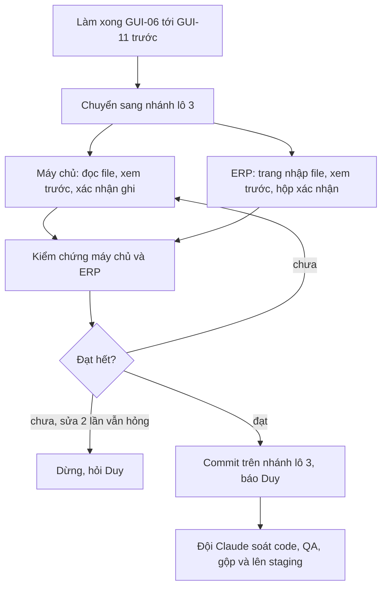

# Giao việc Gemini: FISH-66 lô 3, nhập file Excel mặt hàng (S5, S6)



> Claude (điều phối) · 14/11/2026 · Duy giao: "còn bao nhiêu task đẩy qua Gemini làm hết" (đội Claude sắp hết giờ dùng).
> **Ngoại lệ phạm vi** so với `GEMINI.md` mục 1: riêng lô này Gemini được sửa **đúng các file liệt kê dưới đây** ở `backend/` và `erp-console/`.
> Nhánh: `gemini/fish66-lo3` (đã tách từ lô 2 + main). **Làm sau khi xong GUI-06..11** (cùng thư mục làm việc). Không push, không gộp main.
> Không chạy `scripts/check_shop_ui_scope.py` cho lô này (nó chỉ cho phép Shop); thay bằng kiểm danh sách file ở mục "Kiểm phạm vi".

## Đọc trước (bắt buộc)
- `02-stories.md`: S5, S6 (ĐÃ DUYỆT; C-1: ô chữ để trống thì **giữ nguyên** chữ cũ).
- `02b-tech-design.md`: §3 contract (limits, import/preview, import/commit), §4 định dạng file, §5 phiếu ký số `preview_token` + chống ghi hai lần + 409/410, §6 tham số `ITEM_IMPORT_*`, §7 AuditLog, §9 rủi ro, §11 dòng lô 3, §13.2 (5 ghi chú Low L1–L5 phải sửa trong lô này), mục cuối "Duy trả lời" (**Q-TL-2 = A**: kiểm luật chữ công khai BR-DM-25 cho **Tên món** ở cả form ERP và file, khi tên mới hoặc đổi tên).
- `02a-ux-flow.md`: M2–M6, bảng trạng thái, câu chữ §5, cách làm nổi bật đổi giá (nhãn "Kiểm lại số 0", "Chênh lớn", ô "Tôi đã kiểm n giá").
- Skill: `.agents/skills/caveve-domain`, `django-drf-patterns`, `tdd-workflow`, `nextjs-shop-patterns`.

## File được sửa
**Backend:** `backend/apps/catalog/pricing/services.py` (tách `check_new_price`, không đổi hành vi) · `backend/config/api_urls.py` (limits, preview, commit) · `backend/apps/catalog/item_files/**` (reader, plan, token, services, api, tests) · `backend/apps/catalog/items/serializers.py` hoặc `public_text.py` (chỉ phần kiểm Tên theo Q-TL-2) + test.
**ERP:** `erp-console/features/catalog/itemFilesApi.ts`, `itemFilesTypes.ts`, `itemFilesMock.ts`, mới `itemFilesModel.ts` + test, mới `components/ItemImportScreen.tsx`, `ImportPreview.tsx`, `ImportErrors.tsx`, `ImportConfirmModal.tsx`, route `erp-console/app/(console)/catalog/import/page.tsx`, `ItemFileActions.tsx` (đổi `IMPORT_PAGE_READY` thành `true`, sửa L4), `messages.ts`, `catalog.module.css`, `shared/lib/http.ts` (chỉ L3: kiểm `Content-Type`).
**Hồ sơ:** `03-dev-notes.md` (mục Lô 3), `04-qa-report.md` (mục Lô 3 tự kiểm).
**Cấm:** model, migration, `apps/ai`, inventory, purchasing, sales, `accounts/`, `common/audit.py`, `frontend/`, `backend/config/settings.py` (tham số đã có từ lô 2), mọi deploy, DB staging/production.

## Phải đạt
- TDD từng AC của S5, S6 (thấy đỏ rồi mới xanh). Có test đua Postgres cho "bấm xác nhận hai lần" (SQLite sẽ bỏ qua, ghi rõ).
- Rủi ro bắt buộc có test: không giá vốn ở bất kỳ phản hồi nào; chỉ Chủ (đủ 4 quyền) nhập được, Quản lý 403 dù có quyền giá; file `.csv` đổi đuôi, file có macro, zip bomb, file có công thức đều bị chặn đúng mã lỗi; dòng lỗi thì không ghi dòng nào (400 `IMPORT_INVALID_ROWS`); 409 `IMPORT_DATA_CHANGED`, 409 `IMPORT_ALREADY_APPLIED` kèm số đếm lần đầu, 410 hết phiếu; không đụng tồn kho/lô/giá vốn; AuditLog từng món + dòng tổng `import_items`; vòng "tải về → nhập lại → không có gì mới" (lưu ý ký tự điều khiển, §13.2).
- Sửa L1 (bỏ `head`), L2 (dùng chung quyền xem giá), L3, L4, L5 (assert `openpyxl.xml.LXML is False`).

## Kiểm chứng (dán output thật vào `03-dev-notes.md`)
```bash
cd backend && .venv/bin/python manage.py test --parallel 1        # phải thấy "Ran N tests ... OK"
.venv/bin/python manage.py makemigrations --check --dry-run       # No changes detected
cd ../erp-console && npm ci && npx tsc --noEmit && npm test && NEXT_PUBLIC_USE_MOCK=0 NEXT_PUBLIC_API_BASE=http://localhost:8000 npm run build
cd .. && python3 scripts/check_naming.py
```
Tự kiểm thật trên trình duyệt (BE local + ERP build trỏ local, vai Chủ và Quản lý): chọn file → xem trước → lỗi theo dòng → xác nhận → toast; ảnh 360 + 1280 ở `shots/lo3/`.

## Kiểm phạm vi trước khi commit
`git diff --name-only feat/fish66-lo2-gop...HEAD` chỉ được ra các file trong mục "File được sửa". Có file khác → dừng, hỏi Duy.

## Khi xong
Commit theo pathspec, message tiếng Việt có "FISH-66 S5 S6". Báo Duy: hash, số test thật, việc dừng. Đội Claude sẽ techlead review + QA rồi gộp main và lên staging.
