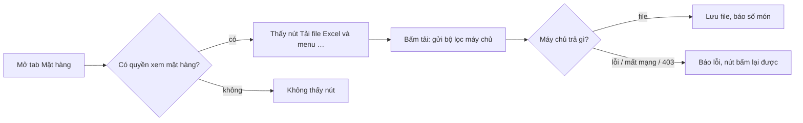

# Ghi chú dev FISH-66 — Lô 2 FE (S3, S4: tải danh sách mặt hàng và file mẫu)



Nhánh `feat/fish66-lo2-export-fe` (từ `main`, chưa push, chưa gộp). Chỉ sửa `erp-console/`.

## FE — trang và component đã sửa

| File | Việc |
|---|---|
| `erp-console/shared/lib/http.ts` | Thêm `apiDownload(path, {mock, signal, fallbackName})` trả `{blob, filename, rowCount}`; `filenameFromDisposition`, `rowCountFromHeader`. Lỗi (400/401/403/5xx, mất mạng, thân rỗng) ném `ApiError`, không bao giờ trả blob hỏng. Tách phần đổi mã lỗi thành `raiseHttpError` dùng chung với `apiFetch` (hành vi `apiFetch` giữ nguyên) |
| `erp-console/shared/lib/download.ts` (mới) | `saveBlob` bằng `URL.createObjectURL` + thẻ `<a download>`, thu hồi URL ngay sau đó |
| `erp-console/features/catalog/permissions.ts` | Thêm `changeItemPrice`, `IMPORT_PERMS` (4 chuỗi đúng 02b §3.1), `canImport` trong `CatalogAbility` (đủ cả 4, không xét tên nhóm) |
| `erp-console/features/catalog/itemFilesApi.ts` (mới) | `exportItems(params)` dùng `itemListQuery` (bỏ `page`), `exportTemplate()` |
| `erp-console/features/catalog/itemFilesTypes.ts` (mới) | `ItemExportParams`, `INVALID_FILTER`, `ItemFileSaved` |
| `erp-console/features/catalog/itemFilesMock.ts` (mới) | Mock đúng 02b §3.2–3.3: 4 món giả, lọc theo tham số, 14/17 cột theo quyền, 400 `INVALID_FILTER`, 0 món vẫn 200; chế độ `window.__caveMock.itemFiles("ok"\|"fail"\|"forbidden")` |
| `erp-console/features/catalog/components/ItemFileActions.tsx` (mới) | Nút "Tải file Excel", menu "…" có "Tải file mẫu", link "Nhập từ Excel" (ẩn tới lô 3, cờ `IMPORT_PAGE_READY`). Khoá nút + `aria-busy` khi đang tạo file, chặn bấm đúp bằng ref. Toast T1/T1b/T2/T3/E3/E4/E5 đúng câu 02a §5 |
| `erp-console/features/catalog/components/ItemListTab.tsx` | Gắn `ItemFileActions` vào thanh `actions` (Quản lý và NV kho giờ có thanh này nhưng không có nút Thêm), bọc cụm nút trong `.itemActions` |
| `erp-console/features/catalog/messages.ts`, `catalog.module.css` | Chữ mục 5 vào `CATALOG_MSG`; lớp `.itemActions` cho điện thoại. Hai file này không có trong danh sách 02b lô 2 nhưng cần cho quy ước "chữ ở một chỗ" |
| `erp-console/features/catalog/itemFilesDownload.test.ts` (mới) | 15 test: header, `apiDownload` thật (200, thiếu header, 500, thân rỗng, 400 `INVALID_FILTER`, 403, mất mạng), đường dẫn tải, 4 quyền nhập |
| `erp-console/features/catalog/README.md` | Thêm mục tải/nhập file |

Không đụng `frontend/`, `backend/`, `features/auth`.

## Chỗ lệch contract / quyết định cần biết

1. Mock xlsx là chữ phân cách tab đặt tên `.xlsx` (không mở được bằng Excel). Chỉ để thử đường tải.
2. Icon: 02a ghi `download` và `upload_file`, nhưng hai tên này chưa có trong tập con font `public/fonts/ms` (hiện thành ô chữ "D"). Dùng tạm `description` (nút tải) và `swap_vert` (nút nhập, đang ẩn). Muốn đổi thì thêm tên vào `scripts/subset-material-symbols.py` rồi sinh lại font (đổi file nhị phân, nên chưa làm).
3. Nút "Nhập từ Excel" ẩn tới lô 3 (route `/catalog/import/` chưa có). Lô 3 đổi `IMPORT_PAGE_READY` thành `true`.
4. Quản lý và NV kho: nhờ nút Tải file nên thanh actions của tab giờ luôn có nút, không còn trống như trước.
5. Máy chủ phải cho FE đọc `Content-Disposition` và `X-Row-Count` qua CORS (`CORS_EXPOSE_HEADERS`, việc của BE lô 2). Thiếu thì FE vẫn tải được nhưng dùng tên dự phòng `hang-ban.xlsx` và bỏ số món khỏi toast.
6. `npm run build` trong máy này không tải được Google Fonts (lỗi mạng của `next/font`, không liên quan thay đổi). Build chạy bằng `NEXT_FONT_GOOGLE_MOCKED_RESPONSES=<file giả>`, nên ảnh chụp dùng font serif dự phòng. Trên máy có mạng build bình thường.

## Kiểm chứng (chạy trong worktree, 14/11)

```
$ cd erp-console && npm ci            # xong, không lỗi
$ npx tsc --noEmit                    # exit 0, không dòng nào
$ npm test
 Test Files  115 passed (115)
      Tests  1375 passed (1375)
$ NEXT_FONT_GOOGLE_MOCKED_RESPONSES=... npm run build
 ✓ Compiled successfully
 ✓ Generating static pages (65/65)
$ python3 scripts/check_naming.py
check_naming: OK - 6437 vi phạm cũ trong 173 file, không phát sinh mới.
```

Chạy Playwright trên bản build mock (`NEXT_PUBLIC_USE_MOCK=1`), đều PASS: Chủ thấy Tải file Excel + menu Tải file mẫu, không thấy Nhập; tải ra `hang-ban-YYYYMMDD-HHmm.xlsx` (giờ VN), toast "(4 món)"; file mẫu `mau-hang-ban.xlsx` 17 cột; lọc rỗng cho toast cảnh báo; chế độ `fail` cho câu E3 và nút bấm lại được; `forbidden` cho câu E5; NV kho thấy Tải file, không thấy Thêm, file 14 cột không có chữ "Giá"; Quản lý thấy Tải file, không thấy Thêm; 360 px không cuộn ngang. Không lỗi trang (pageerror).

## Ảnh chụp (`shots/`, dữ liệu giả)

- `lo2-chu-1280.png`, `lo2-chu-menu-1280.png`, `lo2-chu-toast-1280.png`, `lo2-chu-loi-1280.png`: vai Chủ, 1280 px.
- `lo2-nv-kho-1280.png`: vai NV kho, 1280 px.
- `lo2-chu-360.png`: vai Chủ, 360 px.

## Việc còn nợ

- Lô 3: trang `/catalog/import/`, bật `IMPORT_PAGE_READY`, thêm `getImportLimits`, `previewImport`, `commitImport`.
- Chưa chụp riêng vai Quản lý (đã kiểm bằng script, không có ảnh); chưa kiểm dark mode.
- Chưa nối BE thật (BE lô 2 làm song song); cần thử lại khi hai bên gộp, nhất là CORS expose headers.
