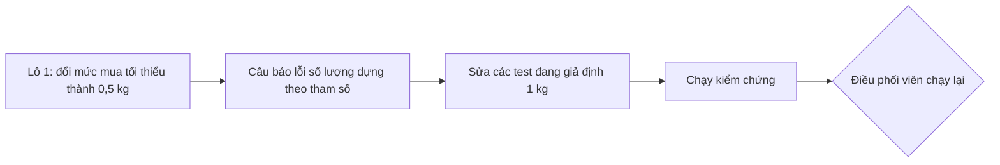
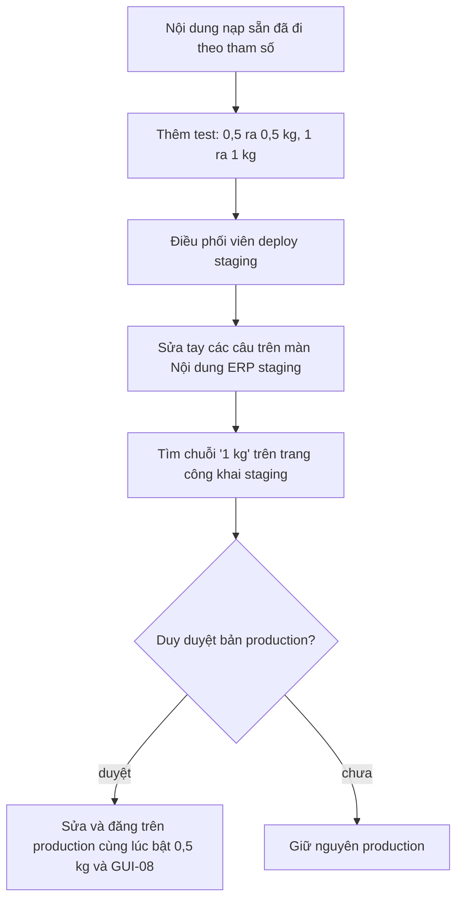

# Ghi chú dev: hàng bán từ 0,5 kg, tải và nhập file Excel



## Mục BE, Lô 1 — S1 (FISH-66): khách đặt được 0,5 kg một món

Rule: BR-BH-22 (mức tối thiểu và bước đọc từ settings), BR-BH-23 (`stock_level` hết khi tồn bán được < mức tối thiểu),
BR-BH-05/06/15, bất biến 1, 7, 9. Q-TL-1 (Duy): 0,5 mọi nơi, không khoá env 1 kg trên production.

### File đã sửa (backend/)
- `config/settings.py`: chỉ dòng `SHOP_MIN_QTY_KG` (mặc định "0.5", vẫn đọc env, `Decimal`).
- `apps/sales/orders/shop_errors.py`: `InvalidQtyError.detail` dựng từ tham số, ví dụ
  "Món theo kg đặt từ 0,5 kg, mỗi lần thêm 0,5 kg. Combo đặt số nguyên từ 1." `code` vẫn `INVALID_QTY`,
  `lines[].min_qty/qty_step` giữ nguyên. Không đưa chuỗi "BR-BH-22" vào `detail` (API công khai); mã luật ở docstring và test.
- `apps/content/management/commands/load_shop_content.py`, `apps/content/site/services.py`: bỏ giá trị dự phòng `Decimal("1")`,
  đọc thẳng `settings.SHOP_MIN_QTY_KG`.
- Không đổi: `catalog/items/services.py` (`qty_rule`, `validate_line_qty`, `stock_level` đã đọc tham số), migration, `frontend/`, `pages.json`.

### Test
- Mới: `apps/sales/orders/tests/test_shop_min_qty.py` (S1-AC1,2,3,4,5,7,9,10,12,13),
  `apps/catalog/items/tests/test_shop_min_qty.py` (AC6,7,8,12),
  AC11 (đua 0,5 + 0,5 trên tồn 0,5) thêm vào `test_shop_create_race.py` (`TransactionTestCase`, chỉ chạy trên PostgreSQL;
  SQLite bỏ qua nên **chưa chạy được ở máy này, cần CI Postgres cloud**).
- Sửa test giả định 1 kg: thêm `override_settings(SHOP_MIN_QTY_KG=Decimal("1"))` ở `test_shop_catalog.py` (StockLevelTests,
  test_contract_shape_groups_and_items, test_stock_level_is_one_of_three_values), `test_shop_create.py` (InvalidQtyTests,
  một ca OutOfStock; kỳ vọng `detail` đổi sang câu mới), `test_site_info_shop.py`, `test_load_shop_content.py` (banner).
  Đổi dữ liệu 0,5 kg thành 0,25 kg (vẫn là số lượng sai) ở `test_shop_create_error_order.py`, `test_shop_order_create.py`.
- Đã thấy ĐỎ trước khi sửa code (13 ca mới đỏ vì mặc định 1 kg và câu lỗi cũ).

### Kết quả kiểm chứng (output thật, chạy tuần tự)
Toàn bộ `cd backend && python manage.py test`:
```
Ran 3975 tests in 170.148s
FAILED (failures=1, errors=33, skipped=17)
```
Còn đỏ, KHÔNG thuộc lô này (đã xác minh nguyên nhân):
- 33 ERROR admin: `ValueError: Missing staticfiles manifest entry for 'admin/css/base.css'`. Worktree thiếu thư mục
  `backend/staticfiles` (không có trong git). Đặt tạm symlink tới `staticfiles` của checkout chính rồi chạy lại các app đó:
  ```
  Ran 1785 tests in 192.795s
  OK (skipped=3)
  ```
  (accounts, common, inventory, purchasing, sales.credit_notes, test_p8_lo7_privacy_gl03). Đã gỡ symlink, không commit.
- 1 FAIL `apps.catalog.vouchers.tests.test_api.CreateTests.test_s3b_01_ac1_create_stores_utc_times_and_audits`: test cứng
  ngày hết hạn 31/10/2026, nay là 14/11/2026 nên trạng thái "expired" thay vì "scheduled". Có từ trước, không liên quan S1
  (chạm `apps/catalog/vouchers/` bị cấm trong lô này). Cần sửa riêng (đề xuất: dùng ngày tương đối).

Các lệnh khác:
```
$ DJANGO_DEBUG=1 python manage.py makemigrations --check --dry-run
No changes detected
$ python3 scripts/check_naming.py
check_naming: OK - 6437 vi phạm cũ trong 173 file, không phát sinh mới.
```

### Còn nợ / lưu ý cho điều phối viên
- Cập nhật câu BR-BH-22/23 trong `doc/business-process-spec.md` (việc của điều phối viên).
- Production không đặt env `SHOP_MIN_QTY_KG`: lần deploy production kế tiếp tự bật 0,5 kg (Duy chốt Q-TL-1). Nên gom cùng S2 và GUI-08.
- Nội dung CMS đã nạp trên staging/production vẫn có chữ "1 kg" (lô 1b của `mkt-brand`).
- `load_shop_content.py` còn giá trị dự phòng cho `SHOP_QTY_STEP_KG` (ngoài phạm vi S1, không đổi).
- AC11 cần chạy trên CI Postgres.
- Hồ sơ `doc/features/2026-11-14-hang-ban-excel-dong-lanh/` ở checkout chính chưa được commit (các file 01, 02, 02a, 02b còn untracked); nhánh này chỉ thêm `03-dev-notes.md`.

## Lô 1b — S2 (FISH-66): chữ trang nội dung ghi đúng "từ 0,5 kg"



> mkt-brand · 14/11/2026 · Nhánh `feat/fish66-lo1b-content` · Nguồn: `02-stories.md` S2, `02b-tech-design.md` §8.2 và §11,
> `doc/decisions.md` mục 2026-11-14 ("Mua tối thiểu 0,5 kg", "Mức 0,5 kg áp mọi nơi"). Trạng thái: **CHỜ DUYỆT**.

### Rà nội dung nạp sẵn (`backend/apps/content/management/shop_content/`)

- `pages.json`: mọi câu về mức mua tối thiểu đã dùng `{min_qty_kg}` (lệnh nạp đổi thành "0,5" hoặc "1", dấu phẩy kiểu Việt).
  Có 4 trang: `cach-mua-hang` (tóm tắt, mô tả SEO, thân bài 2 chỗ), `dieu-khoan` (thân bài mục 2), `gioi-thieu` (tóm tắt),
  `home-banner` (tóm tắt, thân bài slide 1). Không còn số kg viết cứng.
- `posts.json`, `categories.json`: không có câu về mức mua. Không có số kg nào.
- Câu chữ đã sửa (một chỗ, cho tự nhiên khi ghi "0,5 kg", không đổi nghĩa, không thêm cam kết):
  - `gioi-thieu` tóm tắt: "…bán hàng cấp đông theo kg từ {min_qty_kg} kg và giao tận nhà bạn ở Phan Thiết." →
    "…bán hàng cấp đông theo kg, mua từ {min_qty_kg} kg, giao tận nhà bạn ở Phan Thiết."
- Câu combo "Combo mua từ 1 combo" / "Combo mua theo combo" giữ nguyên (decisions 14/11: combo vẫn từ 1, bước 1).
- Không đổi code Python. Hai dòng giá trị dự phòng `Decimal("1")` ở `load_shop_content.py:153` và `site/services.py:73` là việc
  của lô 1 (be-dev).

### Test (`backend/apps/content/tests/test_load_shop_content.py`, class mới `LoadShopContentMinQtyTextTests`)

| Test | AC | Kiểm gì |
|---|---|---|
| `test_s2_ac1_min_qty_half_kg_written_vietnamese_style` | S2-AC1 | Tham số 0,5 → 4 trang trên ghi "từ 0,5 kg" ở đúng vị trí (cả mô tả SEO); không trang nào có "từ/tối thiểu/ít nhất N kg" với N khác 0,5; không còn "0.5 kg" dấu chấm; API công khai trả đúng |
| `test_s2_ac4_min_qty_follows_setting_when_one_kg` | S2-AC4 | Tham số 1 → ghi "từ 1 kg", không viết cứng 0,5 |
| `test_s2_source_files_have_no_hard_coded_kg` | bất biến 7 | File nguồn không có số kg viết cứng (phải qua biến) |
| `test_s2_ac2_rerun_after_param_change_keeps_owner_edit` | S2-AC2 | Nạp ở 1 kg, Lộc sửa trang Cách mua, đổi tham số 0,5 rồi nạp lại → bỏ qua trang, giữ chữ Lộc sửa |

Test viết sau khi nội dung đã đúng (02b §8.2 cho phép: "xác nhận test hiện có phủ, thiếu thì thêm"), nên xanh ngay. Để chắc test
bắt được lỗi, đã thử đổi tạm câu `dieu-khoan` thành "từ 1 kg" viết cứng: 2 test đỏ đúng lý do (S2-AC1 và kiểm file nguồn), rồi
trả file về như cũ.

Ghi chú cho lô 1: chạy `apps.content` với `SHOP_MIN_QTY_KG=0.5` (giống mặc định mới của lô 1) thì 4 test mới xanh; 2 test cũ đỏ
vì đang viết cứng "1 kg": `test_shop_5_03_banner_shape_follows_contract` (dòng ~429) và
`site/tests/test_site_info_shop.py::test_shop_5_01_ac1_returns_new_seller_keys_and_policies`. Cả hai nằm trong danh sách sửa của
lô 1 (be-dev), lô 1b không đụng để tránh xung đột. Class mới đặt ở cuối file vì cùng lý do.

### Kiểm chứng (chạy trong worktree, 14/11)

```
$ cd backend && .venv/bin/python manage.py test apps.content
System check identified no issues (0 silenced).
.......… (216 dấu chấm, rút gọn)
----------------------------------------------------------------------
Ran 216 tests in 27.373s

OK

$ SHOP_MIN_QTY_KG=0.5 .venv/bin/python manage.py test apps.content     # thử trước mặc định của lô 1
FAIL: test_shop_5_01_ac1_returns_new_seller_keys_and_policies (…test_site_info_shop…)   # việc của lô 1
FAIL: test_shop_5_03_banner_shape_follows_contract (…test_load_shop_content…)           # việc của lô 1
Ran 216 tests in 23.209s
FAILED (failures=2)

$ python3 scripts/check_naming.py
check_naming: OK - 6437 vi phạm cũ trong 173 file, không phát sinh mới.
exit=0
```

(4 dòng cảnh báo "không phân tích trọn vẹn erp-console/features/catalog/components/*.tsx" của `check_naming` có từ trước, không
liên quan lô này.)

### Việc cho điều phối viên: sửa nội dung đã nạp trên staging và production

Nội dung đã nạp trên staging và production được dựng lúc tham số là 1, nên đang ghi "1 kg". **Không chạy lại `load_shop_content`**
(trang Lộc đã sửa sẽ bị bỏ qua, xem S2-AC2; `--overwrite` sẽ đè chỗ Lộc sửa). Sửa tay ở **ERP → Nội dung**, từng trang:
mở trang → sửa đúng câu dưới đây → Lưu nháp → Đăng. Chỉ đổi số kg, giữ nguyên phần còn lại của câu (kể cả chỗ Lộc đã sửa).

- **Staging:** làm sau khi deploy lô 1 lên staging. Xong thì chạy lệnh tìm chuỗi ở cuối mục này, dán kết quả vào đây (S2-AC3).
- **Production:** chỉ làm khi Duy duyệt (S2-AC6), **cùng một lần** bật 0,5 kg (lô 1) và GUI-08 của Gemini. Trang nào trên production
  còn Nháp (chưa đăng) thì sửa trong bản nháp, không tự bấm Đăng thay Duy.

| # | Trang (slug) | Chỗ trên màn Nội dung | Trước | Sau |
|---|---|---|---|---|
| 1 | Cách mua hàng (`cach-mua-hang`) | Tóm tắt | Chọn món từ 1 kg, đặt hàng, quét mã QR để thanh toán, rồi nhận hàng tận nhà. | Chọn món từ 0,5 kg, đặt hàng, quét mã QR để thanh toán, rồi nhận hàng tận nhà. |
| 2 | Cách mua hàng | Mô tả SEO | Năm bước đặt hải sản cấp đông ở Cá Về: chọn món từ 1 kg, đặt hàng, chuyển khoản quét mã QR và nhận hàng tận nhà. | Năm bước đặt hải sản cấp đông ở Cá Về: chọn món từ 0,5 kg, đặt hàng, chuyển khoản quét mã QR và nhận hàng tận nhà. |
| 3 | Cách mua hàng | Thân bài, bước 1 "Chọn món." | Mỗi món mua từ 1 kg, thêm từng 0,5 kg. Combo mua theo combo. | Mỗi món mua từ 0,5 kg, thêm từng 0,5 kg. Combo mua theo combo. |
| 4 | Cách mua hàng | Thân bài, câu hỏi "Mua ít nhất bao nhiêu?" | Mỗi món từ 1 kg, thêm từng 0,5 kg. Combo mua từ 1 combo. | Mỗi món từ 0,5 kg, thêm từng 0,5 kg. Combo mua từ 1 combo. |
| 5 | Điều kiện giao dịch chung (`dieu-khoan`) | Thân bài, mục "2. Đặt hàng và giá" | …Mỗi món mua từ 1 kg, thêm từng 0,5 kg. Giá đã gồm giao hàng… | …Mỗi món mua từ 0,5 kg, thêm từng 0,5 kg. Giá đã gồm giao hàng… |
| 6 | Giới thiệu Cá Về (`gioi-thieu`) | Tóm tắt | Cá Về mua hải sản theo từng lô tại cảng, bán hàng cấp đông theo kg từ 1 kg và giao tận nhà bạn ở Phan Thiết. | Cá Về mua hải sản theo từng lô tại cảng, bán hàng cấp đông theo kg, mua từ 0,5 kg, giao tận nhà bạn ở Phan Thiết. |
| 7 | Banner trang chủ (`home-banner`) | Tóm tắt (dải chữ đầu trang) | Hải sản cấp đông theo lô · mua từ 1 kg · giao tận nhà | Hải sản cấp đông theo lô · mua từ 0,5 kg · giao tận nhà |
| 8 | Banner trang chủ | Thân bài, slide 1 (đoạn dưới "Mua theo lô tại cảng") | Hải sản cấp đông, giá theo kg, mua từ 1 kg. | Hải sản cấp đông, giá theo kg, mua từ 0,5 kg. |

Không cần sửa: Liên hệ, Đổi trả, Giao hàng, Thanh toán, Quyền riêng tư, Khiếu nại, Thông tin người bán, Cam kết trang chủ,
5 bài Góc bếp (không có câu về mức mua). Mô tả SEO trang Giới thiệu không nhắc mức mua, giữ nguyên.

Trang `dieu-khoan` là trang có giá trị pháp lý: lần này chỉ đổi con số theo quyết định Duy 14/11, không thêm cam kết. Chỗ
"[Câu chữ cuối do legal-vn soạn.]" giữ nguyên; trạng thái pháp lý của trang không đổi.

**Lệnh tìm chuỗi sau khi sửa (S2-AC3)**, thay `$API` bằng địa chỉ API staging (hoặc production) ở `doc/ops/moi-truong.md`:

```bash
for slug in cach-mua-hang dieu-khoan gioi-thieu home-banner lien-he doi-tra giao-hang thanh-toan quyen-rieng-tu khieu-nai thong-tin-nguoi-ban home-commitments; do
  body=$(curl -s "$API/api/public/content/entries/$slug/")
  hits=$(printf '%s' "$body" | grep -oE '(từ|tối thiểu|ít nhất) 1 kg' | sort -u | tr '\n' ' ')
  echo "$slug: ${hits:-sạch}"
done
```

Kết quả mong đợi: mọi dòng ghi "sạch". Trang chưa đăng trả 404 nên dòng đó cũng ghi "sạch"; trang nào chưa đăng thì kiểm trong ERP.

Kết quả staging: _(điều phối viên dán sau khi sửa)_

### Ngoài phạm vi lô này (báo để biết)

- `frontend/features/content/mock.ts:271` còn câu tóm tắt Giới thiệu "theo kg từ 1 kg" (dữ liệu mock của Shop). Thuộc `frontend/`,
  để GUI-08 (Gemini) hoặc fe-dev xử lý. Không ảnh hưởng bản build thật (`NEXT_PUBLIC_USE_MOCK=0`).
- `doc/features/2026-10-06-shop-giao-dien-moi/06-marketing.md` (hồ sơ cũ) còn ghi "từ 1 kg": là lịch sử, không sửa.

## Mục BE, Lô 2

### File đã sửa / thêm
| File | Việc |
|---|---|
| `backend/requirements.txt` | thêm `openpyxl==3.1.5`, `defusedxml==0.7.1` (đã cài thật: openpyxl 3.1.5, defusedxml 0.7.1, et_xmlfile 2.0.0 kéo theo) |
| `backend/config/settings.py` | `CORS_EXPOSE_HEADERS`; khối `ITEM_IMPORT_*` (6 tham số, §6.2). Không đụng dòng `SHOP_MIN_QTY_KG` |
| `backend/config/api_urls.py` | 2 `path(...)` đặt trước `include(router.urls)` |
| `backend/apps/catalog/items/filters.py` | thêm `apply_item_filters(qs, params)` |
| `backend/apps/catalog/items/api.py` | `ItemViewSet.filter_list` gọi lại hàm chung, hành vi không đổi |
| `backend/apps/catalog/item_files/{__init__,README,columns,workbook,services,api}.py` | module mới |
| `backend/apps/catalog/item_files/tests/{base,test_export,test_template,test_no_ai_command}.py` | 41 test |
| `backend/README.md` | thêm dòng bản đồ module |

### Endpoint thực tế (khớp 02b §3.2, §3.3, không lệch)
```
GET /api/catalog/items/export/?item_group=&is_active=&item_type=SIMPLE|BUNDLE&has_image=
  200  Content-Type: application/vnd.openxmlformats-officedocument.spreadsheetml.sheet
       Content-Disposition: attachment; filename="hang-ban-20261114-1530.xlsx"   (giờ VN)
       X-Row-Count: 3 · Cache-Control: no-store
  400  {"code": "INVALID_FILTER", "detail": "Tham số item_type có giá trị không hợp lệ."}
  401 chưa đăng nhập · 403 thiếu catalog.view_item (delivery_staff, customer_service) · 405 phương thức khác GET
GET /api/catalog/items/export-template/
  200  Content-Disposition: attachment; filename="mau-hang-ban.xlsx" · X-Row-Count: 1 · bytes xlsx
```
Quyền: Chủ và Quản lý 17 cột; NV kho 14 cột (không `Giá bán hiện hành`, `Giá mới`, `Ngày áp dụng giá mới`). Không ai có cột giá vốn.
Sheet "Hàng bán" (tiêu đề đậm, cố định hàng 1, cột chỉ đọc tô xám, cột cờ có danh sách chọn Có/Không) và sheet "Hướng dẫn" (chữ tĩnh).

### Lô 2 không làm
- `import/limits/`: 02b §11 xếp vào lô 3 (cùng `preview`, `commit`), nên không làm sẵn. Tham số `ITEM_IMPORT_*` đã có trong settings cho lô 3.
- Không đụng model, migration, `apps/ai`, inventory, purchasing, sales, `frontend/`, `erp-console/`.

### Rule đã cài
BR-DM-27 (bộ cột tường minh, không giá vốn), BR-DM-28 (NV kho không thấy cột giá bán), BR-PQ-04/05 (AuditLog `export_items`: `{"rows": n, "with_prices": bool}`, không tên món, không bộ lọc, không `note`), bất biến 1 (không giá vốn), bất biến 9 (file không có dữ liệu khách, không log nội dung).
Chặn công thức độc (S3-AC10): mọi ô chữ ép `data_type = "s"`; ô bắt đầu `= + - @`, tab, CR, LF có `quotePrefix`; giá trị không thêm dấu `'`; ký tự điều khiển bất hợp lệ bị lọc; cắt ở 32.767 ký tự.

### Quyết định nhỏ đã đặt
- Phần hướng dẫn trong sheet "Hướng dẫn" không dùng cụm "giá vốn", để bài kiểm quét file không dính chữ nhạy cảm.
- Ô số/ngày trống vẫn có định dạng `#,##0` và `dd/mm/yyyy` (người dùng điền tay vào dòng đã có vẫn đúng kiểu).
- Test đếm truy vấn có một lần gọi làm nóng bộ nhớ đệm quyền trước khi đo.

### Điều còn nợ
- 1 test cũ đỏ sẵn, không liên quan: `apps.catalog.vouchers.tests.test_api.CreateTests.test_s3b_01_ac1_create_stores_utc_times_and_audits` (ngày cố định trong test đã qua so với 14/11/2026). Chạy trên checkout `main` cũng đỏ y hệt.
- Môi trường worktree mới cần `collectstatic` thì 33 test admin mới qua (thiếu `staticfiles/` gây lỗi manifest, không liên quan code). Đã chạy `collectstatic` trong worktree (thư mục bị gitignore).
- Test hiệu năng 1.000 món ≤ 5 giây (S3-AC13) trên staging: QA kiểm. Ở đây mới chứng minh số truy vấn không tăng theo số món.

## Kiểm chứng (output thật, 14/11/2026)

`cd backend && .venv/bin/python manage.py test apps.catalog.item_files`:
```
Ran 41 tests in 0.703s
OK
```

`cd backend && .venv/bin/python manage.py test` (tuần tự, sau `collectstatic`):
```
Ran 4000 tests in 346.649s
FAILED (failures=1, skipped=16)
FAIL: test_s3b_01_ac1_create_stores_utc_times_and_audits (apps.catalog.vouchers.tests.test_api.CreateTests...)   # đỏ sẵn trên main
```
Lần chạy đầu khi chưa có `staticfiles/`: 33 lỗi `Missing staticfiles manifest entry for 'admin/css/base.css'` (môi trường) + cùng 1 test voucher.

`DJANGO_DEBUG=1 .venv/bin/python manage.py makemigrations --check --dry-run`:
```
No changes detected
```

`python3 scripts/check_naming.py`:
```
check_naming: OK - 6437 vi phạm cũ trong 173 file, không phát sinh mới.
```

## FE — trang và component đã sửa

| File | Việc |
|---|---|
| `erp-console/shared/lib/http.ts` | Thêm `apiDownload(path, {mock, signal, fallbackName})` trả `{blob, filename, rowCount}`; `filenameFromDisposition`, `rowCountFromHeader`. Lỗi (400/401/403/5xx, mất mạng, thân rỗng) ném `ApiError`, không bao giờ trả blob hỏng. Tách phần đổi mã lỗi thành `raiseHttpError` dùng chung với `apiFetch` (hành vi `apiFetch` giữ nguyên) |
| `erp-console/shared/lib/download.ts` (mới) | `saveBlob` bằng `URL.createObjectURL` + thẻ `<a download>`, thu hồi URL ngay sau đó |
| `erp-console/features/catalog/permissions.ts` | Thêm `changeItemPrice`, `IMPORT_PERMS` (4 chuỗi đúng 02b §3.1), `canImport` trong `CatalogAbility` (đủ cả 4, không xét tên nhóm) |
| `erp-console/features/catalog/itemFilesApi.ts` (mới) | `exportItems(params)` dùng `itemListQuery` (bỏ `page`), `exportTemplate()` |
| `erp-console/features/catalog/itemFilesTypes.ts` (mới) | `ItemExportParams`, `INVALID_FILTER`, `ItemFileSaved` |
| `erp-console/features/catalog/itemFilesMock.ts` (mới) | Mock đúng 02b §3.2–3.3: 4 món giả, lọc theo tham số, 14/17 cột theo quyền, 400 `INVALID_FILTER`, 0 món vẫn 200; chế độ `window.__caveMock.itemFiles("ok"\|"fail"\|"forbidden")` |
| `erp-console/features/catalog/components/ItemFileActions.tsx` (mới) | Nút "Tải file Excel", menu "…" có "Tải file mẫu", link "Nhập từ Excel" (ẩn tới lô 3, cờ `IMPORT_PAGE_READY`). Khoá nút + `aria-busy` khi đang tạo file, chặn bấm đúp bằng ref. Toast T1/T1b/T2/T3/E3/E4/E5 đúng câu 02a §5 |
| `erp-console/features/catalog/components/ItemListTab.tsx` | Gắn `ItemFileActions` vào thanh `actions` (Quản lý và NV kho giờ có thanh này nhưng không có nút Thêm), bọc cụm nút trong `.itemActions` |
| `erp-console/features/catalog/messages.ts`, `catalog.module.css` | Chữ mục 5 vào `CATALOG_MSG`; lớp `.itemActions` cho điện thoại. Hai file này không có trong danh sách 02b lô 2 nhưng cần cho quy ước "chữ ở một chỗ" |
| `erp-console/features/catalog/itemFilesDownload.test.ts` (mới) | 15 test: header, `apiDownload` thật (200, thiếu header, 500, thân rỗng, 400 `INVALID_FILTER`, 403, mất mạng), đường dẫn tải, 4 quyền nhập |
| `erp-console/features/catalog/README.md` | Thêm mục tải/nhập file |

Không đụng `frontend/`, `backend/`, `features/auth`.

## Chỗ lệch contract / quyết định cần biết

1. Mock xlsx là chữ phân cách tab đặt tên `.xlsx` (không mở được bằng Excel). Chỉ để thử đường tải.
2. Icon: 02a ghi `download` và `upload_file`, nhưng hai tên này chưa có trong tập con font `public/fonts/ms` (hiện thành ô chữ "D"). Dùng tạm `description` (nút tải) và `swap_vert` (nút nhập, đang ẩn). Muốn đổi thì thêm tên vào `scripts/subset-material-symbols.py` rồi sinh lại font (đổi file nhị phân, nên chưa làm).
3. Nút "Nhập từ Excel" ẩn tới lô 3 (route `/catalog/import/` chưa có). Lô 3 đổi `IMPORT_PAGE_READY` thành `true`.
4. Quản lý và NV kho: nhờ nút Tải file nên thanh actions của tab giờ luôn có nút, không còn trống như trước.
5. Máy chủ phải cho FE đọc `Content-Disposition` và `X-Row-Count` qua CORS (`CORS_EXPOSE_HEADERS`, việc của BE lô 2). Thiếu thì FE vẫn tải được nhưng dùng tên dự phòng `hang-ban.xlsx` và bỏ số món khỏi toast.
6. `npm run build` trong máy này không tải được Google Fonts (lỗi mạng của `next/font`, không liên quan thay đổi). Build chạy bằng `NEXT_FONT_GOOGLE_MOCKED_RESPONSES=<file giả>`, nên ảnh chụp dùng font serif dự phòng. Trên máy có mạng build bình thường.

## Kiểm chứng (chạy trong worktree, 14/11)

```
$ cd erp-console && npm ci            # xong, không lỗi
$ npx tsc --noEmit                    # exit 0, không dòng nào
$ npm test
 Test Files  115 passed (115)
      Tests  1375 passed (1375)
$ NEXT_FONT_GOOGLE_MOCKED_RESPONSES=... npm run build
 ✓ Compiled successfully
 ✓ Generating static pages (65/65)
$ python3 scripts/check_naming.py
check_naming: OK - 6437 vi phạm cũ trong 173 file, không phát sinh mới.
```

Chạy Playwright trên bản build mock (`NEXT_PUBLIC_USE_MOCK=1`), đều PASS: Chủ thấy Tải file Excel + menu Tải file mẫu, không thấy Nhập; tải ra `hang-ban-YYYYMMDD-HHmm.xlsx` (giờ VN), toast "(4 món)"; file mẫu `mau-hang-ban.xlsx` 17 cột; lọc rỗng cho toast cảnh báo; chế độ `fail` cho câu E3 và nút bấm lại được; `forbidden` cho câu E5; NV kho thấy Tải file, không thấy Thêm, file 14 cột không có chữ "Giá"; Quản lý thấy Tải file, không thấy Thêm; 360 px không cuộn ngang. Không lỗi trang (pageerror).

## Ảnh chụp (`shots/`, dữ liệu giả)

- `lo2-chu-1280.png`, `lo2-chu-menu-1280.png`, `lo2-chu-toast-1280.png`, `lo2-chu-loi-1280.png`: vai Chủ, 1280 px.
- `lo2-nv-kho-1280.png`: vai NV kho, 1280 px.
- `lo2-chu-360.png`: vai Chủ, 360 px.

## Việc còn nợ

- Lô 3: trang `/catalog/import/`, bật `IMPORT_PAGE_READY`, thêm `getImportLimits`, `previewImport`, `commitImport`.
- Chưa chụp riêng vai Quản lý (đã kiểm bằng script, không có ảnh); chưa kiểm dark mode.
- Chưa nối BE thật (BE lô 2 làm song song); cần thử lại khi hai bên gộp, nhất là CORS expose headers.
