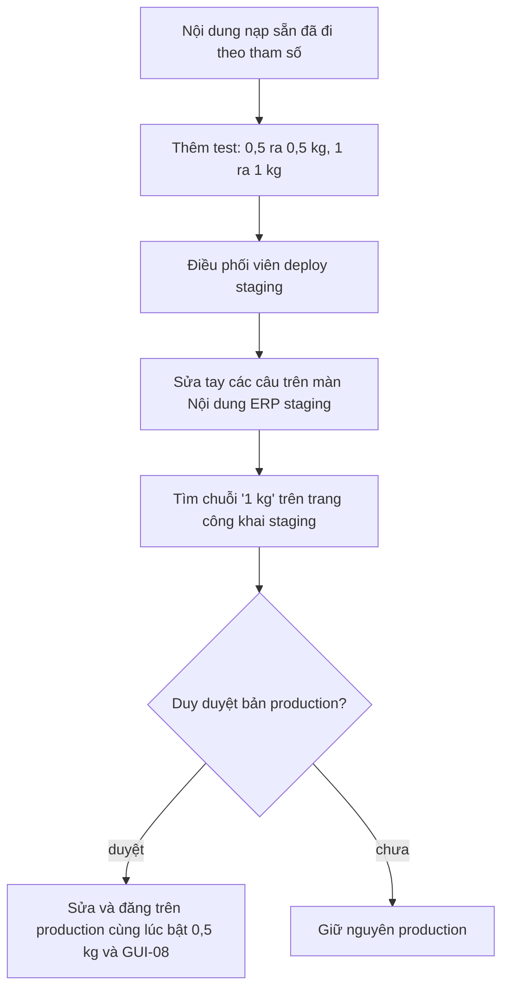

# Hàng bán: mua từ 0,5 kg, file Excel mặt hàng — Ghi chú dev

## Lô 1b — S2 (FISH-66): chữ trang nội dung ghi đúng "từ 0,5 kg"



> mkt-brand · 14/11/2026 · Nhánh `feat/fish66-lo1b-content` · Nguồn: `02-stories.md` S2, `02b-tech-design.md` §8.2 và §11,
> `doc/decisions.md` mục 2026-11-14 ("Mua tối thiểu 0,5 kg", "Mức 0,5 kg áp mọi nơi"). Trạng thái: **CHỜ DUYỆT**.

### Rà nội dung nạp sẵn (`backend/apps/content/management/shop_content/`)

- `pages.json`: mọi câu về mức mua tối thiểu đã dùng `{min_qty_kg}` (lệnh nạp đổi thành "0,5" hoặc "1", dấu phẩy kiểu Việt).
  Có 4 trang: `cach-mua-hang` (tóm tắt, mô tả SEO, thân bài 2 chỗ), `dieu-khoan` (thân bài mục 2), `gioi-thieu` (tóm tắt),
  `home-banner` (tóm tắt, thân bài slide 1). Không còn số kg viết cứng.
- `posts.json`, `categories.json`: không có câu về mức mua. Không có số kg nào.
- Câu chữ đã sửa (một chỗ, cho tự nhiên khi ghi "0,5 kg", không đổi nghĩa, không thêm cam kết):
  - `gioi-thieu` tóm tắt: "…bán hàng cấp đông theo kg từ {min_qty_kg} kg và giao tận nhà bạn ở Phan Thiết." →
    "…bán hàng cấp đông theo kg, mua từ {min_qty_kg} kg, giao tận nhà bạn ở Phan Thiết."
- Câu combo "Combo mua từ 1 combo" / "Combo mua theo combo" giữ nguyên (decisions 14/11: combo vẫn từ 1, bước 1).
- Không đổi code Python. Hai dòng giá trị dự phòng `Decimal("1")` ở `load_shop_content.py:153` và `site/services.py:73` là việc
  của lô 1 (be-dev).

### Test (`backend/apps/content/tests/test_load_shop_content.py`, class mới `LoadShopContentMinQtyTextTests`)

| Test | AC | Kiểm gì |
|---|---|---|
| `test_s2_ac1_min_qty_half_kg_written_vietnamese_style` | S2-AC1 | Tham số 0,5 → 4 trang trên ghi "từ 0,5 kg" ở đúng vị trí (cả mô tả SEO); không trang nào có "từ/tối thiểu/ít nhất N kg" với N khác 0,5; không còn "0.5 kg" dấu chấm; API công khai trả đúng |
| `test_s2_ac4_min_qty_follows_setting_when_one_kg` | S2-AC4 | Tham số 1 → ghi "từ 1 kg", không viết cứng 0,5 |
| `test_s2_source_files_have_no_hard_coded_kg` | bất biến 7 | File nguồn không có số kg viết cứng (phải qua biến) |
| `test_s2_ac2_rerun_after_param_change_keeps_owner_edit` | S2-AC2 | Nạp ở 1 kg, Lộc sửa trang Cách mua, đổi tham số 0,5 rồi nạp lại → bỏ qua trang, giữ chữ Lộc sửa |

Test viết sau khi nội dung đã đúng (02b §8.2 cho phép: "xác nhận test hiện có phủ, thiếu thì thêm"), nên xanh ngay. Để chắc test
bắt được lỗi, đã thử đổi tạm câu `dieu-khoan` thành "từ 1 kg" viết cứng: 2 test đỏ đúng lý do (S2-AC1 và kiểm file nguồn), rồi
trả file về như cũ.

Ghi chú cho lô 1: chạy `apps.content` với `SHOP_MIN_QTY_KG=0.5` (giống mặc định mới của lô 1) thì 4 test mới xanh; 2 test cũ đỏ
vì đang viết cứng "1 kg": `test_shop_5_03_banner_shape_follows_contract` (dòng ~429) và
`site/tests/test_site_info_shop.py::test_shop_5_01_ac1_returns_new_seller_keys_and_policies`. Cả hai nằm trong danh sách sửa của
lô 1 (be-dev), lô 1b không đụng để tránh xung đột. Class mới đặt ở cuối file vì cùng lý do.

### Kiểm chứng (chạy trong worktree, 14/11)

```
$ cd backend && .venv/bin/python manage.py test apps.content
System check identified no issues (0 silenced).
.......… (216 dấu chấm, rút gọn)
----------------------------------------------------------------------
Ran 216 tests in 27.373s

OK

$ SHOP_MIN_QTY_KG=0.5 .venv/bin/python manage.py test apps.content     # thử trước mặc định của lô 1
FAIL: test_shop_5_01_ac1_returns_new_seller_keys_and_policies (…test_site_info_shop…)   # việc của lô 1
FAIL: test_shop_5_03_banner_shape_follows_contract (…test_load_shop_content…)           # việc của lô 1
Ran 216 tests in 23.209s
FAILED (failures=2)

$ python3 scripts/check_naming.py
check_naming: OK - 6437 vi phạm cũ trong 173 file, không phát sinh mới.
exit=0
```

(4 dòng cảnh báo "không phân tích trọn vẹn erp-console/features/catalog/components/*.tsx" của `check_naming` có từ trước, không
liên quan lô này.)

### Việc cho điều phối viên: sửa nội dung đã nạp trên staging và production

Nội dung đã nạp trên staging và production được dựng lúc tham số là 1, nên đang ghi "1 kg". **Không chạy lại `load_shop_content`**
(trang Lộc đã sửa sẽ bị bỏ qua, xem S2-AC2; `--overwrite` sẽ đè chỗ Lộc sửa). Sửa tay ở **ERP → Nội dung**, từng trang:
mở trang → sửa đúng câu dưới đây → Lưu nháp → Đăng. Chỉ đổi số kg, giữ nguyên phần còn lại của câu (kể cả chỗ Lộc đã sửa).

- **Staging:** làm sau khi deploy lô 1 lên staging. Xong thì chạy lệnh tìm chuỗi ở cuối mục này, dán kết quả vào đây (S2-AC3).
- **Production:** chỉ làm khi Duy duyệt (S2-AC6), **cùng một lần** bật 0,5 kg (lô 1) và GUI-08 của Gemini. Trang nào trên production
  còn Nháp (chưa đăng) thì sửa trong bản nháp, không tự bấm Đăng thay Duy.

| # | Trang (slug) | Chỗ trên màn Nội dung | Trước | Sau |
|---|---|---|---|---|
| 1 | Cách mua hàng (`cach-mua-hang`) | Tóm tắt | Chọn món từ 1 kg, đặt hàng, quét mã QR để thanh toán, rồi nhận hàng tận nhà. | Chọn món từ 0,5 kg, đặt hàng, quét mã QR để thanh toán, rồi nhận hàng tận nhà. |
| 2 | Cách mua hàng | Mô tả SEO | Năm bước đặt hải sản cấp đông ở Cá Về: chọn món từ 1 kg, đặt hàng, chuyển khoản quét mã QR và nhận hàng tận nhà. | Năm bước đặt hải sản cấp đông ở Cá Về: chọn món từ 0,5 kg, đặt hàng, chuyển khoản quét mã QR và nhận hàng tận nhà. |
| 3 | Cách mua hàng | Thân bài, bước 1 "Chọn món." | Mỗi món mua từ 1 kg, thêm từng 0,5 kg. Combo mua theo combo. | Mỗi món mua từ 0,5 kg, thêm từng 0,5 kg. Combo mua theo combo. |
| 4 | Cách mua hàng | Thân bài, câu hỏi "Mua ít nhất bao nhiêu?" | Mỗi món từ 1 kg, thêm từng 0,5 kg. Combo mua từ 1 combo. | Mỗi món từ 0,5 kg, thêm từng 0,5 kg. Combo mua từ 1 combo. |
| 5 | Điều kiện giao dịch chung (`dieu-khoan`) | Thân bài, mục "2. Đặt hàng và giá" | …Mỗi món mua từ 1 kg, thêm từng 0,5 kg. Giá đã gồm giao hàng… | …Mỗi món mua từ 0,5 kg, thêm từng 0,5 kg. Giá đã gồm giao hàng… |
| 6 | Giới thiệu Cá Về (`gioi-thieu`) | Tóm tắt | Cá Về mua hải sản theo từng lô tại cảng, bán hàng cấp đông theo kg từ 1 kg và giao tận nhà bạn ở Phan Thiết. | Cá Về mua hải sản theo từng lô tại cảng, bán hàng cấp đông theo kg, mua từ 0,5 kg, giao tận nhà bạn ở Phan Thiết. |
| 7 | Banner trang chủ (`home-banner`) | Tóm tắt (dải chữ đầu trang) | Hải sản cấp đông theo lô · mua từ 1 kg · giao tận nhà | Hải sản cấp đông theo lô · mua từ 0,5 kg · giao tận nhà |
| 8 | Banner trang chủ | Thân bài, slide 1 (đoạn dưới "Mua theo lô tại cảng") | Hải sản cấp đông, giá theo kg, mua từ 1 kg. | Hải sản cấp đông, giá theo kg, mua từ 0,5 kg. |

Không cần sửa: Liên hệ, Đổi trả, Giao hàng, Thanh toán, Quyền riêng tư, Khiếu nại, Thông tin người bán, Cam kết trang chủ,
5 bài Góc bếp (không có câu về mức mua). Mô tả SEO trang Giới thiệu không nhắc mức mua, giữ nguyên.

Trang `dieu-khoan` là trang có giá trị pháp lý: lần này chỉ đổi con số theo quyết định Duy 14/11, không thêm cam kết. Chỗ
"[Câu chữ cuối do legal-vn soạn.]" giữ nguyên; trạng thái pháp lý của trang không đổi.

**Lệnh tìm chuỗi sau khi sửa (S2-AC3)**, thay `$API` bằng địa chỉ API staging (hoặc production) ở `doc/ops/moi-truong.md`:

```bash
for slug in cach-mua-hang dieu-khoan gioi-thieu home-banner lien-he doi-tra giao-hang thanh-toan quyen-rieng-tu khieu-nai thong-tin-nguoi-ban home-commitments; do
  body=$(curl -s "$API/api/public/content/entries/$slug/")
  hits=$(printf '%s' "$body" | grep -oE '(từ|tối thiểu|ít nhất) 1 kg' | sort -u | tr '\n' ' ')
  echo "$slug: ${hits:-sạch}"
done
```

Kết quả mong đợi: mọi dòng ghi "sạch". Trang chưa đăng trả 404 nên dòng đó cũng ghi "sạch"; trang nào chưa đăng thì kiểm trong ERP.

Kết quả staging: _(điều phối viên dán sau khi sửa)_

### Ngoài phạm vi lô này (báo để biết)

- `frontend/features/content/mock.ts:271` còn câu tóm tắt Giới thiệu "theo kg từ 1 kg" (dữ liệu mock của Shop). Thuộc `frontend/`,
  để GUI-08 (Gemini) hoặc fe-dev xử lý. Không ảnh hưởng bản build thật (`NEXT_PUBLIC_USE_MOCK=0`).
- `doc/features/2026-10-06-shop-giao-dien-moi/06-marketing.md` (hồ sơ cũ) còn ghi "từ 1 kg": là lịch sử, không sửa.
