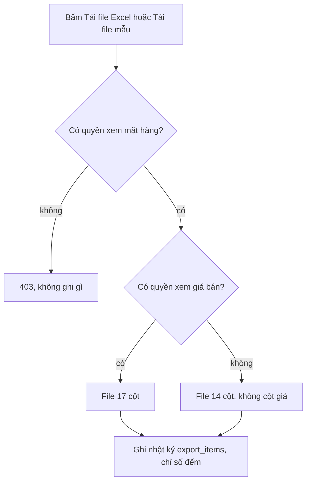

# FISH-66: ghi chú dev, mục BE, Lô 2 (S3 tải file, S4 file mẫu)



> be-dev · 14/11/2026 · Nhánh `feat/fish66-lo2-export-be` (từ `main`). Nguồn: 02-stories S3, S4; 02b §3.2, §3.3, §4.1, §6, §7, §9, §11 dòng lô 2 BE.
> Lưu ý: hồ sơ FISH-66 đang nằm ở nhánh `gemini/shop-ui`, chưa có trên `main`, nên nhánh này chỉ thêm file ghi chú này vào thư mục hồ sơ.

## Mục BE, Lô 2

### File đã sửa / thêm
| File | Việc |
|---|---|
| `backend/requirements.txt` | thêm `openpyxl==3.1.5`, `defusedxml==0.7.1` (đã cài thật: openpyxl 3.1.5, defusedxml 0.7.1, et_xmlfile 2.0.0 kéo theo) |
| `backend/config/settings.py` | `CORS_EXPOSE_HEADERS`; khối `ITEM_IMPORT_*` (6 tham số, §6.2). Không đụng dòng `SHOP_MIN_QTY_KG` |
| `backend/config/api_urls.py` | 2 `path(...)` đặt trước `include(router.urls)` |
| `backend/apps/catalog/items/filters.py` | thêm `apply_item_filters(qs, params)` |
| `backend/apps/catalog/items/api.py` | `ItemViewSet.filter_list` gọi lại hàm chung, hành vi không đổi |
| `backend/apps/catalog/item_files/{__init__,README,columns,workbook,services,api}.py` | module mới |
| `backend/apps/catalog/item_files/tests/{base,test_export,test_template,test_no_ai_command}.py` | 41 test |
| `backend/README.md` | thêm dòng bản đồ module |

### Endpoint thực tế (khớp 02b §3.2, §3.3, không lệch)
```
GET /api/catalog/items/export/?item_group=&is_active=&item_type=SIMPLE|BUNDLE&has_image=
  200  Content-Type: application/vnd.openxmlformats-officedocument.spreadsheetml.sheet
       Content-Disposition: attachment; filename="hang-ban-20261114-1530.xlsx"   (giờ VN)
       X-Row-Count: 3 · Cache-Control: no-store
  400  {"code": "INVALID_FILTER", "detail": "Tham số item_type có giá trị không hợp lệ."}
  401 chưa đăng nhập · 403 thiếu catalog.view_item (delivery_staff, customer_service) · 405 phương thức khác GET
GET /api/catalog/items/export-template/
  200  Content-Disposition: attachment; filename="mau-hang-ban.xlsx" · X-Row-Count: 1 · bytes xlsx
```
Quyền: Chủ và Quản lý 17 cột; NV kho 14 cột (không `Giá bán hiện hành`, `Giá mới`, `Ngày áp dụng giá mới`). Không ai có cột giá vốn.
Sheet "Hàng bán" (tiêu đề đậm, cố định hàng 1, cột chỉ đọc tô xám, cột cờ có danh sách chọn Có/Không) và sheet "Hướng dẫn" (chữ tĩnh).

### Lô 2 không làm
- `import/limits/`: 02b §11 xếp vào lô 3 (cùng `preview`, `commit`), nên không làm sẵn. Tham số `ITEM_IMPORT_*` đã có trong settings cho lô 3.
- Không đụng model, migration, `apps/ai`, inventory, purchasing, sales, `frontend/`, `erp-console/`.

### Rule đã cài
BR-DM-27 (bộ cột tường minh, không giá vốn), BR-DM-28 (NV kho không thấy cột giá bán), BR-PQ-04/05 (AuditLog `export_items`: `{"rows": n, "with_prices": bool}`, không tên món, không bộ lọc, không `note`), bất biến 1 (không giá vốn), bất biến 9 (file không có dữ liệu khách, không log nội dung).
Chặn công thức độc (S3-AC10): mọi ô chữ ép `data_type = "s"`; ô bắt đầu `= + - @`, tab, CR, LF có `quotePrefix`; giá trị không thêm dấu `'`; ký tự điều khiển bất hợp lệ bị lọc; cắt ở 32.767 ký tự.

### Quyết định nhỏ đã đặt
- Phần hướng dẫn trong sheet "Hướng dẫn" không dùng cụm "giá vốn", để bài kiểm quét file không dính chữ nhạy cảm.
- Ô số/ngày trống vẫn có định dạng `#,##0` và `dd/mm/yyyy` (người dùng điền tay vào dòng đã có vẫn đúng kiểu).
- Test đếm truy vấn có một lần gọi làm nóng bộ nhớ đệm quyền trước khi đo.

### Điều còn nợ
- 1 test cũ đỏ sẵn, không liên quan: `apps.catalog.vouchers.tests.test_api.CreateTests.test_s3b_01_ac1_create_stores_utc_times_and_audits` (ngày cố định trong test đã qua so với 14/11/2026). Chạy trên checkout `main` cũng đỏ y hệt.
- Môi trường worktree mới cần `collectstatic` thì 33 test admin mới qua (thiếu `staticfiles/` gây lỗi manifest, không liên quan code). Đã chạy `collectstatic` trong worktree (thư mục bị gitignore).
- Test hiệu năng 1.000 món ≤ 5 giây (S3-AC13) trên staging: QA kiểm. Ở đây mới chứng minh số truy vấn không tăng theo số món.

## Kiểm chứng (output thật, 14/11/2026)

`cd backend && .venv/bin/python manage.py test apps.catalog.item_files`:
```
Ran 41 tests in 0.703s
OK
```

`cd backend && .venv/bin/python manage.py test` (tuần tự, sau `collectstatic`):
```
Ran 4000 tests in 346.649s
FAILED (failures=1, skipped=16)
FAIL: test_s3b_01_ac1_create_stores_utc_times_and_audits (apps.catalog.vouchers.tests.test_api.CreateTests...)   # đỏ sẵn trên main
```
Lần chạy đầu khi chưa có `staticfiles/`: 33 lỗi `Missing staticfiles manifest entry for 'admin/css/base.css'` (môi trường) + cùng 1 test voucher.

`DJANGO_DEBUG=1 .venv/bin/python manage.py makemigrations --check --dry-run`:
```
No changes detected
```

`python3 scripts/check_naming.py`:
```
check_naming: OK - 6437 vi phạm cũ trong 173 file, không phát sinh mới.
```
