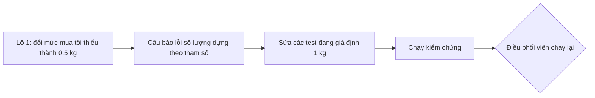

# Ghi chú dev: hàng bán từ 0,5 kg, tải và nhập file Excel



## Mục BE, Lô 1 — S1 (FISH-66): khách đặt được 0,5 kg một món

Rule: BR-BH-22 (mức tối thiểu và bước đọc từ settings), BR-BH-23 (`stock_level` hết khi tồn bán được < mức tối thiểu),
BR-BH-05/06/15, bất biến 1, 7, 9. Q-TL-1 (Duy): 0,5 mọi nơi, không khoá env 1 kg trên production.

### File đã sửa (backend/)
- `config/settings.py`: chỉ dòng `SHOP_MIN_QTY_KG` (mặc định "0.5", vẫn đọc env, `Decimal`).
- `apps/sales/orders/shop_errors.py`: `InvalidQtyError.detail` dựng từ tham số, ví dụ
  "Món theo kg đặt từ 0,5 kg, mỗi lần thêm 0,5 kg. Combo đặt số nguyên từ 1." `code` vẫn `INVALID_QTY`,
  `lines[].min_qty/qty_step` giữ nguyên. Không đưa chuỗi "BR-BH-22" vào `detail` (API công khai); mã luật ở docstring và test.
- `apps/content/management/commands/load_shop_content.py`, `apps/content/site/services.py`: bỏ giá trị dự phòng `Decimal("1")`,
  đọc thẳng `settings.SHOP_MIN_QTY_KG`.
- Không đổi: `catalog/items/services.py` (`qty_rule`, `validate_line_qty`, `stock_level` đã đọc tham số), migration, `frontend/`, `pages.json`.

### Test
- Mới: `apps/sales/orders/tests/test_shop_min_qty.py` (S1-AC1,2,3,4,5,7,9,10,12,13),
  `apps/catalog/items/tests/test_shop_min_qty.py` (AC6,7,8,12),
  AC11 (đua 0,5 + 0,5 trên tồn 0,5) thêm vào `test_shop_create_race.py` (`TransactionTestCase`, chỉ chạy trên PostgreSQL;
  SQLite bỏ qua nên **chưa chạy được ở máy này, cần CI Postgres cloud**).
- Sửa test giả định 1 kg: thêm `override_settings(SHOP_MIN_QTY_KG=Decimal("1"))` ở `test_shop_catalog.py` (StockLevelTests,
  test_contract_shape_groups_and_items, test_stock_level_is_one_of_three_values), `test_shop_create.py` (InvalidQtyTests,
  một ca OutOfStock; kỳ vọng `detail` đổi sang câu mới), `test_site_info_shop.py`, `test_load_shop_content.py` (banner).
  Đổi dữ liệu 0,5 kg thành 0,25 kg (vẫn là số lượng sai) ở `test_shop_create_error_order.py`, `test_shop_order_create.py`.
- Đã thấy ĐỎ trước khi sửa code (13 ca mới đỏ vì mặc định 1 kg và câu lỗi cũ).

### Kết quả kiểm chứng (output thật, chạy tuần tự)
Toàn bộ `cd backend && python manage.py test`:
```
Ran 3975 tests in 170.148s
FAILED (failures=1, errors=33, skipped=17)
```
Còn đỏ, KHÔNG thuộc lô này (đã xác minh nguyên nhân):
- 33 ERROR admin: `ValueError: Missing staticfiles manifest entry for 'admin/css/base.css'`. Worktree thiếu thư mục
  `backend/staticfiles` (không có trong git). Đặt tạm symlink tới `staticfiles` của checkout chính rồi chạy lại các app đó:
  ```
  Ran 1785 tests in 192.795s
  OK (skipped=3)
  ```
  (accounts, common, inventory, purchasing, sales.credit_notes, test_p8_lo7_privacy_gl03). Đã gỡ symlink, không commit.
- 1 FAIL `apps.catalog.vouchers.tests.test_api.CreateTests.test_s3b_01_ac1_create_stores_utc_times_and_audits`: test cứng
  ngày hết hạn 31/10/2026, nay là 14/11/2026 nên trạng thái "expired" thay vì "scheduled". Có từ trước, không liên quan S1
  (chạm `apps/catalog/vouchers/` bị cấm trong lô này). Cần sửa riêng (đề xuất: dùng ngày tương đối).

Các lệnh khác:
```
$ DJANGO_DEBUG=1 python manage.py makemigrations --check --dry-run
No changes detected
$ python3 scripts/check_naming.py
check_naming: OK - 6437 vi phạm cũ trong 173 file, không phát sinh mới.
```

### Còn nợ / lưu ý cho điều phối viên
- Cập nhật câu BR-BH-22/23 trong `doc/business-process-spec.md` (việc của điều phối viên).
- Production không đặt env `SHOP_MIN_QTY_KG`: lần deploy production kế tiếp tự bật 0,5 kg (Duy chốt Q-TL-1). Nên gom cùng S2 và GUI-08.
- Nội dung CMS đã nạp trên staging/production vẫn có chữ "1 kg" (lô 1b của `mkt-brand`).
- `load_shop_content.py` còn giá trị dự phòng cho `SHOP_QTY_STEP_KG` (ngoài phạm vi S1, không đổi).
- AC11 cần chạy trên CI Postgres.
- Hồ sơ `doc/features/2026-11-14-hang-ban-excel-dong-lanh/` ở checkout chính chưa được commit (các file 01, 02, 02a, 02b còn untracked); nhánh này chỉ thêm `03-dev-notes.md`.
