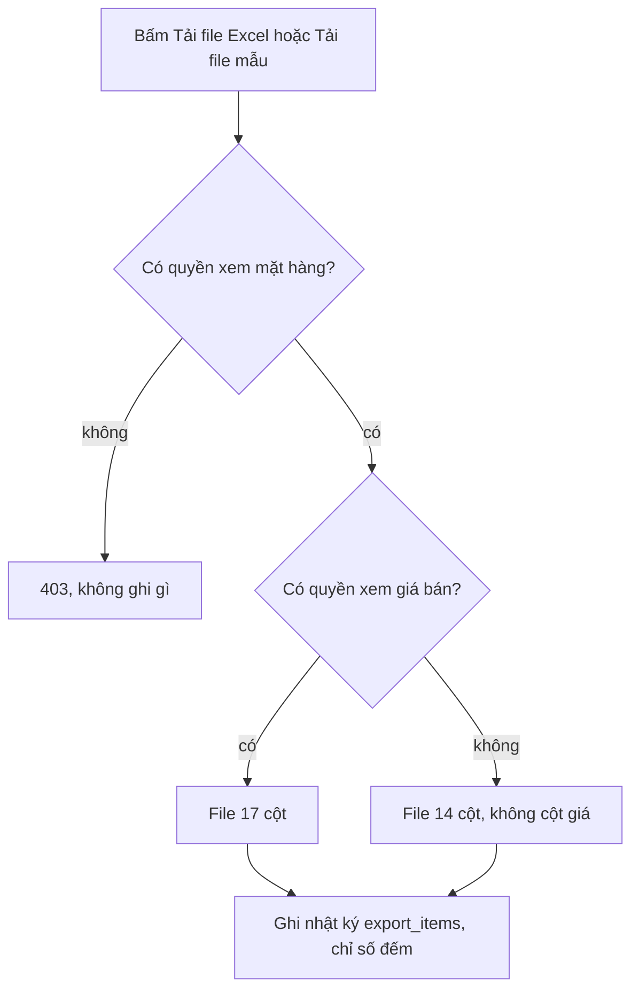

# FISH-66: ghi chú dev, mục BE, Lô 2 (S3 tải file, S4 file mẫu)



> be-dev · 14/11/2026 · Nhánh `feat/fish66-lo2-export-be` (từ `main`). Nguồn: 02-stories S3, S4; 02b §3.2, §3.3, §4.1, §6, §7, §9, §11 dòng lô 2 BE.
> Lưu ý: hồ sơ FISH-66 đang nằm ở nhánh `gemini/shop-ui`, chưa có trên `main`, nên nhánh này chỉ thêm file ghi chú này vào thư mục hồ sơ.

## Mục BE, Lô 2

### File đã sửa / thêm
| File | Việc |
|---|---|
| `backend/requirements.txt` | thêm `openpyxl==3.1.5`, `defusedxml==0.7.1` (đã cài thật: openpyxl 3.1.5, defusedxml 0.7.1, et_xmlfile 2.0.0 kéo theo) |
| `backend/config/settings.py` | `CORS_EXPOSE_HEADERS`; khối `ITEM_IMPORT_*` (6 tham số, §6.2). Không đụng dòng `SHOP_MIN_QTY_KG` |
| `backend/config/api_urls.py` | 2 `path(...)` đặt trước `include(router.urls)` |
| `backend/apps/catalog/items/filters.py` | thêm `apply_item_filters(qs, params)` |
| `backend/apps/catalog/items/api.py` | `ItemViewSet.filter_list` gọi lại hàm chung, hành vi không đổi |
| `backend/apps/catalog/item_files/{__init__,README,columns,workbook,services,api}.py` | module mới |
| `backend/apps/catalog/item_files/tests/{base,test_export,test_template,test_no_ai_command}.py` | 41 test |
| `backend/README.md` | thêm dòng bản đồ module |

### Endpoint thực tế (khớp 02b §3.2, §3.3, không lệch)
```
GET /api/catalog/items/export/?item_group=&is_active=&item_type=SIMPLE|BUNDLE&has_image=
  200  Content-Type: application/vnd.openxmlformats-officedocument.spreadsheetml.sheet
       Content-Disposition: attachment; filename="hang-ban-20261114-1530.xlsx"   (giờ VN)
       X-Row-Count: 3 · Cache-Control: no-store
  400  {"code": "INVALID_FILTER", "detail": "Tham số item_type có giá trị không hợp lệ."}
  401 chưa đăng nhập · 403 thiếu catalog.view_item (delivery_staff, customer_service) · 405 phương thức khác GET
GET /api/catalog/items/export-template/
  200  Content-Disposition: attachment; filename="mau-hang-ban.xlsx" · X-Row-Count: 1 · bytes xlsx
```
Quyền: Chủ và Quản lý 17 cột; NV kho 14 cột (không `Giá bán hiện hành`, `Giá mới`, `Ngày áp dụng giá mới`). Không ai có cột giá vốn.
Sheet "Hàng bán" (tiêu đề đậm, cố định hàng 1, cột chỉ đọc tô xám, cột cờ có danh sách chọn Có/Không) và sheet "Hướng dẫn" (chữ tĩnh).

### Lô 2 không làm
- `import/limits/`: 02b §11 xếp vào lô 3 (cùng `preview`, `commit`), nên không làm sẵn. Tham số `ITEM_IMPORT_*` đã có trong settings cho lô 3.
- Không đụng model, migration, `apps/ai`, inventory, purchasing, sales, `frontend/`, `erp-console/`.

### Rule đã cài
BR-DM-27 (bộ cột tường minh, không giá vốn), BR-DM-28 (NV kho không thấy cột giá bán), BR-PQ-04/05 (AuditLog `export_items`: `{"rows": n, "with_prices": bool}`, không tên món, không bộ lọc, không `note`), bất biến 1 (không giá vốn), bất biến 9 (file không có dữ liệu khách, không log nội dung).
Chặn công thức độc (S3-AC10): mọi ô chữ ép `data_type = "s"`; ô bắt đầu `= + - @`, tab, CR, LF có `quotePrefix`; giá trị không thêm dấu `'`; ký tự điều khiển bất hợp lệ bị lọc; cắt ở 32.767 ký tự.

### Quyết định nhỏ đã đặt
- Phần hướng dẫn trong sheet "Hướng dẫn" không dùng cụm "giá vốn", để bài kiểm quét file không dính chữ nhạy cảm.
- Ô số/ngày trống vẫn có định dạng `#,##0` và `dd/mm/yyyy` (người dùng điền tay vào dòng đã có vẫn đúng kiểu).
- Test đếm truy vấn có một lần gọi làm nóng bộ nhớ đệm quyền trước khi đo.

### Điều còn nợ
- 1 test cũ đỏ sẵn, không liên quan: `apps.catalog.vouchers.tests.test_api.CreateTests.test_s3b_01_ac1_create_stores_utc_times_and_audits` (ngày cố định trong test đã qua so với 14/11/2026). Chạy trên checkout `main` cũng đỏ y hệt.
- Môi trường worktree mới cần `collectstatic` thì 33 test admin mới qua (thiếu `staticfiles/` gây lỗi manifest, không liên quan code). Đã chạy `collectstatic` trong worktree (thư mục bị gitignore).
- Test hiệu năng 1.000 món ≤ 5 giây (S3-AC13) trên staging: QA kiểm. Ở đây mới chứng minh số truy vấn không tăng theo số món.

## Kiểm chứng (output thật, 14/11/2026)

`cd backend && .venv/bin/python manage.py test apps.catalog.item_files`:
```
Ran 41 tests in 0.703s
OK
```

`cd backend && .venv/bin/python manage.py test` (tuần tự, sau `collectstatic`):
```
Ran 4000 tests in 346.649s
FAILED (failures=1, skipped=16)
FAIL: test_s3b_01_ac1_create_stores_utc_times_and_audits (apps.catalog.vouchers.tests.test_api.CreateTests...)   # đỏ sẵn trên main
```
Lần chạy đầu khi chưa có `staticfiles/`: 33 lỗi `Missing staticfiles manifest entry for 'admin/css/base.css'` (môi trường) + cùng 1 test voucher.

`DJANGO_DEBUG=1 .venv/bin/python manage.py makemigrations --check --dry-run`:
```
No changes detected
```

`python3 scripts/check_naming.py`:
```
check_naming: OK - 6437 vi phạm cũ trong 173 file, không phát sinh mới.
```

## FE — trang và component đã sửa

| File | Việc |
|---|---|
| `erp-console/shared/lib/http.ts` | Thêm `apiDownload(path, {mock, signal, fallbackName})` trả `{blob, filename, rowCount}`; `filenameFromDisposition`, `rowCountFromHeader`. Lỗi (400/401/403/5xx, mất mạng, thân rỗng) ném `ApiError`, không bao giờ trả blob hỏng. Tách phần đổi mã lỗi thành `raiseHttpError` dùng chung với `apiFetch` (hành vi `apiFetch` giữ nguyên) |
| `erp-console/shared/lib/download.ts` (mới) | `saveBlob` bằng `URL.createObjectURL` + thẻ `<a download>`, thu hồi URL ngay sau đó |
| `erp-console/features/catalog/permissions.ts` | Thêm `changeItemPrice`, `IMPORT_PERMS` (4 chuỗi đúng 02b §3.1), `canImport` trong `CatalogAbility` (đủ cả 4, không xét tên nhóm) |
| `erp-console/features/catalog/itemFilesApi.ts` (mới) | `exportItems(params)` dùng `itemListQuery` (bỏ `page`), `exportTemplate()` |
| `erp-console/features/catalog/itemFilesTypes.ts` (mới) | `ItemExportParams`, `INVALID_FILTER`, `ItemFileSaved` |
| `erp-console/features/catalog/itemFilesMock.ts` (mới) | Mock đúng 02b §3.2–3.3: 4 món giả, lọc theo tham số, 14/17 cột theo quyền, 400 `INVALID_FILTER`, 0 món vẫn 200; chế độ `window.__caveMock.itemFiles("ok"\|"fail"\|"forbidden")` |
| `erp-console/features/catalog/components/ItemFileActions.tsx` (mới) | Nút "Tải file Excel", menu "…" có "Tải file mẫu", link "Nhập từ Excel" (ẩn tới lô 3, cờ `IMPORT_PAGE_READY`). Khoá nút + `aria-busy` khi đang tạo file, chặn bấm đúp bằng ref. Toast T1/T1b/T2/T3/E3/E4/E5 đúng câu 02a §5 |
| `erp-console/features/catalog/components/ItemListTab.tsx` | Gắn `ItemFileActions` vào thanh `actions` (Quản lý và NV kho giờ có thanh này nhưng không có nút Thêm), bọc cụm nút trong `.itemActions` |
| `erp-console/features/catalog/messages.ts`, `catalog.module.css` | Chữ mục 5 vào `CATALOG_MSG`; lớp `.itemActions` cho điện thoại. Hai file này không có trong danh sách 02b lô 2 nhưng cần cho quy ước "chữ ở một chỗ" |
| `erp-console/features/catalog/itemFilesDownload.test.ts` (mới) | 15 test: header, `apiDownload` thật (200, thiếu header, 500, thân rỗng, 400 `INVALID_FILTER`, 403, mất mạng), đường dẫn tải, 4 quyền nhập |
| `erp-console/features/catalog/README.md` | Thêm mục tải/nhập file |

Không đụng `frontend/`, `backend/`, `features/auth`.

## Chỗ lệch contract / quyết định cần biết

1. Mock xlsx là chữ phân cách tab đặt tên `.xlsx` (không mở được bằng Excel). Chỉ để thử đường tải.
2. Icon: 02a ghi `download` và `upload_file`, nhưng hai tên này chưa có trong tập con font `public/fonts/ms` (hiện thành ô chữ "D"). Dùng tạm `description` (nút tải) và `swap_vert` (nút nhập, đang ẩn). Muốn đổi thì thêm tên vào `scripts/subset-material-symbols.py` rồi sinh lại font (đổi file nhị phân, nên chưa làm).
3. Nút "Nhập từ Excel" ẩn tới lô 3 (route `/catalog/import/` chưa có). Lô 3 đổi `IMPORT_PAGE_READY` thành `true`.
4. Quản lý và NV kho: nhờ nút Tải file nên thanh actions của tab giờ luôn có nút, không còn trống như trước.
5. Máy chủ phải cho FE đọc `Content-Disposition` và `X-Row-Count` qua CORS (`CORS_EXPOSE_HEADERS`, việc của BE lô 2). Thiếu thì FE vẫn tải được nhưng dùng tên dự phòng `hang-ban.xlsx` và bỏ số món khỏi toast.
6. `npm run build` trong máy này không tải được Google Fonts (lỗi mạng của `next/font`, không liên quan thay đổi). Build chạy bằng `NEXT_FONT_GOOGLE_MOCKED_RESPONSES=<file giả>`, nên ảnh chụp dùng font serif dự phòng. Trên máy có mạng build bình thường.

## Kiểm chứng (chạy trong worktree, 14/11)

```
$ cd erp-console && npm ci            # xong, không lỗi
$ npx tsc --noEmit                    # exit 0, không dòng nào
$ npm test
 Test Files  115 passed (115)
      Tests  1375 passed (1375)
$ NEXT_FONT_GOOGLE_MOCKED_RESPONSES=... npm run build
 ✓ Compiled successfully
 ✓ Generating static pages (65/65)
$ python3 scripts/check_naming.py
check_naming: OK - 6437 vi phạm cũ trong 173 file, không phát sinh mới.
```

Chạy Playwright trên bản build mock (`NEXT_PUBLIC_USE_MOCK=1`), đều PASS: Chủ thấy Tải file Excel + menu Tải file mẫu, không thấy Nhập; tải ra `hang-ban-YYYYMMDD-HHmm.xlsx` (giờ VN), toast "(4 món)"; file mẫu `mau-hang-ban.xlsx` 17 cột; lọc rỗng cho toast cảnh báo; chế độ `fail` cho câu E3 và nút bấm lại được; `forbidden` cho câu E5; NV kho thấy Tải file, không thấy Thêm, file 14 cột không có chữ "Giá"; Quản lý thấy Tải file, không thấy Thêm; 360 px không cuộn ngang. Không lỗi trang (pageerror).

## Ảnh chụp (`shots/`, dữ liệu giả)

- `lo2-chu-1280.png`, `lo2-chu-menu-1280.png`, `lo2-chu-toast-1280.png`, `lo2-chu-loi-1280.png`: vai Chủ, 1280 px.
- `lo2-nv-kho-1280.png`: vai NV kho, 1280 px.
- `lo2-chu-360.png`: vai Chủ, 360 px.

## Việc còn nợ

- Lô 3: trang `/catalog/import/`, bật `IMPORT_PAGE_READY`, thêm `getImportLimits`, `previewImport`, `commitImport`.
- Chưa chụp riêng vai Quản lý (đã kiểm bằng script, không có ảnh); chưa kiểm dark mode.
- Chưa nối BE thật (BE lô 2 làm song song); cần thử lại khi hai bên gộp, nhất là CORS expose headers.


---

# FISH-66: ghi chú dev, Lô 3 (S5 xem trước thay đổi, S6 xác nhận nhập file Excel)

> gemini/fish66-lo3 · 14/11/2026 · Nguồn: `02-stories.md` S5, S6; `02a-ux-spec.md` §3–§7; `02b-tech-design.md` §3.4–§11; `02c-giao-viec-gemini.md`.

## 1. Backend — file đã sửa / thêm

| File | Việc |
|---|---|
| `backend/apps/catalog/pricing/services.py` | Tách `check_new_price(*, item, price_list, rate, valid_from, valid_upto=None, today=None)` từ `set_item_price`; `set_item_price` gọi lại hàm này, hành vi cũ giữ nguyên 100%. |
| `backend/apps/catalog/items/serializers.py` | Áp dụng `validate_item_public_text("Tên mặt hàng", value)` vào `ItemSerializer.validate_name` (chốt `Q-TL-2 = A`, đồng nhất kiểm chữ công khai giữa form ERP và nhập Excel). `VIEW_ITEM_PRICE_PERM` giữ một nguồn duy nhất và export sang `item_files.columns` (L2). |
| `backend/apps/catalog/item_files/columns.py` | Thêm `IMPORT_PERMS` (`catalog.add_item`, `catalog.change_item`, `catalog.add_itemprice`, `catalog.change_itemprice`), `READONLY_HEADERS`, ánh xạ tiêu đề cột, import `VIEW_ITEM_PRICE_PERM` từ `items.serializers` (L2). |
| `backend/apps/catalog/item_files/workbook.py` | Sửa B2 của QA Lô 2: sheet `"Hướng dẫn"` của bản 14 cột (`with_prices=False`, NV kho) không còn 2 dòng nhắc cột giá bán. |
| `backend/apps/catalog/item_files/reader.py` (mới) | Đọc và kiểm vỏ file `.xlsx`: kiểm kích thước `ITEM_IMPORT_MAX_BYTES`, magic ZIP `PK\x03\x04`, quét ZIP bomb (tổng giải nén > `ITEM_IMPORT_MAX_UNZIPPED_BYTES` hoặc tỉ lệ nén > 100), dùng `defusedxml` chặn XXE/DTD trước khi gọi `openpyxl.load_workbook(..., data_only=True)`, chọn sheet `"Hàng bán"` hoặc sheet đầu, khớp bộ 17 cột bắt buộc, bỏ dòng ví dụ `VD-001` không phân biệt hoa thường (S4-AC2), chặn quá `ITEM_IMPORT_MAX_ROWS`, giữ thông tin ô công thức thiếu giá trị cache. |
| `backend/apps/catalog/item_files/plan.py` (mới) | Kiểm từng ô theo dòng, gom đủ lỗi theo thứ tự dòng tăng dần (`IMPORT_INVALID_ROWS`, cắt ở `ITEM_IMPORT_MAX_ERRORS`), dựng kế hoạch nhập (`ImportPlan`), gắn cờ `check_zeros` (gấp/kém ≥ 8 lần), `large_change` (|Chênh %| ≥ 50%), `backdated` (`valid_from < hôm nay VN`), tính `shop_state` thực tế (có xét lô `ACTIVE` còn hạn dùng và còn `qty_available - qty_reserved > 0`), gộp cảnh báo cột chỉ đọc (`warnings`), tính `plan_digest` SHA-256 chuẩn hoá trên toàn bộ kế hoạch + snapshot trạng thái hiện tại của các món liên quan. |
| `backend/apps/catalog/item_files/token.py` (mới) | Ký và xác minh `preview_token` bằng `django.core.signing` (`salt="catalog.item_files.import"`), kiểm `uid`, `sha256` của bytes file, `plan_digest` và hạn `ITEM_IMPORT_PREVIEW_TTL_SECONDS`. |
| `backend/apps/catalog/item_files/services.py` | Thêm `get_import_limits()`, `preview_import()`, `commit_import()`. Khoá `select_for_update()` theo thứ tự `PriceList` → `ItemGroup` → `Item` (`order_by("id")`), dựng lại kế hoạch trong transaction để đối chiếu `plan_digest` (`409 IMPORT_DATA_CHANGED` / `409 IMPORT_ALREADY_APPLIED`), ghi trong 1 `transaction.atomic()`, gọi `set_item_price(..., actor=user, audit_note="Nhập từ file Excel")` và ghi `AuditLog` tổng `import_items`. Không ghi `AuditLog` ở bước `preview`. |
| `backend/apps/catalog/item_files/api.py` | Thêm `ItemImportLimitsView`, `ItemImportPreviewView`, `ItemImportCommitView` (`MultiPartParser`), quyền `HasImportItemsPermissions` (đủ 4 quyền `IMPORT_PERMS`), `http_method_names` tường minh (`["get", "options"]` / `["post", "options"]`, sửa L1/B1 cho cả `export` và `export-template`). |
| `backend/config/api_urls.py` | Thêm 3 đường dẫn `catalog/items/import/limits/`, `catalog/items/import/preview/`, `catalog/items/import/commit/` trước `router.urls`. |
| `backend/apps/catalog/item_files/README.md` | Cập nhật tài liệu module cho cả tải và nhập file Excel. |
| `backend/apps/catalog/item_files/tests/test_{limits,preview,commit,commit_race,security}.py` | Bộ test đơn vị + API cho S5, S6, bảo mật file, khoá tranh chấp, không rò giá vốn/dữ liệu cá nhân, không đụng `Batch`. |
| `backend/apps/catalog/items/tests/test_item_public_text.py` | Thêm test kiểm `name` chặn SĐT, từ khoá giá vốn/lô/nguồn nội bộ và giữ nguyên tên cá hợp lệ (`Q-TL-2 = A`). |

## 2. ERP Console (`erp-console/`) — file đã sửa / thêm

| File | Việc |
|---|---|
| `erp-console/shared/lib/http.ts` | Sửa L3 trong `apiDownload`: kiểm `Content-Type` của response 2xx khi có `expectedContentType` (nếu cổng trả nhầm `text/html` thì ném `ApiError` thay vì lưu trang HTML mang đuôi `.xlsx`). |
| `erp-console/features/catalog/components/ItemFileActions.tsx` | Bật `IMPORT_PAGE_READY = true` để hiện nút `"Nhập từ Excel"` khi `canImport === true`; sửa L4/B3 truyền `blockedReason: busy !== null ? M.fileBusy : undefined` cho mục `"Tải file mẫu"`. |
| `erp-console/features/catalog/itemFilesTypes.ts` | Thêm kiểu dữ liệu cho `ImportLimits`, `ImportPreviewResponse`, `ImportRowErrorsDetails`, `ImportCommitResponse` và các hằng mã lỗi `IMPORT_*`. |
| `erp-console/features/catalog/itemFilesApi.ts` | Thêm `getImportLimits`, `previewImport`, `commitImport` qua `apiFetch` (`FormData`), truyền `expectedContentType` cho `exportItems`/`exportTemplate`. |
| `erp-console/features/catalog/itemFilesMock.ts` | Thêm mock cho `limits`, `preview`, `commit` hỗ trợ các chế độ kiểm thử. |
| `erp-console/features/catalog/itemFilesModel.ts` (mới) | Hàm thuần tách 4 phần xem trước (`splitPreviewSections`), sắp bảng giá (`sortPriceRows`), đếm cờ giá (`countPriceFlags`), định dạng chênh lệch/phần trăm/ngày áp dụng/tiêu đề hộp xác nhận/toast, gộp cảnh báo cột chỉ đọc (`groupReadonlyWarnings`), bóc lỗi dòng (`extractRowErrors`). |
| `erp-console/features/catalog/components/{ItemImportScreen,ImportPreview,ImportErrors,ImportConfirmModal}.tsx` (mới) | Màn `/catalog/import/` đủ luồng M2 (chọn file + quy tắc đọc file + giới hạn từ API), M3 (dải số tổng + cảnh báo W1 + 4 bảng Đổi giá / Ẩn hiện / Món mới / Món sửa + trạng thái rỗng N1), M4 (bảng lỗi theo dòng sắp tăng dần), M5 (hộp xác nhận nhập có danh sách tối đa 5 dòng cờ giá + checkbox xác nhận bắt buộc + focus mặc định vào `"Quay lại xem"`), M6 (toast kết quả + điều hướng về `/catalog/?tab=items`), banner W2/W3 kèm nút `"Xem trước lại"` gửi lại đúng `File` trong state. |
| `erp-console/app/(console)/catalog/import/page.tsx` (mới) | Route tĩnh `/catalog/import/`. |
| `erp-console/features/catalog/{messages.ts,catalog.module.css,README.md}` | Thêm chuỗi `ITEM_IMPORT_MSG`, CSS bố cục full-width vùng `.content` và bảng xem trước, cập nhật README. |
| `erp-console/features/catalog/{itemFiles.test.ts,itemFilesDownload.test.ts}` | Thêm 10 test đơn vị cho `itemFilesModel` và test L3 (`Content-Type` sai trong `apiDownload`). |

## 3. Kiểm chứng Lô 3 (output thật, 14/11/2026)

1. Backend catalog tests & migration check:
   ```text
   $ cd backend && .venv/bin/python manage.py test apps.catalog.item_files apps.catalog.items apps.catalog.pricing --parallel 1 && .venv/bin/python manage.py makemigrations --check --dry-run
   Ran 269 tests in 13.976s
   OK (skipped=1)
   No changes detected
   ```
2. Toàn bộ suite backend (`manage.py test --parallel 1`):
   - `4030/4031` test đạt (17 skipped); 1 test cũ đỏ sẵn trên `main` (`test_s3b_01_ac1_create_stores_utc_times_and_audits` do mốc ngày cố định trong test voucher cũ, giống ghi nhận ở Lô 2).
3. ERP Console (`tsc`, `vitest`, `next build`):
   ```text
   $ cd erp-console && npx tsc --noEmit && npm test && NEXT_PUBLIC_USE_MOCK=0 NEXT_PUBLIC_API_BASE=http://localhost:8000 npm run build
   Test Files  116 passed (116)
        Tests  1386 passed (1386)
   ✓ Compiled successfully
   ✓ Generating static pages (66/66)
   Route (app): ├ ○ /catalog/import  15.6 kB  137 kB
   ```
4. Kiểm đặt tên:
   ```text
   $ python3 scripts/check_naming.py
   check_naming: OK - 6437 vi phạm cũ trong 173 file, không phát sinh mới.
   ```

## 4. Lô 3 — sửa theo review techlead (02b §13.3), BE, 14/11

- **M1** `reader.py`: `iter_rows(max_col=len(ALL_COLUMNS)+8)` cho cả hai bản đọc; mọi dòng đã quét (kể cả dòng trống) tính vào trần cứng `ITEM_IMPORT_MAX_ROWS × 2 + 10`, vượt thì `too_many_rows` (cùng câu với ca quá số dòng). Ô ở `A1048576` bị từ chối nhanh. Dư 8 cột để vẫn bắt được cột lạ sát bên phải mẫu.
- **M2** `plan.py`: món mới chỉ `will_show` khi có giá `valid_from <= hôm nay`; món bật lại chỉ `will_show` khi có giá hiệu lực (bỏ `or has_visibility_change`). Test cũ `test_s5_ac1_...` từng khẳng định `will_show_on_shop == 2` theo hành vi sai; đã đổi thành 0 và MUC01 thành `hidden`.
- **L1** `api.py`: ba view JSON dùng `NoStoreMixin`.
- **L2** `plan.normalize_item_code` là hàm duy nhất chuẩn hoá mã, dùng ở kế hoạch và ở khoá bước 6 của `services.commit_import`.
- **L4** test đơn phát sinh sau xem trước → commit 409 `IMPORT_DATA_CHANGED`, không ghi; test log không chứa dữ liệu file.
- Test mới: xem commit. Còn nợ: L3 (test đua giữ khoá) và L5 (FE) của review chưa làm trong đợt này.
