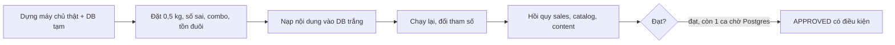

# QA — FISH-66 · Lô 1 (S1) + Lô 1b (S2) · lần 1 · 14/11/2026

## Kết luận: APPROVED — không lỗi chặn; điều kiện gộp: S1-AC11 (đua) phải xanh trên CI Postgres (bị bỏ qua trên SQLite, chưa kiểm ở đây)
## Tổng: 22 ca · ✅ 20 · ❌ 0 · ⏸ 2 (AC11 đua Postgres; S2-AC3/AC6 chờ staging/bản production, ngoài lô này)

## Theo AC
| Mã AC | Kết quả | Bằng chứng |
|---|---|---|
| S1-AC1 | ✅ | Server thật: POST 0,5 kg CA-THU → 201, tổng 82.500 (giá 165.000), phân bổ 0,5 kg vào LO-0918 (hạn 22/11, sớm hơn LO-0915 hạn 26/11) = đúng FEFO; qty_reserved LO-0918 = 0,5 |
| S1-AC2 | ✅ | 1,5 kg → 201, 247.500 |
| S1-AC3 | ✅ | 0,25 / 0 / 0,7 / -0,5 → 400 INVALID_QTY, detail "Món theo kg đặt từ 0,5 kg, mỗi lần thêm 0,5 kg. Combo đặt số nguyên từ 1."; không có mã BR trong câu (theo 02b §8.1); sau 4 lần từ chối, qty_reserved không đổi (tổng giữ chỗ chỉ do các đơn hợp lệ) |
| S1-AC4 | ✅ | Đơn 2 dòng (0,5 hợp lệ + 0,25) → 400, không đơn nào được tạo |
| S1-AC5 | ✅ | COMBO-QA 0,5 → 400, min_qty/qty_step = "1" |
| S1-AC6 | ✅ | Tồn 0,4 → catalog `stock_level`=out; đặt 0,5 → 400 OUT_OF_STOCK |
| S1-AC7 | ✅ | Tồn 0,5 → `low`; đặt 1 kg → 400 OUT_OF_STOCK (short); đặt 0,5 → 201; đặt lần 2 → 400 hết hàng |
| S1-AC8 | ✅ | Catalog + chi tiết: món kg min_qty/qty_step "0.5"; combo "1" |
| S1-AC9 | ✅ | `test_s1_ac9` trong lượt chạy hồi quy (làm tròn BR-BH-15) |
| S1-AC10 | ✅ | `test_s1_ac10` (override 1 kg → từ chối 0,5, câu "từ 1 kg") + mặc định 0,5 chạy ở server thật |
| S1-AC11 | ⏸ | Test đua cần Postgres, SQLite bỏ qua (nằm trong 10 ca skipped). Phải xanh trên CI cloud trước khi gộp main |
| S1-AC12 | ✅ | Server thật: catalog + phản hồi lỗi + phản hồi tạo đơn không chứa purchase_rate/landed/mã lô LO-xx/qty_reserved/tên/SĐT/địa chỉ; log server 0 lần thấy dữ liệu khách |
| S1-AC13 | ✅ | `test_s1_ac13` (đơn 1 kg cũ giữ tổng tiền/dòng). Mức màn ERP và báo cáo chưa kiểm (lô không đổi code đó) |
| S2-AC1 | ✅ | DB trắng + `load_shop_content --publish`: tạo 17 trang; cach-mua-hang (6 chỗ), dieu-khoan (2), gioi-thieu, home-banner (2) đều "0,5 kg"; quét regex "1 kg/1kg/1 ký/tối thiểu 1/từ 1 (không phải combo)" trên title, excerpt, SEO, body: 0 kết quả. Còn "500 g" ở 2 công thức nấu (nguyên liệu, không phải mức mua) |
| S2-AC2 | ✅ | Sửa tay title gioi-thieu, seo_description cach-mua-hang → chạy lại: "không đổi 17", nội dung sửa còn nguyên. Chạy hai lần liền cũng "không đổi 17" |
| S2-AC4 | ✅ | `SHOP_MIN_QTY_KG=1`, DB trắng → các trang ghi "từ 1 kg" |
| S2-AC5 | ✅ | Không đổi code quyền (diff không đụng quyền content) |
| S2-AC3, S2-AC6 | ⏸ | Việc staging và bản production cho Duy duyệt, không thuộc phạm vi kiểm này |

## Ngoại lệ & biên
Ca ngoài đường thuận đã chạy: số sai (0, âm, 0,25, 0,7), combo 0,5, đơn lẫn dòng sai, tồn đuôi 0,4/0,5, đặt hết đuôi rồi đặt lại, chạy nạp nội dung hai lần, nội dung Lộc đã sửa, đổi tham số 1 kg, hai lô FEFO. Đua 0,5+0,5: ⏸ (Postgres).

## Phân quyền
Lô chỉ đổi API công khai (AllowAny) và lệnh nạp. Không đổi quyền ERP/CMS (S2-AC5). Không có endpoint mới, không có migration (`makemigrations --check`: No changes).

## Rò giá vốn / dữ liệu cá nhân
Quét JSON catalog, chi tiết, 400, 201 và log server: không có giá mua, giá vốn, mã lô, số kg tồn; không tên/SĐT/địa chỉ. Câu lỗi chỉ chứa mức tối thiểu và bước công khai. Dữ liệu giả (Nguyễn Văn A, 0900000001).

## Hồi quy
`manage.py test apps.sales apps.catalog apps.content --parallel 1`: **Ran 1452 tests in 129.320s — OK (skipped=10)**.
`check_naming.py`: OK. Frontend không thuộc lô.

## Lỗi
Không có lỗi chặn. Ghi nhận Low đã nêu ở 02b §13.1 (L1–L4) và rủi ro ngoài phạm vi: `frontend/lib/quantity.ts`, mock Shop còn 1 kg thuộc GUI-08; production deploy kế tiếp tự bật 0,5 kg (Q-TL-1) nên phải gộp cùng GUI-08 và nội dung CMS.

## Lệnh đã chạy
- Server local `runserver 8123` với `DATABASE_URL=sqlite:///…/qa.sqlite3` sau `migrate` + `seed_demo` + thêm món đuôi 0,4/0,5 và combo; script gọi API bằng urllib (`scratchpad/qa_api.py`).
- `load_shop_content --author qa_author --publish` trên DB trắng (0,5 và env 1), chạy lại, sau khi sửa tay.
- `manage.py test apps.sales apps.catalog apps.content --parallel 1` → Ran 1452 OK.

## Kết luận: APPROVED — S3 và S4 chạy thật trên máy chủ + ERP thật, không có lỗi Critical/High/Medium; 3 ghi nhận Low.

## Tổng: 38 ca · ✅ 37 · ❌ 0 · ⏸ 1 (S3-AC13 trên staging chưa chạy được ở local, đã đo tương đương)

Môi trường: Django local `:8010` (SQLite tạm, `DJANGO_DEBUG=1`, `CORS_ALLOWED_ORIGINS=http://localhost:3010`), ERP build với
`NEXT_PUBLIC_API_BASE=http://localhost:8010 NEXT_PUBLIC_USE_MOCK=0` phục vụ tĩnh ở `:3010` (khác cổng với API). Playwright
Chromium, mở file bằng `openpyxl` (venv backend, `python -I`). Dữ liệu giả: 4 món (3 thường + 1 combo, 1 món tắt bán, 1 món có
ảnh), 2 lô có giá mua 80.000, 2 mức giá cho CA01 (278.000 hiện hành, 999.000 hiệu lực 5 ngày sau), ô chữ "độc"
(`=HYPERLINK(...)`, `+cmd`, `@SUM(1)`, `-2+3`, tab đầu dòng). Ảnh: `shots/lo2-qa/` (thư mục `shots/` bị `.gitignore`, không vào commit).

## Theo AC
| Mã AC | Kết quả | Bằng chứng |
|---|---|---|
| S3-AC1 (Chủ, 17 cột, tên file giờ VN, giá hiện hành) | ✅ | Playwright Chủ bấm nút → `hang-ban-20261114-1810.xlsx`; openpyxl: 1 tiêu đề + 4 dòng, 17 cột đúng thứ tự, CA01 = 278000 (không phải 999000 là giá tương lai). Tên file giờ VN còn đúng khi tiến trình chạy `TZ=UTC` (UTC 11:19 → `...-1819`) |
| S3-AC2 (Quản lý 17 cột) | ✅ | Playwright + curl token Quản lý: 17 cột, có giá |
| S3-AC3 (NV kho 14 cột) | ✅ | Playwright NV kho: 14 cột, không 3 cột giá; quét mọi ô: không số giá bán |
| S3-AC4 (NV giao, Gọi xác nhận, chưa nhóm: 403; chưa đăng nhập: 401; nút ẩn) | ✅ | curl: courier/cs/no-group 403 `Thiếu quyền: catalog.view_item`, anon 401. ERP: courier/cs thấy "Bạn không có quyền xem mục này", 0 nút; no-group về `/no-role/` (`denied-*.png`) |
| S3-AC5 (giá vốn, so khớp tuyệt đối) | ✅ | Lô giá mua 80.000. File Chủ/Quản lý/NV kho: tiêu đề đúng danh sách cho phép; quét 2 sheet, không ô nào chứa 80000/lô/nhà cung cấp/kho. NV kho không có chữ giá |
| S3-AC6 (lọc nhóm/đang bán/loại/có ảnh) | ✅ | UI: nhóm Tôm → [TOM01]; Cá+đang bán → [CA01, CB01]; có ảnh → [CA01]. API: `is_active=0`→1, `item_type=BUNDLE`→1. Toast số món khớp số dòng file |
| S3-AC7 (rỗng) | ✅ | Tôm + Combo → file chỉ tiêu đề, toast "Không có món nào khớp bộ lọc. File chỉ có dòng tiêu đề." (`f2-empty-warn.png`) |
| S3-AC8 (lọc sai 400) | ✅ | `item_type=abc`, `is_active=maybe`, `item_group=x`, `has_image=zz` → 400 `INVALID_FILTER` câu tiếng Việt |
| S3-AC9 (mất mạng) | ✅ | Dừng máy chủ rồi bấm: toast E3 đúng chữ, 0 file tải, nút bấm lại được (`e3-network-down-*.png`). Nhánh 500: ⏸ chỉ có vitest `itemFilesDownload.test.ts` (xanh), không dựng được 500 thật |
| S3-AC10 (công thức độc) | ✅ | Mở file thật: ô `=HYPERLINK`, `+cmd`, `@SUM(1)`, `-2+3`, `\tTab` đều `data_type="s"`, `quotePrefix=True`, giá trị nguyên chữ; XML sheet không có thẻ `<f>`; 0 ô công thức ở cả 2 sheet |
| S3-AC11 (định dạng) | ✅ | Giá và hạn là `int` (278000, 365); cờ "Có"/"Không"; ngày mẫu là datetime ô ngày |
| S3-AC12 (AuditLog) | ✅ | `export_items`, `changes={"rows": n, "with_prices": bool}`, `note=""`, đúng người tải, không tên món/bộ lọc; mẫu không ghi AuditLog; 403/400 không ghi |
| S3-AC13 (hiệu năng) | ⏸ | Local: 1.004 món → 5 truy vấn, 0,14 giây, 50 KB. Chưa đo ≤ 5 giây trên staging (chưa deploy); test đếm truy vấn nằm trong suite xanh |
| S4-AC1 (mẫu Chủ) | ✅ | `mau-hang-ban.xlsx`, 17 cột, dòng giả `VD-001`/"Cá ví dụ", giá mới 150000, ngày áp dụng 15/11/2026 (ngày mai VN) |
| S4-AC2 | n/a lô 3 | Thuộc S5 (nhập file), chưa có ở lô 2 |
| S4-AC3 (NV kho) | ✅ | Chọn "mở cho người xem được mặt hàng": NV kho nhận mẫu 14 cột không cột giá |
| S4-AC4 (NV giao/chưa đăng nhập) | ✅ | 403 / 401 |

## Ngoại lệ & biên
| Ca | Kết quả | Bằng chứng |
|---|---|---|
| Bấm đúp "Tải file Excel" | ✅ | `dblclick` → 1 lượt tải, 1 dòng AuditLog |
| Ô tìm có chữ (T1b) | ✅ | Toast "…(4 món). File theo bộ lọc, không theo ô tìm." và file đủ 4 món |
| Màn cũ, quyền đổi giữa chừng | ✅ | NV kho đang mở màn, bị chuyển sang NV giao rồi bấm: toast "Quyền của bạn vừa thay đổi…" + E5 "Bạn không có quyền tải danh sách mặt hàng.", 0 file |
| Gỡ hết nhóm khi đang mở màn | ✅ | Màn chuyển sang "Bạn không có quyền vào hệ thống vận hành" (`e5-lost-permission.png`) |
| Mất mạng | ✅ | như S3-AC9, cả nút danh sách lẫn mục "Tải file mẫu" |
| 360 px | ✅ | `scrollWidth = clientWidth = 360` (cả khi mở menu "…"); nút xuống dòng (`w360-items.png`, `w360-menu.png`) |
| Bộ lọc không có món (`item_group=999`) | ✅ | 200, `X-Row-Count: 0` |
| POST vào export | ✅ | 405 |
| Dữ liệu cũ đã bán (món có lô, có giá tương lai) | ✅ | giá hiện hành đúng, giá tương lai không lọt |
| 1.000 món | ✅ (local) | xem S3-AC13 |

## CORS
`curl -H "Origin: http://localhost:3010"`: `Access-Control-Expose-Headers: Content-Disposition, X-Row-Count`; preflight 200. Origin lạ
(`evil.example`) không nhận header CORS. ERP khác cổng với API vẫn đọc được tên file và số món (toast có tên file + `(4 món)`).
Response có `Cache-Control: no-store`.

## Phân quyền
| Group | Tải danh sách | Tải mẫu | Cột | Nút trên ERP |
|---|---|---|---|---|
| owner | 200 | 200 | 17 | có |
| manager | 200 | 200 | 17 | có |
| warehouse_staff | 200 | 200 | 14 | có |
| delivery_staff | 403 | 403 | — | màn "Không có quyền xem mục này" |
| customer_service | 403 | 403 | — | như trên |
| không nhóm | 403 (ERP: `/no-role/`) | 403 | — | không vào ERP |
| chưa đăng nhập | 401 | 401 | — | — |

## Rò giá vốn
Không rò. Mở file thật của 3 vai: tiêu đề khớp tuyệt đối danh sách cho phép, không ô nào chứa 80.000, mã lô, nhà cung cấp, kho,
tồn. `AuditLog.changes` chỉ có `rows`, `with_prices` (không tính ngược ra giá vốn được). Thuộc tính file `creator` = "Cá Về".

## Rò dữ liệu cá nhân
Không có. File không có cột khách; mô tả/ghi chú là chữ của món. Dữ liệu seed là giả. Log máy chủ không có tên/SĐT/địa chỉ
(chỉ cảnh báo cấu hình `SELLER_*`). `localStorage` chỉ có token, id người dùng và giờ đăng nhập (đã có từ trước); `sessionStorage`
rỗng; URL chỉ `?tab=items`; console không có lỗi/cảnh báo. `blob:` chỉ tồn tại tạm.

## Hồi quy
- `manage.py test apps.catalog apps.accounts --parallel 1`: **Ran 1047 tests, FAILED (failures=1, skipped=1)**. Lỗi duy nhất:
  `apps.catalog.vouchers.tests.test_api.CreateTests.test_s3b_01_ac1_create_stores_utc_times_and_audits` (`expired` ≠ `scheduled`,
  do lịch cố định đã sửa ở nhánh lô 1; nằm ngoài lô 2, đã được báo trước).
- `manage.py test apps.catalog.item_files --parallel 1`: Ran 41, OK.
- `makemigrations --check --dry-run`: No changes detected.
- `erp-console`: `tsc --noEmit` exit 0; `npm run build` exit 0 (build thật với `NEXT_PUBLIC_USE_MOCK=0`); `vitest run` 115 file, 1.375 test xanh.
- `python3 scripts/check_naming.py`: OK, không phát sinh vi phạm mới.
- Adapter: không chạy (lô không đụng `adapter/`).

## Lỗi
Không có lỗi chặn. Ghi nhận Low (không chặn):

### B1 — HEAD vẫn dựng file và ghi AuditLog · Low · AC S3-AC12
Tái hiện: `curl -I -H "Authorization: Token <chủ>" http://localhost:8010/api/catalog/items/export/` → 200, có thêm 1 dòng `export_items`
(rows 4) dù không ai nhận file. Trùng ghi chú L1 của techlead (`api.py` `http_method_names` có `"head"`). Nên bỏ `head` ở lô 3.

### B2 — Sheet "Hướng dẫn" của NV kho nhắc cột giá mà file của họ không có · Low · AC S3-AC3
Tái hiện: đăng nhập NV kho, tải file, mở sheet "Hướng dẫn": câu 3-4 nói về "Giá bán hiện hành", "Giá mới", "Ngày áp dụng giá mới".
Không lộ số giá, nhưng gây rối và nhắc tới thông tin NV kho không được xem. Nên bỏ hai dòng đó ở bản 14 cột.

### B3 — Mục "Tải file mẫu" khi đang tải file khác bị bỏ qua im lặng · Low · AC S3-AC9
Trùng L4 của techlead. Chưa tái hiện riêng; giữ ghi nhận.

## Lệnh đã chạy (tóm tắt)
- `manage.py migrate` + `shell < seed` (SQLite tạm), `runserver 8010`, ERP `NEXT_PUBLIC_API_BASE=http://localhost:8010 NEXT_PUBLIC_USE_MOCK=0 npm run build` (exit 0) + `python3 -m http.server 3010` trong `erp-console/out`.
- Playwright (Python): đăng nhập 6 vai, tải danh sách/mẫu, lọc, bấm đúp, dừng máy chủ, mất quyền, 360 px; openpyxl `python -I` đọc từng file.
- curl: token từng vai (có giới hạn tần suất đăng nhập, phải chờ giữa các lần), CORS, preflight, bộ lọc, HEAD, POST.
- Đã dọn: tắt máy chủ `:8010`/`:3010` của QA, xoá `backend/db.sqlite3`. Không sửa code sản phẩm, không commit.
