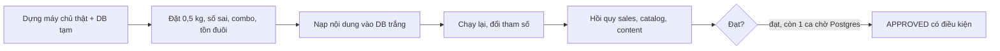

# QA — FISH-66 · Lô 1 (S1) + Lô 1b (S2) · lần 1 · 14/11/2026

## Kết luận: APPROVED — không lỗi chặn; điều kiện gộp: S1-AC11 (đua) phải xanh trên CI Postgres (bị bỏ qua trên SQLite, chưa kiểm ở đây)
## Tổng: 22 ca · ✅ 20 · ❌ 0 · ⏸ 2 (AC11 đua Postgres; S2-AC3/AC6 chờ staging/bản production, ngoài lô này)

## Theo AC
| Mã AC | Kết quả | Bằng chứng |
|---|---|---|
| S1-AC1 | ✅ | Server thật: POST 0,5 kg CA-THU → 201, tổng 82.500 (giá 165.000), phân bổ 0,5 kg vào LO-0918 (hạn 22/11, sớm hơn LO-0915 hạn 26/11) = đúng FEFO; qty_reserved LO-0918 = 0,5 |
| S1-AC2 | ✅ | 1,5 kg → 201, 247.500 |
| S1-AC3 | ✅ | 0,25 / 0 / 0,7 / -0,5 → 400 INVALID_QTY, detail "Món theo kg đặt từ 0,5 kg, mỗi lần thêm 0,5 kg. Combo đặt số nguyên từ 1."; không có mã BR trong câu (theo 02b §8.1); sau 4 lần từ chối, qty_reserved không đổi (tổng giữ chỗ chỉ do các đơn hợp lệ) |
| S1-AC4 | ✅ | Đơn 2 dòng (0,5 hợp lệ + 0,25) → 400, không đơn nào được tạo |
| S1-AC5 | ✅ | COMBO-QA 0,5 → 400, min_qty/qty_step = "1" |
| S1-AC6 | ✅ | Tồn 0,4 → catalog `stock_level`=out; đặt 0,5 → 400 OUT_OF_STOCK |
| S1-AC7 | ✅ | Tồn 0,5 → `low`; đặt 1 kg → 400 OUT_OF_STOCK (short); đặt 0,5 → 201; đặt lần 2 → 400 hết hàng |
| S1-AC8 | ✅ | Catalog + chi tiết: món kg min_qty/qty_step "0.5"; combo "1" |
| S1-AC9 | ✅ | `test_s1_ac9` trong lượt chạy hồi quy (làm tròn BR-BH-15) |
| S1-AC10 | ✅ | `test_s1_ac10` (override 1 kg → từ chối 0,5, câu "từ 1 kg") + mặc định 0,5 chạy ở server thật |
| S1-AC11 | ⏸ | Test đua cần Postgres, SQLite bỏ qua (nằm trong 10 ca skipped). Phải xanh trên CI cloud trước khi gộp main |
| S1-AC12 | ✅ | Server thật: catalog + phản hồi lỗi + phản hồi tạo đơn không chứa purchase_rate/landed/mã lô LO-xx/qty_reserved/tên/SĐT/địa chỉ; log server 0 lần thấy dữ liệu khách |
| S1-AC13 | ✅ | `test_s1_ac13` (đơn 1 kg cũ giữ tổng tiền/dòng). Mức màn ERP và báo cáo chưa kiểm (lô không đổi code đó) |
| S2-AC1 | ✅ | DB trắng + `load_shop_content --publish`: tạo 17 trang; cach-mua-hang (6 chỗ), dieu-khoan (2), gioi-thieu, home-banner (2) đều "0,5 kg"; quét regex "1 kg/1kg/1 ký/tối thiểu 1/từ 1 (không phải combo)" trên title, excerpt, SEO, body: 0 kết quả. Còn "500 g" ở 2 công thức nấu (nguyên liệu, không phải mức mua) |
| S2-AC2 | ✅ | Sửa tay title gioi-thieu, seo_description cach-mua-hang → chạy lại: "không đổi 17", nội dung sửa còn nguyên. Chạy hai lần liền cũng "không đổi 17" |
| S2-AC4 | ✅ | `SHOP_MIN_QTY_KG=1`, DB trắng → các trang ghi "từ 1 kg" |
| S2-AC5 | ✅ | Không đổi code quyền (diff không đụng quyền content) |
| S2-AC3, S2-AC6 | ⏸ | Việc staging và bản production cho Duy duyệt, không thuộc phạm vi kiểm này |

## Ngoại lệ & biên
Ca ngoài đường thuận đã chạy: số sai (0, âm, 0,25, 0,7), combo 0,5, đơn lẫn dòng sai, tồn đuôi 0,4/0,5, đặt hết đuôi rồi đặt lại, chạy nạp nội dung hai lần, nội dung Lộc đã sửa, đổi tham số 1 kg, hai lô FEFO. Đua 0,5+0,5: ⏸ (Postgres).

## Phân quyền
Lô chỉ đổi API công khai (AllowAny) và lệnh nạp. Không đổi quyền ERP/CMS (S2-AC5). Không có endpoint mới, không có migration (`makemigrations --check`: No changes).

## Rò giá vốn / dữ liệu cá nhân
Quét JSON catalog, chi tiết, 400, 201 và log server: không có giá mua, giá vốn, mã lô, số kg tồn; không tên/SĐT/địa chỉ. Câu lỗi chỉ chứa mức tối thiểu và bước công khai. Dữ liệu giả (Nguyễn Văn A, 0900000001).

## Hồi quy
`manage.py test apps.sales apps.catalog apps.content --parallel 1`: **Ran 1452 tests in 129.320s — OK (skipped=10)**.
`check_naming.py`: OK. Frontend không thuộc lô.

## Lỗi
Không có lỗi chặn. Ghi nhận Low đã nêu ở 02b §13.1 (L1–L4) và rủi ro ngoài phạm vi: `frontend/lib/quantity.ts`, mock Shop còn 1 kg thuộc GUI-08; production deploy kế tiếp tự bật 0,5 kg (Q-TL-1) nên phải gộp cùng GUI-08 và nội dung CMS.

## Lệnh đã chạy
- Server local `runserver 8123` với `DATABASE_URL=sqlite:///…/qa.sqlite3` sau `migrate` + `seed_demo` + thêm món đuôi 0,4/0,5 và combo; script gọi API bằng urllib (`scratchpad/qa_api.py`).
- `load_shop_content --author qa_author --publish` trên DB trắng (0,5 và env 1), chạy lại, sau khi sửa tay.
- `manage.py test apps.sales apps.catalog apps.content --parallel 1` → Ran 1452 OK.
