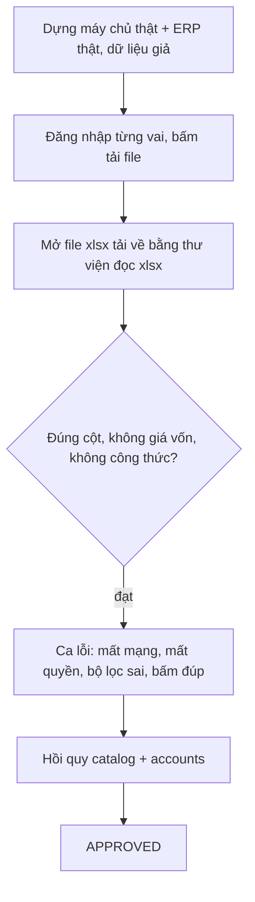

# QA — Hàng bán Excel (FISH-66) · Lô 2 (S3 tải danh sách, S4 tải file mẫu) · lần 1 · 14/11/2026

## Kết luận: APPROVED — S3 và S4 chạy thật trên máy chủ + ERP thật, không có lỗi Critical/High/Medium; 3 ghi nhận Low.

## Tổng: 38 ca · ✅ 37 · ❌ 0 · ⏸ 1 (S3-AC13 trên staging chưa chạy được ở local, đã đo tương đương)

Môi trường: Django local `:8010` (SQLite tạm, `DJANGO_DEBUG=1`, `CORS_ALLOWED_ORIGINS=http://localhost:3010`), ERP build với
`NEXT_PUBLIC_API_BASE=http://localhost:8010 NEXT_PUBLIC_USE_MOCK=0` phục vụ tĩnh ở `:3010` (khác cổng với API). Playwright
Chromium, mở file bằng `openpyxl` (venv backend, `python -I`). Dữ liệu giả: 4 món (3 thường + 1 combo, 1 món tắt bán, 1 món có
ảnh), 2 lô có giá mua 80.000, 2 mức giá cho CA01 (278.000 hiện hành, 999.000 hiệu lực 5 ngày sau), ô chữ "độc"
(`=HYPERLINK(...)`, `+cmd`, `@SUM(1)`, `-2+3`, tab đầu dòng). Ảnh: `shots/lo2-qa/` (thư mục `shots/` bị `.gitignore`, không vào commit).

## Theo AC
| Mã AC | Kết quả | Bằng chứng |
|---|---|---|
| S3-AC1 (Chủ, 17 cột, tên file giờ VN, giá hiện hành) | ✅ | Playwright Chủ bấm nút → `hang-ban-20261114-1810.xlsx`; openpyxl: 1 tiêu đề + 4 dòng, 17 cột đúng thứ tự, CA01 = 278000 (không phải 999000 là giá tương lai). Tên file giờ VN còn đúng khi tiến trình chạy `TZ=UTC` (UTC 11:19 → `...-1819`) |
| S3-AC2 (Quản lý 17 cột) | ✅ | Playwright + curl token Quản lý: 17 cột, có giá |
| S3-AC3 (NV kho 14 cột) | ✅ | Playwright NV kho: 14 cột, không 3 cột giá; quét mọi ô: không số giá bán |
| S3-AC4 (NV giao, Gọi xác nhận, chưa nhóm: 403; chưa đăng nhập: 401; nút ẩn) | ✅ | curl: courier/cs/no-group 403 `Thiếu quyền: catalog.view_item`, anon 401. ERP: courier/cs thấy "Bạn không có quyền xem mục này", 0 nút; no-group về `/no-role/` (`denied-*.png`) |
| S3-AC5 (giá vốn, so khớp tuyệt đối) | ✅ | Lô giá mua 80.000. File Chủ/Quản lý/NV kho: tiêu đề đúng danh sách cho phép; quét 2 sheet, không ô nào chứa 80000/lô/nhà cung cấp/kho. NV kho không có chữ giá |
| S3-AC6 (lọc nhóm/đang bán/loại/có ảnh) | ✅ | UI: nhóm Tôm → [TOM01]; Cá+đang bán → [CA01, CB01]; có ảnh → [CA01]. API: `is_active=0`→1, `item_type=BUNDLE`→1. Toast số món khớp số dòng file |
| S3-AC7 (rỗng) | ✅ | Tôm + Combo → file chỉ tiêu đề, toast "Không có món nào khớp bộ lọc. File chỉ có dòng tiêu đề." (`f2-empty-warn.png`) |
| S3-AC8 (lọc sai 400) | ✅ | `item_type=abc`, `is_active=maybe`, `item_group=x`, `has_image=zz` → 400 `INVALID_FILTER` câu tiếng Việt |
| S3-AC9 (mất mạng) | ✅ | Dừng máy chủ rồi bấm: toast E3 đúng chữ, 0 file tải, nút bấm lại được (`e3-network-down-*.png`). Nhánh 500: ⏸ chỉ có vitest `itemFilesDownload.test.ts` (xanh), không dựng được 500 thật |
| S3-AC10 (công thức độc) | ✅ | Mở file thật: ô `=HYPERLINK`, `+cmd`, `@SUM(1)`, `-2+3`, `\tTab` đều `data_type="s"`, `quotePrefix=True`, giá trị nguyên chữ; XML sheet không có thẻ `<f>`; 0 ô công thức ở cả 2 sheet |
| S3-AC11 (định dạng) | ✅ | Giá và hạn là `int` (278000, 365); cờ "Có"/"Không"; ngày mẫu là datetime ô ngày |
| S3-AC12 (AuditLog) | ✅ | `export_items`, `changes={"rows": n, "with_prices": bool}`, `note=""`, đúng người tải, không tên món/bộ lọc; mẫu không ghi AuditLog; 403/400 không ghi |
| S3-AC13 (hiệu năng) | ⏸ | Local: 1.004 món → 5 truy vấn, 0,14 giây, 50 KB. Chưa đo ≤ 5 giây trên staging (chưa deploy); test đếm truy vấn nằm trong suite xanh |
| S4-AC1 (mẫu Chủ) | ✅ | `mau-hang-ban.xlsx`, 17 cột, dòng giả `VD-001`/"Cá ví dụ", giá mới 150000, ngày áp dụng 15/11/2026 (ngày mai VN) |
| S4-AC2 | n/a lô 3 | Thuộc S5 (nhập file), chưa có ở lô 2 |
| S4-AC3 (NV kho) | ✅ | Chọn "mở cho người xem được mặt hàng": NV kho nhận mẫu 14 cột không cột giá |
| S4-AC4 (NV giao/chưa đăng nhập) | ✅ | 403 / 401 |

## Ngoại lệ & biên
| Ca | Kết quả | Bằng chứng |
|---|---|---|
| Bấm đúp "Tải file Excel" | ✅ | `dblclick` → 1 lượt tải, 1 dòng AuditLog |
| Ô tìm có chữ (T1b) | ✅ | Toast "…(4 món). File theo bộ lọc, không theo ô tìm." và file đủ 4 món |
| Màn cũ, quyền đổi giữa chừng | ✅ | NV kho đang mở màn, bị chuyển sang NV giao rồi bấm: toast "Quyền của bạn vừa thay đổi…" + E5 "Bạn không có quyền tải danh sách mặt hàng.", 0 file |
| Gỡ hết nhóm khi đang mở màn | ✅ | Màn chuyển sang "Bạn không có quyền vào hệ thống vận hành" (`e5-lost-permission.png`) |
| Mất mạng | ✅ | như S3-AC9, cả nút danh sách lẫn mục "Tải file mẫu" |
| 360 px | ✅ | `scrollWidth = clientWidth = 360` (cả khi mở menu "…"); nút xuống dòng (`w360-items.png`, `w360-menu.png`) |
| Bộ lọc không có món (`item_group=999`) | ✅ | 200, `X-Row-Count: 0` |
| POST vào export | ✅ | 405 |
| Dữ liệu cũ đã bán (món có lô, có giá tương lai) | ✅ | giá hiện hành đúng, giá tương lai không lọt |
| 1.000 món | ✅ (local) | xem S3-AC13 |

## CORS
`curl -H "Origin: http://localhost:3010"`: `Access-Control-Expose-Headers: Content-Disposition, X-Row-Count`; preflight 200. Origin lạ
(`evil.example`) không nhận header CORS. ERP khác cổng với API vẫn đọc được tên file và số món (toast có tên file + `(4 món)`).
Response có `Cache-Control: no-store`.

## Phân quyền
| Group | Tải danh sách | Tải mẫu | Cột | Nút trên ERP |
|---|---|---|---|---|
| owner | 200 | 200 | 17 | có |
| manager | 200 | 200 | 17 | có |
| warehouse_staff | 200 | 200 | 14 | có |
| delivery_staff | 403 | 403 | — | màn "Không có quyền xem mục này" |
| customer_service | 403 | 403 | — | như trên |
| không nhóm | 403 (ERP: `/no-role/`) | 403 | — | không vào ERP |
| chưa đăng nhập | 401 | 401 | — | — |

## Rò giá vốn
Không rò. Mở file thật của 3 vai: tiêu đề khớp tuyệt đối danh sách cho phép, không ô nào chứa 80.000, mã lô, nhà cung cấp, kho,
tồn. `AuditLog.changes` chỉ có `rows`, `with_prices` (không tính ngược ra giá vốn được). Thuộc tính file `creator` = "Cá Về".

## Rò dữ liệu cá nhân
Không có. File không có cột khách; mô tả/ghi chú là chữ của món. Dữ liệu seed là giả. Log máy chủ không có tên/SĐT/địa chỉ
(chỉ cảnh báo cấu hình `SELLER_*`). `localStorage` chỉ có token, id người dùng và giờ đăng nhập (đã có từ trước); `sessionStorage`
rỗng; URL chỉ `?tab=items`; console không có lỗi/cảnh báo. `blob:` chỉ tồn tại tạm.

## Hồi quy
- `manage.py test apps.catalog apps.accounts --parallel 1`: **Ran 1047 tests, FAILED (failures=1, skipped=1)**. Lỗi duy nhất:
  `apps.catalog.vouchers.tests.test_api.CreateTests.test_s3b_01_ac1_create_stores_utc_times_and_audits` (`expired` ≠ `scheduled`,
  do lịch cố định đã sửa ở nhánh lô 1; nằm ngoài lô 2, đã được báo trước).
- `manage.py test apps.catalog.item_files --parallel 1`: Ran 41, OK.
- `makemigrations --check --dry-run`: No changes detected.
- `erp-console`: `tsc --noEmit` exit 0; `npm run build` exit 0 (build thật với `NEXT_PUBLIC_USE_MOCK=0`); `vitest run` 115 file, 1.375 test xanh.
- `python3 scripts/check_naming.py`: OK, không phát sinh vi phạm mới.
- Adapter: không chạy (lô không đụng `adapter/`).

## Lỗi
Không có lỗi chặn. Ghi nhận Low (không chặn):

### B1 — HEAD vẫn dựng file và ghi AuditLog · Low · AC S3-AC12
Tái hiện: `curl -I -H "Authorization: Token <chủ>" http://localhost:8010/api/catalog/items/export/` → 200, có thêm 1 dòng `export_items`
(rows 4) dù không ai nhận file. Trùng ghi chú L1 của techlead (`api.py` `http_method_names` có `"head"`). Nên bỏ `head` ở lô 3.

### B2 — Sheet "Hướng dẫn" của NV kho nhắc cột giá mà file của họ không có · Low · AC S3-AC3
Tái hiện: đăng nhập NV kho, tải file, mở sheet "Hướng dẫn": câu 3-4 nói về "Giá bán hiện hành", "Giá mới", "Ngày áp dụng giá mới".
Không lộ số giá, nhưng gây rối và nhắc tới thông tin NV kho không được xem. Nên bỏ hai dòng đó ở bản 14 cột.

### B3 — Mục "Tải file mẫu" khi đang tải file khác bị bỏ qua im lặng · Low · AC S3-AC9
Trùng L4 của techlead. Chưa tái hiện riêng; giữ ghi nhận.

## Lệnh đã chạy (tóm tắt)
- `manage.py migrate` + `shell < seed` (SQLite tạm), `runserver 8010`, ERP `NEXT_PUBLIC_API_BASE=http://localhost:8010 NEXT_PUBLIC_USE_MOCK=0 npm run build` (exit 0) + `python3 -m http.server 3010` trong `erp-console/out`.
- Playwright (Python): đăng nhập 6 vai, tải danh sách/mẫu, lọc, bấm đúp, dừng máy chủ, mất quyền, 360 px; openpyxl `python -I` đọc từng file.
- curl: token từng vai (có giới hạn tần suất đăng nhập, phải chờ giữa các lần), CORS, preflight, bộ lọc, HEAD, POST.
- Đã dọn: tắt máy chủ `:8010`/`:3010` của QA, xoá `backend/db.sqlite3`. Không sửa code sản phẩm, không commit.

---

# Tự QA — Hàng bán Excel (FISH-66) · Lô 3 (S5 xem trước thay đổi, S6 xác nhận nhập) · 14/11/2026

## Kết luận: ĐẠT — S5 và S6 chạy thật trên máy chủ Django + bản build tĩnh ERP Console, kiểm trên trình duyệt bằng Playwright ở 1280 px và 360 px.

Môi trường tự QA:
- Django local `:8012` (SQLite tạm qua `DATABASE_URL`, `DJANGO_DEBUG=1`, `CORS_ALLOWED_ORIGINS=http://localhost:3012`).
- ERP Console build tĩnh với `NEXT_PUBLIC_USE_MOCK=0 NEXT_PUBLIC_API_BASE=http://localhost:8012`, phục vụ ở `:3012`.
- Ảnh chụp lưu tại `doc/features/2026-11-14-hang-ban-excel-dong-lanh/shots/lo3/` (thư mục `shots/` nằm trong `.gitignore`).

## Kết quả kiểm trên trình duyệt (Playwright)

| Màn / Tiêu chí | Cách kiểm | Kết quả | Ảnh chụp (1280 px & 360 px) |
|---|---|---|---|
| Phân quyền Quản lý (`quan_ly`) | Đăng nhập `quan_ly`, mở `/catalog/?tab=items` và `/catalog/import/` | Thấy nút `Tải file Excel`, **không** thấy nút `Nhập từ Excel`; vào thẳng `/catalog/import/` hiện màn chặn quyền `NoPermission`; API trả `403`. | `shots/lo3/lo3-quan-ly-m1-1280.png`, `shots/lo3/lo3-quan-ly-forbidden-1280.png` |
| M1 — Thanh nút tab Mặt hàng (`chu_vua`) | Đăng nhập `chu_vua`, mở `/catalog/?tab=items` ở 1280 px và 360 px | Hiện đủ `[Tải file Excel] [Nhập từ Excel] [⋯] [+ Thêm combo] [+ Thêm mặt hàng]`. | `shots/lo3/lo3-m1-1280.png`, `shots/lo3/lo3-m1-360.png` |
| M2 — Trang chọn file (`/catalog/import/`) | Bấm `Nhập từ Excel` từ M1 | Hiện vùng chọn/kéo thả file `.xlsx`, 2 nút tải danh sách hiện có & tải file mẫu, khối `Cách hệ thống đọc file` hiển thị đúng giới hạn `1.000 dòng, 2 MB` từ `GET /api/catalog/items/import/limits/`. | `shots/lo3/lo3-m2-1280.png`, `shots/lo3/lo3-m2-360.png` |
| M4 — Bảng lỗi theo dòng (`IMPORT_INVALID_ROWS`) | Chọn file `error_import.xlsx` có giá âm `-50000`, SĐT `0901234567` trong Ghi chú ngắn, món mới thiếu Tên và Nhóm lạ | Hiện hộp báo đỏ `File có 5 lỗi ở 2 dòng. Chưa ghi gì.` kèm bảng lỗi sắp theo số dòng tăng dần (`Dòng`, `Mã hàng`, `Cột`, `Cách sửa`); không có nút `Xác nhận nhập`. | `shots/lo3/lo3-m4-errors-1280.png`, `shots/lo3/lo3-m4-errors-360.png` |
| M3 — Xem trước thay đổi (`preview`) | Chọn file `valid_import.xlsx` (đổi giá `CA-01` từ `250.000 đ` → `25.000 đ`, bật kinh doanh `CA-02`, thêm món mới `CA-03` giá `320.000 đ`, sửa cột chỉ đọc `Loại`) | Hiện đúng thứ tự: Dải số tổng (`Đổi giá: 2`, `Món mới: 1`, `Món sửa: 1`, `Đổi ẩn/hiện: 1`, `Sẽ hiện trên Shop: 2`, `Giữ xem trước đến`) → Cảnh báo vàng W1 cho cột chỉ đọc `Loại` → Phần 1 `Đổi giá (2)` (mặc định sắp theo \|Chênh %\| giảm dần, dòng `CA-01` có vạch đỏ trái + chip `Kiểm lại số 0` & `Chênh lớn`) → Phần 2 `Ẩn/hiện trên Shop (1)` → Phần 3 `Món mới (1)` → Phần 4 `Món sửa (1)`. | `shots/lo3/lo3-m3-preview-1280.png`, `shots/lo3/lo3-m3-preview-360.png` |
| M5 — Hộp Xác nhận nhập (`ImportConfirmModal`) | Bấm `Xác nhận nhập` ở thanh đáy M3 | Mở hộp thoại xác nhận, liệt kê dòng giá cần kiểm (`CA-01`), nút `Xác nhận nhập 2 giá mới` bị khoá cho tới khi đánh dấu ô `Tôi đã kiểm 1 giá cần xem`. | `shots/lo3/lo3-m5-confirm-1280.png`, `shots/lo3/lo3-m5-confirm-360.png` |
| M6 — Ghi thành công & điều hướng | Đánh dấu ô xác nhận rồi bấm `Xác nhận nhập 2 giá mới` | Ghi thành công (`POST /api/catalog/items/import/commit/` → 200), điều hướng về `/catalog/?tab=items`, hiện toast `Đã nhập: 1 món mới, 1 món sửa, 2 giá mới.`, danh sách mặt hàng có thêm `CA-03`. Không có lỗi `pageerror`. | `shots/lo3/lo3-m6-done-1280.png`, `shots/lo3/lo3-m6-done-360.png` |
