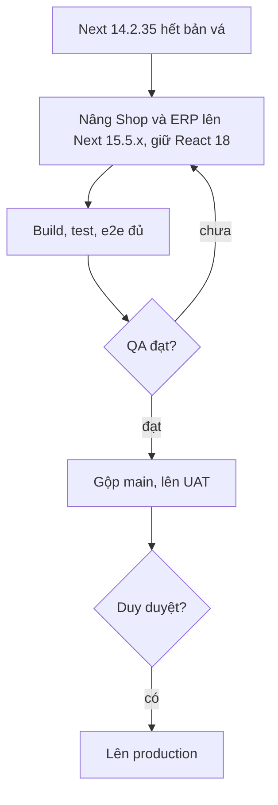

# Nâng Next.js 14 lên 15 để vá bảo mật (luồng NHANH)

Trạng thái: ĐÃ DUYỆT (Duy 15/11: "nextjs … cần nâng để vá bảo mật … xử lý đi").

Bối cảnh: `npm audit` báo `next` critical (các GHSA DoS RSC, request smuggling rewrites, image optimizer, cache poisoning, SSRF WebSocket…), chỉ vá từ 15.5.16. Shop (`frontend/`) và ERP (`erp-console/`) đều `output: "export"` + `images.unoptimized` trên Firebase Hosting nên phần lớn lỗ hổng là phía server, không chạy ở mình; vẫn nâng để hết cảnh báo và còn nhận bản vá về sau.

## NX-01 · Nâng Next ở Shop và ERP
- **AC1:** `frontend/` và `erp-console/` dùng `next` **15.5.x mới nhất** (ghim chính xác, cùng bản cả hai), `eslint-config-next` cùng dòng nếu có; React giữ 18 (không nâng React 19 trong lô này).
- **AC2:** `npm audit --omit=dev` không còn cảnh báo `next`. Lỗi còn lại phải ghi rõ lý do (vd chỉ ở công cụ build, hoặc cần nâng bản lớn thư viện khác).
- **AC3:** Áp các bản vá không đổi bản lớn (`npm audit fix`, không `--force`) cho cả hai app.
- **AC4:** `tsc --noEmit` sạch, `npm run build` (mock và không mock) thành công, `out/` vẫn đủ trang như trước (so số trang tĩnh), các script test `scripts/*.mjs` / vitest đều đạt.
- **AC5:** Không đổi hành vi: e2e Shop (`frontend/e2e/run_shop_e2e.py` các suite chính) và test ERP đều xanh; 360/1280 px không cuộn ngang, 0 lỗi console mới.
- **AC6:** Ghi thay đổi phá vỡ của Next 15 đã gặp và cách sửa vào `03-dev-notes.md`.
