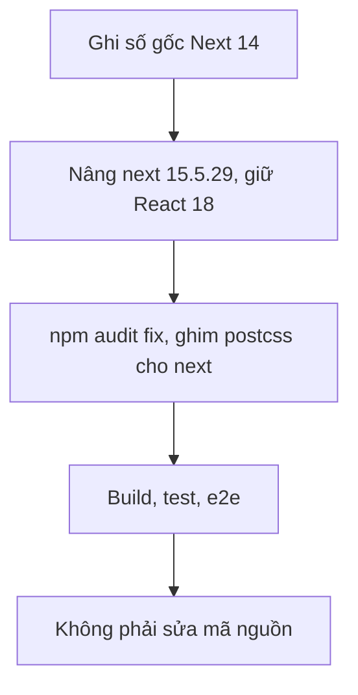

# NX-01 · Ghi chú dev: nâng Next.js 14.2.35 lên 15.5.29

## Mục FE

### Bản trước và sau
| | Trước | Sau |
|---|---|---|
| `next` (Shop và ERP) | 14.2.35 | 15.5.29 (ghim chính xác, bản 15.5.x mới nhất trên registry, dist-tag `backport`) |
| `react`, `react-dom`, `@types/react` | 18.3.x | giữ nguyên 18.3.x |
| `eslint-config-next` | không dùng | không dùng |
| `postcss` kèm `next` | 8.4.31 (lồng trong next) | 8.5.33 qua `overrides` |

Thay đổi file: `frontend/package.json`, `frontend/package-lock.json`, `erp-console/package.json`, `erp-console/package-lock.json`. Không sửa mã nguồn, cấu hình Next (`output: "export"`, `images.unoptimized`, `trailingSlash`) giữ nguyên.

### Thay đổi phá vỡ của Next 15 đã gặp
Không gặp lỗi nào. Hai app là client component + `useEffect`, không dùng `params`/`searchParams` Promise ở server component, không cache `fetch` ngầm, không `next lint`. `tsc` và build sạch, không có cảnh báo build.

### Audit (`npm audit --omit=dev`)
| | Trước | Sau |
|---|---|---|
| Shop | 3 (1 critical `next`, high `postcss`, high `source-map-js`) | 0 |
| ERP | 29 (1 critical `next`, 3 high gồm `markdown-it`, `postcss`, `source-map-js`; 25 moderate tiptap) | 25 moderate (chỉ `@tiptap/*`) |

- `npm audit fix` (không `--force`) vá `source-map-js` và `markdown-it`.
- Registry hiện chỉ có 15.5.29 ở nhánh 15.5; `next` 15.5.29 vẫn bị audit đánh dấu vì kèm `postcss` 8.4.31 lồng bên trong (cảnh báo PostCSS, bản sửa của npm đòi nâng Next 16). Giải quyết bằng `overrides: { next: { postcss: "^8.5.23" } }` ở cả hai app, build vẫn xanh. Đây là phần chỉ chạy lúc build, ngoài ra không còn cảnh báo nào mang tên `next`.
- Còn lại ở ERP: 25 moderate `@tiptap/*` (GHSA-cp6q-959q-f8rh, `mergeAttributes` với khoá `__proto__`). Bản vá cần nâng Tiptap 2 lên 3 (đổi bản lớn, đòi sửa trình soạn nội dung), nằm ngoài NX-01, đề xuất tách story riêng. Chỉ ERP nội bộ dùng.

### Số liệu kiểm chứng (đã tự chạy)
| Lệnh | Trước (Next 14) | Sau (Next 15.5.29) |
|---|---|---|
| `tsc --noEmit` Shop, ERP | sạch | sạch |
| Build không mock Shop, ERP | thành công | thành công, không cảnh báo |
| Build mock Shop, ERP | không chạy | thành công |
| Số html trong `out/` Shop / ERP | 11 / 65 | 11 / 65 (cả bản mock và không mock) |
| Test Shop `scripts/test-*.mjs` | 10/10 đạt | 10/10 đạt |
| ERP vitest | 116 file, 1386 test đạt | 116 file, 1386 test đạt |
| `check-no-mock` Shop | XANH (66 file build) | XANH (66 file) |
| `check-no-mock` ERP | XANH (272 file) | XANH (268 file, chunk đổi tên theo bản mới) |
| `check-ai-chunks` ERP | XANH, 50 mục | XANH, 50 mục |
| `python3 scripts/check_naming.py` | OK | OK, không phát sinh mới |

### e2e Shop (`frontend/e2e/run_shop_e2e.py`, `--skip-build`)
Tên suite trong story (`home`, `item_detail`, `cart_checkout`, `lookup_content`) không có trong runner; dùng các suite hiện có: `general_rules` 168 đạt, `full_flow` 135, `payment_choice` 77, `content_pages` 58, `footer_consent` 31, `formats_timezones` 73, `erp_flow` 41. Tất cả 0 lỗi.

Lưu ý ổn định: ở lượt chạy gộp đầu tiên `payment_choice` (ở 1280, bước thêm vào giỏ) và `erp_flow` (không thấy `#u` ở trang đăng nhập) báo FAIL do timeout; chạy lại riêng thì cả hai đạt, và dò riêng trang đăng nhập ERP bằng Playwright cho thấy hiển thị đúng, không lỗi console. Chưa xác định chắc nguyên nhân (nghi máy tải khi chạy nhiều suite liền); QA nên chạy lại hai suite này.

Build Shop/ERP thông qua runner từng lỗi một lần ở `next/font/google` (không tải được font, do mạng sandbox); build trực tiếp cùng lệnh thì đạt. Không liên quan Next 15.

### Việc còn nợ
- Tiptap 3 để hết 25 cảnh báo moderate ở ERP (story riêng).
- Next 16 chưa làm (đúng phạm vi).
