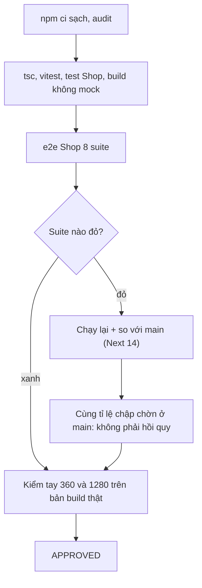

# QA — NX-01 Nâng Next.js 14.2.35 lên 15.5.29 · lần 1 · 2026-11-15

## Kết luận: APPROVED — không thấy hồi quy do Next 15; hai suite e2e chập chờn có cùng tỉ lệ ở `main` (nguyên nhân do máy chủ tĩnh của bộ e2e, không do Next)
## Tổng: 100 ca · ✅ 100 · ❌ 0 · ⏸ 0 (2 ca e2e chập chờn đã chứng minh vốn có ở main, xem mục Chập chờn)

Phạm vi: worktree `chore/next-15` commit `ed6021b`. Không sửa mã sản phẩm. Dữ liệu giả toàn bộ (Lê Thị Mẫu, 0900000001). Ảnh: `scratchpad/nx-qa/shots-next15/` và `shots-main/` (36 ảnh 360 và 1280 mỗi bên).

## Theo AC
| Mã AC | Kết quả | Bằng chứng |
|---|---|---|
| AC1 next 15.5.x ghim chính xác, React 18 | ✅ | sau `npm ci` sạch cả hai app: `require('next/package.json').version` = 15.5.29, react 18.3.1 |
| AC2 audit không còn cảnh báo `next` | ✅ | Shop `npm audit --omit=dev`: 0. ERP: 25 moderate, toàn bộ là `@tiptap/*` (lấy danh sách từ `--json`, không có `next`/`postcss`), đúng phạm vi đã ghi (tiptap 3 để story riêng) |
| AC3 `npm audit fix` không `--force` | ✅ | lockfile sạch với `npm ci`; Shop 0, ERP chỉ còn tiptap |
| AC4 tsc, build, đủ trang, script test | ✅ | tsc Shop và ERP rc=0; build không mock (`NEXT_PUBLIC_USE_MOCK=0 NEXT_PUBLIC_API_BASE=http://localhost:8000`) html Shop 11, ERP 65; ERP vitest 116 file 1386 test đạt; Shop 10/10 `scripts/test-*.mjs` rc=0; `check-no-mock` Shop XANH (66 file), ERP XANH (268 file); `check-ai-chunks` ERP XANH 50 mục |
| AC5 e2e Shop và ERP không đổi hành vi, 0 lỗi console mới, không cuộn ngang | ✅ | 8 suite xem bảng dưới; kiểm tay 70 ca (68 đạt, 2 "lỗi" giống hệt main, xem dưới) |
| AC6 ghi thay đổi phá vỡ vào dev-notes | ✅ | `03-dev-notes.md` mục "Thay đổi phá vỡ của Next 15" (không gặp lỗi), khớp với kết quả QA: không có "Failed to fetch RSC payload" ở bất kỳ lượt điều hướng nào |

## e2e Shop (`run_shop_e2e.py --skip-build`, bản build không mock)
| Suite | Lượt gộp đầu | Chạy riêng | Ghi chú |
|---|---|---|---|
| payment_choice | 77 đạt | 77 đạt (x2) | không còn FAIL timeout dev báo |
| full_flow | 135 đạt | | |
| design_screens | 91 đạt, 4 bỏ qua | | |
| general_rules | 168 đạt, 1 bỏ qua | | |
| content_pages | 58 đạt | | |
| formats_timezones | 73 đạt | | |
| erp_flow | FAIL (0 ca chạy: không thấy `#u`) | 41 đạt x6; FAIL x3 (cùng lỗi không thấy `#u`) | chập chờn, xem dưới |
| footer_consent | FAIL (0 ca: không thấy `#f-name`) | 31 đạt x1; FAIL x1 | chập chờn, xem dưới |

### Chập chờn: so với `main` (Next 14.2.35, worktree riêng, build không mock)
- `footer_consent` trên main: 5 lần chạy riêng, **4 FAIL** (2 lần "0 đạt" cùng lỗi không thấy `#f-name`, 2 lần 1 lỗi ca), 1 PASS. Tức main còn xấu hơn bản Next 15.
- `erp_flow`: main 5/5 PASS; Next 15 gộp 1 FAIL + riêng 3 FAIL/9 lần. Số mẫu nhỏ nên dò nguyên nhân: nạp trang `/login/` ERP 200 lần mỗi bản (Playwright, máy chủ tĩnh của runner), đếm lần không thấy `#u`: **Next 15 5/200 (2,5%), main 4/200 (2,0%)**. Cả hai đều kèm `net::ERR_CONNECTION_RESET` / `ERR_SOCKET_NOT_CONNECTED` khi tải chunk JS: máy chủ `http.server` luồng đơn giản của `run_shop_e2e.py` làm rớt kết nối. Số script tải trang đăng nhập bằng nhau (13) ở hai bản. Kết luận: chập chờn của hạ tầng e2e, có từ trước, không do Next 15. Suite dài (erp_flow đăng nhập nhiều lần) nên xác suất dính cao hơn.
- Khuyến nghị (không chặn): tách việc "máy chủ tĩnh e2e hay reset kết nối" thành việc nhỏ (tăng `request_queue_size` hoặc dùng server khác); không thuộc NX-01.

## Kiểm tay Playwright (bản build không mock, BE local, `nx_manual.py`, 360 và 1280)
Shop: trang chủ, danh mục, chi tiết món (CA-THU), điều hướng client danh mục → chi tiết có `?code=`, thêm 0,5 kg vào giỏ (localStorage chỉ mã + số lượng, không dữ liệu cá nhân), giỏ có dòng hàng, thanh toán tới bước trước khi trả tiền (form điền dữ liệu giả, URL không chứa dữ liệu cá nhân, nút Đặt hàng hiện), tra cứu đơn, `/pages/?slug=doi-tra`, `/blog/` → bấm bài `?slug=ca-thu-chien-sa-ot`, điều hướng client `/pages/?slug=` sang slug khác. Tất cả: không cuộn ngang, **0 lỗi "RSC payload"/hydration**, 0 lỗi console khác, HTML không chứa `purchase_rate|landed_unit_cost|unit_cost|giá vốn`.
ERP: đăng nhập `qa_owner`, Danh mục & giá `/catalog/`, Đơn hàng `/orders/`, Nội dung `/content/`, trình soạn tiptap `/content/edit/?id=…` và `?new=page` mở được, gõ chữ vào ProseMirror nhận được; không cuộn ngang, 0 lỗi console, 0 lỗi RSC/hydration.
Hai ca "FAIL" của script: `0 request thất bại` ở Shop (ảnh `/media/item-images/content/.../md.webp` bị huỷ khi chuyển trang, tệp ảnh không có trong DB giả). **Giống hệt trên main** (cùng 2 ca ở 360 và 1280, cùng nhóm URL), nên không phải hồi quy. Ghi nhận: 68/70 đạt cả hai bản, bảng kết quả hai bản lệch nhau duy nhất ở chuỗi URL ảnh ngẫu nhiên.

## Ngoại lệ & biên
Dữ liệu đã bán/đã có giao dịch (full_flow đặt đơn, thanh toán giả lập, tra đơn từ phiên khác), bấm đúp, 429, shop đóng, chính sách đổi 409, 4 múi giờ trình duyệt đều nằm trong các suite trên và đạt. Điều hướng client giữa các trang có query string (nguy cơ riêng của Next 15) đạt, không có "Failed to fetch RSC payload".

## Phân quyền · Rò giá vốn · Rò dữ liệu cá nhân
- Không đổi API/backend (diff chỉ có `package.json`/`package-lock.json` hai app). `general_rules` (G1–G8: API, HTML, storage, popup) 168 đạt; `full_flow` có bước quét dữ liệu cá nhân đạt.
- `check-no-mock` cả hai XANH: bản build không lẫn dữ liệu seed mock. HTML Shop không có chuỗi giá vốn. localStorage và URL không chứa tên/SĐT/địa chỉ.
- `erp_flow` (phân quyền ERP theo Group, lãi lỗ theo lô) đạt 41 khi chạy được.

## Hồi quy
Toàn bộ 8 suite + 10 script Shop + 1386 test ERP đạt. Không chạy lại backend/adapter (không đổi).

## Lỗi
Không có lỗi chặn. Ghi nhận mức Low: máy chủ tĩnh của bộ e2e chập chờn (ERR_CONNECTION_RESET), có sẵn ở main, nên tách việc riêng.
Lưu ý lúc build: ERP build lần đầu lỗi tải `next/font/google` do mạng sandbox, chạy lại đạt (Shop không gặp). Không liên quan Next 15.

## Lệnh đã chạy
- `npm ci` (frontend, erp-console): sạch; `npm audit --omit=dev`: Shop 0; ERP 25 moderate (chỉ `@tiptap/*`).
- `./node_modules/.bin/tsc --noEmit` x2: rc=0. ERP `npm test`: 116 file, 1386 test đạt. Shop `node scripts/test-*.mjs`: 10/10 rc=0.
- Build không mock x2, đếm html 11 và 65; `check-no-mock` x2 và `check-ai-chunks` XANH.
- `python3 frontend/e2e/run_shop_e2e.py --skip-build` (gộp) và từng `--suite`; vòng lặp so sánh main (footer_consent 5, erp_flow 5) và Next 15 (erp_flow 5); `probe.py` 200 lần x2; `nx_manual.py` trên cả hai bản. Log và ảnh ở `scratchpad/nx-qa/`.
- Đã dọn: symlink `backend/.venv`, worktree main tạm, cổng 3000/3100/3101/8000 trống.
