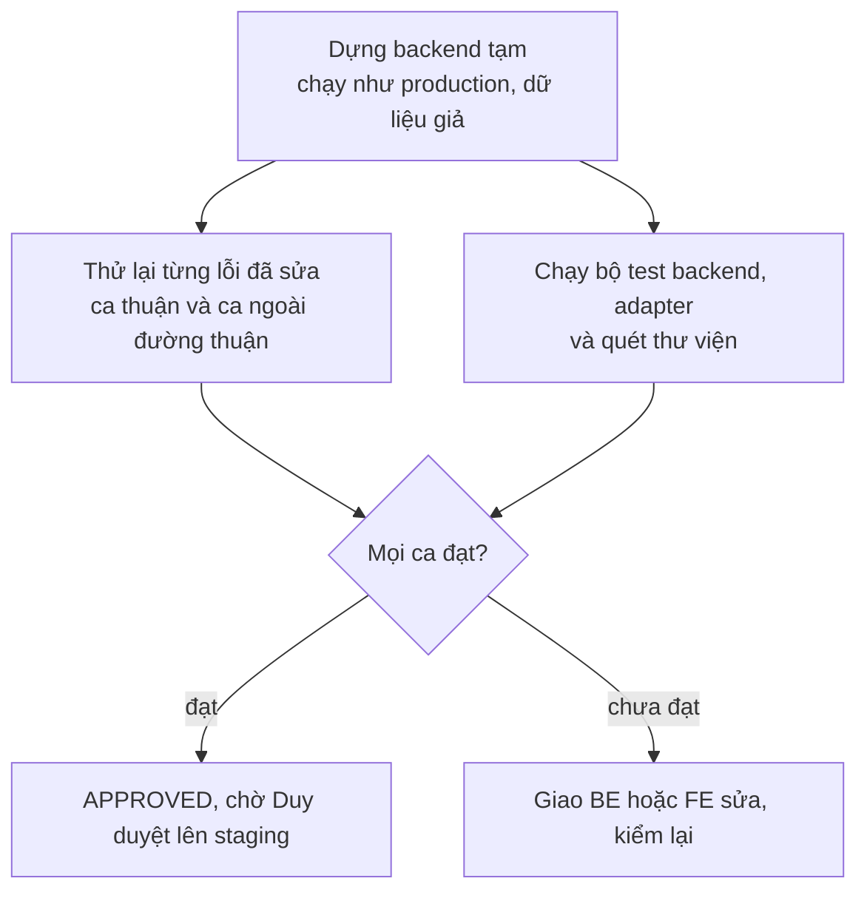

# QA kiểm lại các lỗi bảo mật đã sửa · nhánh tổng `sec/tong` · 15/11/2026

Bản này công khai nên **chỉ ghi mã lỗi, kết quả và mã HTTP**, không ghi cách khai thác. Chi tiết tấn công nằm ở bản gốc `04-qa-bao-mat.md` (không đưa vào repo).

## Kết luận: APPROVED

Mọi lỗi High và Medium đã có bản sửa và đã được thử lại thật trên máy: đều đạt. Không có lỗi chặn. Còn 3 việc phụ thuộc hạ tầng hoặc deploy, ghi ở mục "Chưa kiểm hoặc chưa sửa" (không chặn gộp, nên kiểm sau khi lên staging).

Tổng: 44 ca · ĐẠT 41 · CHƯA ĐẠT 0 · CHƯA KIỂM / CHƯA SỬA 3.

## Môi trường
- Backend chạy `DJANGO_DEBUG=0`, `SECURE_SSL_REDIRECT=0`, cổng 8100, SQLite tạm trong scratchpad, bộ dữ liệu giả `seed_demo` + `seed_qa`. Chia IP giả bằng header proxy để thử giới hạn theo IP.
- Không dùng cổng 8000/3000/3100, không đụng staging, production hay DB thật. Chỉ SĐT giả dạng 09000000xx. Đã tắt server khi xong.

## Theo ca

### 1. Đăng nhập và token (H-1, B4, B6, B8, B12)
| Mã | Mô tả | Bằng chứng | Kết quả |
|---|---|---|---|
| H1-a | DEBUG=0: `/api-auth/login/` không còn | HTTP 404 | ĐẠT |
| H1-b | DEBUG=0: Browsable API tắt, yêu cầu HTML bị từ chối | HTTP 406; đường JSON vẫn 200 | ĐẠT |
| H1-c | DEBUG=0: chỉ xác thực bằng token (SessionAuthentication bỏ) | `test_production_settings.ProductionUrlsAndAuthTests` trong bộ test 4133 ca xanh | ĐẠT |
| H1-d | `/admin/login/` bị giới hạn tần suất (thử 14 lần sai) | HTTP 200 x10 rồi 429 x4 | ĐẠT |
| H1-e | Đăng nhập API sai quá mức theo IP và theo (username, IP) | HTTP 400 x10 rồi 429 | ĐẠT |
| H1-f | Đổi mật khẩu có giới hạn tần suất (12 lần sai mật khẩu cũ) | HTTP 400 x10 rồi 429 | ĐẠT |
| H1-g | Ngoài đường thuận: người từ IP khác, mật khẩu đúng, vẫn đăng nhập được khi một IP đang bị chặn (không khoá được Chủ vựa, B6) | IP bị chặn 429; IP khác 200 | ĐẠT |
| B4 | `username`/`password` sai kiểu (object, số, mảng, null, bool, body không phải object, JSON hỏng) | HTTP 400 cả 8 ca, không còn 500 | ĐẠT |
| TK-a | Token quá `AUTH_TOKEN_TTL_HOURS` (12 giờ) hết hiệu lực | 11h50 -> 200; 12h10 -> 401 (hai lần liên tiếp); đăng nhập lại -> 200 | ĐẠT |
| TK-b | Đăng nhập máy thứ hai khi token còn hạn | (điều phối đổi sau QA) dùng lại token, máy đầu không văng; quá 12 giờ vẫn 401 — test `test_login_again_within_ttl_reuses_token` | ĐẠT |
| B5 | Bộ đếm giới hạn dùng bộ nhớ chung (DB cache) thay vì từng tiến trình | khởi động lại tiến trình, IP đã bị chặn vẫn 429; bảng cache có dữ liệu | ĐẠT |

### 2. Giữ hết tồn kho (H-2/B1, BR-BH-31)
| Mã | Mô tả | Bằng chứng | Kết quả |
|---|---|---|---|
| H2-a | Dòng đúng 20 kg vẫn được (biên) | HTTP 201 | ĐẠT |
| H2-b | Dòng 20,5 kg và dòng bằng cả tồn kho | HTTP 400 `ORDER_LINE_TOO_LARGE` | ĐẠT |
| H2-c | Dòng quá 10 combo | không có combo trong dữ liệu giả để thử trực tiếp; test `test_shop_order_caps` xanh trong bộ 4133 ca | ĐẠT (bằng test) |
| H2-d | Đơn trên 10.000.000đ (dòng từng món đều dưới 20 kg) | HTTP 400 `ORDER_TOO_LARGE` | ĐẠT |
| H2-e | SĐT thứ 3 có đơn chưa trả | đơn 1, 2: 201; đơn 3: 400 `TOO_MANY_OPEN_ORDERS` | ĐẠT |
| H2-f | IP thứ 6 | đơn 1-5: 201; đơn 6, 7: 400 `TOO_MANY_OPEN_ORDERS` | ĐẠT |
| H2-g | Đơn đã trả, đã huỷ, hết hạn không bị tính (SĐT và IP) | đổi trạng thái `PROCESSING`/`CANCELLED`/`AUTO_CANCELLED`/hết hạn rồi đặt tiếp: được đặt đúng số đơn được giải phóng, sau đó chặn lại | ĐẠT |
| H2-h | Lỗi trả về không lộ SĐT, tên, địa chỉ hay số tồn | thân phản hồi chỉ có `code`, `detail`, và `lines` (mã món, mức tồn, trần cấu hình) | ĐẠT |
| H2-i | Đơn bị từ chối không giữ chỗ | đơn quá trần không làm giảm tồn (test `test_bh31_line_cap_blocks_whole_order_without_holding` xanh) | ĐẠT |

### 3. Khởi động và cấu hình
| Mã | Mô tả | Bằng chứng | Kết quả |
|---|---|---|---|
| M4-a | DEBUG=0, `INTERNAL_SERVICE_TOKEN` rỗng, 31 ký tự, hoặc chuỗi mẫu (2 chuỗi mẫu) | cả 4 ca: `ImproperlyConfigured`, web không lên | ĐẠT |
| M4-b | Ngoài đường thuận: đúng 32 ký tự thì lên; DEBUG=1 không cần token; job `manage.py` không bị dừng khi token rỗng | khởi động được; `showmigrations` chạy bình thường | ĐẠT |
| L2 | Header khi DEBUG=0 qua HTTPS: HSTS, nosniff | `Strict-Transport-Security: max-age=31536000`, `X-Content-Type-Options: nosniff`; thêm `X-Frame-Options: DENY` | ĐẠT |
| B10-a | Adapter tắt `/docs`, `/redoc`, `/openapi.json` khi không có `ADAPTER_DOCS_ENABLED=1` | HTTP 404 cả 3; `/healthz` vẫn 200 | ĐẠT |
| B10-b | Ngoài đường thuận: bật `ADAPTER_DOCS_ENABLED=1` thì mở lại | HTTP 200 cả 3 | ĐẠT |

### 4. Ảnh, khách, thanh toán
| Mã | Mô tả | Bằng chứng | Kết quả |
|---|---|---|---|
| B7-a | Ảnh nhỏ dung lượng nhưng quá `ITEM_IMAGE_MAX_PIXELS` bị từ chối (5500², 9500², 13000², 20000²) | HTTP 400, câu lỗi tiếng Việt nói rõ trần | ĐẠT |
| B7-b | Ngoài đường thuận: ảnh 800x600 và 5000x5000 (dưới trần) vẫn nhận | HTTP 201 và 200 | ĐẠT |
| B9-a | Xoá khách đã có đơn | HTTP 409 `BR-PQ-10`, câu lỗi không có dữ liệu khách; 34 khách có đơn vẫn còn nguyên | ĐẠT |
| B9-b | Ngoài đường thuận: khách chưa có chứng từ nào vẫn xoá được | 3 khách HTTP 204. Ghi nhận cho PO: giữ nguyên theo hành vi cũ (quyền của khách xử lý bằng ẩn danh hoá) | ĐẠT |
| L1-a | IPN ghi AuditLog `confirm_payment_ipn` (hệ thống), `changes` chỉ có mã giao dịch, số tiền, trạng thái | 1 dòng cho đơn thử; owner đọc được qua API | ĐẠT |
| L1-b | Ngoài đường thuận: IPN gửi lần 2 không ghi thêm dòng; không token và token sai bị 401 | còn đúng 1 dòng; 401 cả hai | ĐẠT |
| L1-c | AuditLog không chứa tên, SĐT, địa chỉ; số tiền là giá bán, không tính ngược ra giá vốn | quét dòng dữ liệu: sạch | ĐẠT |

### 5. Phần đã đổi ở giao diện, cấu hình Firebase (B2, B14)
| Mã | Mô tả | Bằng chứng | Kết quả |
|---|---|---|---|
| B2-a | Shop và ERP (production và staging) khai CSP, X-Frame-Options, nosniff, Referrer-Policy, Permissions-Policy | đọc 4 tệp `firebase*.json` bằng chương trình, đủ 5 khoá; `connect-src` chỉ có API đúng môi trường | ĐẠT |
| B2-b | Bản build Shop chạy dưới đúng header staging không vi phạm CSP | Chromium thật, 6 trang (`/`, `/shop/`, giỏ, thanh toán, `/about/`, `/blog/`), 390px và 1280px: 0 vi phạm. Lỗi console còn lại là do máy chủ tĩnh thử của QA, không phải CSP | ĐẠT |
| B2-c | Nhúng trang vào khung (clickjacking) bị chặn | iframe nhúng bị chặn trên Chromium | ĐẠT |
| B14 | ERP production có `X-Robots-Tag: noindex` | có trong `erp-console/firebase.json` | ĐẠT (cấu hình) |

### 6. Hồi quy
| Mã | Mô tả | Bằng chứng | Kết quả |
|---|---|---|---|
| HQ-1 | Đặt đơn Shop thường 1, 1,5, 2 kg | HTTP 201 | ĐẠT |
| HQ-2 | Đăng nhập ERP đúng mật khẩu (owner, manager, warehouse) | HTTP 200 | ĐẠT |
| HQ-3 | Không rò giá vốn ở API công khai: danh mục, tạo đơn, tra đơn | quét `purchase_rate`, `landed_unit_cost`, `unit_cost`, `cogs`, `gross_profit`, mã lô, nhà cung cấp, tồn kg: sạch | ĐẠT |
| HQ-4 | Không rò dữ liệu cá nhân: phản hồi tạo đơn và tra đơn không có tên, SĐT, địa chỉ; tra đơn dùng POST (GET trả 405) | quét thân phản hồi: sạch | ĐẠT |
| HQ-5 | Log máy chủ không chứa dữ liệu cá nhân từ các request hợp lệ | duy nhất một dòng nhật ký truy cập có SĐT giả, do chính QA gửi thử GET vào đường đã bị gỡ (bị từ chối 405). Ghi nhận, không phải lỗi | ĐẠT |
| HQ-6 | Toàn bộ test backend | `Ran 4133 tests ... OK (skipped=19)` (tuần tự, `--parallel 1`) | ĐẠT |
| HQ-7 | `makemigrations --check --dry-run` | `No changes detected` | ĐẠT |
| HQ-8 | Test adapter | `70 passed` | ĐẠT |
| HQ-9 | Quét thư viện `pip-audit` (backend `requirements.txt`, adapter `requirements.txt`) | `No known vulnerabilities found` cả hai, exit 0 | ĐẠT |

## Chưa kiểm hoặc chưa sửa (không chặn)
| Mã | Việc | Ghi chú |
|---|---|---|
| B3 | `/admin/login/` vẫn mở công khai trên mạng | Đã thêm giới hạn tần suất (ca H1-d đạt). Việc ẩn hẳn là cấu hình triển khai: đặt `DJANGO_ADMIN_ENABLED=0` hoặc chặn theo IP. CHƯA SỬA phần ẩn đường dẫn, Duy quyết khi deploy |
| B11 | Endpoint nội bộ (IPN) vẫn gọi được từ internet | Đã ép token dài, so sánh an toàn (ca M4 đạt). Việc tách ingress hoặc IAM là hạ tầng: CHƯA SỬA |
| B2/B14 | Header thật trên host Firebase staging và luồng đặt hàng có thanh toán sandbox, Google Maps dưới CSP | CHƯA KIỂM trên host thật (chưa deploy). Cần kiểm sau khi lên staging; nếu CSP chặn nhầm thì sửa chuỗi trong `firebase.staging.json` |
| H2-c (trực tiếp) | Trần 10 combo | Dữ liệu giả không có combo; chỉ kiểm bằng test tự động |

## Danh sách lỗi chặn
Không có.

## Lệnh đã chạy (tóm tắt)
- `manage.py test --parallel 1` (DEBUG=1): `Ran 4133 tests in 326.901s` / `OK (skipped=19)`.
- `manage.py makemigrations --check --dry-run`: `No changes detected`.
- `adapter: pytest -q`: `70 passed`. `pip-audit -r requirements.txt` ở `backend/` và `adapter/`: sạch.
- Server `runserver 8100` (DEBUG=0) kèm các kịch bản gọi HTTP bằng `requests` (script ở scratchpad, không đưa vào repo).
- FE: `NEXT_PUBLIC_USE_MOCK=1 npm run build` exit 0, phục vụ tĩnh dưới header của `frontend/firebase.staging.json`, Playwright Chromium đọc `securitypolicyviolation`.
