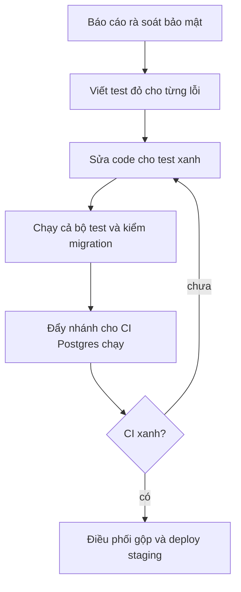

# Dev notes BE: sửa bảo mật gấp, nhóm đăng nhập và cấu hình (15/11)



Nhánh `sec/be-auth`. Repo công khai nên file này chỉ ghi "đã sửa gì, test nào", không mô tả cách khai thác. Không đổi nghiệp vụ,
không đổi contract API (chỉ thêm mã 429/409/401 ở chỗ trước đây là 500 hoặc không giới hạn).

## Đã sửa

| Mã | Sửa | Test |
|---|---|---|
| H-1 | `/api-auth/` chỉ có khi `DEBUG`. Production bỏ `SessionAuthentication` và Browsable API (chỉ Token + JSON). Django Admin giữ mặc định BẬT (doc vận hành có liệt kê link Admin, nên coi là đang dùng) nhưng đăng nhập Admin có throttle như `/api/auth/token/`; tắt hẳn bằng `DJANGO_ADMIN_ENABLED=0` | `test_production_settings.ProductionUrlsAndAuthTests`, `test_security_hardening.AdminLoginThrottleTests` |
| M-1/B5 | `CACHES` dùng `DatabaseCache` (bảng `django_cache`) khi không chạy test; migration `accounts 0019` tạo bảng nên job `cangca-migrate` tự tạo, không cần `createcachetable` | `SharedCacheConfigTests`, `SharedCacheBehaviourTests` |
| B4 | `username`/`password` không phải chuỗi (số, object, list, null, bool, body không phải object) trả 400 | `LoginInputTests` |
| B6/L-3 | Throttle `login_user` đếm theo cặp (username, IP), mặc định `10/hour`; `login_ip` giữ `10/min` | `LoginThrottleKeyTests`, `test_l5_throttle` (đã sửa theo luật mới) |
| B8 | Đổi mật khẩu có throttle `change_password` theo người dùng, mặc định `10/hour` | `ChangePasswordThrottleTests` |
| M-3/B12 | Token hết hạn sau `AUTH_TOKEN_TTL_HOURS` (mặc định 12) kể từ lúc cấp, quá hạn trả 401 và xoá token; đăng nhập cấp token mới và thu token cũ; đăng xuất xoá token | `TokenExpiryTests` |
| M-4/B11 | Web production (`config/wsgi.py`, khi không DEBUG) dừng khởi động nếu `INTERNAL_SERVICE_TOKEN` rỗng, dưới 32 ký tự hoặc là chuỗi mẫu. Cố ý không đặt trong settings để job `manage.py` không bị dừng. Đường so token đã là `hmac.compare_digest` | `InternalServiceTokenTests` |
| L-1 | IPN và webhook xác nhận tiền ghi AuditLog `confirm_payment_ipn` (actor Hệ thống), `changes` chỉ có mã giao dịch, số tiền, trạng thái, không có `raw_payload` | `payments/tests/test_ipn_audit.py` |
| B7/L-5 | Ảnh trên 30 triệu điểm ảnh (`ITEM_IMAGE_MAX_PIXELS`) bị chặn từ header trước khi giải mã, câu lỗi tiếng Việt | `images/tests/test_image_bomb.py` |
| B9 | Xoá khách đã có chứng từ trả 409 câu tiếng Việt thay vì 500 | `customers/tests/test_delete_protected.py` |
| L-2 | Production: `SECURE_SSL_REDIRECT`, `SECURE_HSTS_SECONDS=31536000`, không includeSubDomains; `SECURE_PROXY_SSL_HEADER` đã có từ trước | `ProductionTransportTests` |
| B10 | Adapter tắt `/docs`, `/redoc`, `/openapi.json` trừ khi `ADAPTER_DOCS_ENABLED=1` | `adapter/tests/test_ipn.py::test_docs_*` |

## Số liệu chọn

- Throttle đăng nhập: theo IP 10 lần/phút (giữ), theo cặp (username, IP) 10 lần/giờ (trước: 30/giờ theo riêng username). Hệ quả đã biết:
  dò mật khẩu một tài khoản từ rất nhiều IP khác nhau chỉ bị giới hạn theo từng IP. Nếu muốn thêm trần toàn cục theo username thì phải chấp nhận
  nó lại khoá được Chủ, nên chưa làm.
- Throttle đổi mật khẩu: 10 lần/giờ/người.
- Token: 12 giờ, không gia hạn trượt. **Điều phối đổi sau khi gộp (15/11):** token còn hạn thì đăng nhập lại dùng lại token đó, giữ C8 (nhiều máy cùng tài khoản, vd kho dùng chung, không văng nhau); chỉ thu và cấp mới khi đã hết hạn. Đăng xuất, đổi mật khẩu vẫn thu mọi token.

## Env cần đặt khi deploy

| Tên | Giá trị gợi ý | Ghi chú |
|---|---|---|
| `INTERNAL_SERVICE_TOKEN` | giữ giá trị hiện có (phải từ 32 ký tự) | web không lên nếu yếu; kiểm trước khi deploy |
| `AUTH_TOKEN_TTL_HOURS` | `12` (mặc định) | tuỳ chọn |
| `DJANGO_ADMIN_ENABLED` | bỏ trống (bật) hoặc `0` | `0` nếu không ai dùng Admin |
| `SECURE_SSL_REDIRECT` | bỏ trống (bật) | `0` để tắt nếu health check bị 301 |
| `ITEM_IMAGE_MAX_PIXELS` | `30000000` (mặc định) | tuỳ chọn |
| `ADAPTER_DOCS_ENABLED` | không đặt | chỉ `1` ở máy dev |
| `THROTTLE_LOGIN_USER`, `THROTTLE_CHANGE_PASSWORD` | `10/hour` (mặc định) | tuỳ chọn |

Migration mới: `accounts 0019_cache_table` (tạo bảng `django_cache`, idempotent). Job migrate phải chạy TRƯỚC khi đổi traffic sang image mới,
vì code mới ghi throttle vào bảng này; không có bảng thì các endpoint có throttle (đăng nhập, Shop) lỗi 500.
Rollback: image cũ không dùng bảng, để nguyên bảng cũng không sao.

## Còn nợ, ghi nhận

- ERP cần xử lý 401 khi token hết hạn (fe-dev lo) và đã có sẵn đường 401 về trang đăng nhập.
- Hai chuỗi `.env.example` vẫn là chuỗi mẫu cố định; production dùng Secret Manager nên không ảnh hưởng.
- `check --deploy` còn W005 (includeSubDomains, cố ý) và W021 (preload); W009 chỉ do khoá thử ngắn.

## Kiểm chứng (chạy thật, SQLite, tuần tự)

```
cd backend; DJANGO_SECRET_KEY=test DJANGO_DEBUG=1 .venv/bin/python manage.py collectstatic --noinput
  154 static files copied, 444 post-processed.
DJANGO_SECRET_KEY=test DJANGO_DEBUG=1 .venv/bin/python manage.py test --parallel 1
  Ran 4114 tests in 276.665s
  OK (skipped=19)
manage.py makemigrations --check --dry-run   -> No changes detected
python3 scripts/check_naming.py              -> OK - 6437 vi phạm cũ trong 173 file, không phát sinh mới.
cd adapter; .venv/bin/python -m pytest -q    -> 70 passed
manage.py check --deploy (env production giả) -> chỉ còn W005, W021 (cố ý), W009 (khoá thử ngắn), content.W001 (SELLER_*)
```

Trước khi sửa, bộ test `main` là 4062 test; thêm khoảng 52 test mới, sửa 3 test cũ mã hoá hành vi cũ (`test_s03_ac2_login_user_throttle`,
`test_login_lan_hai_cap_token_moi`, thứ tự đăng xuất trong `test_no_role_gate`).

## CI (GitHub Actions, run 43707872153, commit e9ad02a)

Test backend PostgreSQL 16: xanh. Test backend SQLite: xanh. Kiểm đồng bộ bộ agent: xanh.
