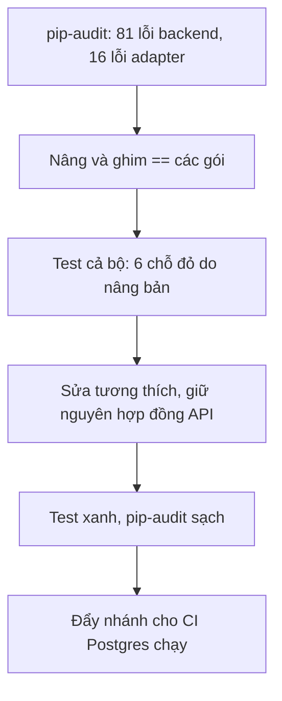

# Nâng thư viện có CVE (be-deps, nhánh sec/be-deps)

## Bảng gói (chỉ chọn bản phát hành từ 2 tuần trở lên, ngày 15/11)

| Gói | Cũ | Mới | Ghi chú |
|---|---|---|---|
| Django | 5.1.15 (khoá <5.2) | **5.2.18** (LTS, 06/10) | |
| djangorestframework | 3.17.2 | **3.18.3** | |
| Pillow | 10.4.0 | **13.0.0** (16/10) | 12.x vẫn dính CVE, bản sửa là 13.0.0 |
| psycopg[binary] | >=3.1 | 3.3.6 | bản 3.3.9 mới 3 ngày, chưa đủ 2 tuần |
| celery | >=5.3 | 5.6.3 | 5.7.0 mới 10 ngày |
| gunicorn | >=22 | 26.2.0 | 27.0.1 mới 3 ngày |
| redis, whitenoise, django-cors-headers, dj-database-url, python-dotenv, jsonschema | không ghim | 8.1.0, 6.12.0, 4.9.0, 3.1.2, 1.2.4, 4.26.0 | |
| google-cloud-storage | >=2.18,<3 | 2.19.0 | |
| Adapter: fastapi | 0.115.6 | 0.162.0 | |
| Adapter: starlette (gói phụ, nay ghim riêng) | 0.41.3 | 1.10.0 | |
| Adapter: uvicorn / httpx / pydantic / pydantic-settings | 0.32.1 / 0.27.2 / 2.9.2 / 2.6.1 | 0.54.0 / 0.28.1 / 2.14.2 / 2.16.2 | httpx 1.0 mới ở dạng dev, chọn 0.28.1 |
| Adapter dev: pytest / respx | 8.3.4 / 0.22.0 | 9.2.0 / 0.23.1 | pytest 8.3.4 có PYSEC-2026-1845 |

Python 3.12 (khớp Dockerfile `python:3.12-slim`, còn hỗ trợ tới 10/2028, không cần đổi). Không thêm công cụ lock.

## pip-audit

Trước: backend **81 lỗ hổng** (Pillow 69, Django 9, DRF 3); adapter **16** (starlette 14 dòng, pytest 2).
Sau: backend `No known vulnerabilities found`; adapter `No known vulnerabilities found` (kiểm trên `pip freeze` của venv sạch cài từ requirements).

## Thay đổi code do nâng cấp (6 test đỏ lần chạy đầu, nay xanh)
1. DRF 3.18 đổi lỗi lỗi `lines[]` thành dict thưa `{"1": {...}}` (đổi hợp đồng API, FE đọc `lines[i].rate`). `config/settings.py`: `LIST_SERIALIZER_ERRORS_AS_DICT: False` (giữ dạng danh sách cũ). **Nợ:** DRF bỏ dạng cũ ở 3.20; khi đó FE phải đọc dạng dict.
2. Django 5.2 đổi msgid của `MinimumLengthValidator` nhưng bản dịch `vi` không khớp, thông điệp mật khẩu ngắn rơi về tiếng Anh. Thêm `apps/common/password_validators.py` (`VietnameseMinimumLengthValidator`) và trỏ `AUTH_PASSWORD_VALIDATORS` tới nó.
3. SQLite trong Django 5.2 không còn ném lỗi khi lưu số vượt cột. `apps/inventory/batches/services.py::recompute_landed_cost` kiểm tràn `landed_unit_cost` tường minh (raise `InvalidOperation`, service chi phí đã bắt và trả 400 N3). Postgres vẫn ném DataError như cũ.

`makemigrations --check --dry-run`: `No changes detected` (không sinh migration).

## Kiểm chứng
- `DJANGO_SECRET_KEY=test DJANGO_DEBUG=1 manage.py collectstatic --noinput`: 154 file chép, 444 post-processed.
- `manage.py test --parallel 1` (venv Python 3.12, Django 5.2.18): `Ran 4071 tests in 308.175s` / `OK (skipped=19)`.
- Adapter `pytest`: `68 passed`.
- `python3 scripts/check_naming.py`: `OK - 6437 vi phạm cũ ... không phát sinh mới`.
- `check --deploy` (DEBUG=0): còn 3 cảnh báo, không do nâng cấp: content.W001 (SELLER_*), security.W004 (HSTS), security.W008 (SECURE_SSL_REDIRECT). Giao be-dev settings / ops xử lý.
- Cảnh báo test còn lại: 2 `UnorderedObjectListWarning` (BundleLine, ItemGroup phân trang chưa order_by), có từ trước.

## Dockerfile
Image `python:3.12-slim` vẫn được hỗ trợ, không đổi. Máy không có docker nên **chưa thêm user không root** (rủi ro với `collectstatic` và quyền ghi lúc chạy chưa kiểm). Khuyến nghị: thêm `RUN useradd -r app && chown -R app /app` + `USER app` sau bước collectstatic và thử `docker build` + chạy thử trước khi deploy.

## CI
Lần 1 (run 43707994749): SQLite xanh; PostgreSQL 16 đỏ `Ran 4052 tests ... FAILED (errors=9)`: 9 lớp test đua lỗi `PostgresRaceFixtureMixin._fixture_setup() missing 1 required positional argument` (Django 5.2 đổi `_fixture_setup` thành classmethod). Sửa `apps/common/tests/postgres_race.py` thành classmethod.
Lần 2 (run 43719509602): cả 3 job xanh (SQLite, PostgreSQL 16 với test đua không bị skip, đồng bộ agent).
