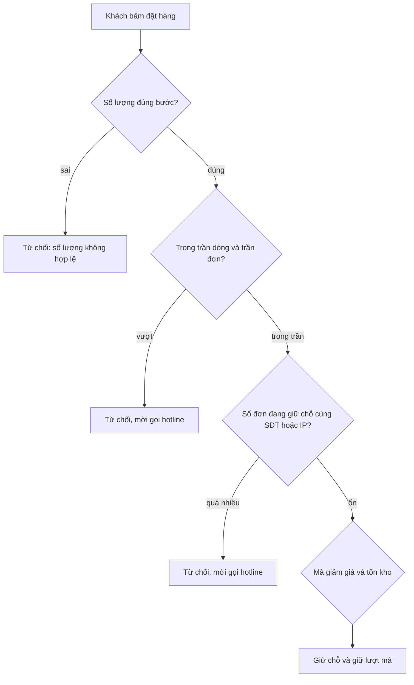

# Dev notes BE: trần đặt hàng online (H-2, M-2), nhánh `sec/be-order`

Rule: **BR-BH-31** (Duy duyệt 15/11). Lưu ý: Duy ghi BR-BH-26, nhưng BR-BH-26..30 đã dùng (BR-BH-26 là "Trang đơn công khai"),
nên rule mới lấy mã trống kế tiếp là **BR-BH-31** (ghi ở `doc/business-process-spec.md`).

## File đã sửa
`backend/config/settings.py` (chỉ thêm tham số SHOP_*), `backend/apps/sales/models/orders.py`, `backend/apps/sales/migrations/0023_salesorder_client_ip_hash.py`,
`apps/sales/orders/{services,shop_errors,shop_api}.py`, test mới `apps/sales/orders/tests/test_shop_order_caps.py` (19 ca),
sửa 5 ca cũ cần nâng trần (`test_shop_api`, `test_shop_create`, `test_voucher_order`), `doc/business-process-spec.md`.

## Tham số env (mặc định trong code)
| Env | Mặc định |
|---|---|
| `SHOP_MAX_LINE_KG` | 20 |
| `SHOP_MAX_LINE_COMBO` | 10 |
| `SHOP_MAX_ORDER_VND` | 10000000 (tổng tạm tính trước giảm) |
| `SHOP_MAX_OPEN_ORDERS_PER_PHONE` | 2 |
| `SHOP_MAX_OPEN_ORDERS_PER_IP` | 5 |

## Hành vi
- Thứ tự lỗi `POST /api/shop/orders/`: SHOP_CLOSED, VALIDATION, INVALID_QTY, POLICY_CHANGED, **trần dòng/đơn, trần đơn mở**, VOUCHER_INVALID, OUT_OF_STOCK.
  Trần chạy trước voucher và tồn: đơn bị từ chối không giữ chỗ, không giữ lượt mã, không tạo Customer. Vì vậy lỗi `OUT_OF_STOCK`
  chỉ còn xảy ra với số lượng trong trần, không dò nhị phân ra số tồn lớn được; `lines` vẫn chỉ có `item_code` + `stock_level` (không đổi, FE tương thích).
- Đơn mở = `BOOKED` và `booked_expires_at` chưa quá hạn. Đơn đã trả (PROCESSING...) hoặc hết hạn không tính.
- SĐT đếm theo `SalesOrder.phone` đã chuẩn hoá (cùng `normalize_phone`). Đếm lại sau khi khoá dòng Customer để hai request song song không lọt trần.
- IP: lấy bằng `get_ident` của throttle tạo đơn; lưu **dấu vân HMAC-SHA256(SECRET_KEY, IP)** ở `SalesOrder.client_ip_hash` (64 ký tự, không lưu IP thô, không log IP).
  Đếm IP không khoá (đủ cho mục tiêu chặn lạm dụng, throttle 20/giờ/IP vẫn còn).
- Chỉ đường Shop công khai truyền `enforce_caps=True`; ERP/`create_order` gọi nội bộ không bị trần.
- Gửi lại cùng `client_request_id` trả đơn cũ, không bị tính lại trần.

## Mã lỗi cho FE (HTTP 400, phong bì `{code, detail, ...}`; `detail` đã có sẵn câu, FE chỉ cần hiển thị)
| code | detail (hotline lấy từ `SHOP_HOTLINE`) | extra |
|---|---|---|
| `ORDER_LINE_TOO_LARGE` | "Số lượng một món vượt mức đặt trực tuyến. Vui lòng gọi hotline <hotline> để được hỗ trợ." | `lines: [{item_code, max_qty}]` |
| `ORDER_TOO_LARGE` | "Giá trị đơn vượt mức đặt trực tuyến. Vui lòng gọi hotline <hotline> để được hỗ trợ." | không |
| `TOO_MANY_OPEN_ORDERS` | "Đang có quá nhiều đơn chưa thanh toán. Hãy thanh toán hoặc chờ đơn cũ hết hạn giữ chỗ. Vui lòng gọi hotline <hotline> để được hỗ trợ." | không |
`max_qty` là trần cấu hình, không phải tồn kho. Không trả số tồn, không dữ liệu khách.

## Migration
`sales/0023_salesorder_client_ip_hash`: chỉ AddField `client_ip_hash` CharField(64, blank, default "", db_index). Đơn cũ để rỗng (không tính vào đếm IP).
`makemigrations --check`: "No changes detected".

## Ảnh hưởng e2e Shop (không sửa frontend)
- `frontend/e2e/run_shop_e2e.py:58-61` dựng env backend: cần thêm `SHOP_MAX_OPEN_ORDERS_PER_PHONE` và `SHOP_MAX_OPEN_ORDERS_PER_IP` giá trị lớn (vd 1000).
  Không thì các bộ `shop_general_rules.py` (8 lần `create_order_api`), `shop_full_flow.py` (6), `shop_erp_flow.py` (2)... cùng `FAKE_PHONE` và IP 127.0.0.1 sẽ gặp `TOO_MANY_OPEN_ORDERS` ở đơn thứ 3 (cùng SĐT) hoặc thứ 6 (cùng IP).
- Ca `1e30` ở `shop_general_rules.py` G4 vẫn ra `INVALID_QTY` (kiểm bước/trần 1.000.000 kg chạy trước), không vỡ.
- Không thấy ca e2e đặt số lượng lớn hợp lệ (>20 kg) nào.

## Kiểm chứng (lượt này, `--parallel 1`, DJANGO_SECRET_KEY=test DJANGO_DEBUG=1)
- RED: 19 ca mới đỏ trước khi code (7 failure, 9 error).
- Cả bộ: `Ran 4090 tests in 265.494s` / `OK (skipped=19)`.
- `makemigrations --check --dry-run`: No changes detected. `python3 scripts/check_naming.py`: OK, không phát sinh mới.
- Probe `StockHoldDosProbe`/`VoucherHoldDosProbe` nay không còn tái hiện: 50 kg vượt trần dòng (400 `ORDER_LINE_TOO_LARGE`), tồn không bị giữ.

## Còn nợ
- Mốc "1 lượt mã mỗi SĐT" (M-2, đề xuất thêm) và rút TTL khi chưa sang cổng thanh toán: ngoài phạm vi, chờ Duy/techlead.
- Không còn nợ CI.

## CI (run 43707934256, commit 802934f)
Success: Test backend (SQLite), Test backend (PostgreSQL 16), Kiểm đồng bộ bộ agent.
