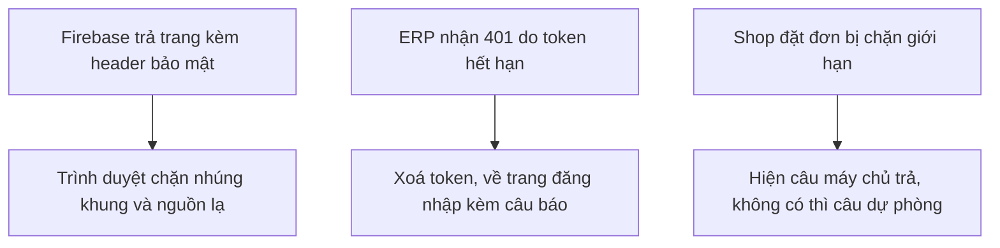

# 05 - Ghi chú dev FE: header bảo mật, token hết hạn, lỗi giới hạn đơn

Mã: SEC-INFRA-2 (M1/B2/B14), M-3, B12. Nhánh `sec/fe`.

## 1. Header bảo mật (4 file firebase)
`frontend/firebase.json`, `frontend/firebase.staging.json`, `erp-console/firebase.json`, `erp-console/firebase.staging.json`, nguồn `**`:
- `Content-Security-Policy`: `default-src 'self'`; `script-src 'self' 'unsafe-inline'` (+ `maps.googleapis.com` chỉ ở Shop); `style-src 'self' 'unsafe-inline'`; `img-src 'self' data: blob: https://storage.googleapis.com` (+ maps ở Shop); `font-src 'self' data:`; `connect-src 'self'` + API đúng môi trường (+ maps ở Shop); `worker-src 'self' blob:`; `object-src 'none'`; `base-uri 'self'`; `frame-ancestors 'none'`.
- `X-Frame-Options: DENY`, `X-Content-Type-Options: nosniff`, `Referrer-Policy: strict-origin-when-cross-origin`, `Permissions-Policy: camera=(), microphone=(), geolocation=()`.
- `X-Robots-Tag: noindex, nofollow` cho staging và cho ERP production (B14). Shop production không có.
- Khối cache `/_next/static/**` giữ nguyên.

Quyết định cần anh biết:
- **`'unsafe-inline'` cho script-src và style-src.** Next static export chèn script inline `self.__next_f.push(...)` có nội dung khác nhau theo từng trang, nên không thể dùng một hash chung cho cả site; ERP còn có script khởi tạo giao diện. Vì vậy chưa thể bỏ `unsafe-inline` nếu không đổi kiến trúc (nonce không dùng được với static hosting). Các lớp còn lại (`object-src`, `base-uri`, `frame-ancestors`, `connect-src` chỉ API, không `unsafe-eval`) vẫn có tác dụng.
- **connect-src chỉ chứa API của chính môi trường đó** (production json chỉ API production, staging json chỉ API staging), chặt hơn yêu cầu "cả hai". Nếu sau này đổi sang tên miền API riêng thì phải sửa chuỗi này, nếu không Shop và ERP sẽ không gọi được API.
- **Không khai `form-action`**: Shop gửi form POST sang cổng thanh toán (`features/checkout/gateway.ts`), CSP `form-action` cũng chặn cả chuyển hướng sau đó nên có thể làm hỏng thanh toán. Cần kiểm trên staging nếu muốn siết thêm.
- Chưa chạy `Report-Only` trên staging (không deploy). Khuyên deploy staging trước, thử một luồng đặt hàng có thanh toán sandbox và có bấm "Bản đồ" (Google Maps), rồi mới lên production.

## 2. ERP token hết hạn (M-3, B12)
Luồng 401 đã có sẵn: `http.ts` gọi handler khi có token, `AuthProvider` gọi `endSession()` (xoá token), về `/login/?next=…`, không chuyển lại nếu đã ở `/login`. Đổi câu `MSG.sessionExpired` thành "Phiên đăng nhập đã hết hạn, anh/chị đăng nhập lại. Nội dung đang gõ dở vẫn được giữ." Test đơn vị mới: `erp-console/shared/lib/tokenExpiry.test.ts` (401 xoá token, handler đúng 1 lần dù 401 tiếp theo, không vòng lặp; câu thông báo).

## 3. Shop: 3 mã lỗi giới hạn đơn
- `frontend/features/checkout/orderLimitError.ts`: `ORDER_LINE_TOO_LARGE`, `ORDER_TOO_LARGE`, `TOO_MANY_OPEN_ORDERS` lấy `detail` máy chủ, thiếu thì "Đơn vượt giới hạn đặt online, vui lòng gọi hotline để được hỗ trợ".
- `CheckoutScreen.tsx` `handleSendError` hiện câu này ở banner.
- Mock: `lib/mock.ts` (`createOrder`) ném ba lỗi khi địa chỉ có dấu `[GIOI-HAN-DON]`, `[GIOI-HAN-NHIEU-DON]`, `[GIOI-HAN-DONG]` (chỉ mock).
- Test: `frontend/scripts/test-order-limit.mjs` (12/12).
- **Lệch contract:** em chưa thấy mã BE cuối cùng nên chưa biết HTTP status và dạng thân; FE dựa vào `code` và `detail` (`{code, detail}`), không phụ thuộc status. Cần BE xác nhận.
- Ảnh: `doc/features/2026-11-15-ra-soat-bao-mat/shots/shop-limit-*.png` (390 px, dữ liệu giả).

## 4. Kiểm chứng
- Shop: `npm ci`, `tsc --noEmit` sạch, build `USE_MOCK=0` sạch, `check-no-mock` XANH, các `scripts/test-*.mjs` đều đạt.
- ERP: `npm ci`, `tsc` sạch, vitest 118 file / 1391 test đạt, build `USE_MOCK=0` sạch, `check-no-mock` XANH. `check_naming.py` OK.
- CSP trên bản build thật: máy chủ tĩnh áp đúng header của `firebase.staging.json`, Playwright (Chromium) nghe `securitypolicyviolation`. **0 vi phạm** ở Shop `/`, `/shop/`, `/shop/cart/`, `/shop/checkout/`, `/about/`, `/blog/` và ERP `/login/`, `/`. Trang cần dữ liệu (checkout có giỏ, chi tiết món, ERP sau đăng nhập `/overview/`, `/catalog/`, `/orders/`) kiểm bằng bản build mock dưới cùng header: 0 vi phạm. Với bản thật, các request tới API staging từ localhost bị trình duyệt từ chối (CORS của localhost, không phải CSP), nên luồng gọi API thật và Google Maps **chưa được kiểm trên staging**.

## Việc còn nợ
- Deploy staging và thử luồng thật (đặt hàng, Bản đồ, đăng nhập ERP) để xác nhận CSP.
- Xác nhận mã BE cho 3 lỗi giới hạn đơn.
- Dài hạn: bỏ `unsafe-inline` cần đổi cách sinh script; token ERP còn ở `localStorage` (M2).
